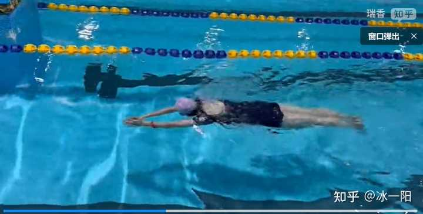
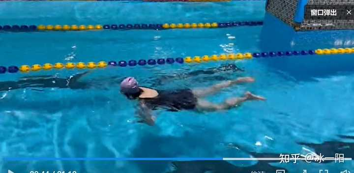
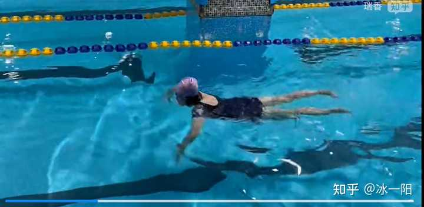
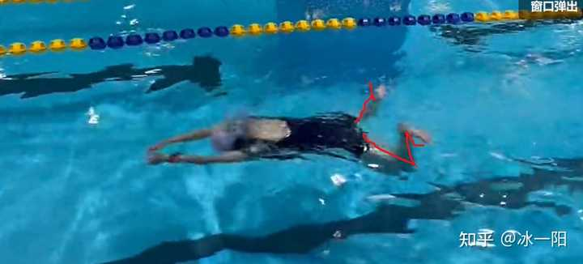
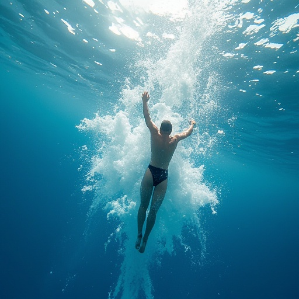

谢邀 @瑞香[收录于 · 冰一阳的游泳杂谈

](https://www.zhihu.com/column/c_1851926735387504640)64 人赞同了该回答

​目录

你这个问题大部分人都有，标准的泳池养生蛙泳。动作基本上到位，配合节奏也还可以。但是**为啥就是不走水呢？言简意赅的答案就是：你不会用力！**

从旁边的水线可以看出来，你蛙泳大概一个动作走 1m 多一点点。手大概是 20 多 cm，腿大概是 80 多 cm。但是就你游泳形态来看，你如果学了其他泳姿，你就会发现你不仅蛙泳是这样，其他泳姿也还是这样不往前走。

### 流线型几乎没有

- **问题**：你完全放松的状态，是不可能游快的。手腿都做完后身体没有完全伸直，头抬得高、腰塌、膝盖微弯都会增加阻力。**你以为游泳是往前游，其实游泳是往前滑。**我之前一直在强调游泳理念问题。 ** 
- 自查**：划完一套动作后，是否能感觉自己像“箭”一样完全伸长？如果滑行阶段不到 0.5 秒就开始下一次划，就浪费了推进力。** 
- 改进**：**动作结束后双臂贴耳、下巴微收、脚尖绷直，胳膊、肩关节、核心使劲向前伸**，**保持 1–2 秒滑行**。甚至再漂久一点也没有关系。但是**要保持好流线型，不保持好流线型，那叫泡澡。**

你看下你的流线型，脚是啥样的？头还没有低下去，肩膀太放松了。阻力好大！

你再看下你换气这一下，核心部分的流线型去哪里了？
### 推水距离和角度

- **问题**：

-  手臂前进只有 20 cm，划水路线实际有效推进不足。
-  手臂有向下或外甩的成分，把水推向两侧而不是向后。

- **改进**：想象“划一个爱心”——双手从前方合拢向外划到肩宽，再向内回收，手肘始终高于手。

你的划水路线就是把水推向了两侧，腿还是分开的，增大阻力，抬头的时候还顺便塌了一下腰。
### 腿部动作细节

- **问题**：

-  收腿时膝盖分得过开，像“青蛙蹲”产生巨大的前方阻力。
-  脚掌没有完全翻出外翻，用小腿蹬水而不是脚背外缘。

- **改进**：回腿时大腿尽量靠近中线，像“夹一张纸”；蹬水时脚踝外翻，脚底向后外画一个“鞭状划水”。感受腿部划水的感觉。

再看看你的青蛙腿很奇怪，好像大家的蛙泳都是要跟青蛙学。

### **建议练习**

- **滑行练习**：蹬墙后双手伸直看自己能滑多远，目标≥3 m。** 
- 分解腿**：扶板单练腿，感觉脚+小腿向后外“划水”的感觉。** 
- 配合练习**：用“手+腿+漂”的口令，确认动作节奏。
**当然你还是有其他的问题，细节还是有很多，但是先把大的改过来再说吧，能把大面的改过来，你就能超过80%的人了。但是我还是想强调你一下你的理念问题：游泳是一项运动，如果你想游快，那就是得用劲儿，不费劲想游快，不可能。但是游泳又是一个技术性很强的事情，光用劲儿，不想动作，也游不快。**

**

### 当然：你有你的优势

动作大面上没啥问题，节奏大面上没有啥大问题，并且你的腿没有沉下去。这三点就足以成为你能变得更强的基础。**

只要解决“流线+用力+动作细节”这三大块，蛙泳的距离和速度就应该会有明显提升。就这样，希望你能继续游下去。加油！

送礼物

1 人已送礼物

[所属专栏 · 2026-02-27 10:26 更新](https://zhuanlan.zhihu.com/c_1851926735387504640)[冰一阳的游泳杂谈

冰一阳

​游泳话题下的优秀答主

95 篇内容 · 3715 赞同

](https://zhuanlan.zhihu.com/c_1851926735387504640)订阅[最热内容 ·

在自由泳比赛中，运动员在最后50米改用蛙泳，在游到终点时单手触壁，犯规吗？

](https://zhuanlan.zhihu.com/c_1851926735387504640)[编辑于 2025-09-14 13:51](//www.zhihu.com/question/1949544001024815814/answer/1950476201404642855)・陕西

​4 条评论​79 ​10 ​分享

​​

收起​