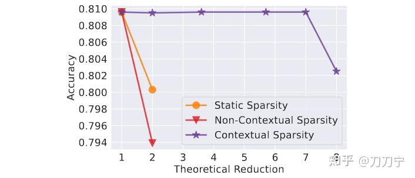
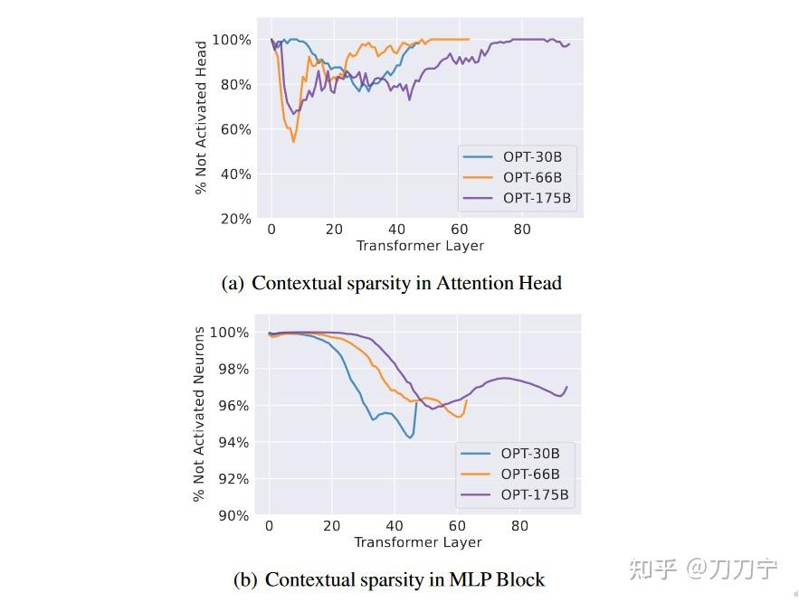
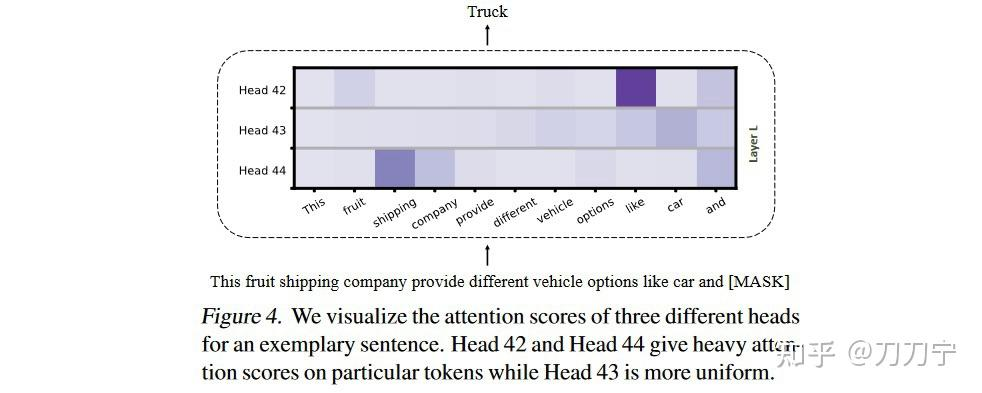
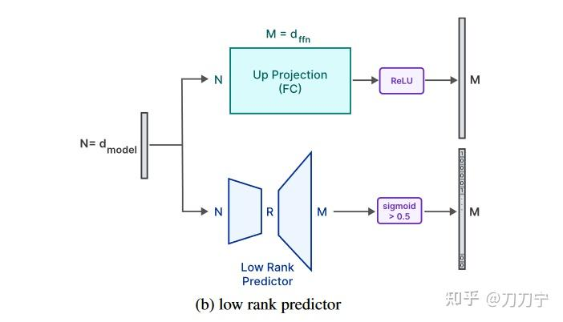
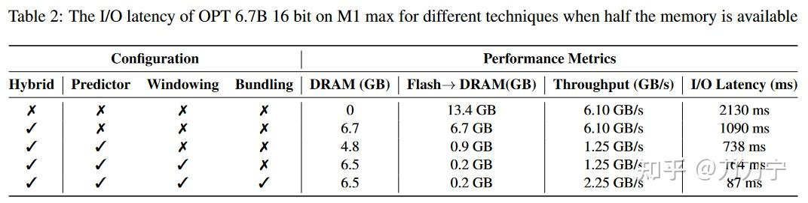
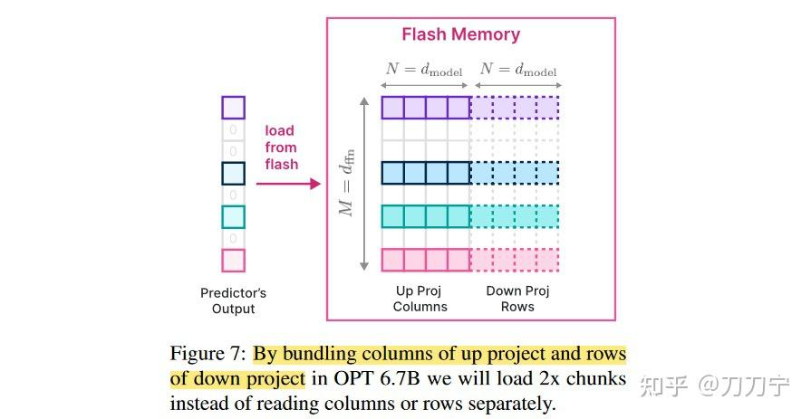
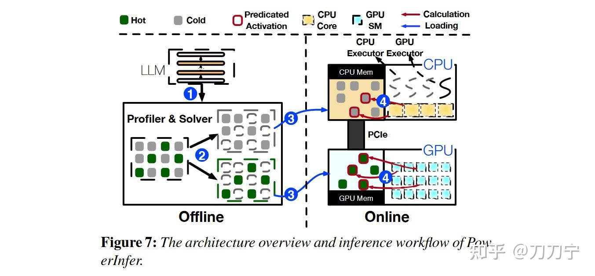

你经历过似曾相识的感觉吗？当你处在一个陌生场景里，却隐隐约约地感觉到，此刻的光线，周围散发出的味道，正在说话的人和他正在说的话，都像曾经发生过，或者梦见过的事情，这种感觉往往只在那一刻，转瞬即逝。这种熟悉感被称为Deja-vu现象，原文为法语 Déjà vu，中文翻译成“**既视感**”。

DejaVu 这篇论文用这个名字，还是挺有艺术感的。

我猜作者们大概是想表达：大模型的稀疏性，可能在那一刻有那么几个神经元给了似曾相识的感觉？

**

这篇论文为 llm in flash、powerinfer 等几个工作的稀疏加速提供了重要的技术思路。这里一脉相承的是大模型的稀疏性，通过稀疏剪枝的方法提高大型语言模型推理时的效率，因为一部分参数与计算在推理时直接被省略掉了。不过不同于静态剪枝，也就是在训练时就把模型剪枝完成的方法，DejaVu 是动态剪枝，也就是输入的数据是会影响如何剪枝的，也就是在推理时动态预测模型的稀疏性，就能在不牺牲模型性能的情况下显著减少计算和内存需求。

[Deja Vu: Contextual Sparsity for Efficient LLMs at Inference Time](https://link.zhihu.com/?target=https%3A//arxiv.org/abs/2310.17157)
[LLM in a flash: Efficient Large Language Model Inference with Limited Memory](https://link.zhihu.com/?target=http%3A//arxiv.org/abs/2312.11514)
[PowerInfer: Fast Large Language Model Serving with a Consumer-grade GPU](https://link.zhihu.com/?target=http%3A//arxiv.org/abs/2312.12456)

### DejaVu

本文中有不少很有趣的发现，相应的论证和实验还都不复杂。很有趣。

我简单的统计了一下，全文 observe/observation 这个词用了 25，surprise 这个词就用了 11 次，可见作者能有这些发现，就非常的惊奇和兴奋。

作者提出方法之前的发现和分析，就非常值得好好研究一下。

这篇论文作者分布很广：莱斯大学、浙江大学、Stanford、ucsd、ETH、adobe、meta ai、cmu。其中第三作者是大名鼎鼎的 FlashAttention 的一作 Tri Dao。

#### 上下文稀疏性假设：

论文提出一个假设，高达 85% 的模型参数在推理阶段是上下文稀疏的。也就是说，对于特定的输入，只有一小部分注意力头和前馈网络中的参数对模型输出有显著影响。

文章说我们很幸运，用了一种 surprisingly simple 的方法就验证了这个假设。

相对于非上下文稀疏性或静态稀疏性，上下文稀疏性在效率和准确度之间有更好的权衡。这句话怎么理解呢？

Accuracy-Efficiency Trade-offs如图所示，如果直接做静态稀疏和非上下文稀疏化（主要就是指静态剪枝和随机动态剪枝），会使得准确度快速下降，而上下文稀疏化则会好很多。原因是上下文稀疏性不仅取决于单个输入标记，还取决于它们之间的相互关联，当然在这篇文章中相互关联最后是靠预测器来提供，而预测器是额外训练的。这里 Theoretical Reduction 应该代表的是几倍稀疏化，“leads to a 7× parameter reduction”。

这里想想也是比较合理的，上下文就相当于是适应了当前的输入，根据输入做动态的调整，确实会比生硬的照搬一套不变的剪枝方法，应该要有效果。

这里的稀疏化会被分为 MLP 和 Attention 两部分分开做。并且作者在这里给出了没有被激活的 heads/neurons 的可视化曲线，说实话，可稀疏化的空间比我想象的要大得多。

注意力头中超过80%的部分会在实验中变得不活跃，而 MLP 层上的平均稀疏性则可以发现，超过95%的MLP参数都可以不参与推理。

作者把只参与推理的神经元记录下来，然后做两次实验，一次全部参加推理也就是保持原来的样子，第二次用只参与推理的神经元做计算，然后发现所有上下文学习和语言建模任务上都有相似的预测或性能，可以说上下文稀疏具备一定的稳健性和可重复性。而记录这些神经元的方法也比较直观，就是直接使用激活函数即可。

不过显然的是，这部分还是验证有效性的步骤，因为不推理不计算一遍是不知道**哪些神经元是有效的哪些不是。所以才需要再提出一个预测算法。并且，无效的神经元只是在这次推理的过程中无效，它一定会在某次其他推理中有效的。

#### 额外发现：

**Token Clustering in Attention Layers**

在注意力层中，有时候某个头的输出是一枝独秀（heavy hitter）的，而某个头输出则是平分秋色（uniform）的，例如下图 head43 相对更加平分秋色一些，head42 则一枝独秀。作者在这里的发现通俗点说就是，只选择一枝独秀同时丢弃平分秋色，相比全都选是没有啥影响的，反正平分秋色的也没有啥 token 之间的关联信息量。

这里作者进行了又一次的假设，他们认为在学习过程中注意力机制是在进行一次 mean shift 聚类。[均值漂移聚类算法](https://link.zhihu.com/?target=https%3A//cloud.tencent.com/developer/article/1459530)的思想是假设不同簇类的数据集符合不同的概率密度分布，找到任一样本点密度增大的最快方向（最快方向的含义就是Mean Shift）。

这是一个**假设**，而我觉得则像是一个**比喻**。然后作者认为每一次推理时候进过一次 attention layer，就是发生一步 mean shift 聚类的操作。当多层 block 推理之后，相当于是完成了信息的聚合，每个头是个聚类簇。这个假设或者比喻是作者认为后续预测算法的一个重要基础。

**Slowly Changing Embeddings across Layers**

作者另外的发现就是层间的数据变化特点了。

我们都知道激活层会改变数据和运算间的线性关系，作者在这里发现，两个相邻层的嵌入层或激活层之间的余弦相似性非常高。同时，以 OPT-175B 为例，从第二层开始，任意两个相邻层之间的相似性约为 0.99，这表明当通过模型传递输入时，层间的计算结果变化的是很缓慢的。并且，在较深层会更加明显。

更进一步，作者还论证了，推理中每层 embedding 相似性较高的原因是由于残差连接。这里作者还有一些深入的数学理论见解，例如收缩性质（shrinking property）。

#### 预测算法：

好，我们进入激动人心的预测算法部分。

简单说，作者使用了一个额外的神经网络分类器作为近邻搜索器，实时预测每个层的上下文稀疏性，即哪些 Attention head 和 MLP 参数在给定输入下是活跃的，就只加载这些参数进行计算。在 MLP 和 Attention 阶段都是类似的结构。

可以理解为用一个较小的网络先拟合出来一个剪枝方案，再跑剪枝后的逻辑，那么只要较小网络带来的计算等开销小于剪枝掉的部分，这笔转换方法就是划算的。

**在 Attention 阶段**的解决方法略有一些不同之处，主要是因为 Attention 主要就是计算 token 之间的关联关系，那么舍弃哪些 token 不好提前预判。另外，就是舍弃掉的 token 如果没有计算过 k 和 v，那么后续其他 query 再使用的时候，会破坏原来的 kv cache 关系。

所以之前前面的均值漂移的假设就有用了，作者说因为 Transformer 有 token-mixing 的特性，所以仅仅考虑当前的 token embedding 就足以进行预测。这块我是有些存疑的，如果这里只需要当前的 token 的话，那么 kv cache 的那些前向 token 的相关计算结果，岂不是就没有啥用了？还是按文章的逻辑往下推导，在当层数比较深的时候，才会这样？这里文章没有细说。

**

#### 高效执行与硬件部署：

为了减少预测开销，Deja Vu采用异步执行策略，使得稀疏性预测与模型的计算并行进行。

因为文章利用残差连接的特性，使得稀疏性预测器可以进行跨层决策。（又回到了前面有用的发现上了）

由于 GPU 的内存访问是块导向的，即加载和存储数据时倾向于以连续的内存块进行，所以作者通过异步执行策略来优化内存访问模式。主要是为了加载和处理数据时减少随机内存访问的次数，提高内存带宽的利用率。

这里裁剪稀疏化模型一个绕不过的问题就是稀疏矩阵索引问题，这里作者将稀疏矩阵的索引和乘法操作合并为一个单一的内核，以及采用了其他一些内存对齐技术以保证高效执行。

#### 实验很牛逼：

OPT-175B 推理加速 2 倍以上，某些情况下达到 6 倍。稀疏度 75% ，性能不变。

在内存优化、模型容量、批处理、量化结合、泛化能力方面，都有不错的表现。

细节可以参考论文。

### LLM in a flash (by apple)

苹果公司的模型轻量化研究工作一直都还可以，比如之前的 mobileone 等，毕竟手机公司轻量化小型化模型本就是刚需。今天这篇论文主要是在内存受限设备上高效推理的方法。核心思想是将模型参数存储在闪存（flash memory）上，而不是直接加载到动态随机存取内存（DRAM）中，去解决内存容量不足的问题。最终他们使得模型能够在不超过DRAM容量两倍的情况下运行，并且与在CPU和GPU上采用简单加载方法相比，推理速度分别提高了4-5倍和20-25倍。

#### 动机和发现：

其实只是把 Flash 用起来，不是什么新鲜的想法，重点是如何应对相应带来的问题，文章主要指出有两点，一是如何尽量少从 flash 读数据，二是然后增加更大的内存读取块。

我本来计划只将其中和 DejaVu 相关的稀疏化预测部分择出来单独分析一下子。结果发现，稀疏化是第一项技术的一个比较重要的理论基础，也就是说因为稀疏化所以才能这样设计系统。例如，文章的 windowing 和稀疏预测技术配合之后，可以在 FFN 层运行时只从 flash 上读取相当于原来 2% 的数据。可以说，这篇文章很像是从实践的层面把 DejaVu 进行了一次应用。

文章虽然没有说，但是因为前面刚刚读过 DejaVu，你自然会思考，它的 windowing 技术，因为只保留了临近的几个 token，相当于直接剪枝减掉了越靠前的所有 token，这里是否因为稀疏性的特点下进行这样的设计？反正我觉得是。

#### Low Rank 预测器：

这里文章和 DejaVu 不一样的一点是：ReLU 函数将所有负值映射为零，在 FFN 中间产生大量的零值，所以采用了 low rank 低秩预测器（也就是 LoRA）来识别 ReLU 激活后将变为零的元素。

通过后续的实验数据看，增加了 predictor 之后读取的数量从 6.7GB 锐减到 0.9GB，再增加 windowing 技术之后会进一步减少到 0.2GB 。

#### 内存优化：

这里的工作比较扎实，也比较工程化。得花点时间慢慢啃一啃。

稀疏化自然会造成很多不连续内存段，以及不规则访存行为。

这里使用的一个关键词叫做：Bundling**，想表达的是将模型中的某些相关数据元素组合在一起，以便在内存中更高效地管理和访问它们，这是一个需要对底层体系结构比较了解才能深入理解好的概念。

**Row-Column Bundling**：文章中的思路简单说是：“By bundling columns of up project and rows of down project”这句话不太好理解。经评论区讨论应该理解为 FFN 里面的 up linear layer 和down linear layer 这两个 layer 正好尺寸的 mxn 和 nxm，所以行列正好相反。如图所示进行连续存储之后，在从flash加载的时候作为一个chunk，从而增大吞吐量。

**Bundling Based on Co-activation**：这里还是因为和前文同理的稀疏性特点，尤其是聚类特点，某些神经元经常一起激活。所以本文将这些高度相关的神经元绑定在一起，一起加载和卸载，而不是单独处理。

**内存数据管理：**主要是提出一些数据结构以支持上述的优化方法。以及支持一些不连续内存段的异步挪动，这里还使用了一些小技巧，比如 delete on new insert 等等。

总的来说，内存优化这一章的内容，工程细节才是决定效果好坏的关键，而文中的方法只是揭示了一个方法，不结合代码分析就总感觉 get 不到细节。[难]

#### 疑问点：

本文对稀疏性的分析力度相比 DejaVu 来说是不足的，重点还是实现一套系统。

co-activation 的神经元经常一起激活，有什么特点？文中没有详细介绍。

预测算法和预测器的细节披露不多，预测器本质还是个神经网络拟合器，但是是如何训练的呢？可能在作者看来这部分不是非常重要。

选用的模型也是以 OPT 为主，另外还测试了 Falcon 。OPT 这个模型是不是本身稀疏性就比较高，不知道其他更加通用的模型是否具备如此的稀疏性。

### PowerInfer：

本来只想分析一波前面两篇的，现在一起分析完搞完算了。正好前面阅读 llama.cpp 的时候一直想深入研究的。

这篇文章的加速基础来源也是稀疏化，文章 sparse/sparsity 单词总计出现了 97 次，快三位数了。

**

简单说：幂律分布的神经元被类似的预测器分为 hot/cold 等类型，hot 神经元在 GPU 上算，cold 神经元在 CPU 上算。这个想法是很有一种眼前一亮**的味道的，因为我们都知道因为数据流转问题这是一般情况下需要避免的，既然敢这么做就一定会有非常厉害的工作进行这部分的优化。

与前面两篇相同的是：有一个预测哪些神经元会被激活的 predictor ；因为要处理稀疏化，所以需要有专门的稀疏化操作/算子/优化方法；

#### GPU/CPU 混合架构切分问题：

这个标题是我给起的。

如图可以发现这里将数据分配到 GPU/CPU 是靠一个 offline 的 predictor 来完成的。既然是 offline 的，那么这里的预测就是基于一个对于通用数据集的数据分布分析的。这里的逻辑和前文几个方法的 online 不一样了，**前文 online 时的稀疏比例这里理论上是不适用的**。这里的offline 在理论上就更像之前的**静态剪枝方法，一次完成多次使用，但缺少灵活性**。所以这里后续还是会有一个 online 的 predictor ，两者配合着来，结构相比前面两篇文章就复杂了不少。

也就是说 offline 是个粗粒度的划分，肯定不太准，有些比较重要的神经元在部分计算流程中会被分到 CPU 上去，这时候就靠 online 来补位再划分了。其实我觉得这里完全可以做一些重复性的划分，部分数据可以 CPU/GPU 都放一些，调度时可以更加灵活。

另外，online predictor 好像是直接复用的 DejaVu 开源的 predictor ，也没什么毛病。

这里有一个关键问题应该是，**划分比例如何设计？**

论文提出一个对神经元影响度的定量标准，用来区分神经元 hot/cold 程度，进而决定如何分配到具体设备上。这里论文引入了一个整数线性规划的**最优求解问题**来解决这个划分问题。可以理解为具体的划分比例是被搜索出来的。所以我认为这里的比例应该是针对特定的 GPU，**卡着 GPU 能装得下的最大值去做的，其他的放 CPU**。同时再兼顾网络数据传输压力等等。

**内存管理：**

工程实现上大头的还是内存管理，这几篇论文都是这样的，不过这篇没怎么讲。

**实验对比：**

文章主要使用了三个模型，OPT 6.7B - 175B、Falcon(ReLU)-40B、ReLU-llama-70b.  https://huggingface.co/SparseLLM/ReluLLaMA-70B 

#### 简单总结：

亮点还是在于对于小网卡友好。

另外，网传小道评论：“改了模型，同时在 benchmark 上引入了相当显著的损失。”“当前主流大模型结构基本都是源于 llama，并不是使用 RELU，没法直接使用这个框架。”

论文也还是留了一些小尾巴。

期待他们出 2 吧。

### 综合性问题：

这几篇文章都是动态在线预测器的方案，这些预测器是根据输入来的和静态的提前剪枝和压缩是有本质不同的，思路会认为全部的参数都是有用的，只是在某一次的推理过程中我只需要其中一部分而已。

动态在线预测器的结构、训练、拟合能力（也就是准确度）这些目前都还是属于不可知状态。

预测器存在一定概率不准，这些不准的情况是什么？对结果有什么影响？

预测器比较准，但是是否存在某些某些不活跃神经元可能代表了全局最优状态？

参考：
[Civ：[ICML'23] DejaVu：LLM中的动态剪枝](https://zhuanlan.zhihu.com/p/673848224)
[量子位：2080 Ti就能跑70B大模型，上交大新框架让LLM推理增速11倍](https://zhuanlan.zhihu.com/p/673249063)
[如何看待上交大提出的LLM推理加速框架：PowerInfer？](https://www.zhihu.com/question/636760404)

再附几篇我自己的 llama.cpp/deepspeed 的笔记：
[刀刀宁：笔记：Llama.cpp 代码浅析（一）：并行机制与KVCache](https://zhuanlan.zhihu.com/p/670515231)
[刀刀宁：笔记：Llama.cpp 代码浅析（二）：数据结构与采样方法](https://zhuanlan.zhihu.com/p/671761052)
[刀刀宁：笔记：Llama.cpp 代码浅析（三）：计算开销](https://zhuanlan.zhihu.com/p/672289691)
[刀刀宁：笔记：DeepSpeed inference 代码理解（一）](https://zhuanlan.zhihu.com/p/668181423)