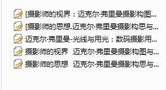
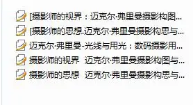
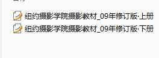
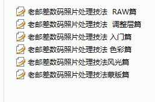
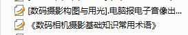
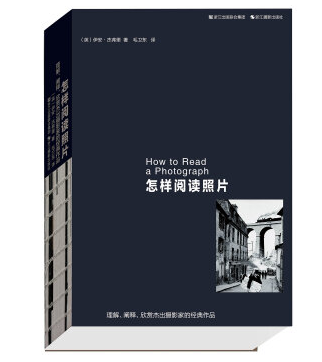
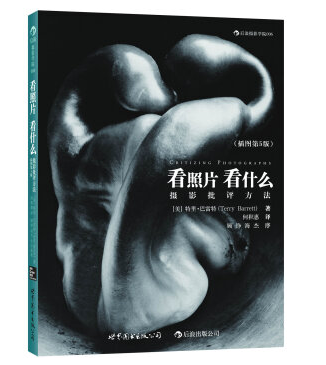
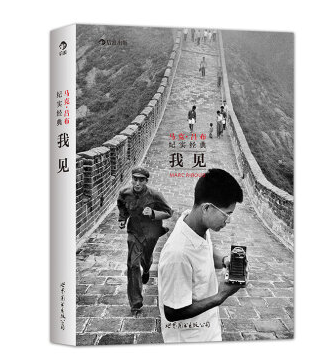
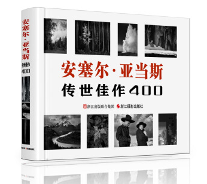
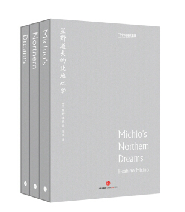

授人以鱼不如授人以渔，既然是如此针对的问题，我也乐意分享点自己的东西。**

摄影需要一个培养过程。

对于初学者，一个好的态度和学习方法胜过一百种杂而不精的技巧。**

-

摄影网站（百度即可）。

国家地理中文网；玛格南图片社；sony/iphone手机摄影大赛官网以及，500px。

前三个没啥好说的，被选入其中的作品本身就说明了拍摄水平，都是公认的好作品。

这些作品，有的看似普通，初看并无惊艳之感，其实技术以臻完美或者说自带技术风格，因此并不适合你去学习研究。

但这些作品反映的拍摄价值，趣味性以及作者为之注入的情感，就需要你时常观摩，体会感受，然后总结提炼，融入到自己的摄影体系中，逐步培养摄影感觉。

再说下500px。

500px里的作品多有后期精准醇厚，角度新颖，制作考究的特点。这些品其实不够接地气，与普通人的生活有一定距离，所以大众很难从中习得有价值的拍摄经验。

但500px中大多作品非常优秀，堪称技术综合运用的典范。如视角，色彩搭配，层次，人像类模特的姿势、动作，常让人拍案叫绝的创意，因此对于发散思维，提供更多拍摄思路有一定借鉴意义，可选择性浏览学习。

下面干货时间（所有推荐教材均为pdf）。

这俩书没什么专业性技巧。它们用极其客观的语言告诉读者摄影是什么，它与世界的联系，以及构图的原理规律，怎样用最恰当的方式把思维具像表达。

如果你热爱摄影并愿意为此思考探究，建议阅读。

当你对摄影有了基本认识，了解其原理规律之后，此系列书能让你更针对性学习拍摄的方法技术，以及如何创作的问题。中英两个版本。

纽摄内容分类全面周到，道理深入浅出，是巩固基础的一门好教材。

本系列新版在内容上有补充，但总体来说，由于实在面面具到，导致大量子类问题阐述不细致，建议平时巩固学习使用。

此类书把更多观点放在思想的培养，以及如何学习赏析图画。本帖仅仅例举几本，类似书籍非常之多，学到一定程度可自行网上搜索下载阅读。

后期入门经典教材，实用性很强。多种摄影类型的后期方法都有讲解。

本系列书文字生动凝练，没有废话。内容编排合理，通俗易懂，有些知识点略省略，初学者需自行查阅理解学习。

低端入门书籍。

此书注重理论，大篇幅阐述布光原理，举例丰富，有许多作者的经验之谈。有利于读者思维养成，非常基础的布光教材。

摄影除了技术的掌握学习，培养审美能力也很重要。

在专业网站欣赏感悟大师作品，对培养审美固然能起到一定程度的作用，然而网站页面的排版，内容，类型，作品风格并不全然统一，因此对读者的检索归纳能力自然有一定要求。

因此无论专业程度，体验方面，要说舒适方便，阅读纸质读物仍然是最佳选择。

关于名家作品类书籍，答主推荐几本看过后感觉不错的，涵盖影史，人文纪实，自然风光，建筑，等等。抛砖引玉，诸位可自行购买或借阅。

-

关于教材推荐的话。

众所周知，国内各摄影网站资源无数，然而质量实在不敢恭维。

绝大部分教程普及贴仅把一些基本的技术方法罗列一遍，配几张图片说明下完事。这种固有的模式没有任何创新，况且大部分作者实在业余，东拼西凑弄出一堆东西不负责任的贴出来。他们本身理论水平就少得可怜，又如何给人传授经验？

我之前读过一些摄影资料，如今看到这个问题，经过仔细考虑对比，为诸位推荐上述

教材 。

**（密码 v3y2，莫忘点赞）**

虽说它不会让你摄影水平有质的飞跃，但至少有助于构建自己的摄影体系，知道一些技术方法的道理和理论基础以及摄影师们的拍摄经验和思想。希望诸位用心对待，认真学习，拍出更好的作品。

以上。

-

[编辑于 2016-11-17 13:35](//www.zhihu.com/question/20720882/answer/93426531)

​​6446 ​1639 ​分享

​​

收起​
