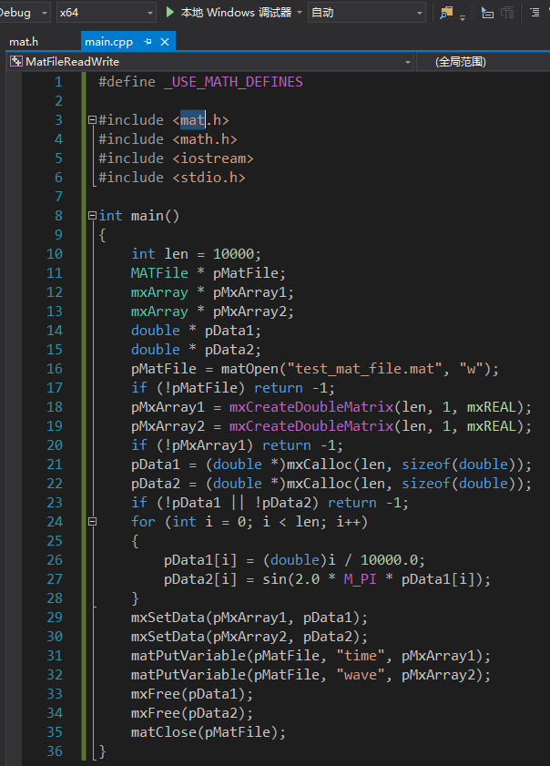
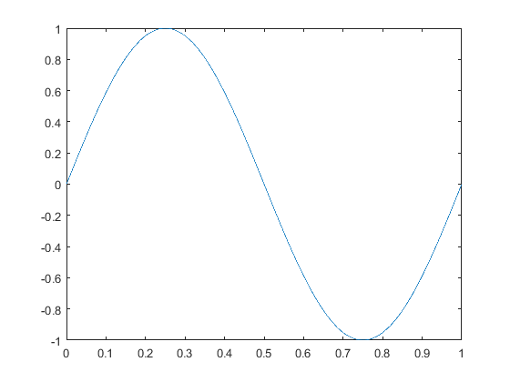

**一、为什么要这么做这种吃力不讨好的事**

**千万不要做A语言调用B语言这种费时费力的事情，直接用数据文件作为中间媒介，一个语言去写另一个去读就OK了。    ——来自很多程序员的忠告**但是当我面对Matlab和上G的文本数据的时候，这句话并不好用，因为我甚至无法读入这些以字符串形式储存的数据（不要问我为什么要用这么蛋疼的数据格式，数据是甲shang方di提供的）。而因为数据分析报告中需要用Matlab画图，这些数据又必须导入Matlab中。

用Matlab自带的import工具，选择大文件后，往往卡死在生成预览之前，而用textscan函数批量读取文件则会报Out of memory的错误，最后只能用fgetl函数一行一行的读入数据，再进行转换、保存，一个1G+大小的文件，可能一两个小时也读不进来，令人捉急。

这时候一个很自然的想法就是，用C++直接读取文本数据文件，转换为浮点数后直接存入mat文件中，再在Matlab中直接load就好了。

**二、必要的准备**

由于读写mat文件需要用到由Matlab提供的库，因此需要一些额外的设置。如果你的电脑上安装了Matlab，那么所需的文件应当是齐全的。我的开发环境是Win10 x64 + VS2015 + Matlab R2016a，在XP x32 + VS2010 + Matlab R2011b上也成功过。

1. 修改系统环境变量

 在系统环境变量中添加：

> C:\Program Files\MATLAB\R2016a\extern\lib\win64
 C:\Program Files\MATLAB\R2016a\bin\win64; 

如果是32位系统，则修改为32位系统对应的路径。 

2. 新建一个VS工程

打开工程属性页，将“配置”选择为‘所有配置’，“平台”选择为‘x64’，然后依次设置包含目录、链接附加库目录以及附加依赖库：

 在 C++->常规->附加包含目录 添加：

> C:\Program Files\MATLAB\R2016a\extern\include
C:\Program Files\MATLAB\R2016a\extern\include\win64

在 链接器->常规->附加库目录 添加：

> C:\Program Files\MATLAB\R2016a\extern\lib\win64\microsoft
C:\Program Files\MATLAB\R2016a\extern\lib\win32\microsoft

在 链接器->输入->附加依赖库 添加：

> libmat.lib
libmx.lib
libmex.lib
libeng.lib

为工程添加一个cpp文件，在文件开头输入

`#include 
`

若工程配置正常，则此时应该不报错，右键点击mat.h，还能打开该文件： 

3. Mat文件的读写

其实做到这一步，接下来的事情就很简单了。 Matlab提供的C++读写mat文件的接口函数非常简单易懂，在Matlab的帮助文档中搜索MAT-File API即可查看各个函数的帮助文档。

下面是一个简单的mat文件写入程序：

`#define _USE_MATH_DEFINES

#include 
#include 
#include 
#include 

int main()
{
	int len = 10000;
	MATFile * pMatFile;
	mxArray * pMxArray1;
	mxArray * pMxArray2;
	double * pData1;
	double * pData2;
	pMatFile = matOpen("test_mat_file.mat", "w");
	if (!pMatFile) return -1;
	pMxArray1 = mxCreateDoubleMatrix(len, 1, mxREAL);
	pMxArray2 = mxCreateDoubleMatrix(len, 1, mxREAL);
	if (!pMxArray1) return -1;
	pData1 = (double *)mxCalloc(len, sizeof(double));
	pData2 = (double *)mxCalloc(len, sizeof(double));
	if (!pData1 || !pData2) return -1;
	for (int i = 0; i  len; i++)
	{
		pData1[i] = (double)i / 10000.0;
		pData2[i] = sin(2.0 * M_PI * pData1[i]);
	}
	mxSetData(pMxArray1, pData1);
	mxSetData(pMxArray2, pData2);
	matPutVariable(pMatFile, "time", pMxArray1);
	matPutVariable(pMatFile, "wave", pMxArray2);
	mxFree(pData1);
	mxFree(pData2);
	matClose(pMatFile);
}
`

在Matlab中load刚才保存的mat文件，并画图：

`load('E:\VSProjects\MatFileReadWrite\MatFileReadWrite\test_mat_file.mat')
plot(time, wave)
`

读取程序和上面类似，不过我用不到，就先不写了。

**三、存在的问题**

其实写这篇文章的初衷就是想讨论一下mat文件写入时存在的问题 ，因为现象比较奇怪，搜索引擎上找不到解决方法。

我写入mat文件的变量比较多，大概有300多个单列的向量，这些向量的长度相同，都有三十多万行，整个mat文件大概有不到500M。在写入变量的时候，我用循环遍历指针组：

`......
mxArray ** ppMxArr = (mxArray *)malloc(sizeof(mxArray *)*300);
for (int i=0; i300; i++)
{
	ppMxArr[i] = mxCreateDoubleMatrix(300000, 1, mxREAL);
}
......
char varName[] = "var000";
for (int i=0; i300; i++)
{
	sprintf(varName, "var%03d", i);
	matPutVariable(pMatFile, varName, ppMxArr[i]);
}
......
`

写入这么大的文件需要很长的时间，于是我打开mat文件存放的路径，想看看文件大小的变化。这时候我发现一个很奇怪的现象：

Mat文件的体积逐渐从0字节增加到大概300M，然后停住很久，这时候循环变量一直都保持不变，也就是说matPutVariable函数还没运行完。接着Mat文件的体积突然变为0字节，再一次逐渐增加到大概300M，这样反复几次后，循环变量迅速增加几十个值，然后又重复上面的过程。 

也就是说**在一次matPutVariable函数执行的过程中，mat文件的体积会反复变化。**

我猜想有两个可能，一个可能是matPutVariable函数在保存数据时，默认对数据进行压缩， 反复对数据进行读写；其次是可能由于磁盘上连续空间不足，当文件大小增长到一定大小时，只好全部清除，再寻找一段能够放下文件的连续空间。
