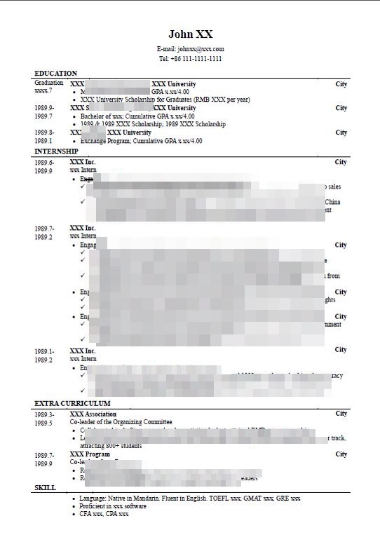

本回答以针对商业类工作的学生简历为基础，其它简历或有不同。

本回答纯属个人意见，好简历有千万种。

---------------

前几天办活动，趁机看了一些简历，发现不少问题。

首先要交代一点，这些问题都是小问题。我把内容虚假看做大问题，相应地所有其他问题都是小问题，这里的大、小仅仅是为了给一类问题起个名字而已，绝无高下轻重之判。小问题并不代表不重要、不吸引注意力。相反，有些小问题反倒是最扎眼的，比如字体、字号、行间距等。这些都是超脱于内容之外的存在，一旦有明显的闪失，拿过来扫一眼，都不用看写的啥，就可以盖棺了。

当然，也有些小问题深藏功与名，为了把它们找出来，我滴着蜡瞪着眼平均每份简历看了半个小时，实际招聘的时候，三十秒算客气了，十二秒八八也完全正常。所以，这些问题未必会在实战中毁掉一次好机会。但我想说，首先，那只是未必而已，万一筛简历的人第一眼就鬼使神差地撞见了一个坑呢。其次，他看不看得出来问题是他的事儿，我写得有没有问题是我的事儿，这不是问题的问题，这是态度的问题，跟抽屉背面要不要精工是一个道理。

此外，我的假设是用word做简历。如果用其他工具，过程或有不同，但要实现的效果应该是一样的。

---------------

**1. 字体**

拿来一份简历，上面只要超过三种字体，直接眼花。如果是搞字体设计的，并且想把简历和作品展示放到一起，忽略这一点。

字体太多，最直接的坏处就是——怎么这么乱啊。说到这里，你一定想起了高考作文和文综。这些卷子和简历的共同点就是：看它们的人都不怎么想看它们。保护观者脆弱的眼睛=保护自己脆弱的未来。

中文简历正文部分**宋体**即可，区分度主要靠加粗和字号来实现。实在想让别人知道自己电脑里字体丰富，就用用楷体吧。极不推荐正文中出现黑长直的黑体和花枝招展的艺术字体。标题部分如果想突出“名字”，黑长直一下也无妨，但注意别黑大了，否则头重脚轻，好像洒了几滴墨水。此外，用黑体的时候注意不要出现视觉上的笔画黏连，笔画多的字就干脆别用黑体了。像我这名字，一大堆横，像咸菜一样摆在一起，黑起来真心不愉悦。

英文简历没啥好说的，**Times New Roman**美味可口人畜无害。

最后需要注意，中文简历中不可避免地有英文字符和数字。**请和英文简历的字体保持一致**。看了十几份简历，只有一两个人做到了。没做到的人里，用了Arial的还好，顺着汉字用了宋体的就惨不忍睹了。其实改起来很简单，在“字体”选项里统一设置一下拉丁字体和汉字字体就好了。

---------------

**2. 字号及修饰**

和字体一样，别太花哨。其实一份简历里需要区分的层次没多少。无非就是：

- 第一层：名字和标题（放在顶端，天然区分，名字可选大号字，地址、电话等不做修饰）
- 第二层：教育背景、实习经历、课外活动、个人能力等大标题（英文大写字母，加粗，可选大号字，下面用1.5pt的线分隔）
- 第三层：学校、公司、社团名称（可选英文大写字母，加粗，标准字号）
- 第四层：部门和职位（可选加粗，可选英文斜体，标准字号）
- 第五层：具体内容/正文（不做修饰，用bullet point分条列示）
这样下来应该足够有层次了。

上个图示意一下。（该图仅用于说明以上五个层次如何安排，其余方面并不尽善，不要当作范例）

几点注意事项：

- **中文别用斜体。**英文手写天然就是斜体，看上去也美观，中文手写你要是见过天然斜体的，请保存标本来给我开阔眼界重整三观。**
- 下划线尽量避免。**标题通过加粗、字号、分行就足够区分了，下划线纯属横插一刀扰乱社会和谐。正文加下划线无非是为了告诉别人——我这里真的很厉害啊你快来看看好不好。如果那里真的厉害，人家很难看不到，不用下划线。如果那里只是你觉得厉害，实际上很菜，人家本来看不到也看到了，等于示短与人。**
- 正文尽量不加粗。**因为标题中注定大量使用加粗，使得加粗在简历中有了特殊的层次含义。正文中一旦出现加粗，一方面彻底破坏了这种层次感，导致整份简历视觉效果骤降，另一方面参见下划线的负面效果。**
---------------

3. 间距**

太重要了。别以为差个2毫米，鬼都看不出来。或许鬼确实看不出来……但我们又不是去阴间报到，简历不是给鬼看的。间距不一致的刺眼程度绝不亚于斜体汉字。

简历中的间距主要是字间距、行间距、段间距。

先说行与段。

保持行、段间距一致，个人推荐的方法就是用**表格**做简历，带着所有边框做，先码字，再调格式，（我曾经先调格式再码字，相信我，用不了多久一定会砸键盘的）去掉边框应该是最后的最后。我理解“边框看起来让我很烦”的想法，但没了它，整个简历看起来都会让你很烦。

当然，我也见到一些用表格做出来，间距依然不一致的简历。这其中的原因我就不是很清楚了……只能猜测，是因为手工对个别行列进行了宽高调整。如果有类似操作，一定要对相同级别的条目做统一调整。特别留心：间距一致不代表间距一样，同个层级的间距一样就可以了。

此外，一个条目内部的间距应该小于条目之间的间距。就好像章节内部段落的间距要小于章节之间的间距。我见过各种   公司名称      和       职位名称        之间             间距        特    别                            大    的，这是     何          苦    呢？

至于字间距，主要涉及对齐方式和字数的问题。

对齐，我见过说两端对齐的，也见过说左对齐的。一个牺牲了右端的齐整，一个牺牲了统一的字间距。我选择**左对齐**，我喂自己袋盐。一方面，我痛恨两端对齐后字间距的不一致（中英文都有）。另一方面，两端对齐的优势主要体现在大长段，对齐之后四四方方浑然一块，看着爽。简历里面何来大长段，基本就是一条一两行，三行撑死了，两端对齐的优势发挥不出来。

字数，我见过因为公司或学校名字太长，被迫把字间距调小的。对这种看似实属无奈的情况，检查一下是否有简称。UNESCO，全称写上去确实非常伤人，而且大家看简称看惯了，反而不认识全称。你要实在怕HR不认识简称，不还有中文简历么，硕大的“联合国教科文组织”看不见？这里包括对Ltd.，& Company等后缀进行必要的删减。这样删过之后，应该没有正常字间距写不下的名字了。

与之相反的情况是名字太短，看着也不和谐，比如BCG。这时候就别写简称了，全称刚刚好。

---------------

**4. 标点**

标点真心是小问题。肯定会有人鄙视我，连这种地方都挑，时间过剩了吧……但是当你看到千分位符是一个硕大的中文逗号，你心中有没有10，000只草泥马呼啸而过的声音？

所以最重要的一点，中英文标点各回各家，别乱跑。中文简历除了千分位符这样约定俗成的符号，剩下的一律用中文标点。英文简历中不要出现任何中文标点。英文标点后面要加空格，中文的不要。

还有一个容易被忽略的地方，就是**句末**。按照习惯，句末应该使用标点符号，但简历中普遍的单行和bullet point让句末标点显得有些多余。个人推荐不加，但如果你非常想加，就全部加上。前一行有后一行没，看起来糟透了。

最后，注意标点符号的层次问题。最明显的三个层次就是「、，；」。顿号不用说。如果一句话里要表达两块意思，每个意思又不止一句话，就别全用逗号了，中间；一下吧。

看这句话：深度参与XXXX项目，在后台负责数据，文档，报告，会议记录的收集，分类，保管工作，提升了团队的效率，同时在业务第一线进行访谈，抽样，问卷调查，及时发现方案中存在的问题，反馈至后期控制部门

大哥，你键盘上是不是只有逗号……

---------------

**5. 拼写和文法**

拼写问题属于一票否决，看到简历有大错字还让过的人，应该不多吧。这问题基本出现在英文部分。中文的错别字我也见过几次，除了拖出去X，没有更好的办法。

因为Word有拼写检查功能，所以拼写错误不太容易出现，但建议大家别太自信，你永远都不知道Word为啥漏掉了一个错字没告诉你。我看过的错字还是不少的，常见于长单词，例如accommodation。这词儿闭着眼写，我从来就没写对过，刚写了一遍又错了……但写简历的时候，你从来不是闭着眼的。至于写univercity的，我就不说啥了。

相比错字，更普遍的是**拼写正确的错误形近字**，例如Mayor in Finance，打眼一看，还以为是法国市长。再例如Principle of the association，这是道成肉身了么。

相比以上所有，更普遍的是**用法不对**。这几天看的简历中，最典型的就是Minister。Yes，Minister。虽然不知道为什么社团的内部组成都叫“部”不叫“处”之类的，但事实如此，那就意味着有一堆部长。此部长非彼部长。每每看到简历上的Minister，都想说领导你来错地方了……用Leader这种百搭的词，或者Head都行。

文法上，都是中国人嘛，写不出所谓纯正的英文也没啥大不了的，中式英文看着亲切（什么理由啊）。但出现中学甚至小学文法问题就不太好了。时态不一致、单复数不一致、句子成分残缺之类的（GMAT改错走一遍），很伤大雅，尤其是对英文要求比较高的公司。这种问题完全可以通过细心来避免。

再可靠一点，就是找几个人来，大家交换简历仔细读。每个人都会眼漏，但每个人眼漏的点都不一样。

最可靠的方法是找个英语母语的、靠谱的人瞅瞅。靠谱很重要。因为我见过给老美瞅了还有拼写错误的……老美的不靠谱程度亲身见识过，是可以超乎想象的。

---------------

**6. 内容编排**

再好的洋芋，不是邹韬炸的就不好吃。好内容必须要好编排才能体现出来。

一份学生简历就模块而言，不外乎教育背景、实习经历、课外活动、其他信息这么几类。

**6.1 教育背景**

最好放到第一位，对于在校学生而言，学校本身就是个大护身符，对于狠卡学校的公司，这一项差不多就够了。至于教育背景里写啥，一般就是学校、学院、专业/学位、成绩、课程、荣誉。最敏感的就是成绩。见过4种写成绩的方法：全科GPA，核心GPA，单科成绩，不写成绩。推荐第一和第四种。中间两种的坑爹之处在于，它们等于告诉别人：我没写上去的都不是很行。不过，如果你的核心专业课确实很厉害，但综合成绩被一堆莫名其妙的政治课和素质选修课毁掉了，想申请的公司又对成绩有执念，这样处理也勉强可以。不过就我所见，大部分公司对成绩执念并不深，所以只要没有过低（GPA 以下之类的），就放心写吧。

至于荣誉是否写到教育背景里，我是写了，因为单列出来地方不够。如果单列出来地方足够，而且这些荣誉本身又有分量，单列也无妨。常见的荣誉就是奖学金、三好、优秀、X等奖之类的，如果拿的荣誉太多，建议精挑细选。奖学金、三好属于百搭。各类比赛奖项要有所侧重，尤其是和专业无关的诸如声乐、摄影、舞蹈等等，最好放到个人兴趣里面，不要和专业内容放一起。**
6.2 实习经历**

见过两个极端，太多（七八个）和太少（一个）。太少情有可原，没做过就是没做过。移花接木，把同学的实习搬上来，这种事儿尽量别做。支持合理加工，反对艺术创造。对付太少，唯一的办法就是深挖，穷尽实习中做过的每一件事，并且尽可能赋予一件事情更多的意义。

举个例子，实习部分只有一个四大的审计。

描述如下：参与XXX年终审计，负责抽凭、询证、编底稿、校对报告、整理文档。

改进一下：

- 参与XXX 2012年的年终审计
- 负责抽取会计凭证，向银行和其它相关企业发放询证函，核对客户会计记录的真实性和完整性
- 参与编写货币资金、应收账款、应付账款、存货等会计科目的工作底稿，并校对最终审计报告
- 负责所在团队的日常文档整理与保存，（如果有做会议记录之类的也尽管写）提升了团队的工作效率
- 还觉得不够，就把这个实习对个人素质的提升也写上来吧
这个写的不一定好，只是举个例子，通过深挖内容，把一行变成几行，让简历摆脱莽莽荒原的感觉。

对付太少，还有一种方法是加一些实习以外的专业活动，比如XXX培训、XXX夏令营、XXX访问体验等等，前提是这些活动与申请有直接关系。申请金融机构，放个快消的培训参访没啥意义。同时，记得把标题里的“实习经历”改成“商务实践”（英文可以写Professional Experience）之类的。

与此相反，密密麻麻的CBD式排列也让人看得流泪。个人以为实习最多写4个就够了，再多也不会加分了——如果不减分的话。实习太多，读不过来是一方面，另一方面总会让人怀疑，是不是每个实习都是蜻蜓点水。挑几个自己做的最深入、和申请职位最相关、无论面试官怎么问都能缜密对答的实习吧。

**6.3 课外活动**

种类太多，大原则是“体现自己的能力”。专业活动最好有一个。娱乐活动当然可以写，不过要确保自己的经历能反映特定的能力，纯跟着玩儿的那种就算了。公益活动很不错，尽管放心写。政治性较强的活动不评论。至于内容量的多少，参见上面实习经历的说明。

有的简历课外活动数量太多，部分活动就只有名字，没有具体解释。个人很不推荐这种做法。别以为课外活动感觉上没有实习重要，就单放个名字那里，除非这个活动天下皆知（奥运会志愿者），否则只写名字和没写是差不多效果。即便是奥运会志愿者，也有五彩缤纷的岗位和工作内容，可详述的东西多着呢。

**6.4 其他信息**

这是个大坑，什么都能装，但一般来说，装的都是语言、技术能力、兴趣爱好、荣誉这么几样。语言的重要性不言而喻，英文居多，四六级、托福、雅思、托业、剑桥商务、GMAT、GRE（这其实已经不是语言测试了……），挑成绩最漂亮的写就是了。会二外的话固然好，但要确保自己真有两把刷子，否则别随便写。比如学了一学期的法语，最多会点基本对话，就敢写个法语初级，面试官哪怕只学了两学期，也能完爆你。

技术能力和兴趣爱好就八仙过海了。兴趣爱好最好别写读书、电影、旅行之类的，这些没有附加值，省出一行写点别的吧。当然，如果你自己写了本书（哪怕没出版）、拍了部电影（哪怕是微电影）、去了个很神奇的地方（丛林科考、沙漠徒步、南极探险、太空旅行，西藏就算了啊喂），一切另论。所以，原则就是：没什么不能写的，但写了就要保证足够吸引人。

**6.5 最后，说说中英文一致**

诚然英文的流线字比我们的方块字长了很多，所以中文转写英文时不可避免地遇到地方不够的问题。通常有两个方法，一是砍掉部分内容，一是精简文字。多数时候，我看到的是第一种。

砍内容没问题，但不要破坏原有内容的灵魂。如果原有内容是“与市场部相关人员合作编写20,000字的消费者偏好研究报告”，英文就不该是“Cooperated with colleagues from Marketing Department to create a 20,000-word report”。因为中文表达的重点应该放在报告的内容——消费者偏好上，没人关心你这报告多少字，和谁一起写的，写了什么才关键。所以英文要砍，也把合作人员或者字数砍掉，而不是砍消费者偏好。

实际上，真正的问题往往在于第二点——精简。追本溯源，大概和我们从小受的英文训练有关。那时候，所谓英文写得好，就是单词难、句式复杂。一个词组能写清楚的事儿 a beautiful girl，为了表现自己会用从句，非要写成 a girl who is beautiful，再表现一下自己会长单词，a girl who is extraordinarily beautiful。

简历中一不要长难句，二不要夸张的形容词，多用简单结构和强力动词就行了。省略主语，省略多次重复的部分。能用一个词，就别用词组，比如 Beijing 和 the city of Beijing。除非万不得已，不要唤醒从句大神。这样一来，基本能控制住英文的长度，使其内容与中文保持一致。

不一致的另一个来源就是不仔细。典型：中文简历做了修改，英文忘了。别以为英文没人看，马虎点没关系。

---------------

**7. 杂七杂八**

- 空格别乱用。Jul . 2009，M &A，2012 —2013，不觉得很奇怪嘛……仔细检查都是可以避免的。

- 页边距要对称。上下不对称也就勉强罢了，左右不对称要命。

- 对齐。整个简历的最左和最右一定要齐（用表格的一大好处）。中间看情况，同一层级的要对齐，例如所有的学校名称、公司名称、社团名称都要对齐，所有的时间都要对齐，所有的地点都要对齐，所有的bullet point要对齐等等。

- PDF。别给人发Word直接生成的文件。不信你自己对比一下，哪个更好看。

- 照片。国企基本会要求放的，甚至是生活照，对这种趣味不评论。外企通用的简历没有照片要求，如果放了，很可能只是娱乐大众（不是贬义，就是单纯地让观者在疲劳的工作中得到些许乐趣而已），对于录用没多少帮助。一旦决意要放，最好是标准正装照，一般最多照到齐胸为止，深色（蓝/黑）上装，浅色（白色最保险）衬衫，不要很奇怪的领带（牛根生那种绿色奶牛款千万不要，深蓝色和绛红色都比较安全）。半身照就算了，简历照片不会很大，再来个半身，脸还看得清么。

- 纸张。对纸品没什么研究，不专业地讲，去打印店要克数较大的A4纸就可以了（太不专业了……）。硬纸壳那种个人感觉没必要。

- 求职信。独立于简历之外的一个大家伙。这里只说一点；这是一封“信”，不是几段话堆在那里就完了呀。如果不知道标准商务信件什么格式，上网查查就是了。Vault Guide里面也有，一看即知。

---------------

絮絮叨叨。以上。

[编辑于 2015-06-02 10:44](//www.zhihu.com/question/20184884/answer/16578543)

​​8787 ​1572 ​分享

​​

收起​
