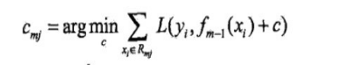

1：RF与GBDT之间的区别

（1）相同点

- 都是由多棵树组成
- 最终的结果都是由多棵树一起决定
（2）不同点

- 组成随机森林的树可以分类树也可以是回归树，而GBDT只由回归树组成
- 组成随机森林的树可以并行生成，而GBDT是串行生成
- 随机森林的结果是多数表决表决的，而GBDT则是多棵树累加之和
- 随机森林对异常值不敏感，而GBDT对异常值比较敏感
- 随机森林是通过减少模型的方差来提高性能，而GBDT是减少模型的偏差来提高性能的
- 随机森林不需要进行数据预处理，即特征归一化。而GBDT则需要进行特征归一化
2：分类树和回归树的区别

（1）**分类树使用信息增益或增益比率来划分节点；每个节点样本的类别情况投票决定测试样本的类别。**

**（2)回归树使用最小化均方差划分节点；每个节点样本的均值作为测试样本的回归预测值**

**3：说一下GBDT**

**GBDT的核心就在于，每一棵树学的是之前所有树结论和的残差**，这个**残差就是一个加预测值后能得真实值的累加量**

**4：**Xgboost和GBDT的区别

(1)传统GBDT以CART作为基分类器，xgboost还支持线性分类器，这个时候xgboost相当于带L1和L2正则化项的逻辑斯蒂回归（分类问题）或者线性回归（回归问题）。节点分裂的方式不同，gbdt是用的gini系数，xgboost是经过优化推导后的

(2)传统GBDT在优化时只用到一阶导数信息，xgboost则对代价函数进行了二阶泰勒展开，同时用到了一阶和二阶导数。为什么xgboost要用泰勒展开，优势在哪里？xgboost使用了一阶和二阶偏导, 二阶导数有利于梯度下降的更快更准. 使用泰勒展开取得函数做自变量的二阶导数形式, 可以在不选定损失函数具体形式的情况下, 仅仅依靠输入数据的值就可以进行叶子分裂优化计算, 本质上也就把损失函数的选取和模型算法优化/参数选择分开了. 这种去耦合增加了xgboost的适用性, 使得它按需选取损失函数, 可以用于分类, 也可以用于回归。

(3)Xgboost在代价函数里加入了正则项，用于控制模型的复杂度，降低了过拟合的可能性。正则项里包含了树的叶子节点个数、每个叶子节点上输出的score的L2模的平方和

(4)Xgboost工具支持并行。boosting不是一种串行的结构吗?怎么并行的？注意xgboost的并行不是tree粒度的并行，xgboost也是一次迭代完才能进行下一次迭代的（第t次迭代的代价函数里包含了前面t-1次迭代的预测值）。xgboost的并行是在特征粒度上的。我们知道，决策树的学习最耗时的一个步骤就是对特征的值进行排序（因为要确定最佳分割点），xgboost在训练之前，预先对数据进行了排序，然后保存为block结构，后面的迭代中重复地使用这个结构，大大减小计算量。这个block结构也使得并行成为了可能，在进行节点的分裂时，需要计算每个特征的增益，最终选增益最大的那个特征去做分裂，那么各个特征的增益计算就可以开多线程进行

5:N问GBDT

(1)怎样设置单棵树的停止生长条件？

答：A. 节点分裂时的最小样本数

B. 最大深度

C. 最多叶子节点数

D. loss满足约束条件

(2)如何评估特征的权重大小？

答：a. 通过计算每个特征在训练集下的信息增益，最后计算每个特征信息增益与所有特征信息增益之和的比例为权重值。

b. 借鉴投票机制。用相同的gbdt参数对w每个特征训练出一个模型，然后在该模型下计算每个特征正确分类的个数，最后计算每个特征正确分类的个数与所有正确分类个数之和的比例为权重值。

(3)当增加样本数量时，训练时长是线性增加吗？

答：不是。因为生成单棵决策树时，对于

，

损失函数极小值

与样本数量N不是线性相关

(4)当增加树的棵树时，训练时长是线性增加吗？

答：不是。因为每棵树的生成的时间复杂度不一样。

(5)当增加一个棵树叶子节点数目时，训练时长是线性增加吗？

答：不是。叶子节点数和每棵树的生成的时间复杂度不成正比。

(6)每个节点上都保存什么信息？

答：中间节点保存某个特征的分割值，叶结点保存预测是某个类别的概率。

(7)如何防止过拟合？

答：a. 增加样本（data bias or small data的缘故），移除噪声。

b. 减少特征，保留重要的特征（可以用PCA等对特征进行降维）。

c. 对样本进行采样（类似bagging）。就是建树的时候，不是把所有的样本都作为输入，而是选择一个子集。

d. 对特征进行采样。类似样本采样一样, 每次建树的时候，只对部分的特征进行切分。

(8) gbdt在训练和预测的时候都用到了步长，这两个步长一样么？都有什么用，如果不一样，为什么？怎么设步长的大小？（太小？太大？）在预测时，设太大对排序结果有什么影响？跟shrinking里面的步长一样么这两个步长一样么？

答：训练跟预测时，两个步长是一样的，也就是预测时的步长为训练时的步长，从训练的过程可以得知（更新当前迭代模型的时候）。

都有什么用，如果不一样，为什么？答：它的作用就是使得每次更新模型的时候，使得loss能够平稳地沿着负梯度的方向下降，不至于发生震荡。

那么怎么设步长的大小?

答：有两种方法，一种就是按策略来决定步长，另一种就是在训练模型的同时，学习步长。

A. 策略：

a 每个树步长恒定且相等，一般设较小的值；

b 开始的时候给步长设一个较小值，随着迭代次数动态改变，或者说衰减。

B. 学习：

因为在训练第k棵树的时候，前k-1棵树时已知的，而且求梯度的时候是利用前k-1棵树来获得。所以这个时候，就可以把步长当作一个变量来学习。

（太小？太大？）在预测时，对排序结果有什么影响？

答：如果步长过大，在训练的时候容易发生震荡，使得模型学不好，或者完全没有学好，从而导致模型精度不好。

而步长过小，导致训练时间过长，即迭代次数较大，从而生成较多的树，使得模型变得复杂，容易造成过拟合以及增加计算量。

不过步长较小的话，使训练比较稳定，总能找到一个稳定的局部最优解。

个人觉得过大过小的话，模型的预测值都会偏离真实情况（可能比较严重），从而导致模型精度不好。

跟shrinking里面的步长一样么？答：这里的步长跟shrinking里面的步长是一致的。

(9)boosting的本意是是什么？跟bagging，random forest，adaboost，gradient boosting有什么区别？

答：Bagging:

可以看成是一种圆桌会议，或是投票选举的形式。通过训练多个模型，将这些训练好的模型进行加权组合来获得最终的输出结果(分类/回归)，一般这类方法的效果，都会好于单个模型的效果。在实践中，在特征一定的情况下，大家总是使用Bagging的思想去提升效果。例如kaggle上的问题解决，因为大家获得的数据都是一样的，特别是有些数据已经过预处理。

基本的思路比较简单，就是：训练时，使用replacement的sampling方法，sampling一部分训练数据k次并训练k个模型；预测时，使用k个模型，如果为分类，则让k个模型均进行分类并选择出现次数最多的类（每个类出现的次数占比可以视为置信度）；如为回归，则为各类器返回的结果的平均值。在该处，Bagging算法可以认为每个分类器的权重都一样由于每次迭代的采样是独立的，所以bagging可以并行。
而boosting的采样或者更改样本的权重依赖于上一次迭代的结果，在迭代层面上是不能并行的。
Random forest：
随机森林在bagging的基础上做了修改。
A. 从样本集散用Boostrap采样选出n个样本，预建立CART
B. 在树的每个节点上，从所有属性中随机选择k个属性/特征，选择出一个最佳属性/特征作为节点
C. 重复上述两步m次，i.e.build m棵cart
D. 这m棵cart形成random forest。

随机森林可以既处理属性是离散的量，比如ID3算法，也可以处理属性为连续值得量，比如C4.5算法。
这里的random就是指：
A. boostrap中的随机选择样本
B. random subspace的算法中从属性/特征即中随机选择k个属性/特征，每棵树节点分裂时，从这随机的k个属性/特征，选择最优的。
Boosting: 

boosting是”提升”的意思。一般Boosting算法都是一个迭代的过程，每一次新的训练都是为了改进上一次的结果。

boosting在选择hyperspace的时候给样本加了一个权值，使得loss function尽量考虑那些分错类的样本（如分错类的样本weight大）。怎么做的呢？
boosting重采样的不是样本，而是样本的分布，对于分类正确的样本权值低，分类错误的样本权值高(通常是边界附近的样本)，最后的分类器是很多弱分类器的线性叠加(加权组合)。
或者这么理解也是可以的:
如果弱学习器与强学习器是等价的, 当强学习器难以学习时(如强学习器高度非线性等)，问题就可以转化为这样的学习问题：
学习多个弱分类器(弱分类器容易学习)，并将多个弱分类器组合成一个强分类器(与原来的强学习器等价)。
Adaboosting:
这其实思想相当的简单，大概是对一份数据，建立M个模型(比如分类)，而一般这种模型比较简单，称为弱分类器(weak learner)。每次分类都将上一次分错的数据权重提高一点，对分对的数据权重降低一点，再进行分类。这样最终得到的分类器在测试数据与训练数据上都可以得到比较好的效果。
每次迭代的样本是一样的，即没有采样过程，不同的是不同的样本权重不一样。(当然也可以对样本/特征进行采样，这个不是adaboosting的原意)。
另外，每个分类器的步长由在训练该分类器时的误差来生成。
Gradient boosting: 
每一次的计算是为了减少上一次的残差(residual)，而为了消除残差，我们可以在残差减少的梯度 (Gradient)方向上建立一个新的模型。所以说在Gradient Boost中，每个新模型是为了使之前模型的残差往梯度方向减少，与传统Boost对正确，错误的样本进行加权有着很大的区别。(或者这样理解：每一次建立模型是在之前建立模型损失函数的梯度下降方向。这句话有一点拗口，损失函数(loss function)描述的是模型的不靠谱程度，损失函数越大，则说明模型越容易出错(其实这里有一个方差、偏差均衡的问题, 但是这里就假设损失函数越大, 模型越容易出错)。如果我们的模型能够让损失函数持续的下降, 则说明我们的模型在不停的改进, 而最好的方式就是让损失函数在其Gradient的方向上下降)。

(10)gbdt中哪些部分可以并行？

答：A. 计算每个样本的负梯度

B. 分裂挑选最佳特征及其分割点时，对特征计算相应的误差及均值时

C. 更新每个样本的负梯度时

D. 最后预测过程中，每个样本将之前的所有树的结果累加的时候

(11) 树生长成畸形树，会带来哪些危害，如何预防？

答：在生成树的过程中，加入树不平衡的约束条件。这种约束条件可以是用户自定义的。

例如对样本集中分到某个节点，而另一个节点的样本很少的情况进行惩罚。

参考博客：N问GBDT（1-12答案） - CSDN博客
