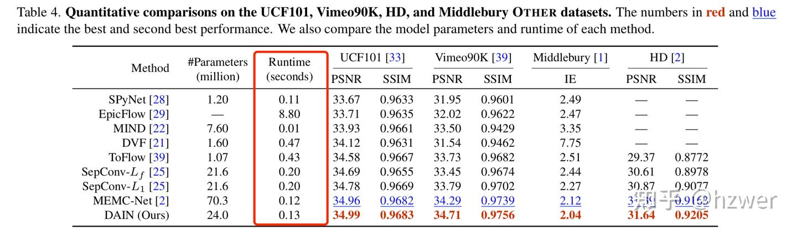
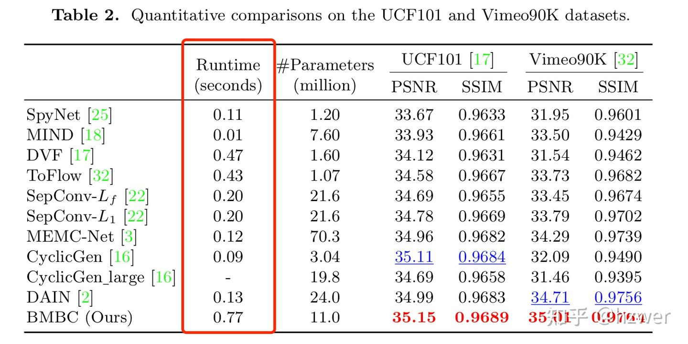
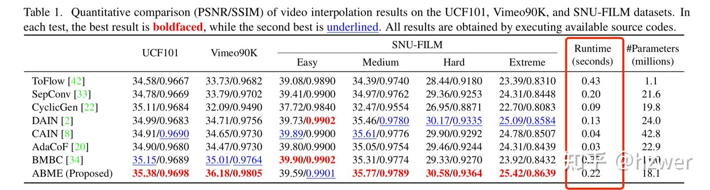
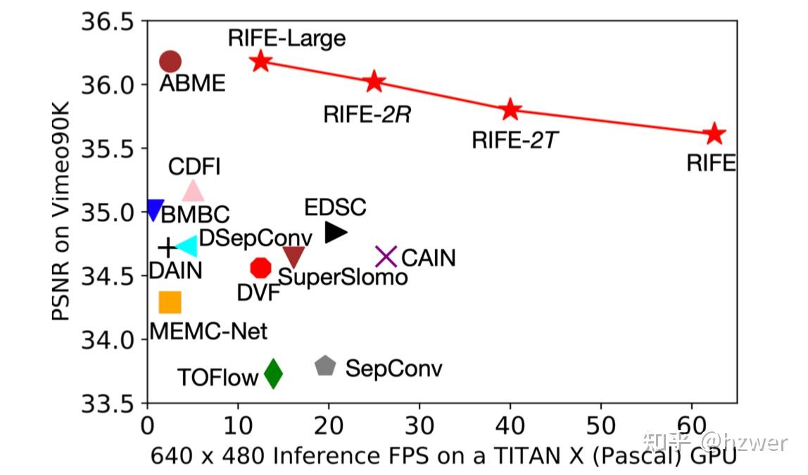

这两年视频插帧领域热度渐涨，我从 19 年底开始了解相关工作，在 20 年底写了论文第一稿，到 22 年才把它投中。宣传一下我们的工作：[https://github.com/megvii-research/ECCV2022-RIFE](https://link.zhihu.com/?target=https%3A//github.com/megvii-research/ECCV2022-RIFE/blob/main/README.md)。

之所以搞的这么漫长，一方面是我做学术的经验尚浅，一开始摸不着门道；另一方面是这个领域有很多历史遗留问题我花了挺多时间搞明白，于是我想写篇文章帮助未来者少走弯路。

**首先声明，我的观点也可能是片面的或不准确的，读者需要自行甄别。**

#### 模型测速

目前 CVPR19 - DAIN 还是一个十分流行的算法（目前在 GitHub 有 7K star），然而它的速度离实时处理高清 (1080p) 视频差了一个数量级不止，我们工作的初衷是想做一个跑的快的插帧应用。我们的论文前两次投稿被喷的很惨，原因是我们引用了 DAIN 的主表的 runtime，只是验证了一下 ICCV17 - SepConv 就以为我们差不多对上了。这个表格也被一些论文继承，比如 ECCV20 - BMBC，ICCV21 - ABME。

DAIN 的主表

BMBC 的主表

ABME 的主表然而我后来知道，这些 runtime 是直接从 Middlebury 官网 摘抄的，而这些数字是在不同的软硬件平台报告的且没有经过第三方验证。**严谨地来说，它们之间不能互相比较**。甚至一些 paper 在正文里说自己是在统一硬件上测速但是报告了摘抄的结果，这个坑务必小心。同时 BMBC 和 ABME 报告的 runtime 我也不能准确复现。

runtime 测试其实是一件很重要的事情，有一篇大佬的文章 FLAVR，被 CVPR21 接收但是后来发现把 runtime 测错了两个数量级，导致文章核心贡献不成立，之后撤稿重投了几次看起来都没中。[https://github.com/tarun005/FLAVR/issues/14](https://link.zhihu.com/?target=https%3A//github.com/tarun005/FLAVR/issues/14)

RIFE 提供的测速报告（其中一些方法是重新在 Vimeo90K 训练的）我激进地认为，报告性能质量的时候不带 runtime 是耍流氓。因为在大部分任务上，总可以通过调大模型来获得更好的性能，可以看我们绘制的速度 - 质量表。RIFE 最终也是把主表分成两栏以后，才让审稿人看明白我们的性能是有一定先进性的。

未来大家要报告 runtime 的话，可以参考 TPAMI21 - EDSC (要是早看到就好了）或者我们的 RIFE，我们多方验证后至少能保证不出现大的误差。我们的测试代码也欢迎大家来用：[https://github.com/megvii-research/ECCV2022-RIFE/tree/main/benchmark](https://link.zhihu.com/?target=https%3A//github.com/megvii-research/ECCV2022-RIFE/tree/main/benchmark)

#### 量化指标

现在比较流行的 PSNR，SSIM 和 LPIPS，这里面也有好多坑点。一是在测 PSNR 之前，大多数现有工作会先把图片量化到 uint8 再测，比起不量化大概会降低 0.03~0.04 dB，我们起初提交的代码里面没写这个量化就被喷了，我看到很多插帧工作的 issue 里也有类似讨论。对于一些比较早的做法，比如 SuperSlomo，DVF，我们也发现它们 PSNR 指标低的原因主要是因为当年训练数据集比较小，而不是因为这些方法落后了。

二是 SSIM 有多种测法，也务必要注意，我们后来统一用的是 matlab 的 SSIM 计算方法，而 Simon Niklaus 经常用的是另外一种，见讨论： [https://github.com/sniklaus/softmax-splatting/issues/24](https://link.zhihu.com/?target=https%3A//github.com/sniklaus/softmax-splatting/issues/24)。但目前还是有很多发表工作在混用多种 SSIM 测试方式。

三是 关于 LPIPS，默认应该是 clone 官方 GitHub 的代码，用 AlexNet 测。也有一些测的不一致的论文，比如我曾经在 CDFI  repo 里提的 issue：[https://github.com/tding1/CDFI/issues/6](https://link.zhihu.com/?target=https%3A//github.com/tding1/CDFI/issues/6)。

我审稿的时候看到这些错误一般也就是提醒一下，但是较真的审稿人可能就会很不客气了（我围观过一些被其他人喷的非常惨的论文。

附送 PSNR 提高的几个 trick，一个是把训练时候的 L1 loss 换成 [Laplacian L1 loss](https://link.zhihu.com/?target=https%3A//github.com/megvii-research/ECCV2022-RIFE/blob/19b903effb008cefbffaea2c4a0b877beaece6b1/model/laplacian.py)（虽然涨 PSNR，不过 Laplacian L1 loss 会把生成图变得比较模糊），还有就是用在训练的时候加入 [census loss](https://link.zhihu.com/?target=https%3A//github.com/megvii-research/ECCV2022-RIFE/blob/0e241367847a0895748e64c6e1604c94db54d395/model/loss.py%23L20)（链接里写的是 Ternary)，我一开始是从做无监督光流的论文里学来的。

#### benchmark 和 SOTA

目前我所知流行的 benchmark 有两套，一是从 DAIN，CAIN，SoftSplat 都在用的 Middlebury + UCF101 + Vimeo90K。

我不太喜欢 Middlebury，主要是因为它没几张图，不是很能反映模型性能。这里附送一个小 trick，在训练的时候加旋转 90 度的增广可以提高 Middlebury 指标不少。Vimeo90K 是我认为最硬的指标，图多且区分度大。我起初在刷的时候，发现 CVPR20 - SoftSplat 报告了 36.1dB，这个点其实同行大概两年后才差不多刷出来，估计是加了很多 trick 得到的，目前好像还没人同时能复现它的精度和速度。同时还要注意，FLAVR 文章中报告的 Vimeo90K（被 CVPR22-Video Frame Interpolation Transformer 引用）是用了 Vimeo90K 更大版本的数据集训练的，且 FLAVR 的表也是被一些人喷不公平对比的。

另一套是多帧插帧的 GOPRO，Adobe240，DAVIS 这些的，可以参考 NeurIPS19 - QVI，我不是特别了解。目前怎么把这些多帧到多帧的插帧方法和两帧出一帧的插帧方法相比较，社区都没太搞清楚。我的观点是不用比较，就像是单图超分和视频超分不用放在一起比。或者说主表用一类比较方法，附录或者次要的地方再顺便报告另一种也挺好的。

#### 大分辨率插帧

ICCV21 - XVFI 做 4K 数据集插帧的文章得了 Oral，最近也有一些 paper 用 SoftSplat 提的 Xiph 数据集。对于大分辨率插帧，我个人感觉，只要在小图上推理光流，再放大回去，就能让大多数方法的性能显著提高。以往方法效果不好，本质上是因为训练集都是小图，模型没见过横跨几百个像素的运动而已。XVFI 所提的数据集大家也可以试一下，我个人感觉还是在 Vimeo90K 上加数据增广更有效。

所以我目前对做所谓大运动相关光流估计的 paper 都有一些怀疑，真正要做应该做高速极小物体的大分辨率光流估计可能比较有说服力。

#### 视觉效果

做 low-level 的朋友大多听说过，PSNR 和视觉效果不是正相关的。在超分任务上，PSNR 高的结果会看起来像油画，在插帧上会看起来模糊。这也是很多 paper 同时报告 LPIPS 指标的原因。

有一篇著名工作叫 [The Perception-Distortion Tradeoff](https://link.zhihu.com/?target=https%3A//arxiv.org/abs/1711.06077)，指出主观感知和 PSNR 是矛盾的，不过 PSNR 更高的模型一般也指示模型更好，只要在训练的时候把 pixel-wise loss 换成类似 [perceptual loss](https://link.zhihu.com/?target=https%3A//github.com/megvii-research/ECCV2022-RIFE/blob/0e241367847a0895748e64c6e1604c94db54d395/model/loss.py%23L98) 就可以了。所以我认为目前的 paper 继续刷 psnr 还算合理，真正工业落地的时候再考虑一些 hard case 就挺好的。

动漫插帧也是一个比较流行的领域，怎么用好动漫插帧数据集，以及动漫插帧需要什么独特技术，目前还是开放性问题。

#### 其它一些小问题

- 插帧 paper 用的数据增广很少，原因是什么？
我感觉目前原数据集已经不能被大多数模型吃下去了，所以加增广不配套延长训练时间通常会降低性能。

- 做插帧应用有什么比较好的方法？
如文中提到的，首先换成 [perceptual loss](https://link.zhihu.com/?target=https%3A//github.com/megvii-research/ECCV2022-RIFE/blob/0e241367847a0895748e64c6e1604c94db54d395/model/loss.py%23L98)，或 [perceptual loss](https://link.zhihu.com/?target=https%3A//github.com/megvii-research/ECCV2022-RIFE/blob/0e241367847a0895748e64c6e1604c94db54d395/model/loss.py%23L98) 组合 L1 loss。

加一些 resize，平移增广，训练时间延长几倍，不嫌麻烦最好换成 Vimeo90K 七帧数据集。

在光流上加一些平滑性约束对解决一些奇怪扭曲有用。

- 评论区待续

#### 致谢

除了感谢 RIFE 相关的作者、贡献者外，特别感谢 Li Siyao，[Xianhang Cheng](https://link.zhihu.com/?target=https%3A//github.com/Xianhang)，Kunming Luo 几位朋友给予的帮助。

#### 参考文献

以下列出本文提及的各个论文全名和链接（不分先后）：

SepConv: [Video Frame Interpolation via Adaptive Separable Convolution](https://link.zhihu.com/?target=https%3A//arxiv.org/pdf/1708.01692v1.pdf)

DAIN：[Depth-Aware Video Frame Interpolation](https://link.zhihu.com/?target=https%3A//arxiv.org/abs/1904.00830)

DVF：[Video Frame Synthesis using Deep Voxel Flow](https://link.zhihu.com/?target=https%3A//arxiv.org/abs/1702.02463)

CAIN：Channel Attention Is All You Need for Video Frame Interpolation

EDSC：[Multiple Video Frame Interpolation via Enhanced Deformable Separable Convolution](https://link.zhihu.com/?target=https%3A//arxiv.org/abs/2006.08070)

SoftSplat: [Softmax Splatting for Video Frame Interpolation](https://link.zhihu.com/?target=https%3A//arxiv.org/abs/2003.05534)

QVI：[Quadratic Video Interpolation](https://link.zhihu.com/?target=https%3A//arxiv.org/abs/1911.00627)

BMBC: BMBC: Bilateral Motion Estimation with Bilateral Cost Volume for Video Interpolation

ABME: Asymmetric Bilateral Motion Estimation for Video Frame Interpolation

XVFI: [XVFI: eXtreme Video Frame Interpolation](https://link.zhihu.com/?target=https%3A//arxiv.org/abs/2103.16206)

RIFE: [Real-Time Intermediate Flow Estimation for Video Frame Interpolation](https://link.zhihu.com/?target=https%3A//arxiv.org/pdf/2011.06294.pdf)

**祝愿社区更进一步，也祝愿未来者相关研究顺利！**
