" role="presentation">\quad 

循环神经网络 (Recurrent Neural Network，RNN) 是一类具有短期记忆能力的神经网络，因而常用于序列建模。本篇先总结 RNN 的基本概念，以及其训练中时常遇到梯度爆炸和梯度消失问题，再引出 RNN 的两个主流变种 —— LSTM 和 GRU。

**

VanillaRNN" role="presentation" style="font-size: 100%; display: inline-block; position: relative;">VanillaRNN\Large\cal{Vanilla \;\; RNN} \\ 

 Vanilla RNN 的主体结构： 

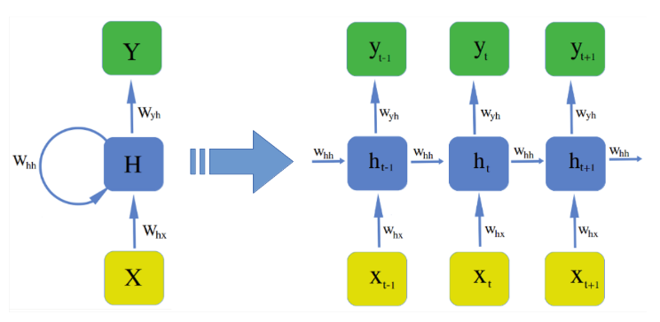

Vanilla RNN

上图中 X,h,y" role="presentation">X,h,y\bf{X, h, y} 都是向量，公式如下： 

$(1)ht=fW(ht&#x2212;1,xt)(2a)ht=f(Whxxt+Whhht&#x2212;1+bh)(2b)ht=tanh(Whxxt+Whhht&#x2212;1+bh)(3)y&#x005E;t=softmax(Wyhht+by)" role="presentation" style="font-size: 100%; display: inline-block; position: relative;">(1)ht=fW(ht−1,xt)(2a)ht=f(Whxxt+Whhht−1+bh)(2b)ht=tanh(Whxxt+Whhht−1+bh)(3)y^t=softmax(Wyhht+by)\begin{align} \textbf{h}_{t} &= f_{\textbf{W}}\left(\textbf{h}_{t-1}, \textbf{x}_{t} \right) \tag{1} \\ \textbf{h}_{t} &= f\left(\textbf{W}_{hx}\textbf{x}_{t} + \textbf{W}_{hh}\textbf{h}_{t-1} + \textbf{b}_{h}\right) \tag{2a} \\ \textbf{h}_{t} &= \textbf{tanh}\left(\textbf{W}_{hx}\textbf{x}_{t} +  \textbf{W}_{hh}\textbf{h}_{t-1} + \textbf{b}_{h}\right) \tag{2b} \\ \hat{\textbf{y}}_{t} &= \textbf{softmax}\left(\textbf{W}_{yh}\textbf{h}_{t} + \textbf{b}_{y}\right) \tag{3} \end{align} $

$其中  \textbf{W}_{hx} \in \mathbb{R}^{h \times x}, \; \textbf{W}_{hh} \in \mathbb{R}^{h \times h},  \; \textbf{W}_{yh} \in \mathbb{R}^{y \times h}, \; \textbf{b}_{h} \in \mathbb{R}^{h}, \; \textbf{b}_{y} \in \mathbb{R}^{y} $

(2a)  式中的两个矩阵 \mathbf{W} 可以合并：

\begin{align*} \textbf{h}_{t} &= f\left(\textbf{W}_{hx}\textbf{x}_{t} + \textbf{W}_{hh}\textbf{h}_{t-1} + \textbf{b}_{h}\right) \\ & = f\left(\left(\textbf{W}_{hx}, \textbf{W}_{hh}\right)  \begin{pmatrix} \textbf{x}_t \\ \textbf{h}_{t-1} \end{pmatrix} + \textbf{b}_{h}\right) \\ & =  f\left(\textbf{W} \begin{pmatrix} \textbf{x}_t \\ \textbf{h}_{t-1} \end{pmatrix} + \textbf{b}_{h}\right) \end{align*} \\ 

注意到在计算时，每一 time step 中使用的参数 \textbf{W}, \; \textbf{b} 是一样的，也就是说每个步骤的参数都是共享的，这是RNN的重要特点。

和普通的全连接层相比，RNN 除了输入 \textbf{x}_t 外，还有输入隐藏层上一节点 \mathbf{h}_{t-1} ，RNN 每一层的输出就是这两个输入用矩阵 \textbf{W}_{hx} ， \textbf{W}_{hh} 和激活函数进行组合的结果。从 (2a) 式可以看出 \textbf{x}_t 和 \mathbf{h}_{t-1}  都是与 \textbf{h}_t 全连接的，下图形象展示了各个时间节点 RNN 隐藏层记忆的变化。随着时间流逝，最初的蓝色结点保留地越来越少，这意味着 RNN 对于长时记忆的困难。

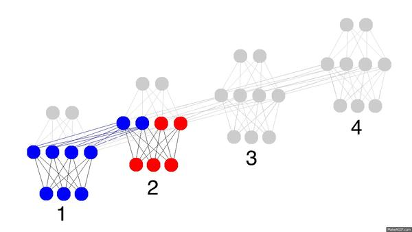

### Vanishing & Exploding Gradient Problems

RNN 对于长时记忆的困难主要来源于梯度爆炸 / 消失问题，下面进行说明。RNN 中 Loss 的计算图示例： 

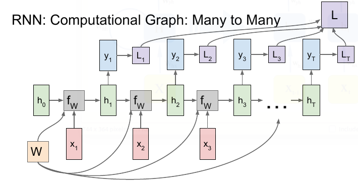

$总的 Loss 是每个 time step 的加和 ： \mathcal{\large{L}} (\hat{\textbf{y}}, \textbf{y}) = \sum_{t = 1}^{T} \mathcal{ \large{L} }(\hat{\textbf{y}_t}, \textbf{y}_{t}) $

$$由 backpropagation through time (BPTT)** 算法，参数的梯度为： \frac{\partial \boldsymbol{\mathcal{L}}}{\partial \textbf{W}} = \sum_{t=1}^{T} \frac{\partial \boldsymbol{\mathcal{L}}_{t}}{\partial \textbf{W}} = \sum_{t=1}^{T} \frac{\partial \boldsymbol{\mathcal{L}}_t}{\partial \textbf{y}_{t}} \frac{\partial \textbf{y}_{t}}{\partial \textbf{h}_{t}} \overbrace{\frac{\partial \textbf{h}_{t}}{\partial \textbf{h}_{k}}}^{ \bigstar } \frac{\partial \textbf{h}_{k}}{\partial \textbf{W}} \\ $$

$$其中 \frac{\partial \textbf{h}_{t}}{\partial \textbf{h}_{k}} 包含一系列 \text{Jacobian} 矩阵， $$

$$\frac{\partial \textbf{h}_{t}}{\partial \textbf{h}_{k}} = \frac{\partial \textbf{h}_{t}}{\partial \textbf{h}_{t-1}} \frac{\partial \textbf{h}_{t-1}}{\partial \textbf{h}_{t-2}} \cdots \frac{\partial \textbf{h}_{k+1}}{\partial \textbf{h}_{k}}   = \prod_{i=k+1}^{t} \frac{\partial \textbf{h}_{i}}{\partial \textbf{h}_{i-1}} \\ $$

由于 RNN 中每个 time step 都是用相同的 \textbf{W} ，所以由 (2a) 式可得： 

$$\prod_{i=k+1}^{t} \frac{\partial \textbf{h}_{i}}{\partial \textbf{h}_{i-1}} = \prod_{i=k+1}^{t} \textbf{W}^\top \text{diag} \left[ f'\left(\textbf{h}_{i-1}\right) \right] \\ $$

**

$由于 \textbf{W}_{hh} \in \mathbb{R}^{h \times h} 为方阵，对其进行特征值分解： $

$\mathbf{W} = \mathbf{V} \, \text{diag}(\boldsymbol{\lambda}) \, \mathbf{V}^{-1} \\ 由于上式是连乘 \text{t} 次 \mathbf{W} : $

$\mathbf{W}^t = (\mathbf{V} \, \text{diag}(\boldsymbol{\lambda}) \, \mathbf{V}^{-1})^t = \mathbf{V} \, \text{diag}(\boldsymbol{\lambda})^t \, \mathbf{V}^{-1} \\ 连乘的次数多了之后，则若最大的特征值 1">\lambda >1 ，会产生梯度爆炸； \lambda  ，则会产生梯度消失 。不论哪种情况，都会导致模型难以学到有用的模式。$

下左图显示一个 time step 中 tanh 函数的计算结果，右图显示整个神经网络的计算结果，可以清楚地看到哪个区域最容易产生梯度爆炸/消失问题。

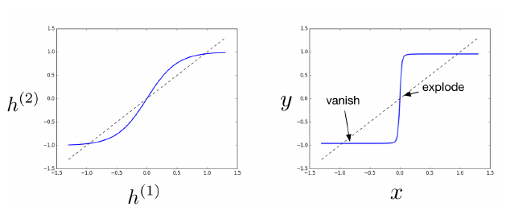

### 梯度爆炸的解决办法：

(1)  Truncated Backpropagation through time**：每次只 BP 固定的 time step 数，类似于 mini-batch SGD。缺点是丧失了长距离记忆的能力。

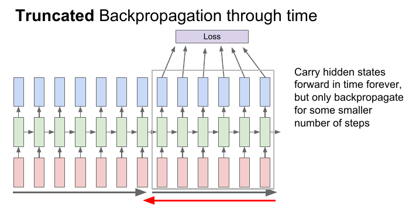

**

(2)  Clipping Gradients**： 当梯度超过一定的 threshold 后，就进行 element-wise 的裁剪，该方法的缺点是又引入了一个新的参数 threshold。同时该方法也可视为一种基于瞬时梯度大小来自适应 learning rate 的方法： 

$$\text{if} \quad \lVert \textbf{g} \rVert \ge \text{threshold} \\[1ex] \textbf{g} \leftarrow \frac{\text{threshold}}{\lVert \textbf{g} \rVert} \textbf{g} $$

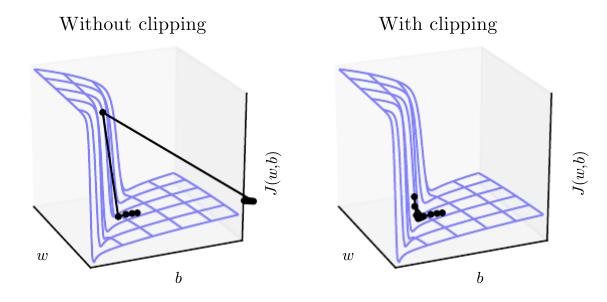

**

### 梯度消失的解决办法

(1)**  使用 LSTM、GRU等升级版 RNN，使用各种 gates 控制信息的流通。

**(2)**  在这篇论文 ([https://arxiv.org/pdf/1602.06662.pdf](https://link.zhihu.com/?target=https%3A//arxiv.org/pdf/1602.06662.pdf)) 中提出将权重矩阵 \textbf{W}  初始化为正交矩阵。正交矩阵有如下性质： A^T A =A A^T =  I, \; A^T = A^{-1} ， 正交矩阵的特征值的绝对值为 \text{1} 。证明如下，  对矩阵 A 有： 

$\begin{align*} & A \mathbf{v} = \lambda \mathbf{v} \\[1ex]  ||A \mathbf{v}||^2& = (A \mathbf{v})^\text{T} (A \mathbf{v}) \\ &= \mathbf{v}^\text{T}A ^{\text{T}}A \mathbf{v} \\ & = \mathbf{v}^{\text{T}}\mathbf{v} \\ & = ||\mathbf{v}||^2 \\ & = |\lambda|^2 ||\mathbf{v}||^2 \end{align*} \\ $

由于 \mathbf{v} 为特征向量， \mathbf{v} \neq 0 ，所以 |\lambda| = 1 ，这样连乘之后 \lambda^t 不会出现越来越小的情况。

**(3)** 反转输入序列。像在机器翻译中使用 seq2seq 模型，若使用正常序列输入，则输入序列的第一个词和输出序列的第一个词相距较远，难以学到长期依赖。将输入序列反向后，输入序列的第一个词就会和输出序列的第一个词非常接近，二者的相互关系也就比较容易学习了。这样模型可以先学前几个词的短期依赖，再学后面词的长期依赖关系。见下图正常输入顺序是  |\text{ABC}| ，反向是 |\text{CBA}| ，则 \text{A} 与第一个输出词 \text{W} 接近：

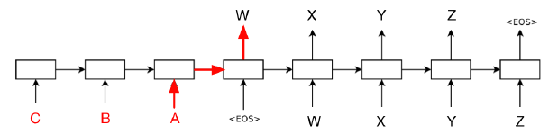

### \Large\cal{LSTM} \\ 

虽然 Vanilla RNN 理论上可以建立长时间间隔状态之间的依赖关系，但由于梯度爆炸或消失问题，实际上只能学到短期依赖关系。为了学到长期依赖关系，LSTM 中引入了门控机制来控制信息的累计速度，包括有选择地加入新的信息，并有选择地遗忘之前累计的信息，整个 LSTM 单元结构如下图所示：

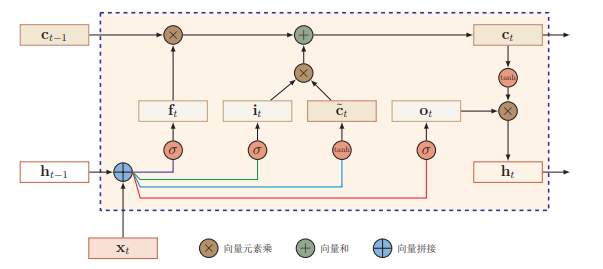

LSTM

$\begin{align} \text{input gate}&: \quad  \textbf{i}_t = \sigma(\textbf{W}_i\textbf{x}_t + \textbf{U}_i\textbf{h}_{t-1} + \textbf{b}_i)\tag{1} \\ \text{forget gate}&: \quad  \textbf{f}_t = \sigma(\textbf{W}_f\textbf{x}_t + \textbf{U}_f\textbf{h}_{t-1} + \textbf{b}_f) \tag{2}\\ \text{output gate}&: \quad  \textbf{o}_t = \sigma(\textbf{W}_o\textbf{x}_t + \textbf{U}_o\textbf{h}_{t-1} + \textbf{b}_o) \tag{3}\\ \text{new memory cell}&: \quad  \tilde{\textbf{c}}_t = \text{tanh}(\textbf{W}_c\textbf{x}_t + \textbf{U}_c\textbf{h}_{t-1} + \textbf{b}_c) \tag{4}\\ \text{final memory cell}& : \quad \textbf{c}_t =   \textbf{f}_t \odot \textbf{c}_{t-1} + \textbf{i}_t \odot \tilde{\textbf{c}}_t \tag{5}\\ \text{final hidden state} &: \quad \textbf{h}_t= \textbf{o}_t \odot \text{tanh}(\textbf{c}_t) \tag{6} \end{align} $

式 (1) \sim (4)  的输入都一样，因而可以合并： 

$\begin{pmatrix} \textbf{i}_t \\ \textbf{f}_{t} \\ \textbf{o}_t \\ \tilde{\textbf{c}}_t \end{pmatrix}  =   \begin{pmatrix} \sigma \\ \sigma \\ \sigma \\ \text{tanh} \end{pmatrix}  \left(\textbf{W}  \begin{bmatrix} \textbf{x}_t \\ \textbf{h}_{t-1} \end{bmatrix} + \textbf{b} \right) \\ $

$\tilde{\textbf{c}}_t 为时刻 t 的候选状态， \textbf{i}_t 控制 \tilde{\textbf{c}}_t  中有多少新信息需要保存， \textbf{f}_{t} 控制上一时刻的内部状态 \textbf{c}_{t-1} 需要遗忘多少信息， \textbf{o}_t 控制当前时刻的内部状态 \textbf{c}_t 有多少信息需要输出给外部状态 \textbf{h}_t 。$

下表显示 forget gate 和 input gate 的关系，可以看出 forget gate 其实更应该被称为 “remember gate”， 因为其开启时之前的记忆信息 \textbf{c}_{t-1} 才会被保留，关闭时则会遗忘所有：

    forget gate        |         input gate        |         \quad      result

$- \quad     1          \quad       |         \quad      0        \quad       |   \quad 保留上一时刻的状态 \textbf{c}_{t-1} $
$- \quad     1         \quad        |         \quad       1       \quad        |   \quad 保留上一时刻 \textbf{c}_{t-1}  和添加新信息 \tilde{\textbf{c}}_t $
- \quad     0          \quad       |          \quad      1       \quad        | \quad  清空历史信息，引入新信息 \tilde{\textbf{c}}_t 
- \quad     0          \quad       |         \quad       0        \quad       |  \quad 清空所有新旧信息  

对比 Vanilla RNN，可以发现在时刻 t，Vanilla RNN 通过  \textbf{h}_t  来保存和传递信息，上文已分析了如果时间间隔较大容易产生梯度消失的问题。 LSTM 则通过记忆单元 \textbf{c}_t 来传递信息，通过 \textbf{i}_t 和 \textbf{f}_{t} 的调控， \textbf{c}_t 可以在 t 时刻捕捉到某个关键信息，并有能力将此关键信息保存一定的时间间隔。

原始的 LSTM 中是没有 forget gate 的，即： 

\textbf{c}_t =   \textbf{c}_{t-1} + \textbf{i}_t \odot \tilde{\textbf{c}}_t\\这样 \frac{\partial \textbf{c}_t}{\partial \textbf{c}_{t-1}} 恒为 \text{1} 。但是这样 \textbf{c}_t 会不断增大，容易饱和从而降低模型性能。后来引入了 forget gate ，则梯度变为 \textbf{f}_{t} ，事实上连乘多个 \textbf{f}_{t} \in (0,1) 同样会导致梯度消失，但是 LSTM 的一个初始化技巧就是将 forget gate 的 bias 置为正数（例如 1 或者 5，如 tensorflow 中的默认值就是 1.0 ），这样一来模型刚开始训练时 forget gate 的值都接近 1，不会发生梯度消失 (反之若 forget gate 的初始值过小则意味着前一时刻的大部分信息都丢失了，这样很难捕捉到长距离依赖关系)。 随着训练过程的进行，forget gate 就不再恒为 1 了。不过，一个训好的模型里各个 gate 值往往不是在 [0, 1] 这个区间里，而是要么 0 要么 1，很少有类似 0.5 这样的中间值，其实相当于一个二元的开关。假如在某个序列里，forget gate 全是 1，那么梯度不会消失；某一个 forget gate 是 0，模型选择遗忘上一时刻的信息。

LSTM 的一种变体增加 peephole 连接，这样三个 gate 不仅依赖于 \textbf{x}_t 和 \textbf{h}_{t-1} ，也依赖于记忆单元 \textbf{c} ： 

$\begin{align*} \text{input gate}&: \quad  \textbf{i}_t = \sigma(\textbf{W}_i\textbf{x}_t + \textbf{U}_i\textbf{h}_{t-1} + \textbf{V}_i\textbf{c}_{t-1} + \textbf{b}_i) \\ \text{forget gate}&: \quad  \textbf{f}_t = \sigma(\textbf{W}_f\textbf{x}_t + \textbf{U}_f\textbf{h}_{t-1} + \textbf{V}_f\textbf{c}_{t-1} +\textbf{b}_f) \\ \text{output gate}&: \quad  \textbf{o}_t = \sigma(\textbf{W}_o\textbf{x}_t + \textbf{U}_o\textbf{h}_{t-1} + \textbf{V}_o\textbf{c}_{t} +\textbf{b}_o) \\ \end{align*} \\ $

注意 input gate 和 forget gate 连接的是 \textbf{c}_{t-1} ，而 output gate 连接的是 \textbf{c}_t 。下图来自 *[《LSTM: A Search Space Odyssey》](https://link.zhihu.com/?target=https%3A//arxiv.org/pdf/1503.04069.pdf)*，标注了 peephole 连接的样貌。

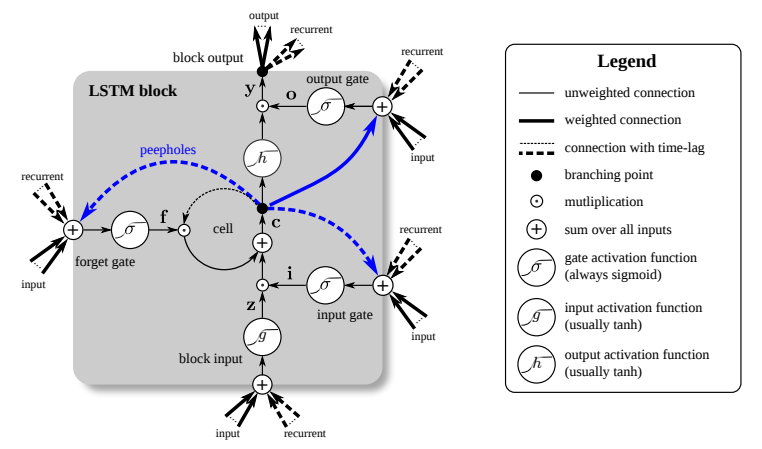

### \Large\cal{GRU} \\ 

相比于 Vanilla RNN (每个 time step 有一个输入 \textbf{x}_t )，从上面的 (1) \sim (4) 式可以看出 一个 LSTM 单元有四个输入 (如下图，不考虑 peephole) ，因而参数是 Vanilla RNN 的四倍，带来的结果是训练起来很慢，因而在2014年 Cho 等人提出了 *[GRU](https://link.zhihu.com/?target=https%3A//arxiv.org/pdf/1409.1259.pdf)* ，对 LSTM 进行了简化，在不影响效果的前提下加快了训练速度。

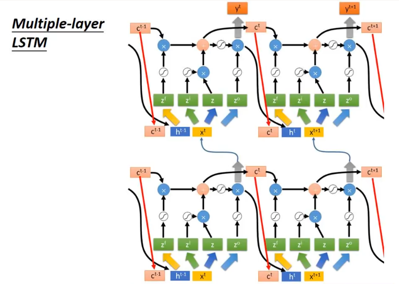

\large\scr{LSTM:} 

$\normalsize \begin{align} \text{input gate}&: \quad  \textbf{i}_t = \sigma(\textbf{W}_i\textbf{x}_t + \textbf{U}_i\textbf{h}_{t-1} + \textbf{b}_i)\tag{1} \\ \text{forget gate}&: \quad  \textbf{f}_t = \sigma(\textbf{W}_f\textbf{x}_t + \textbf{U}_f\textbf{h}_{t-1} + \textbf{b}_f) \tag{2}\\ \text{output gate}&: \quad  \textbf{o}_t = \sigma(\textbf{W}_o\textbf{x}_t + \textbf{U}_o\textbf{h}_{t-1} + \textbf{b}_o) \tag{3}\\ \text{new memory cell}&: \quad  \tilde{\textbf{c}}_t = \text{tanh}(\textbf{W}_c\textbf{x}_t + \textbf{U}_c\textbf{h}_{t-1} + \textbf{b}_c) \tag{4}\\ \text{final memory cell}& : \quad \textbf{c}_t =   \textbf{f}_t \odot \textbf{c}_{t-1} + \textbf{i}_t \odot \tilde{\textbf{c}}_t \tag{5}\\ \text{final hidden state} &: \quad \textbf{h}_t= \textbf{o}_t \odot \text{tanh}(\textbf{c}_t) \tag{6} \end{align}$

在式 (5)​ 中 forget gate 和 input gate 是互补关系，因而比较冗余，GRU 将其合并为一个 update gate。同时 GRU 也不引入额外的记忆单元 (LSTM 中的 \textbf{c}​ ) ，而是直接在当前状态  \textbf{h}_t​  和历史状态 \textbf{h}_{t-1}​ 之间建立线性依赖关系。

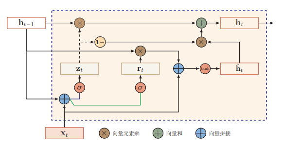

\large\scr{GRU:} 

$\normalsize \begin{align} \text{reset gate}&: \quad  \textbf{r}_t = \sigma(\textbf{W}_r\textbf{x}_t + \textbf{U}_r\textbf{h}_{t-1} + \textbf{b}_r)\tag{7} \\ \text{update gate}&: \quad  \textbf{z}_t = \sigma(\textbf{W}_z\textbf{x}_t + \textbf{U}_z\textbf{h}_{t-1} + \textbf{b}_z)\tag{8} \\ \text{new memory cell}&: \quad  \tilde{\textbf{h}}_t = \text{tanh}(\textbf{W}_h\textbf{x}_t + \textbf{r}_t \odot (\textbf{U}_h\textbf{h}_{t-1}) + \textbf{b}_h) \tag{9}\\ \text{final hidden state}&: \quad \textbf{h}_t = \textbf{z}_t \odot \textbf{h}_{t-1} + (1 - \textbf{z}_t) \odot \tilde{\textbf{h}}_t \tag{10} \end{align} $

 $\tilde{\textbf{h}}_t   为时刻 t 的候选状态， \textbf{r}_t 控制  \tilde{\textbf{h}}_t  有多少依赖于上一时刻的状态 \textbf{h}_{t-1} ，如果  \textbf{r}_t = 1  ，则式 (9) 与 Vanilla RNN 一致，对于短依赖的 GRU 单元，reset gate 通常会更新频繁。 \textbf{z}_t  控制当前的内部状态 \textbf{h}_t 中有多少来自于上一时刻的 \textbf{h}_{t-1} 。如果 \textbf{z}_t = 1 ，则会每步都传递同样的信息，和当前输入 \textbf{x}_t 无关。 $

另一方面看， \textbf{r}_t 与 LSTM 中的 \textbf{o}_t 角色有些类似，因为将上面的 (6) 式代入 (4) 式可以得到：

$\begin{align*}  \tilde{\textbf{c}}_t &= \text{tanh}(\textbf{W}_c\textbf{x}_t + \textbf{U}_c\textbf{h}_{t-1} + \textbf{b}_c) \\  \textbf{h}_t &= \textbf{o}_t \odot \text{tanh}(\textbf{c}_t)  \end{align*} \quad \Longrightarrow \quad \tilde{\textbf{c}}_t = \text{tanh}(\textbf{W}_c\textbf{x}_t + \textbf{U}_c  \left(\textbf{o}_{t-1} \odot \text{tanh}(\textbf{c}_{t-1})\right)  + \textbf{b}_c) \\ $

最后是 cs224n 中提出的 RNN 训练 tips：

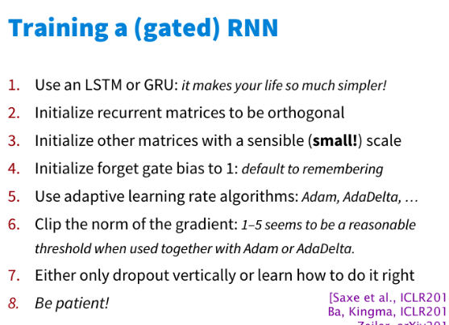

/
