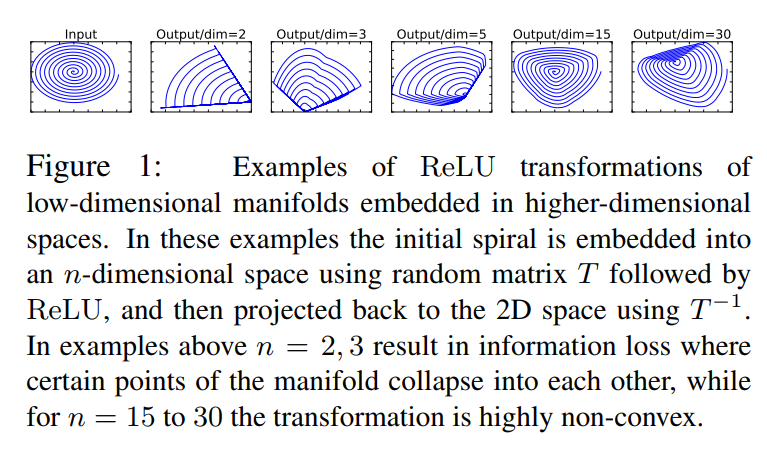

最近在总结完成语义分割任务的轻量级神经网络时，看到了MobileNet V2中对于ReLU层的思考，于是我也回过头重新审视ResNet之所以work的本质原因。以下是一些个人的见解，如有错误，还望及时指正。

在谈及ResNet之前，我们先聊聊故事的背景。

我们知道，在神经网络中，非线性激活层可以为模型引入了非线性，让模型具有更强的拟合能力。如果只是单纯的线性操作层的叠加，则完全可以等价为一个线性层，这就浪费了深度神经网络的一身好本领。

所谓针无两头尖，那么非线性激活层会带来一些什么问题呢？我们以ReLU为例来进行说明，其他非线性激活层亦同理。

首先，最直观的，从实验中我们可以注意到一个事实：ReLU会造成的低维数据的坍塌（collapse）。顾名思义，即是说，低维度的feature在通过ReLU的时候，这个feature会像塌方了一样，有一部分被毁掉了，或者说失去了。能恢复吗？能，但是基本无法百分百还原了。

具体表现出来就是：若是我们对一个feature，先通过一个给定的变换规则T，将它映射到它的embedding space中，再在该embedding space中，利用一个ReLU去处理该feature，最后再把这个feature以同样的变换规则（逆方向）给映射回原始空间，我们会发现，这时，这个feature已经变得连亲妈都不认得了。如图↓

图片来自《MobileNetV2: Inverted Residuals and Linear Bottlenecks》ReLU这个东西，其实就是一个滤波器，只不过这个滤波器的作用域不是信号处理中的频域，而是特征域。那么滤波器又有什么作用呢？维度压缩，俗话说就是降维啦：如果我们有m个feature被送入ReLU层，过滤剩下n个（n梯度消失，这将导致神经元的权重无法再通过梯度下降法进行更新，这种现象被称为特征退化。所以这个神经元相当于死掉了，丧失了学习能力。我们说，一旦神经元的输出陷入0值，就无法恢复了。

那么，我们应该怎么去规避数据的坍塌呢？非线性激活层到底是个什么样的东西？

其实，对于一个数据，利用非线性激活层对其进行激活，其实是从该数据的信息中提取出其潜在的稀疏性，但是这种提取的结果是否正确，就要分情况讨论了。

对于一个M维的数据，我们可以将其看成是在M维空间中的一个M维流形（manifold）。而其中的有用信息，就是在该M维空间中的一个子空间（子空间的维度记为N维，Nskip connection获得无冗余的identity部分），然后对冗余信息采用了非线性激活（通过ReLU对identity之外的其余部分进行信息提取/过滤，提取出的有用信息即是残差）。

其中，提取identity这一步，就是ResNet思想的核心。

从本文的观点来看，因为从数据中拿掉了非冗余信息的identity部分，会导致余下部分的信息冗余度变高。这就像从接近饱和的溶液中移走了一部分溶质，会使得剩下的溶液的饱和度降低，一个道理。

在这里也引用一下其他的一些观点，方便大家可以从一个更全面的角度去看这个问题：

从特征复用的观点来看，提取identity部分，可以让网络不用再去学习一个identity mapping（虽然是一样的东西，但是毕竟又要从头学起，讲真，换你来试试，这其实真的不容易学到），而是直接学习residual。这就轻松愉快多了：站在巨人的肩膀上，做一点微小的工作什么的...

既然说了ResNet解决的痛点，也顺便多说几句它带来的好处：

- 由于identity之外的其余部分的信息冗余度较高，因此在对其使用ReLU进行非线性激活时，丢失的有用信息也会较少，ReLU层输出为0的可能性也会较低。这就降低了在反向传播时ReLU的梯度消失的概率，从而便于网络的加深，以大大地发挥深度网络的潜能。
- 特征复用能加快模型的学习速度，因为参数的优化收敛得快（从identity的基础上直接学习残差，总比从头学习全部来得快）。
最后是两个小tips：

- 如果一个信息可以完整地流过一个非线性激活层，则这个非线性激活层对于这个信息而言，相当于仅仅作了一个线性激活。
- **解决由非线性激活导致的反向传播梯度消失的窍门，就是要提高进行非线性激活的信息的冗余度**。

如果您觉得本文对您有所帮助，请高抬贵手点个赞~

接下来会填之前语义软分割的坑和图神经网络的坑，还有一些杂七杂八的：如姿态估计网络啦、deepSLAM啦、视觉跟踪网络啦、VQA啦...最近光忙着看paper和写笔记了，有空再整理后发上来。

以上。
