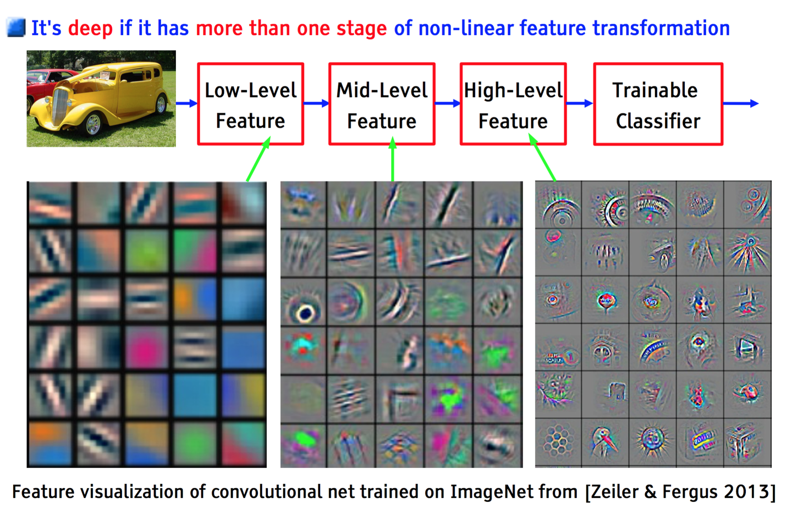
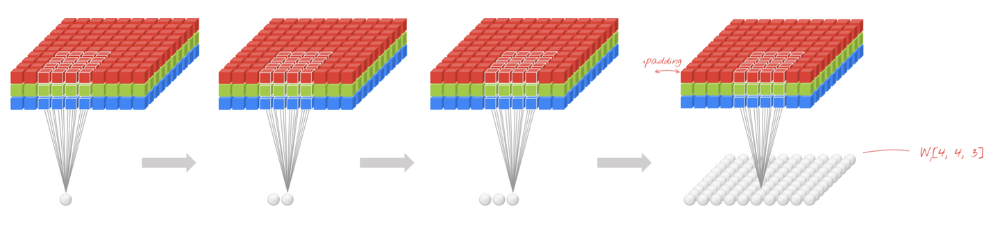
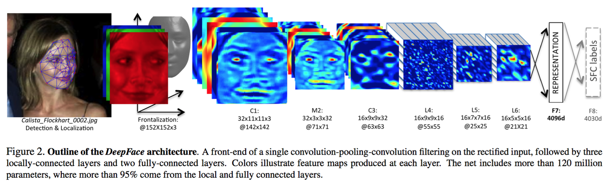
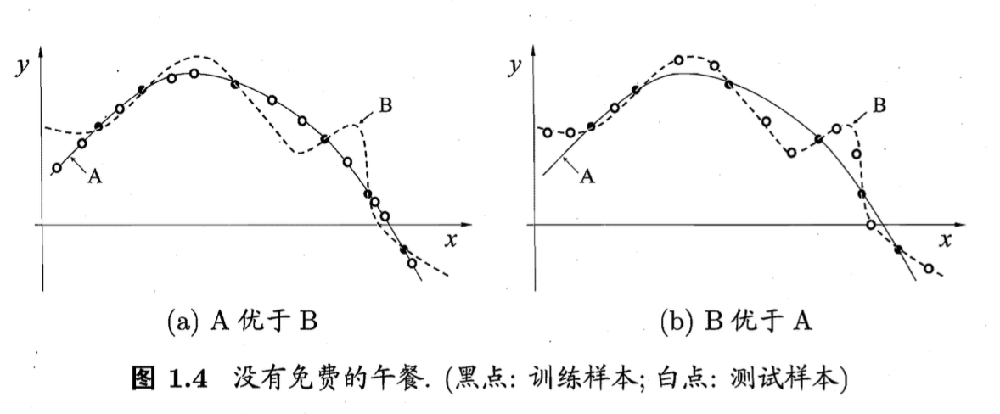
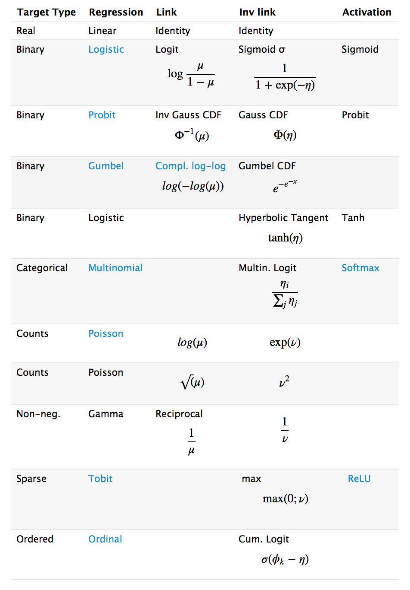
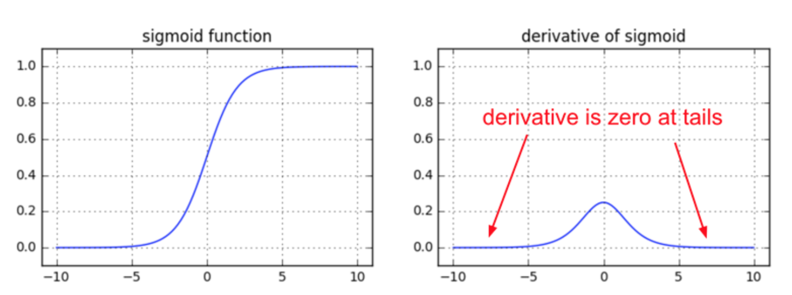

更新几个面试被问到或者联想出来的问题，后面有时间回答

- SGD 中 S(stochastic)代表什么**

- 个人理解差不多就是Full-Batch和Mini-Batch

- 监督学习／迁移学习／半监督学习／弱监督学习／非监督学习？
- Softmax Loss推一下
－－－－－－－－－－－－－－－－－－－－－－－－－－－－－－－－－－－－－－－－－

本笔记主要问题来自以下两个问题，后续会加上我自己面试过程中遇到的问题。

[深度学习相关的职位面试时一般会问什么？会问一些传统的机器学习算法吗？](https://www.zhihu.com/question/54308150)** 

**[如果你是面试官，你怎么去判断一个面试者的深度学习水平？](https://www.zhihu.com/question/41233373)**

**

以下问题来自@Naiyan Wang

- CNN最成功的应用是在CV，那为什么NLP和Speech的很多问题也可以用CNN解出来？为什么AlphaGo里也用了CNN？这几个不相关的问题的相似性在哪里？CNN通过什么手段抓住了这个共性？**

- **Deep Learning -Yann LeCun, Yoshua Bengio & Geoffrey Hinton**
- **[Learn TensorFlow and deep learning, without a Ph.D.](https://link.zhihu.com/?target=https%3A//docs.google.com/presentation/d/1TVixw6ItiZ8igjp6U17tcgoFrLSaHWQmMOwjlgQY9co/pub%3Fslide%3Did.p)** 
- **The Unreasonable Effectiveness of Deep Learning -LeCun 16 NIPS Keynote** 
- 以上几个不相关问题的相关性在于，都存在**局部与整体的关系**，由低层次的特征经过组合，组成高层次的特征，并且得到不同特征之间的空间相关性。如下图：低层次的直线／曲线等特征，组合成为不同的形状，最后得到汽车的表示。

**

- CNN抓住此共性的手段主要有四个：局部连接／权值共享／池化操作／多层次结构。**
- 局部连接使网络可以提取数据的局部特征；权值共享大大降低了网络的训练难度，一个Filter只提取一个特征，在整个图片（或者语音／文本） 中进行卷积；池化操作与多层次结构一起，实现了数据的降维，将低层次的局部特征组合成为较高层次的特征，从而对整个图片进行表示。如下图：

**

- 上图中，如果每一个点的处理使用相同的Filter，则为全卷积，如果使用不同的Filter，则为Local-Conv。**

- **为什么很多做人脸的Paper会最后加入一个Local Connected Conv？**

- **DeepFace: Closing the Gap to Human-Level Performance in Face Verification** 
- 以FaceBook DeepFace 为例：

**

- DeepFace 先进行了两次全卷积＋一次池化，提取了低层次的边缘／纹理等特征。
- 后接了3个Local-Conv层，这里是用Local-Conv的原因是，人脸在不同的区域存在不同的特征（眼睛／鼻子／嘴的分布位置相对固定），当不存在全局的局部特征分布时，Local-Conv更适合特征的提取。**

**

以下问题来自@抽象猴

 

- 什麽样的资料集不适合用深度学习?**

- **数据集太小**，数据样本不足时，深度学习相对其它机器学习算法，没有明显优势。
- **数据集没有局部相关特性，**目前深度学习表现比较好的领域主要是图像／语音／自然语言处理等领域，这些领域的一个共性是局部相关性。图像中像素组成物体，语音信号中音位组合成单词，文本数据中单词组合成句子，这些特征元素的组合一旦被打乱，表示的含义同时也被改变。对于没有这样的局部相关性的数据集，不适于使用深度学习算法进行处理。举个例子：预测一个人的健康状况，相关的参数会有年龄、职业、收入、家庭状况等各种元素，将这些元素打乱，并不会影响相关的结果。

**

- 对所有优化问题来说, 有没有可能找到比現在已知算法更好的算法?**

- **机器学习－周志华**
- **没有免费的午餐定理：**

****

**

**

**

- 对于训练样本（黑点），不同的算法A/B在不同的测试样本（白点）中有不同的表现，这表示：对于一个学习算法A，若它在某些问题上比学习算法 B更好，则必然存在一些问题，在那里B比A好。

- 也就是说：对于所有问题，无论学习算法A多聪明，学习算法 B多笨拙，它们的期望性能相同。
- 但是：没有免费午餐定力假设所有问题出现几率相同，实际应用中，不同的场景，会有不同的问题分布，所以，在优化算法时，针对具体问题进行分析，是算法优化的核心所在。**

**

- 用贝叶斯机率说明Dropout的原理**

- **Dropout as a Bayesian Approximation: Insights and Applications**

- **何为共线性, 跟过拟合有啥关联?**

- **Multicollinearity－Wikipedia** 
- 共线性：多变量线性回归中，变量之间由于存在高度相关关系而使回归估计不准确。
- 共线性会造成冗余，导致过拟合。
- 解决方法：排除变量的相关性／加入权重正则。

**

- 广义线性模型是怎被应用在深度学习中?**

- **A Statistical View of Deep Learning (I): Recursive GLMs** 
- 深度学习从统计学角度，可以看做**递归的广义线性模型**。
- 广义线性模型相对于经典的线性模型(y=wx+b)，核心在于引入了连接函数g(.)，形式变为：y=g−1(wx+b)。
- 深度学习时递归的广义线性模型，神经元的激活函数，即为广义线性模型的链接函数。逻辑回归（广义线性模型的一种）的Logistic函数即为神经元激活函数中的Sigmoid函数，很多类似的方法在统计学和神经网络中的名称不一样，容易引起初学者（这里主要指我）的困惑。下图是一个对照表：

**

- 什麽造成梯度消失问题? 推导一下**

- **Yes you should understand backdrop－Andrej Karpathy** 
- **How does the ReLu solve the vanishing gradient problem?** 
- 神经网络的训练中，通过改变神经元的权重，使网络的输出值尽可能逼近标签以降低误差值，训练普遍使用BP算法，核心思想是，计算出输出与标签间的损失函数值，然后计算其相对于每个神经元的梯度，进行权值的迭代。
- 梯度消失会造成权值更新缓慢，模型训练难度增加。造成梯度消失的一个原因是，许多激活函数将输出值挤压在很小的区间内，在激活函数两端较大范围的定义域内梯度为0。造成学习停止

**

以下问题来自匿名用户

- Weights Initialization. 不同的方式，造成的后果。为什么会造成这样的结果。**

- **几种主要的权值初始化方法：                                                                               lecun_uniform /  glorot_normal / he_normal / batch_normal** 
- **lecun_uniform:Efficient BackProp**
- **glorot_normal:Understanding the difficulty of training deep feedforward neural networks ** 
- **he_normal:[Delving Deep into Rectifiers: Surpassing Human-Level Performance on ImageNet Classification](https://link.zhihu.com/?target=https%3A//arxiv.org/pdf/1502.01852.pdf)** 
- **batch_normal:[Batch Normalization: Accelerating Deep Network Training by Reducing Internal Covariate Shift](https://link.zhihu.com/?target=https%3A//arxiv.org/pdf/1502.03167.pdf)**

**

- 为什么网络够深(Neurons 足够多)的时候，总是可以避开较差Local Optima？**

- **[The Loss Surfaces of Multilayer Networks](https://zhuanlan.zhihu.com/)** 

- **Loss. 有哪些定义方式（基于什么？）， 有哪些优化方式，怎么优化，各自的好处，以及解释。**

- **Cross-Entropy / MSE / K-L散度**

**

- Dropout。 怎么做，有什么用处，解释。**

- **How does the dropout method work in deep learning?** 
- **[Improving neural networks by preventing co-adaptation of feature detectors](https://link.zhihu.com/?target=https%3A//arxiv.org/pdf/1207.0580.pdf)** 
- **[An empirical analysis of dropout in piecewise linear networks](https://link.zhihu.com/?target=https%3A//arxiv.org/pdf/1312.6197.pdf)** 

**

- Activation Function. 选用什么，有什么好处，为什么会有这样的好处。**

- **几种主要的激活函数：Sigmond / ReLU ／PReLU**
- **Deep Sparse Rectifier Neural Networks** 
- **[Delving Deep into Rectifiers: Surpassing Human-Level Performance on ImageNet Classification](https://link.zhihu.com/?target=https%3A//arxiv.org/pdf/1502.01852.pdf)**
