**本文结构：**

- **一、论文简介**
- **二、名词解释**
- **三、模型简介**
- **四、训练之前：匹配策略**
- **五、训练之时：训练目标（本文重点部分）**

- **定义训练目标**
- **量化训练目标**
- **量化训练目标之：认得清**
- **量化训练目标之：框得准**

- **六、训练之后：输出策略**

### **PS：本文涉及论文的核心公式，稳住莫慌抱紧小编，其实很容易懂的（真诚的眼神）**

### **一、论文简介**

论文地址：[SSD: Single Shot MultiBox Detector](https://link.zhihu.com/?target=https%3A//arxiv.org/abs/1512.02325)

论文贡献：在物体检测领域，此论文在前人的基础上，减少计算量的同时，提升了算法的准确度，达到实时检测物体的程度，堪称物体检测领域的小米手机，物美（准度高）价廉（运算量小）。（这么卖力宣传，雷军同学还不赶紧送几斤小米9犒劳犒劳我？）

**

### 二、名词解释：**

傻傻弟：本文主角SSD，单发多框物体检测模型

$IOU：又称Jaccard Index， J(A,B)=|A&#x2229;B||A&#x222A;B|=|A&#x2229;B||A|+|B|&#x2212;|A&#x2229;B|." role="presentation">J(A,B)=|A∩B||A∪B|=|A∩B||A|+|B|−|A∩B|.{\displaystyle J(A,B)={{|A\cap B|} \over {|A\cup B|}}={{|A\cap B|} \over {|A|+|B|-|A\cap B|}}.} $

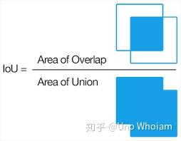

IOU**Jaccard index - Wikipedia锚框：人为设计的一系列固定大小和宽高比例的图框。

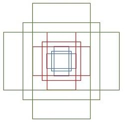

锚框

### 三、SSD模型结构简介**

总的来说，物体检测任务和对图片分类任务其实差不多，只不过多了一个“截图”的过程，即在整张图片用滑窗扫描生成一系列“截图”，让后对截出来的部分做一下分类，看看是背景还是目标物体，有就标出来。

SSD的设计思路也不例外，其高明之处做了两处改进：

- 利用一系列固定大小的锚框（还是不懂锚框是啥？看下去就明白了）进行“截图”，减少“截图”的数量，降低运算量。
- 对图片（实际上是feature map，特征图）进行多次缩放构成多级图（类似图像金字塔），对每级图都进行检测。这么做的原因是缩放得到的小尺寸的图用固定大小的锚框容易识别出大物体，而没缩放的大尺寸图可以用固定大小的锚框识别出小物体，这样就可以提高识别的准度。
大致结构如下图所示，图片特征用训练好的VGG16进行提取。

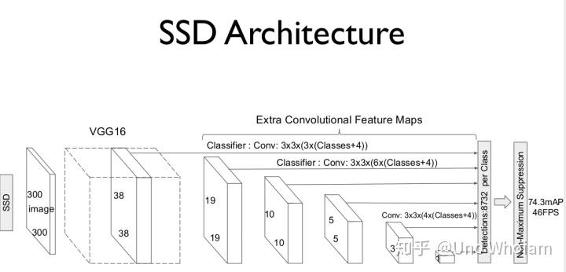

论文原图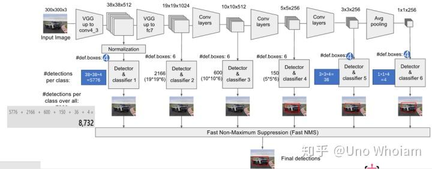

来源：https://zhuanlan.zhihu.com/p/24954433大致的结构设计说完了，该讲讲怎么训练这个模型了。如果把这个SSD模型当作一个啥也不懂的小朋友——嗯，干脆叫他**傻傻弟**好了，要让傻傻弟能够准确地找出图片中的不同物体，我们该怎么训练他呢？首先，你得让他看很多图片，让他随便框，随便说框出来的是个啥，然后你去告诉他标准答案（真框以及其类别），纠正他，如此往复。那么第一个问题就出现，傻傻弟框了那么多框，怎么让这些框框与标准答案匹配呢？

**

### 四、训练之前：匹配策略**

论文作者首先想到的是只把每个真框与IOU值最大的那个框进行匹配，后来他选择了另一种方法：对于每个真框，只要某预测框和它IOU值大于设定值（0.5），那就让它们匹配。也就是说，会出现一个真框与多个预测框匹配的情况。前后两匹配策略的区别就像你让傻傻弟乱涂乱画30分钟，然后只纠正他一个错误，or 纠正100个错误一样。匹配数就好比纠正数，每次训练的纠正次数多，傻傻弟的进步就更快，模型的训练也是如此。

**

### 五、训练之时：训练目标**

**5.1、定义训练目标**

新的问题又来了，要有效地训练傻傻弟，得给它定个目标吧，这个目标应该是怎样的呢？

目标应该包括两个部分

- 框得准：预测框要和真框位置相同
- 认得清：对于框出来的物体进行正确分类
那么，该如何量化这个目标呢？

**

5.2量化训练目标**

要想达到吸收本论文精髓的目的，无法避免地要出现公式，莫慌，我一点一点讲，保证看得懂。

匹配策略刚刚已经说明，现在，用一个简单的公式对其做一个描述：

x_{ij}^p=\{0,1\}  

i 代表傻傻弟画的第 i 个框框， j 代表图片中第 j 个真框， p 代表该真框中的物体类别。该值为1的时候，表示傻傻弟的第 i 个框与第 j 个真框匹配，即两框的 设定值">  IOU>设定值 ，其包含物体真实类别为p。

**

训练目标的公式可以描述如下：

$$L(x,c,l,g)=\frac{1}{N}(L_{conf}(x,c)+\alpha L_{loc}(x,l,g)) $$

首先 L(x,c,l,g) 可以理解成傻傻弟的出错程度，越大表示傻傻弟错得越离谱，所以我们的训练目标是将尽可能地让其变小。

$$N 是匹配数量，即 x_{ij}^p 中为1的个数， \frac{1}{N} 显然就是对所有匹配的出错程度取个平均， 当然 N=0 时直接让 L(x,c,l,g)=0 就完事了。$$

BTW，这个超参数 \alpha 原论文作者定为 1 ，感兴趣的朋友可以验证一下。

5.3量化训练目标之：认得清**

L_{conf}  是对**认得清**的量化，conf代表 confidence，即置信率，数值范围为 [0,1] ，也就是傻傻弟框出框框后，对其判断所属物体类别的信心。该过程就是对一个框框里的东西你问傻傻弟是不是狗狗？傻傻弟说我觉得不太像啊，但又好像有点相似，应该有0.4的可能性是狗吧？而你问他是不是猫，傻傻弟就很激动，拍着行胸脯说我认为有0.99的可能性是猫！对于每个物体类别都这样问一遍，把这些可能性数值放在一起构成一个数组，就得到了傻傻弟对于一个预测框中物体判断的置信度向量c。在最好的情况下，c中与正确类别对应的置信度为1，其他数都为0，这个情况下， L_{conf}= 0 ，更具体地：

$$L_{conf}(x,c)=-\sum_{x\in{Pos}}^{N}x_{ij}^{p}log(f(c_{i}^{p}))-\sum_{x\in{Neg}}^{N}x_{ij}^{p}log(f(c_{i}^{0})) \\ where:\  f(c_{i}^{p})=\frac{exp(c_{i}^{p})}{\Sigma_{p} exp(c_{i}^{p})} $$

看着是不是有些蓝瘦？没事，我们简化一下：

$$L_{conf}(x,c)=\sum_{x\in{Pos}}^{N}x_{ij}^{p}softmax(c_{i}^{p})+\sum_{x\in{Neg}}^{N}x_{ij}^{p}softmax(c_{i}^{0}) $$

这个“软大”softmax是个啥玩意？想详细了解的Googel一下。简单来说如果傻傻弟猜得越准（向量 c_{}^{} 越接近于最好情况）它就越小，而上面这个式子前后两项代表了两种情况：

- 前者 x\in{Pos} 为上文中提到的预测框匹配到真框的情况
- 后者 x\in{Neg} 为傻傻弟剩下没匹配到真框的预测框，明明图片这个地方啥东西也没有，就是个背景，你给我框出来还有声有色地描述里面有只多漂亮的妹子，那我还不揍你这个傻傻弟？
- c^{0} 表示背景类
**

关于认得清的量化方法已经描述完了，接下来看看框得准。

5.4量化训练目标之：框得准**

L_{loc} 是对**框得准**的量化，loc代表location， L_{loc}(x,l,g) 里的 g 代表真框的位置，它们都有4个参数： cx,cy,w,h 分别表示框的中心横纵坐标 (cx,cy) ，框的宽、高； l  又是个什么玩意呢？它与预测框的位置有关，待会再说。

对于 L_{loc} 具体地：

$$L_{loc}(x,l,g)=\sum_{i\in{Pos}}^{N}\sum_{m\in\{cx,cy,w,h\}}x_{ij}^{k}smooth_{L1}(l_{i}^{m}-G(g_{j}^{m})) $$

where:\\ G(g_{j}^{cx})=(g_{j}^{cx}-d_{i}^{cx})/d_{i}^{w}\\ G(g_{j}^{cy})=(g_{j}^{cy}-d_{i}^{cy})/d_{i}^{h}\\ G(g_{j}^{w})=log(\frac{g_{j}^{w}}{d_{j}^{w}})\\G(g_{j}^{h})=log(\frac{g_{j}^{h}}{d_{j}^{h}}) 

看着是不是有点头疼？不捉鸡，一点点来看：

$1、\sum_{i\in{Pos}}^{N} 这个玩意的意思就是，只考虑预测框和真框匹配上的情况。$

$2、\sum_{m\in\{cx,cy,w,h\}} 表示m只有四个取值， 即框的中心横纵坐标 (cx,cy) 以及框宽和高。$

3、x_{ij}^{k} 上文提到过，不赘述。

4、smooth_{L1} 是个啥？很简单， y=|x| 知道吧？ x=0 处是不是很尖，很容易伤到手（不可导）？来，我们让它smooth一下~

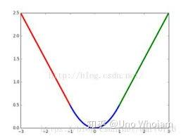

$也就是说， x\in(-0.5,0.5),y=0.5x^{2}\ otherwise \ y=|x|-0.5 $

在上一张带上L1、L2全家福：

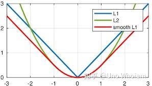

5、这个一大堆 G(g) 看着真让人GG。还是老话，莫方，其实很简单的。

首先 d 是什么？和 g 一样，d 也是一个描述位置大小的4元组，表示的是锚框（也叫先验框）的位置大小。

那锚框又是个啥？锚框就是认为设计的一系列有固定宽高比的方框：

**

锚框为什么需要锚框呢？或者说锚框解决了什么问题？这其实和买衣服鞋帽一样，每个人的身材都各有差别，如果商家要根据每个人的身材来设计制造衣服，那尺码的种类就会多得吓人，商家也无力应对。合理的方式就如同我们生活中见到的一样，每款衣服设计不多的一系列尺寸大小，客户选个差不多合身的就行啦。

锚框的意义也是如此，在保证框出物体位置的同时，减少框框“型号”的数量，降低计算成本。

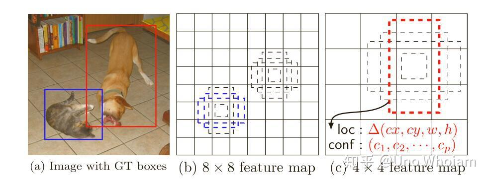

锚框是怎么工作的呢？如上图，锚框会对每个位置点用设计好的一系列大小来框出物体，检查里面是否有目标物体存在。比如上图b，有8x8个位置点，4种锚框，这样只需框出 8*8*4=256  个框一一检查有没有需要预测的物体，如果物体太大，也很简单，把原图（其实是feature map，不影响理解）缩小，如果框不变话，就相当于框变大了，也就可以顺利框出大物体了。

但新的问题又来了，锚框的确可以框出个大概，没法框得足够准啊**。没关系，我们可以对位置进行修正鸭！这就是上文中 l 的意义了：

$$g_{}^{cx}=d^{cx}+l^{cx}  d^{w}\\ g_{}^{cy}=d^{cy}+l^{cy}d^{h}\\ g_{}^{w}=d^{w}\cdot exp(l^{w})\\ g_{}^{h}=d^{h} \cdot exp(l^{h})\\ $$

通过 l 的修正，可以得到框处物体准确的位置了！另外，上面看着是不是很眼熟？没错倒腾一下就得到上文中的这些公示啦：

where:\\ G(g_{j}^{cx})=(g_{j}^{cx}-d_{i}^{cx})/d_{i}^{w}\\ G(g_{j}^{cy})=(g_{j}^{cy}-d_{i}^{cy})/d_{i}^{h}\\ G(g_{j}^{w})=log(\frac{g_{j}^{w}}{d_{j}^{w}})\\G(g_{j}^{h})=log(\frac{g_{j}^{h}}{d_{j}^{h}}) 

G(g) 的作用，就是把 g 转化为与 l 一致，即求出真框与锚框 d_i （预测框 i 对应的锚框）的相对修正量。

**

回到锚框上，这个锚框有是怎么设计出来的呢？

首先，是锚框大小的问题。文章开头提到，傻傻弟会把图像多次缩放，每层图都会进行检测，那么每层的锚框对应在原始图像的大小肯定是不同的，缩放等级越高的层上锚框的边长肯定更大一些。论文给出的每层默认框大小计算公式为： s_{k}=s_{min} +\frac{s_{max}-s_{min}  }{m-1}(k-1),k\in [1,m]  ，其中k代表缩放第几层，m为特征图数目， s_{min} 为最底层特征图大小（原论文中值为0.2）， s_{min} 为最顶层特征图默认框大小（原论文中为0.9）。

$$有了基本大小，还需要高宽比才能得出锚框具体的规格，论文中给出了一系列比例值：a_r\in \left\{ 1,2,3,, \right\} ，而与此对应的锚框的宽为w_{k}^{a} =s_{k}\sqrt{a_{r} }  ，高为h_{k}^{a} =s_{k}/\sqrt{a_{r} }  。对于比例为1的默认框，则额外添加一个比例为s_{k}^{'} =\sqrt{s_{k}s_{k+1}} 的默认框。最终，每张特征图中的每个点生成6个锚框。每个默认框中心设定为(\frac{i+0.5}{|f_{k} |},\frac{j+0.5}{|f_{k} |} ),其中，\left| f_{k} \right| 为第k个特征图尺寸。$$

### 六、训练之后：输出策略**

最后模型训练好了，傻傻弟终于也成为了聪明蛋，还是存在一个问题，如果你让聪明蛋找出人脸，他给你个这个，你会夸他呢，还是揍他一顿？

> 参考链接：https://blog.csdn.net/shuzfan/article/details/52711706

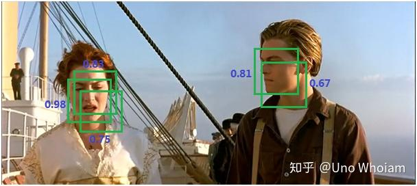

框得都对，但...其实框得很完美了，只是有冗余，那该如何只保留最好的那个框，而将其他的框都去除呢？这就需要NMS非极大抑制了。

非极大抑制，顾名思义，只留最好的那个，剩下的与最好的那个黏在一起的，全都不要。

step 1：将所有框的得分排序，选中最高分及其对应的框：

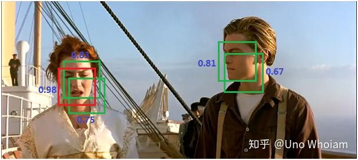

step 2：遍历其余的框，如果和当前最高分框的重叠面积(IOU)大于一定阈值，我们就将框删除。

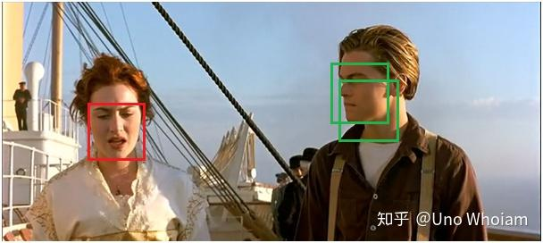

step 3：从未处理的框中继续选一个得分最高的，重复上述过程。

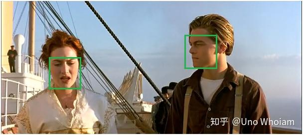

完美啦！傻傻弟正式成为了聪明弟。看完文章的你，是不是比昨天又更聪明了呢？

PS：

广告时间啦~

理工狗不想被人文素养拖后腿？不妨关注微信公众号：

