大家好，这是专栏《AI不惑境》的第十篇文章，讲述模型量化相关的内容。

进入到不惑境界，就是向高手迈进的开始了，在这个境界需要自己独立思考。如果说学习是一个从模仿，到追随，到创造的过程，那么到这个阶段，应该跃过了模仿和追随的阶段，进入了创造的阶段。从这个境界开始，讲述的问题可能不再有答案，更多的是激发大家一起来思考。

作者&编辑 | 言有三

模型量化是非常实用的模型压缩技术，当前已经在工业界发展比较成熟，本文给大家梳理模型量化的核心技术，发展现状，未来展望以及学习资源推荐。

### **1 模型量化基础**

**1.1 什么是模型量化**

我们知道为了保证较高的精度，大部分的科学运算都是采用浮点型进行计算，常见的是32位浮点型和64位浮点型，即float32和double64。

对于深度学习模型来说，乘加计算量是非常大的，往往需要GPU等专用的计算平台才能实现实时运算，这对于端上产品来说是不可接受的，而模型量化是一个有效降低计算量的方法。

量化，即将网络的权值，激活值等从高精度转化成低精度的操作过程，例如将32位浮点数转化成8位整型数int8，同时我们期望转换后的模型准确率与转化前相近。

**1.2 模型量化的优势**

模型量化可以带来几方面的优势，如下。

(1) 更小的模型尺寸。以8bit量化为例，与32bit浮点数相比，我们可以将模型的体积降低为原来的四分之一，这对于模型的存储和更新来说都更有优势。

(2) 更低的功耗。移动8bit数据与移动32bit浮点型数据相比，前者比后者高4倍的效率，而在一定程度上内存的使用量与功耗是成正比的。

(3) 更快的计算速度。相对于浮点数，大多数处理器都支持8bit数据的更快处理，如果是二值量化，则更有优势。

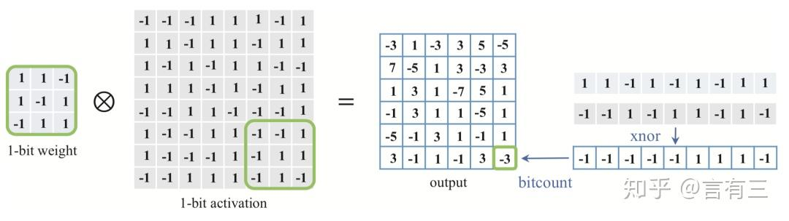

上图展示的是一个二值权重和激活值矩阵的运算，卷积过程中的乘加都可以转换为异或操作，并行程度更高，运算速度因此也更快。

因此，在工业界对模型量化有着非常强烈的需求，接下来我们讲解其中的主要算法。

### **2 模型量化算法**

量化的技术根据不同的量化原理和位宽可以分为许多种。根据量化原理来说，可以分为直接经验量化算法，基于重建的方法，基于梯度和损失优化的算法等。根据位宽常见的有1bit量化，8bit量化，以及任意bit数量化。

由于我们在实际应用的时候更关注量化本身带来的对模型体积的减小和加速效果，因此我们根据位宽的不同来分别介绍常见的代表性模型量化技术。

**2.1 二值量化(1bit量化)**

二值量化是最高效率的量化方式，也可以称之为1bit量化，即将32位浮点数量化为1bit整型，非常适合FPGA等平台进行并行运算。二值量化模型以Binary Connect和Binarized Neural Networks为代表。

BinaryConnect[1]是首先做二值化研究的论文，它们对权重进行了二值化。将权重和每层的激活值全部二值化的方法有两种方法。第一种就是符号函数，即x>0，则f(x)=1，x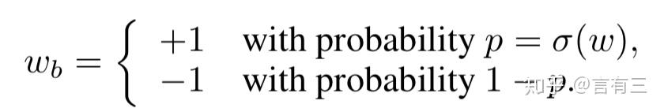

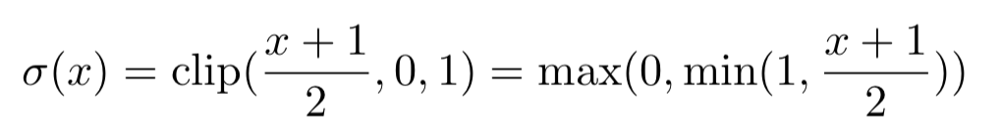

需要注意的是，为了保持精度，权重在前向传播和反向传播计算的时候进行二值化，但是在进行参数更新的时候使用浮点类型。随机的二值化策略能够起到提高模型泛化能力的作用，这与Dropout，Dropconnect等技术是类似的。

在BinaryConnect的基础上，Binarized Neural Networks[2]随后被提出，它对权重和激活值都进行了二值化，并且同时采用了符号函数和随机量化两种策略。对于激活函数，采用了随机量化方法，而其余的都采用符号函数。

针对符号函数的导数并不连续，无法进行梯度传播的问题，该网络方法将符号函数进行松弛，在-1到1之间采用了线性函数：f(x)=max(-1,min(1,x))。

下图展示的就是一个二值化的权重。

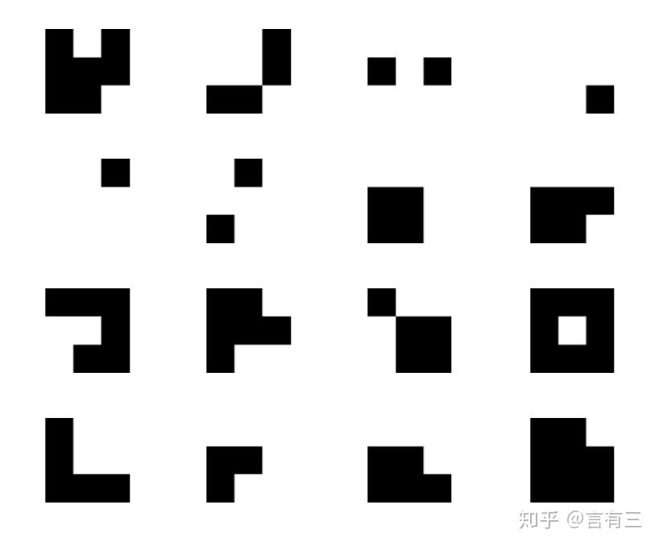

当然了，二值量化还有非常多的技术，包括XNorNet[3]等基于重建的模型，优化目标敏感的二值化模型，基于阈值的二值化改进，激活值正则化等，篇幅有限不再详述，读者可以阅读综述文章[4]进行学习。

**2.2 8bit量化**

8bit量化是当前工业界最常见的量化方法，也是当前精度保持最高的量化类型。Tensorflow，TensorRT等框架都提供了支持，并且各自代表着非对称量化和对称量化的方案，以Nvidia的8bit对称量化方案为例：

TensorRT[5]通过最小化原始数据分布和量化后数据分布之间的KL散度来对激活值进行量化，将FP32降为INT8的操作如下：

FP32(T) = scale_factor(s) * 8-bit(t) +FP32_bias(b)

实验证明偏置实际上是不需要的，去掉偏置后就是T=s∗t。其中s就是比例因子（scaling factor），因此现在的问题就是如何确定比例因子，一个简单的示意图如下：

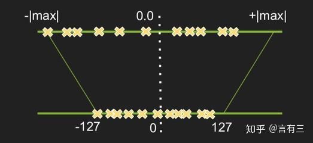

上图直接将一个tensor中的-|max|和|max|的FP32值线性映射为-127和127，这样的映射是对称的，并且是不饱和的，实验结果显示这样做会导致比较大的精度损失。主要的原因是max值可能会存在一些离散点噪声，如果直接进行线性缩放，可能就放大了这些噪声，TensorRT的改进做法是从127和|max|之间选择好一个阈值T，把大于这个阈值T的部分截断，示意图如下：

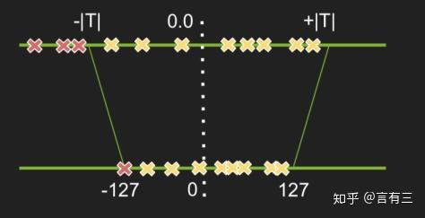

只要阈值选取得当，就能将不稳定的大激活值舍弃掉，并且使精度损失不至于降低太多。原始的数据是一个FP32的分布，现在我们要用INT8的分布来表达这个tensor，根据阈值|T|的取值不同有多种选择，只需要选择其中最接近FP32的即可，所以现在的问题是确定|T|。

我们需要一个衡量指标来衡量不同的INT8分布与原来的FP32分布之间的差异程度，这就是相对熵，或者称为KL散度，它是衡量两个分布相似度的经典算法，定义如下：

KL_divergence(P,Q):= SUM(P[i]*log(P[i]/Q[i]),i)

P，Q分别称为参考分布(reference_distribution)、量化分布(quantize_distribution)。在应用的时候，每一层的|T|值都不同，确定每一层的|T|值的过程被称为校准(Calibration)。

所以完整的流程如下：

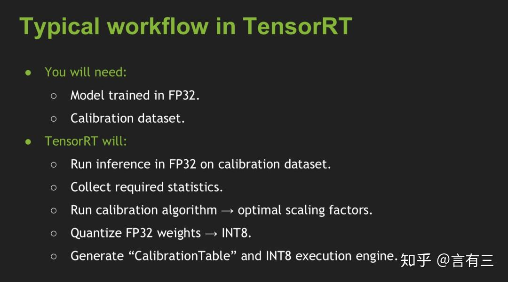

(1) 首先将FP32的模型在一个数据集(Calibration Dataset)上跑一遍记录下每一层的FP32激活值，这里没必要去跑整个训练集，比较现实的做法是从验证集中选取一个子集，当然它最好有代表性，多样性好。之后对网络的每一层收集激活值，得到直方图，bins的大小官方建议为2048，所以阈值就在128和2047之间。

(2) 对于128和2047之间的不同阈值|T|进行遍历，选取使得KL散度取得最小值的|T|。对每一层计算出|T|，得到一个所谓的CalibrationTable。把0-T组的数值线性映射到0-128之间，超出T的直接映射到128。

具体的代码实现可以看源代码，下表展示的是一些实验结果，证明分类任务上精度损失并不大。

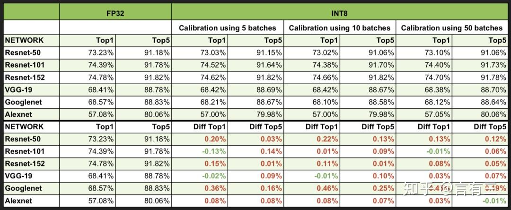

当前8bit的量化还有以Google提出的非对称量化方法[6]，篇幅有限不再赘述。

**2.3 任意bit量化**

除了2bit和8bit两类最常见的量化方法，3bit，4bit，6bit等也经常被研究，以韩松等人提出的Deep Compression[7]为例，Deep Compression综合应用了剪枝、量化、编码三个步骤来进行模型压缩，是2016 ICLR最佳论文。

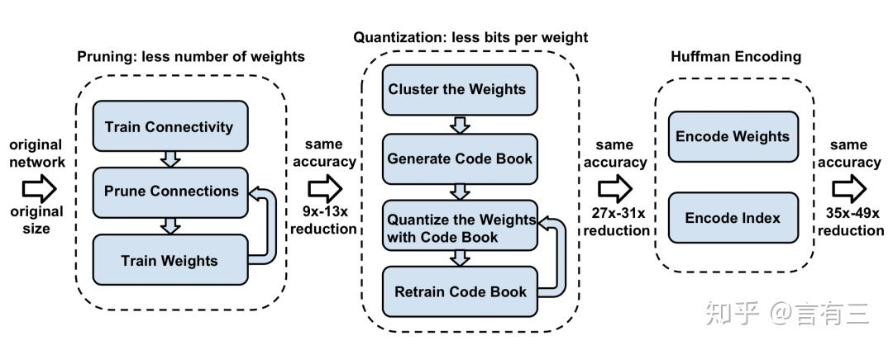

整个框架如上所示，包括三个步骤：

(1) 网络剪枝

即移除不重要的连接，包括3个步骤，分别是普通网络训练，删除权重小于一定阈值的连接得到稀疏网络，对稀疏网络再训练，这是一个反复迭代的过程。

(2) 权重量化

如下图，这是一个4×4的权值矩阵，量化权重为4阶，即2bit，分别对应浮点数-1.0，0，1.5，2.0。

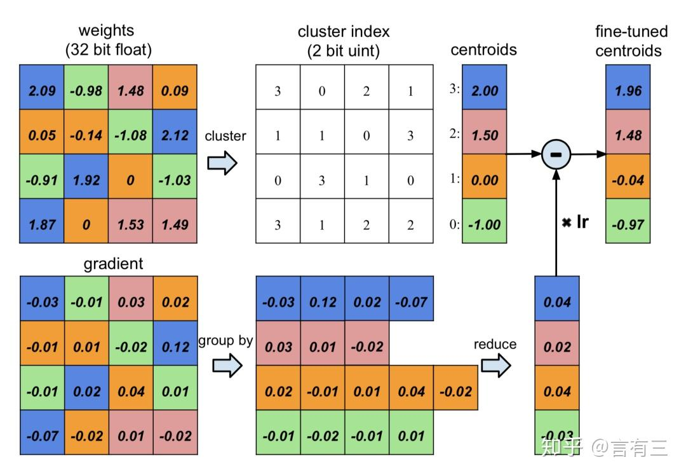

对weights矩阵采用cluster index进行存储后，原来需要16个32bit float，现在只需要4个32bit float，与16个2bit uint，参数量为原来的(16×2+4×32)/(16×32)=0.31。

这就完成了存储，那如何对量化值进行更新呢？事实上，文中仅对码字进行更新，也就是量化后的2bit的权重。

将索引相同的地方梯度求和乘以学习率，叠加到码字，这就是不断求取weights矩阵的聚类中心。原来有成千上万个不同浮点数的weights矩阵，经过一个有效的聚类后，每一个值都用其聚类中心进行替代，作者的研究表明这样并不会降低网络的效果。而聚类的迭代过程，通过BP的反向传播完成。

(3) 霍夫曼编码

霍夫曼编码是一种成熟的编码技巧，与CNN无关，它有效地利用了权重的有偏分布，可以进一步减少需要存储的参数体积。

### **3 模型量化算法的展望**

在第二部分，我们简单对2bit，8bit，任意bit量化方法介绍了代表性的框架，但是其实量化本身还有非常多的研究方向，下面列举其中比较具有代表性的。

**3.1 混合精度量化**

所谓混合精度量化，它可以指不同的网络层有不同的量化位阶，或者权重，激活以及输出采用不同的量化方案，当下可以利用AutoML技术来实现，以HAQ[78]框架为例。

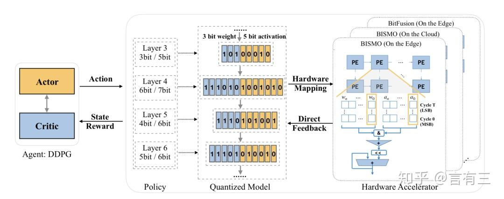

**3.2 量化训练框架**

目前前向传播中权重和激活的量化比较成熟，但是训练中大部分的计算在反向传播步骤，如果能够将量化技术应用在反向传播中，则可以加速卷积的反向梯度传播过程，不过这需要对梯度也进行量化操作，而梯度的分布比较复杂，容易带来误差造成训练过程的不稳定。如何让量化模型的训练更加稳定，这是非常值得研究的方向[9]。

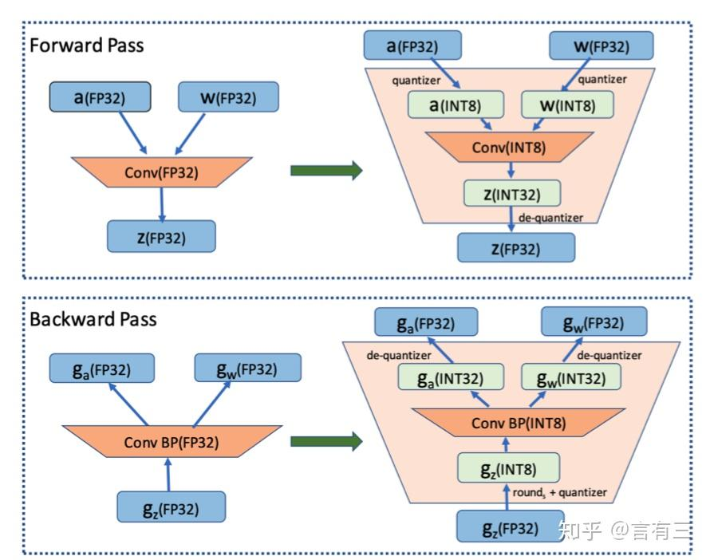

**3.3 非均匀量化方案**

通常来说量化函数是一个分段的常数函数，不同的量化等级之间的距离是相等的，即均匀量化，然而数据的分布往往不是均匀的，所以均匀量化不是最合理的方案，因此有一些研究针对量化函数本身进行学习[10]。

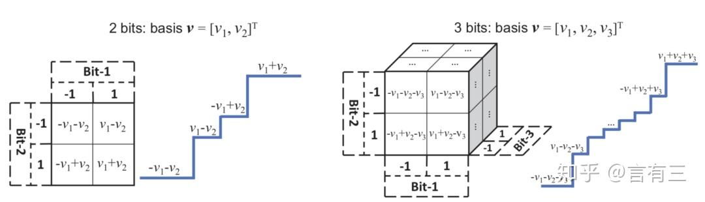

除此之外，还有基于重建与损失敏感的量化方法，量化正则化方法，量化网络结构的设计，量化的具体硬件实现等内容。

我们不再一一介绍，对模型量化感兴趣的同学，欢迎到**有三AI知识星球的网络结构1000变-模型压缩-模型量化板块**进行学习，数十期内容定能满足你的求知欲。

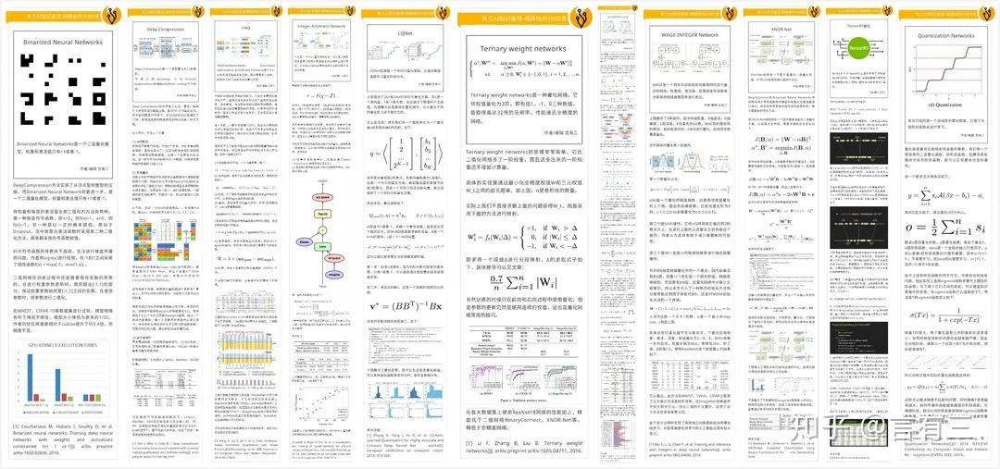

扫码即可加入，了解有三AI知识星球详情请阅读以下文章。

参考文献

[1] Courbariaux M, Bengio Y, David J, et al. BinaryConnect: training deep neural networks with binary weights during propagations[C]. neural information processing systems, 2015: 3123-3131.

[2] Courbariaux M, Hubara I, Soudry D, et al. Binarized neural networks: Training deep neural networks with weights and activations constrained to+ 1 or-1[J]. arXiv preprint arXiv:1602.02830, 2016.

[3] Rastegari M , Ordonez V , Redmon J , et al. XNOR-Net: ImageNet Classification Using Binary Convolutional Neural Networks[J]. 2016.

[4] Qin H, Gong R, Liu X, et al. Binary neural networks: A survey[J]. Pattern Recognition, 2020.

[5] 8-bit-inference-with-tensorrt

[6] Jacob B, Kligys S, Chen B, et al. Quantization and training of neural networks for efficient integer-arithmetic-only inference[C]//Proceedings of the IEEE Conference on Computer Vision and Pattern Recognition. 2018: 2704-2713.

[7] Han S, Mao H, Dally W J. Deep compression: Compressing deep neural networks with pruning, trained quantization and huffman coding[J]. arXiv preprint arXiv:1510.00149, 2015.

[8] Wang K, Liu Z, Lin Y, et al. HAQ: Hardware-Aware Automated Quantization with Mixed Precision[C]//Proceedings of the IEEE Conference on Computer Vision and Pattern Recognition. 2019: 8612-8620.

[9] Zhu F, Gong R, Yu F, et al. Towards Unified INT8 Training for Convolutional Neural Network.[J]. arXiv: Learning, 2019.

[10] Zhang D, Yang J, Ye D, et al. LQ-Nets: Learned Quantization for Highly Accurate and Compact Deep Neural Networks[C]. european conference on computer vision, 2018: 373-390.

**总结**如果想要系统性地学习模型优化相关的理论和实践，欢迎关注视频专栏课程：

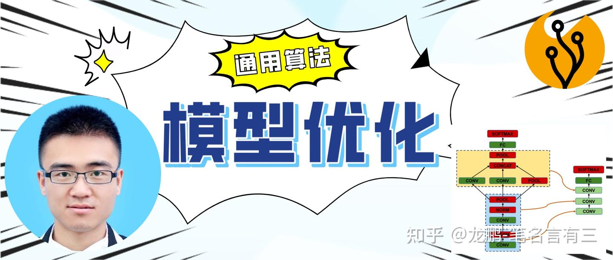

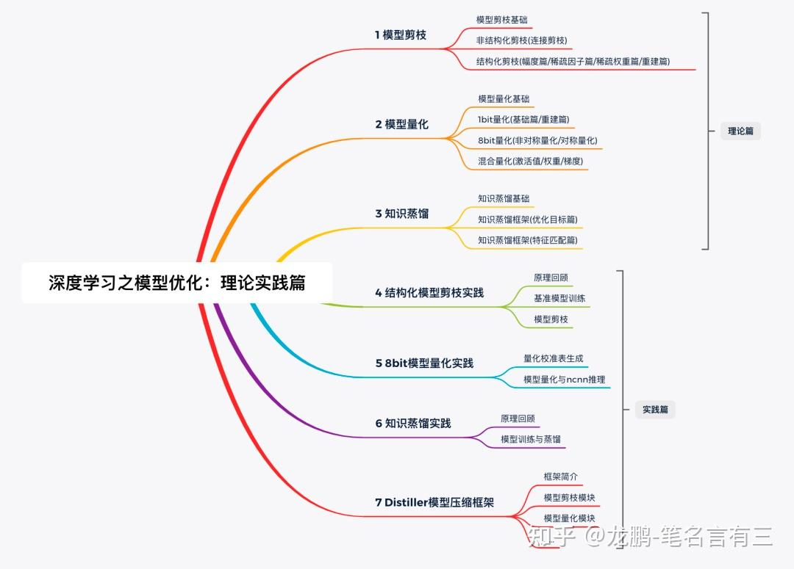

或者有三AI秋季划-模型优化组，系统性地学习数据使用，模型使用和调参，模型性能分析，紧凑模型设计，模型剪枝，模型量化，模型部署，NAS等内容。

> AI白身境系列完整阅读：

第一期：[【AI白身境】深度学习从弃用windows开始](https://link.zhihu.com/?target=https%3A//mp.weixin.qq.com/s%3F__biz%3DMzA3NDIyMjM1NA%3D%3D%26mid%3D2649030781%26idx%3D1%26sn%3D8425674df68425e622f114d043239c2b%26chksm%3D8712be00b0653716ca9c97057d9c6e393d471d6160b28c783cb6e001bae55c09ac69a2adec62%26token%3D1400726199%26lang%3Dzh_CN%23rd)

第二期：[【AI白身境】Linux干活三板斧，shell、vim和git](https://link.zhihu.com/?target=https%3A//mp.weixin.qq.com/s%3F__biz%3DMzA3NDIyMjM1NA%3D%3D%26mid%3D2649030809%26idx%3D1%26sn%3D512513678a99218392260d3d5763e09a%26chksm%3D8712bee4b06537f2253b469fda709698f90e23bf91387ceea4af313766125ea4b9119c015c58%26token%3D1400726199%26lang%3Dzh_CN%23rd)

第三期：[【AI白身境】学AI必备的python基础](https://link.zhihu.com/?target=https%3A//mp.weixin.qq.com/s%3F__biz%3DMzA3NDIyMjM1NA%3D%3D%26mid%3D2649030876%26idx%3D1%26sn%3D75710e10e1503c9c6bab16cc83b73ef0%26chksm%3D8712bea1b06537b7977c67676122f544c9a3d09abe77362556403252c173c5bca0bee10f7351%26token%3D739981443%26lang%3Dzh_CN%23rd)

第四期：[【AI白身境】深度学习必备图像基础](https://link.zhihu.com/?target=https%3A//mp.weixin.qq.com/s%3F__biz%3DMzA3NDIyMjM1NA%3D%3D%26mid%3D2649030907%26idx%3D1%26sn%3D79f1123869a14254e31b21f57961b524%26chksm%3D8712be86b06537907c5664f1244f6bca2ce6e9f6a2593440c57dfff646038cf46fe3afd0d49b%26token%3D739981443%26lang%3Dzh_CN%23rd)

第五期：[【AI白身境】搞计算机视觉必备的OpenCV入门基础](https://link.zhihu.com/?target=https%3A//mp.weixin.qq.com/s%3F__biz%3DMzA3NDIyMjM1NA%3D%3D%26mid%3D2649030969%26idx%3D1%26sn%3Dec1cabf9fa52ece790f8a5ab19f2458b%26chksm%3D8712bf44b06536524b97130198905b1fdda03c4432f4e136f665a1a3b93bd9f806eeaedef155%26token%3D1879088111%26lang%3Dzh_CN%23rd)

第六期：[【AI白身境】只会用Python？g++，CMake和Makefile了解一下](https://link.zhihu.com/?target=https%3A//mp.weixin.qq.com/s%3F__biz%3DMzA3NDIyMjM1NA%3D%3D%26mid%3D2649031006%26idx%3D1%26sn%3Dc2bbb57e95ccf651eec22fe378160095%26chksm%3D8712bf23b0653635fb1a932aa33dea5a5f6d75e4767cdbebd4b8809b108c8b2f4339b215f8ea%26token%3D667764862%26lang%3Dzh_CN%23rd)

第七期：[【AI白身境】学深度学习你不得不知的爬虫基础](https://link.zhihu.com/?target=https%3A//mp.weixin.qq.com/s%3F__biz%3DMzA3NDIyMjM1NA%3D%3D%26mid%3D2649031056%26idx%3D1%26sn%3D6f8f5a6e7bc236e928f3a5d4211b4f84%26chksm%3D8712bfedb06536fbd94ee4322cc35b3377ddf39a2abdc073d5001f1766fdb52d09f83a08c357%26token%3D1377716633%26lang%3Dzh_CN%23rd)

第八期： [【AI白身境】深度学习中的数据可视化](https://link.zhihu.com/?target=https%3A//mp.weixin.qq.com/s%3F__biz%3DMzA3NDIyMjM1NA%3D%3D%26mid%3D2649031147%26idx%3D1%26sn%3D99491d39e880c68597c2a29a307652d6%26chksm%3D8712bf96b0653680a41817c899a49ad351b6f375e78e25871422cc4c068831cce0fc7820c88b%26token%3D795591801%26lang%3Dzh_CN%23rd)

第九期：[【AI白身境】入行AI需要什么数学基础：左手矩阵论，右手微积分](https://link.zhihu.com/?target=https%3A//mp.weixin.qq.com/s%3F__biz%3DMzA3NDIyMjM1NA%3D%3D%26mid%3D2649031183%26idx%3D1%26sn%3D4f31ef67460c371ccc93296d21993771%26chksm%3D8712bc72b065356461668bca8b1e14ba1e6d953b7be83878a2f983fecb541b4b3be8c3e51ebf%26token%3D1281762331%26lang%3Dzh_CN%23rd)

第十期：[【AI白身境】一文览尽计算机视觉研究方向](https://link.zhihu.com/?target=https%3A//mp.weixin.qq.com/s%3F__biz%3DMzA3NDIyMjM1NA%3D%3D%26mid%3D2649031231%26idx%3D1%26sn%3D8371deedfe05be36f8d727aa6737b59f%26chksm%3D8712bc42b0653554ce727cfb3339ae735ca2945605d412f622cde7372c1181b89219cdfdf772%26token%3D1392937622%26lang%3Dzh_CN%23rd)

[第十一期：【AI白身境】AI+，都加在哪些应用领域了](https://link.zhihu.com/?target=https%3A//mp.weixin.qq.com/s%3F__biz%3DMzA3NDIyMjM1NA%3D%3D%26mid%3D2649031322%26idx%3D1%26sn%3Db933534e39e22e4dff2d60716db612e8%26chksm%3D8712bce7b06535f14beb2b50c06a363aee7f91abf13f22f795b3a1de4582ab8fde63ba6deb52%26token%3D580500824%26lang%3Dzh_CN%23rd)

第十二期：[【AI白身境】究竟谁是paper之王，全球前10的计算机科学家](https://link.zhihu.com/?target=https%3A//mp.weixin.qq.com/s%3F__biz%3DMzA3NDIyMjM1NA%3D%3D%26mid%3D2649031355%26idx%3D1%26sn%3Dac22f4d25c91657055db93a27415f433%26chksm%3D8712bcc6b06535d0150ea2082fad7465632d31b5fc130151377f5cb91f30e647886756ee70d4%26token%3D677571606%26lang%3Dzh_CN%23rd)

> AI初识境系列完整阅读

第一期：[【AI初识境】从3次人工智能潮起潮落说起](https://link.zhihu.com/?target=http%3A//mp.weixin.qq.com/s%3F__biz%3DMzA3NDIyMjM1NA%3D%3D%26mid%3D2649031475%26idx%3D1%26sn%3D381e5ff44a9d724134d167aaab93393e%26chksm%3D8712bd4eb06534584d0f9dfe9840ca0a9afba5890c6935c63f2886b3a29adec0bc8ccef2ef6a%26scene%3D21%23wechat_redirect)

第二期：[【AI初识境】从头理解神经网络-内行与外行的分水岭](https://link.zhihu.com/?target=http%3A//mp.weixin.qq.com/s%3F__biz%3DMzA3NDIyMjM1NA%3D%3D%26mid%3D2649031503%26idx%3D1%26sn%3D52124c89fd52d197db4e3f089bceec3a%26chksm%3D8712bd32b0653424acdbdb1515ec009741bfe1a189eb44690cf71017ff0def71520534a4e5b3%26scene%3D21%23wechat_redirect)

第三期：[【AI初识境】近20年深度学习在图像领域的重要进展节点](https://link.zhihu.com/?target=http%3A//mp.weixin.qq.com/s%3F__biz%3DMzA3NDIyMjM1NA%3D%3D%26mid%3D2649031524%26idx%3D1%26sn%3D564750aea2c3c7cc03b6532852d1efe3%26chksm%3D8712bd19b065340f9fd87034bca58ec77a27ec75ef50accbcc807061135ddeff6ef34bdd55e0%26scene%3D21%23wechat_redirect)

第四期：[【AI初识境】激活函数：从人工设计到自动搜索](https://link.zhihu.com/?target=http%3A//mp.weixin.qq.com/s%3F__biz%3DMzA3NDIyMjM1NA%3D%3D%26mid%3D2649031541%26idx%3D1%26sn%3Db1fac1a1bce8cb27727ffea2b77b1689%26chksm%3D8712bd08b065341e0b4078dbd994f864dbd274571668968961881efb4a52ed0822c32a4742ba%26scene%3D21%23wechat_redirect)

第五期：[【AI初识境】什么是深度学习成功的开始？参数初始化](https://link.zhihu.com/?target=http%3A//mp.weixin.qq.com/s%3F__biz%3DMzA3NDIyMjM1NA%3D%3D%26mid%3D2649031561%26idx%3D1%26sn%3D8de2f0e398c1df0bdaebda99138dc22b%26chksm%3D8712bdf4b06534e2979cca8558f2817d4547676a768f3fc895dd578afda941999e48efd3cafb%26scene%3D21%23wechat_redirect)

第六期：[【AI初识境】深度学习模型中的Normalization，你懂了多少？](https://link.zhihu.com/?target=http%3A//mp.weixin.qq.com/s%3F__biz%3DMzA3NDIyMjM1NA%3D%3D%26mid%3D2649031599%26idx%3D1%26sn%3Df06df4fe57024e7652ac6f6062253b32%26chksm%3D8712bdd2b06534c456f046d76f5f71696f294de6ce0f84736e0cea173eaa970c0a2d0015d72b%26scene%3D21%23wechat_redirect)

第七期：[【AI初识境】为了围剿SGD大家这些年想过的那十几招](https://link.zhihu.com/?target=http%3A//mp.weixin.qq.com/s%3F__biz%3DMzA3NDIyMjM1NA%3D%3D%26mid%3D2649031658%26idx%3D1%26sn%3Dfd1b54b24b607a9d28dc4e83ecc480fb%26chksm%3D8712bd97b065348132d8261907c56ce14077646dfc9c7531a4c3f1ecf6da1a488450428e4580%26scene%3D21%23wechat_redirect)

第八期：[【AI初识境】被Hinton，DeepMind和斯坦福嫌弃的池化，到底是什么？](https://link.zhihu.com/?target=http%3A//mp.weixin.qq.com/s%3F__biz%3DMzA3NDIyMjM1NA%3D%3D%26mid%3D2649031740%26idx%3D1%26sn%3D2766cf718daf57a9c7f1556885cf35e9%26chksm%3D8712ba41b065335751aa0a50b6bbb1d6e230ed2f3d9a72914f1eb178ba0c2ecd9f77068fc0c0%26scene%3D21%23wechat_redirect)

第九期：[【AI初识境】如何增加深度学习模型的泛化能力](https://link.zhihu.com/?target=http%3A//mp.weixin.qq.com/s%3F__biz%3DMzA3NDIyMjM1NA%3D%3D%26mid%3D2649031822%26idx%3D1%26sn%3D2f5c0485ce54f9e1347bec48ee638072%26chksm%3D8712baf3b06533e5d89b949c3b5232665f428842f6712449785b20ba5dbc73ebf2a0f3f481e3%26scene%3D21%23wechat_redirect)

第十期：[【AI初识境】深度学习模型评估，从图像分类到生成模型](https://link.zhihu.com/?target=https%3A//mp.weixin.qq.com/s%3F__biz%3DMzA3NDIyMjM1NA%3D%3D%26mid%3D2649031923%26idx%3D1%26sn%3Dbcc3cef468f44d0a6de5b87ea00e5e5b%26chksm%3D8712ba8eb065339829ee84e7398e23d85dd7c4c7c154b96caead73c8815f887bb3c1bb7de063%26token%3D598159941%26lang%3Dzh_CN%23rd)

第十一期：[【AI初识境】深度学习中常用的损失函数有哪些？](https://link.zhihu.com/?target=https%3A//mp.weixin.qq.com/s%3F__biz%3DMzA3NDIyMjM1NA%3D%3D%26mid%3D2649032086%26idx%3D1%26sn%3Dfad93a8867bcc1c5b8e6b8db0260fe24%26chksm%3D8712bbebb06532fd8a1cd02df87db32ea17f07011405a00da844b160f88792b0581030e26565%26token%3D598159941%26lang%3Dzh_CN%23rd)

第十二期：[【AI初识境】给深度学习新手开始项目时的10条建议](https://link.zhihu.com/?target=https%3A//mp.weixin.qq.com/s%3F__biz%3DMzA3NDIyMjM1NA%3D%3D%26mid%3D2649032137%26idx%3D1%26sn%3D486dd16dec9a1df9b25aee23765e3f67%26chksm%3D8712bbb4b06532a21b8068e80c94be95b2148e3009abe816146ffc532a96a5aecd8e1dd9fcb0%26scene%3D21%23wechat_redirect)

> AI不惑境系列完整阅读：

第一期：[【AI不惑境】数据压榨有多狠，人工智能就有多成功](https://link.zhihu.com/?target=https%3A//mp.weixin.qq.com/s%3F__biz%3DMzA3NDIyMjM1NA%3D%3D%26mid%3D2649032394%26idx%3D1%26sn%3D1e5b111d5ab05942d25af85836901bbd%26chksm%3D8712b8b7b06531a1e388ae741720386d1004193c2145b4b633a875b08d37f7eb810a33bae831%26token%3D1720669728%26lang%3Dzh_CN%23rd)

第二期：[【AI不惑境】网络深度对深度学习模型性能有什么影响？](https://link.zhihu.com/?target=https%3A//mp.weixin.qq.com/s%3F__biz%3DMzA3NDIyMjM1NA%3D%3D%26mid%3D2649032714%26idx%3D1%26sn%3D12c2e66a8de5e9e5a3d6667382f1bafa%26chksm%3D8712b677b0653f612dd0d11a297e32e5900581f3b8964a7278bd30d4bac039b027d1d16cad9f%26token%3D1268963984%26lang%3Dzh_CN%23rd)

第三期：[【AI不惑境】网络的宽度如何影响深度学习模型的性能？](https://link.zhihu.com/?target=https%3A//mp.weixin.qq.com/s%3F__biz%3DMzA3NDIyMjM1NA%3D%3D%26mid%3D2649032883%26idx%3D1%26sn%3D9e557cf7bff4bceecb522f28b074c25e%26chksm%3D8712b6ceb0653fd8ec4c7a9f39e5905de421dd08b7dbe49c55bbb25806d7c824089ae36f014a%26token%3D1169783853%26lang%3Dzh_CN%23rd)

第四期：[【AI不惑境】学习率和batchsize如何影响模型的性能？](https://link.zhihu.com/?target=https%3A//mp.weixin.qq.com/s%3F__biz%3DMzA3NDIyMjM1NA%3D%3D%26mid%3D2649032995%26idx%3D2%26sn%3D28b065415c2d8a11345531f1284413d0%26chksm%3D8712b75eb0653e48f46de857b14d6e029f08a5c0336928fc638eac1f8287aefea01a262be1e2%26token%3D2097035342%26lang%3Dzh_CN%23rd)

第五期：[【AI不惑境】残差网络的前世今生与原理](https://link.zhihu.com/?target=https%3A//mp.weixin.qq.com/s%3F__biz%3DMzA3NDIyMjM1NA%3D%3D%26mid%3D2649033134%26idx%3D1%26sn%3D69a5be0c1677e55a0311269b0e481242%26chksm%3D8712b7d3b0653ec5211cfd57364bb7d4b8073e620f00f04de734ae2ae7b2e9179ae9d1468e58%26token%3D1855353646%26lang%3Dzh_CN%23rd)

第六期：[【AI不惑境】移动端高效网络，卷积拆分和分组的精髓](https://link.zhihu.com/?target=https%3A//mp.weixin.qq.com/s%3F__biz%3DMzA3NDIyMjM1NA%3D%3D%26mid%3D2649033716%26idx%3D1%26sn%3D71e6bc88057706ce864b30d3b176c863%26chksm%3D8712b589b0653c9f12a59fa81e68414b81e85532daef119e97b091c4abb6c7d4e393c3a695c9%26scene%3D21%23wechat_redirect)

第七期：[【AI不惑境】深度学习中的多尺度模型设计](https://link.zhihu.com/?target=https%3A//mp.weixin.qq.com/s%3F__biz%3DMzA3NDIyMjM1NA%3D%3D%26mid%3D2649034714%26idx%3D1%26sn%3D720a3c5e8189955295745c783be08143%26chksm%3D8712b1a7b06538b1057cc76ca1b1897a64db888e8658045c29143ef756d7aac75286cae58ade%26token%3D1073894756%26lang%3Dzh_CN%23rd)

第八期：[【AI不惑境】计算机视觉中注意力机制原理及其模型发展和应用](https://link.zhihu.com/?target=https%3A//mp.weixin.qq.com/s%3F__biz%3DMzA3NDIyMjM1NA%3D%3D%26mid%3D2649034948%26idx%3D1%26sn%3Df02b7d42d72cadfa50ab34cfeffb36af%26chksm%3D8712aeb9b06527af4d06105d95503d6f36bd287293e2e8b76e6647858e109a201c1efe763599%26token%3D1296655195%26lang%3Dzh_CN%23rd)

第九期：[【AI不惑境】模型剪枝技术原理及其发展现状和展望](https://link.zhihu.com/?target=https%3A//mp.weixin.qq.com/s%3F__biz%3DMzA3NDIyMjM1NA%3D%3D%26mid%3D2649038593%26idx%3D1%26sn%3D7492e2d8f13114e2bf74e242fb1237ac%26chksm%3D8712a17cb065286ac062079c8e1ad06763518dd1a3f4d0f2d9cfc1b1e73b7209553c1b2cbcba%26token%3D1019746549%26lang%3Dzh_CN%23rd) 

第十期：[【AI不惑境】模型量化技术原理及其发展现状和展望](https://link.zhihu.com/?target=https%3A//mp.weixin.qq.com/s%3F__biz%3DMzA3NDIyMjM1NA%3D%3D%26mid%3D2649038805%26idx%3D1%26sn%3Da39f593e10cdd9de6b968ca42ca6859f%26chksm%3D8712a1a8b06528bed3aab6e6fa8f4c2015997d01a5a5d04abb4f7cc7b665853cc7305a5b638f%26token%3D1007482354%26lang%3Dzh_CN%23rd) 

第十一期：[【AI不惑境】模型压缩中知识蒸馏技术原理及其发展现状和展望](https://link.zhihu.com/?target=https%3A//mp.weixin.qq.com/s%3F__biz%3DMzA3NDIyMjM1NA%3D%3D%26mid%3D2649038898%26idx%3D1%26sn%3D8828f97e67ed1d8427e95d889cf26b1d%26chksm%3D87129e4fb0651759b9a70da8d507f98e3c69e1b08af1eae1bb74f319e562665d83a0210d0ca1%26token%3D299388098%26lang%3Dzh_CN%23rd)

第十二期：[【AI不惑境】AutoML在深度学习模型设计和优化中有哪些用处？](https://link.zhihu.com/?target=https%3A//mp.weixin.qq.com/s%3F__biz%3DMzA3NDIyMjM1NA%3D%3D%26mid%3D2649038954%26idx%3D1%26sn%3D093438b07ac977fee0e57ac212342cf2%26chksm%3D87129e17b06517012210b64a513d5defe5f782ce4a78cbc6e216b354d06ae80326df53012157%26token%3D1293115859%26lang%3Dzh_CN%23rd)
