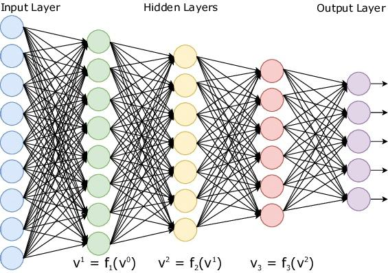
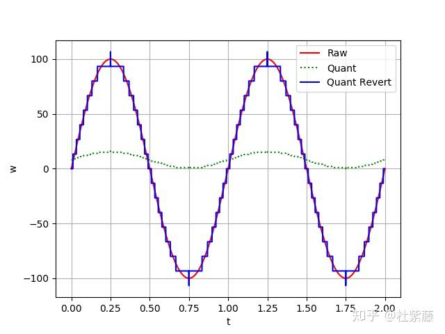
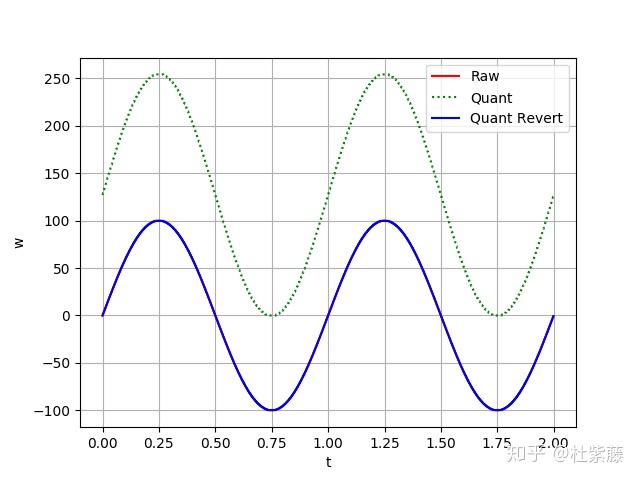
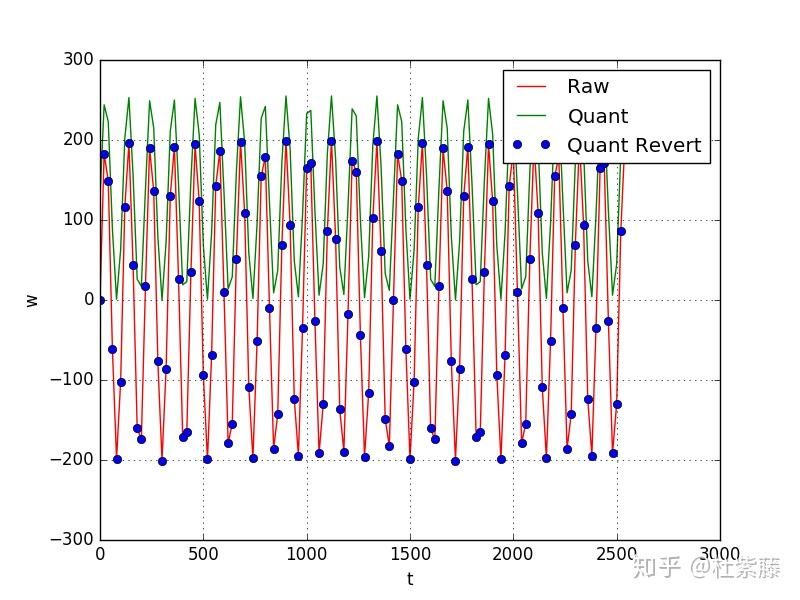
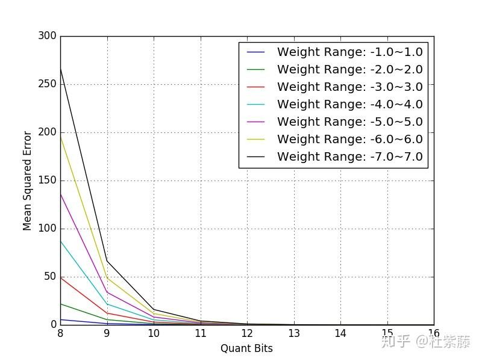
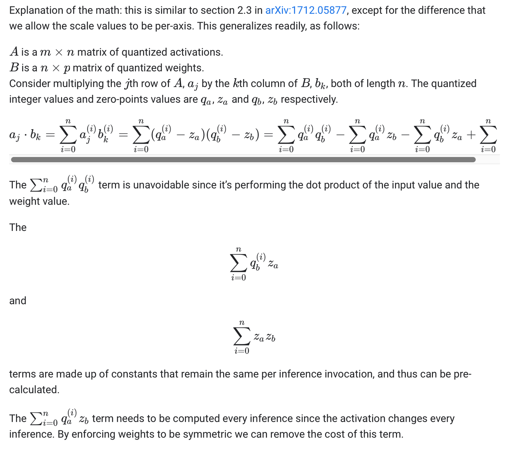
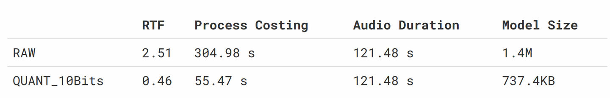
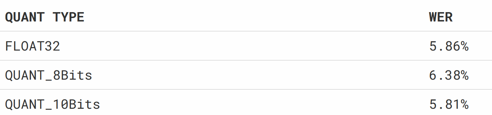
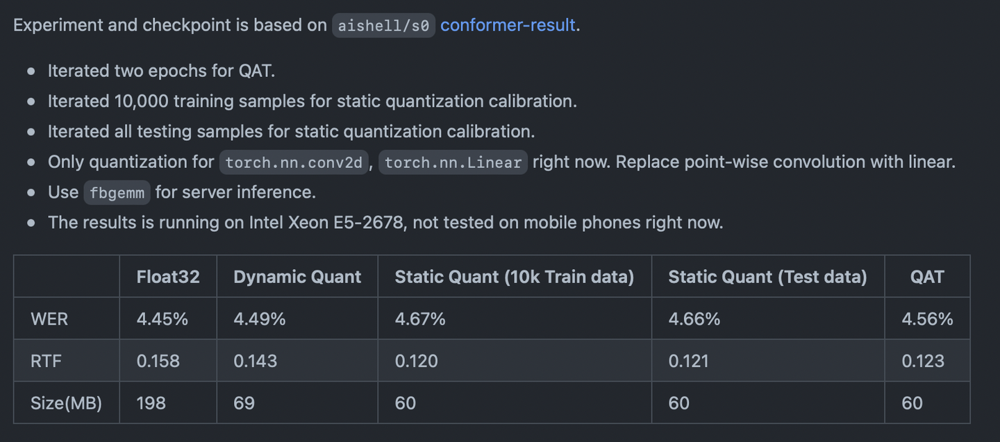

### 前言

得益于数据量以及算力的提升，**深度学习**技术发展迅猛。我目前所从事的语音识别应用领域也有了很大的发展。但深度学习方法也带来了一些问题，比如计算代价高、难以解释、过拟合等问题。不过该方法在工业界确实就是** Work**。

顺应这个潮流，市面上出现很多深度学习的开源框架（Tensorflow、Caffe、Torch、Keras、Theano ...），以及满天飞的深度学习论文。那么，很多人或许会这么想：『实际使用，应该就是训练的时候喂喂数据、产品代码粘贴些开源代码、包装包装就完事了吧？』我个人认为在不考虑功耗、算力、成本的前提下好像是可以这么做。

但是实际工程中，考虑的情况会比较复杂。比如在无硬浮点支持的低功耗嵌入式设备上，那些『深』不可测的模型带来了 『昂贵』 的浮点运算，让开发者总有些力不从心。如果大家都希望好的算法能落地，就不得不考虑其市场价值。要把**高性价比**（Di Cheng Ben）的嵌入式设备卖出去，就要考虑更低的**内存占有**、更少的**功耗开销**、更快的**计算效率**、更好的**识别效果**、以及更成熟（Pian Yi）的**市场售价**。以上应该就是消费者和合作商都比较喜欢的产品了。其中一个让开发者最头疼的事情——耗时和内存占用问题，是不是有什么比较轻便的方法使之得以提升？

谈到耗时，我们不得不分析下耗时的原因到底在哪里？深度学习作为一个新的『厂牌』，前身是神经网络，神经网络的框架最常见的几种分别为深度神经网络（DNN）、卷积神经网络（CNN）、递归神经网络（RNN）等。以 DNN 为例，DNN-Wiki 上的解释是这样的：由多重非线性变换构成的多个处理层，对数据进行高层抽象的算法。这里就不详细阐述了，来一张图看看它长是什么样子。

DNN 拓扑结构其中多层的非线性转换就是上一层的输出与当前层神经元对应的权重点积（`x*W`），加之偏置（`x*W+b`）和激活处理(`f(x*W+b)`)。其中每个神经元都接收一些输入并做一些**点积**的计算，这是非常耗时的，尤其是在一些不支持硬浮点运算的设备上，DNN 的计算就显得更加疲软。

为此，各大公司以及研究机构想方设法来进行优化，有[模型剪裁](https://link.zhihu.com/?target=https%3A//arxiv.org/pdf/1510.00149.pdf)、Low-Rank 低秩分解、Knowledge  Distillation；也有从算法本身出发优化的[量化方法](https://link.zhihu.com/?target=https%3A//arxiv.org/pdf/1607.04683.pdf)、[定点化计算](https://link.zhihu.com/?target=https%3A//arxiv.org/pdf/1711.07128.pdf)、二/三值化的方法等等，更多的压缩与加速方法可以参考让机器『删繁就简』：深度神经网络加速与压缩。其中，浮点转定点、二值化等方法是试图避免浮点计算耗时而引入的方法，这些方法能加快运算速率，同时减少内存和存储空间的占用，并保证模型的精度损失在可接受的范围内，因此这些方法的应用是有其现实价值的。

个人认为在这些方法中，只需要做『微创手术』的方法应该就是量化的方法了。因为它只需要对已经训练好的模型做细微改动，就可以提升运算速度和内存占用，而不需要重新训练模型。而且其适用面广泛，只要涉及到点积的运算，都可以应用这种方法。文章最后我会放出引入量化后对语音识别任务的性能影响。

### 工作原理

量化（Quantization）模型的论文来自于 Google 发表的文章 [On the efficient representation and execution of deep acoustic models](https://link.zhihu.com/?target=https%3A//arxiv.org/pdf/1607.04683.pdf)。作者的初衷是：

**We present a simple and computationally efficient quantization scheme that enables us to reduce the resolution of the parameters of a neural network from 32-bit floating point values to 8-bit integer values. The proposed quantization scheme leads to significant memory savings and enables the use of optimized hardware instructions for integer arithmetic, thus significantly reducing the cost of inference.量化方法的目的就是使用 8 位或 16 位的整型数来替代浮点数，这种方法试图利用定点点积来替代浮点点积，这很大程度上降低了神经网络在无硬浮点设备上的运算开销。同时，该方法在一些支持单指令流多数据流 SIMD 的硬件设备上优势就更加明显了，比如128-bit 寄存器 SSE 可以单个指令同时运算 4 个 32 位单精度浮点，8 个 16 位整型，16 个 8 位整型。显然 8 位整型数在 SIMD 的加持下，相比于单精度浮点运算速率要更快一些。另外，该方法还可以减少模型的内存和存储占用空间。

量化方法是一种类似于离差标准化的归一化方法，是对原始数据进行线性变换，使结果映射到一定范围内，具体公式如下：

$$ V_q = Q * (V_x - min(V_x)) $$

$$ V_x' = V_q / Q + min(V_x) $$

其中 

$$ Q=S/R $$

,  $ R=max(V_x)-min(V_x) $ , \[ S = 1 。$V_x$ 表示原始浮点输入，$V_q $ 表示量化后的定点数值， $V_x' $ 是根据量化参数还原出的浮点数， $bits$ 表示量化位数。上述公式可以进一步简化为：

$$ V_q = round(Q * V_x) - RQM $$

$$ V_x' = (V_q + RQM) / Q $$

$$ RQM = round(Q*min(V_x)) $$

python 代码实现如下：

`# 根据参数和原始浮点数量化为定点数
def Quant(Vx, Q, RQM):
    return round(Q * Vx) - RQM

# 根据量化参数还原回浮点
def QuantRevert(VxQuant, Q, RQM):
    return (VxQuant + RQM) / Q`

针对数组的量化和还原如下：

`import numpy as np

def ListQuant(data_list, quant_bits):
    # 数组范围估计
    data_min = min(data_list)
    data_max = max(data_list)

    # 量化参数估计
    Q = ((1  quant_bits) - 1) * 1.0 / (data_max - data_min)
    RQM = (int)(round(Q*data_min))

    # 产生量化后的数组
    quant_data_list = []
    for x in data_list:
        quant_data = Quant(x, Q, RQM)
        quant_data_list.append(quant_data)
    quant_data_list = np.array(quant_data_list)
    return (Q, RQM, quant_data_list)

def ListQuantRevert(quant_data_list, Q, RQM):
    quant_revert_data_list = []
    for quant_data in quant_data_list:
        # 量化数据还原为原始浮点数据
        revert_quant_data = QuantRevert(quant_data, Q, RQM)
        quant_revert_data_list.append(revert_quant_data)
    quant_revert_data_list = np.array(quant_revert_data_list)
    return quant_revert_data_list`

下面两幅图，将原本在浮点分布的正弦曲线**，经过量化和还原得到了另外两条曲线。类似图像上的降采样结果，4 位量化方式还原后的曲线出现了明显的锯齿形状，如下图：

4位量化曲线然而，8 位量化方式在还原后，其连接曲线与原始曲线几乎重合，如下图：

8位量化曲线**

另外，我们看看随机产生的数组，量化数组分布形式与原始分布形式几乎一致，只是取值范围发生了变化，而还原后的点几乎都落在了原始数据的连接线上。

随机数的量化实际使用中我发现，ARM CMSIS – Arm Developer 使用的是 `int8_t` 的 SIMD 优化，所以我这里在补充下关于 `uint8_t` 转成 `int8_t` 的量化和反量化代码：

`import numpy as np

np.random.seed(41)

def FindMaxMin(inputs):
  return np.min(inputs), np.max(inputs)

def ChooseQuantizationParams(x_min, x_max, quant_bits=8):
  q_scale = (int)((1  quant_bits) - 1)
  q_shift = (int)(1  (quant_bits - 1))

  Q = q_scale / (x_max - x_min);           
  RQM = (int)(round(Q * x_min) + q_shift);  

  return Q, RQM

def Quantize(inputs, Q, RQM):
  return np.round(Q * inputs) - RQM

def Dequantize(inputs, Q, RQM):
  return (inputs + RQM) / Q

if __name__ == '__main__':
  m = 2
  n = 3
  k = 4
  
  # Reference
  inputs = np.random.uniform(low=-12, high=12, size=(m, k))
  weight = np.random.uniform(low=-3, high=3, size=(k, n))
  res = np.dot(inputs, weight)
  
  print("Reference:")
  print(res)

  # Quantized
  inputs_min, inputs_max = FindMaxMin(inputs)
  weight_min, weight_max = FindMaxMin(weight)
  inputs_Q, inputs_RQM = ChooseQuantizationParams(inputs_min, inputs_max)
  weight_Q, weight_RQM = ChooseQuantizationParams(weight_min, weight_max)

  quantized_inputs = Quantize(inputs, inputs_Q, inputs_RQM)
  quantized_weight = Quantize(weight, weight_Q, weight_RQM)

  res = np.dot(Dequantize(quantized_inputs, inputs_Q, inputs_RQM), Dequantize(quantized_weight, weight_Q, weight_RQM))

  print("Quantize-Dequantize result:")
  print(res)

`

### 误差分析

上面部分我分析了单个数组的量化误差情况。而在实际运用中，还是需要针对不同的数据做运算，比如两个矩阵的点积，在采用量化的方法进行点积**运算，最终还原出浮点结果与原始结果进行比较后结果会是如何呢？这里我利用到了均方误差 (Mean Square Error) 来衡量两个结果的误差程度。

假设我们有一个 256 维浮点的特征参数，以及（256，512）浮点的权重参数，在确定量化比特位和权重参数取值范围的情况下，分别计算浮点点积结果，以及量化还原后的点积结果，最终计算两个结果之间的均方误差，python 代码如下：

`import numpy as np

def get_mse(quant_bits=12,
            feature_range=(0.0, 100.0),
            weight_range=(-1.0, 1.0),
            feature_dim=256,
            output_dim=512):
    # 产生随机数
    np.random.seed(42)
    feature = np.random.uniform(
        low=feature_range[0], high=feature_range[1], size=(feature_dim,))
    weight = np.random.uniform(
        low=weight_range[0], high=weight_range[1], size=(feature_dim*output_dim,))

    # 获取量化后的定点数组及其参数
    feature_Q, feature_RQM, feature_quant = ListQuant(feature, quant_bits)
    weight_Q, weight_RQM, weight_quant = ListQuant(weight, quant_bits)

    # 浮点数的点积
    float_dotprod = np.dot(feature, weight.reshape(feature_dim, output_dim))

    # 量化数的点积
    weight_quant = weight_quant + weight_RQM
    quant_dotprod = np.dot(feature_quant+feature_RQM,
                           weight_quant.reshape(feature_dim, output_dim))/(feature_Q*weight_Q)

    # 均方差计算
    mean_squared_error = ((float_dotprod - quant_dotprod) ** 2).mean()

    return mean_squared_error`

下面代码是针对不同的**权重取值范围**以及**量化位数**进行绘图描述：

`import numpy as np
import matplotlib.pyplot as plt

if __name__ == '__main__':
    # 权重范围列表
    weight_range_list = [(-1.0, 1.0), (-2.0, 2.0), (-3.0, 3.0),
                         (-4.0, 4.0), (-5.0, 5.0), (-6.0, 6.0), (-7.0, 7.0)]

    for weight_range in weight_range_list:
        print "Weight Range: {}".format(weight_range)
        # 量化位数 8～16
        quant_bits_list = [i for i in xrange(8, 16+1)]

        mean_err_list = []
        for quant_bits in quant_bits_list:
            # 量化误差计算
            mean_err = get_mse(quant_bits, weight_range=weight_range)
            print "\tMean Squared Error: {} ({} bits)".format(mean_err, quant_bits)
            mean_err_list.append(mean_err)

        # 画出当前权重范围的量化误差曲线
        plt.plot(quant_bits_list, mean_err_list, label="Weight Range: {}".format(
            "~".join([str(i) for i in weight_range])))

    plt.xlabel('Quant Bits')
    plt.ylabel('Mean Squared Error')
    plt.grid(True)
    plt.legend()

    # 保存图片
    plt.savefig("q_mse.png")`

通过绘图，我们可以观察量化后的误差情况，如下图：

点积误差可以看出，在不同的取值范围下，随着量化位数的增加，浮点模型和量化模型点积结果之间的误差也越来越小，在量化位数为 12 bits 时，误差几乎为零。

另外，权重的取值范围越大，在相同的量化位数下，误差也越来越大。这一点在 8 位量化模型下尤为明显，因此，要实现 8 位量化模型在实际中的应用，控制权重的紧凑程度是首要任务。为什么对 8 位量化模型这么关心，原因如下：

- 结合单指令流多数据流 技术，比如拥有 128 位寄存器的 SSE 技术， 8 位量化时单指令可同时计算数据个数为 16 个，而 16 位量化时，为 8 个。随着同时计算个数的增加，运算速度提升也更加明显。
- 内存以及实际存储占用更小。
- 低比特位量化后的，点积运算数据溢出风险更小。

### 量化训练和推理

前几个小节主要借鉴的是2016年的文章[On the efficient representation and execution of deep acoustic models](https://link.zhihu.com/?target=https%3A//arxiv.org/abs/1607.04683)，然而，在2017年谷歌更近一步扩展到了全定点的计算， 参考 [Quantization and Training of Neural Networks for Efficient Integer-Arithmetic-Only Inference](https://link.zhihu.com/?target=https%3A//arxiv.org/abs/1712.05877)，原理和之前分享的内容也基本上一致，将32位的 RQM 换成了 8 位的 zero_point，具体的量化反量化操作如下代码： 

`def ChooseQuantizationParamsV2(xmin, xmax, num_bits=8):
    qmin = -(int)(1  (num_bits-1))
    qmax = (int)((1  (num_bits-1))-1)

    scale = (xmax - xmin) / (qmax - qmin)
    initial_zero_point = qmin - xmin / scale
    nudged_zero_point = initial_zero_point
    if initial_zero_point  qmin:
        nudged_zero_point = qmin
    elif initial_zero_point > qmax:
        nudged_zero_point = qmax
    else:
        nudged_zero_point = (int)(initial_zero_point)

    return scale, nudged_zero_point

def QuantizeV2(x, scale, nudged_zero_point, num_bits=8):
    qmin = -(int)(1  (num_bits-1))
    qmax = (int)((1  (num_bits-1))-1)
    transformed_val = x/scale+nudged_zero_point
    clamped_val = np.clip(transformed_val, qmin, qmax)
    quantized = np.round(clamped_val)
    return quantized.astype(np.int8)

def DequantizeV2(x, scale, nudged_zero_point):
    return (x.astype(np.float32) - (float)(nudged_zero_point)) * scale
`

目前，既要保证识别效果，同时还要使用 8 bit 量化模型，一种比较完备的做法就是将推理阶段的量化操作迁移到训练阶段，如 Tensorflow 说明文档一章介绍 Fixed Point Quantization。采用 fake 的量化后的浮点来作为 input 和 weight 的替换，同时浮点范围采用了平滑最大最小值的方法，具体可以查看 TensorFlow 的官方代码 [MovingAvgQuantize](https://link.zhihu.com/?target=https%3A//github.com/tensorflow/tensorflow/blob/05ab6a2afa2959410d48aab2336cea9dc1e2c13e/tensorflow/contrib/quantize/python/quant_ops.py%23L186)，训练中平滑得到了全局的输入和权重的最大最小值（类似 batchnorm 的统计方式），代码段如下：

`    if symmetric:
      if narrow_range:
        min_max_ratio = -1
      else:
        # In two's complement notation, the negative range is slightly larger
        # than the positive range.
        min_max_ratio = -((1  num_bits) - 2) / (1  num_bits)

      # TFLite requires that 0.0 is always in the [min; max] range. Because
      # batch_min 
      range_min = math_ops.minimum(batch_min, batch_max / min_max_ratio)
      range_max = math_ops.maximum(batch_max, batch_min * min_max_ratio)
    else:
      # TFLite requires that 0.0 is always in the [min; max] range.
      range_min = math_ops.minimum(batch_min, 0.0)
      range_max = math_ops.maximum(batch_max, 0.0)

    assign_min = moving_averages.assign_moving_average(
        min_var, range_min, ema_decay, name='AssignMinEma')
    assign_max = moving_averages.assign_moving_average(
        max_var, range_max, ema_decay, name='AssignMaxEma')

    return _FakeQuantWithMinMaxVars(
        inputs,
        assign_min,
        assign_max,
        per_channel=per_channel,
        num_bits=num_bits,
        narrow_range=narrow_range)`

关于 int8t 的推理过程，还有一个官方博客把推理过程也写出来了 TensorFlow Lite 8-bit quantization specification，细节之处让人不得不佩服谷歌的匠心，除了因式分解后的提前计算，还有将权重的最大最小值强制设计成对称，这样 zero_point 等于零，减少了两次计算，如下图所示。

8位量化在采用对称的取值范围可以直接省去一个int8的scale计算关于定点/浮点的点积优化方法，可以看看下面几个开源项目：

- Google 开源的代码 [gemmlowp: a small self-contained low-precision GEMM library](https://link.zhihu.com/?target=https%3A//github.com/google/gemmlowp) ，结合 Tensorflow 的量化模型训练应该能发挥很好的『药效』。Google 很慷慨地公布了几种 GEMM 优化方法，比如基于 NEON / SSE 的 SIMD 指令、并行化运算、Cache 预热等优化方法。该 C++ 代码移植到目前市面上绝大部分的手持设备上应该不成问题。
- ARM 公司开源项目，针对自家嵌入式设计的词唤醒引擎架构 [ML-KWS-for-MCU](https://link.zhihu.com/?target=https%3A//github.com/ARM-software/ML-KWS-for-MCU) ，里面针对 **DS-CNN** / **DNN** 模型做了大量的定点计算优化工作，另外该项目还开放了基于 Tensorflow 的 8 位量化模型训练工具，移植到嵌入式设备上的底层优化算法库是来自自家的 [CMSIS_5](https://link.zhihu.com/?target=https%3A//github.com/ARM-software/CMSIS_5) 。
- 如果 GEMM 优化还没入门，还可以从 OpenBlas 贡献者在 Github 发布的指导文档 [How To Optimize Gemm](https://link.zhihu.com/?target=https%3A//github.com/flame/how-to-optimize-gemm) 开始入手。
更多针对移动端的开源代码：

FrameworkOrganizerLinkMACEXiaomi[https://github.com/XiaoMi/mace](https://link.zhihu.com/?target=https%3A//github.com/XiaoMi/mace)FeatherCNNTencent[https://github.com/Tencent/FeatherCNN](https://link.zhihu.com/?target=https%3A//github.com/Tencent/FeatherCNN)NCNNTencent[https://github.com/Tencent/ncnn](https://link.zhihu.com/?target=https%3A//github.com/Tencent/ncnn)TFLiteGoogle[https://github.com/tensorflow](https://link.zhihu.com/?target=https%3A//github.com/tensorflow)Caffe2Facebook[https://github.com/caffe2/caffe2](https://link.zhihu.com/?target=https%3A//github.com/caffe2/caffe2)TNNTencent[https://github.com/Tencent/TNN](https://link.zhihu.com/?target=https%3A//github.com/Tencent/TNN)
### 优化结果

在展示优化结果前，需要引入语音识别中一项重要的参考指标——**实时比（RTF）**。假设一个 t 时长的音频，引擎处理完这段音频所花费的时间为 p，那么我们认为该引擎的实时比为 p / t。如果在某一平台上统计出来的实时比大于 1，则表面该引擎在该平台下的实时性无法保证。在一些对实时性要求比较高的系统中将无法使用。另外，在一些不支持幷行化处理的设备上，则会因为来不及消化录音缓存，而出现录音丢帧的状况从而导致设备工作异常。因而在保证一定效果的情况，应该让识别引擎的实时比应尽可能的低。

下面两组实验的硬件设备和测试数据均为公司内部资源，详细内容和配置不方便透露。第一组对比数据是在 600Mhz 主频、不支持硬浮点运算的设备中得到的，分别使用了浮点和 12 位量化的多层神经网络模型对相同的音频数据进行识别处理。最终识别结果一致，得分有些许差异。耗时和模型占用情况如下表所示：

耗时和模型占用情况可以看出：在这样的嵌入式设备上，动态量化方法无论是在空间占用还是在运行速率上，优势都比较明显。

另外一方面，量化方法会引入精度损失，这个损失会不会给识别造成不良的后果呢？下面取了一组公司的测试数据集，进行了三组 *Benchmark* 测试，结果如下：

Benchmark 测试另外，我在 WeNet 上提交了一份基于量化感知训练的 Conformer 模型  [[Not for merge] code for static quantization by TeaPoly · Pull Request #874 · wenet-e2e/wenet](https://link.zhihu.com/?target=https%3A//github.com/wenet-e2e/wenet/pull/874)，可供参考，基于 X86 优化的 RTF 和识别如下：

WeNet 下的 AISHELL X86 的量化结果
### 致谢

感谢宝妈，辛辛苦苦地顺产下了 8 斤的小胖仔，同时我也见证了一个女孩到母亲的『蜕变』，这些都激励着我为梦想努力奋斗。另外，能将上述工作内容分享到这，也要感谢声瀚科技 CEO 何博士对我的指导和支持。

封面图片引用自论文：
