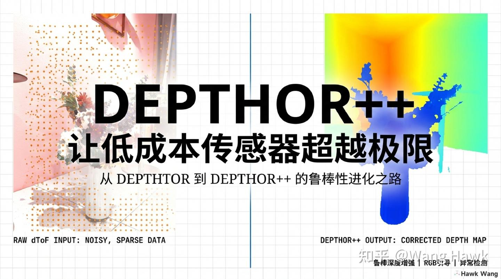

DEPTHOR++：让低成本传感器超越极限**

本文同步发表在我的微信公众号和知乎专栏”计算摄影学”，欢迎扫码关注，转载请注明作者和来源**

### 一、引子

有的相关领域的读者可能遇到过这样的情况：用dToF传感器扫描一个有镜子的房间，结果深度图上出现了一堆奇怪的”悬浮物体”。

这不是魔法，而是dToF传感器的物理局限。当光线穿透玻璃或被镜面反射时，传感器测量的可能是”背后”的墙，而不是”表面”本身。

这就是信号错误的可怕之处：它不像信号丢失那样留下一片空白，而是给你一个”谎言”——一个看起来合理但实际上完全错误的数值。

如何让算法学会”怀疑”这些谎言？这就是DEPTHOR++要解决的问题。这是华中科技大学与荣耀公司继DEPTHOR之后的新工作，项目主页位于：[https://github.com/ShadowBbBb/Depthor](https://link.zhihu.com/?target=https%3A//github.com/ShadowBbBb/Depthor)

### 二、理想很丰满，现实很骨感

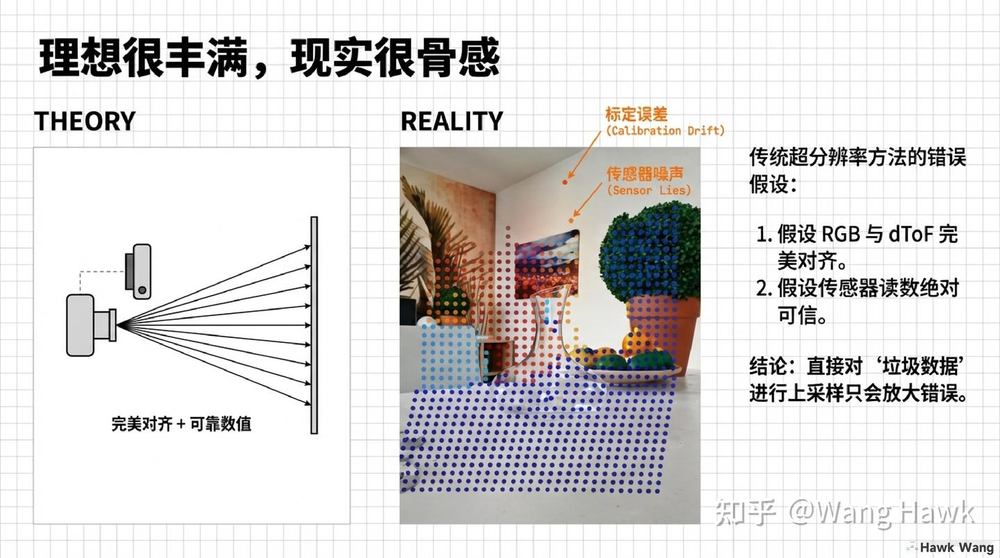

理想与现实的差距**

传统的超分辨率方法有两个致命的理想化假设。

第一个假设是RGB与dToF完美像素级对齐。但现实中，设备物理形变会导致标定漂移，误差能到2个像素。这个看似很小的偏差，在深度估计中会产生严重的”鬼影”伪影。

第二个假设是传感器读数绝对可信。但现实中，非朗伯体（如玻璃）会产生反射错误，黑色物体会导致信号丢失，远距离探测信号会衰减。

直接对”垃圾数据”进行上采样只会放大错误。这就是传统方法在真实场景中表现不佳的根本原因。

### 三、从超分到补全的范式转移

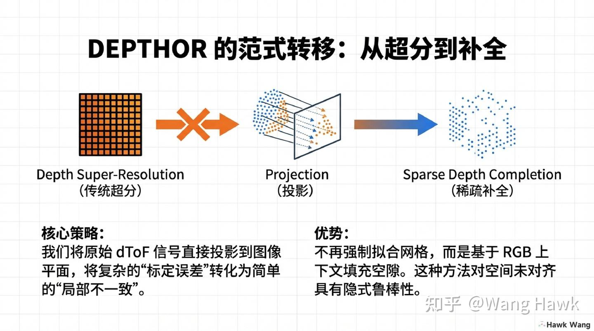

范式转移DEPTHOR++继承并强化了其前身DEPTHOR的核心思路：从”超分辨率”转向”深度补全”。

传统超分辨率方法是在2D规则像素网格上进行上采样。而深度补全的思路是：将原始dToF信号直接投影到图像平面，把复杂的”标定误差”转化为简单的”局部不一致”。

这种方法不再强制拟合网格，而是基于RGB上下文填充空隙，对空间未对齐具有隐式鲁棒性。

### 四、致命弱点：没有数据优于错误数据

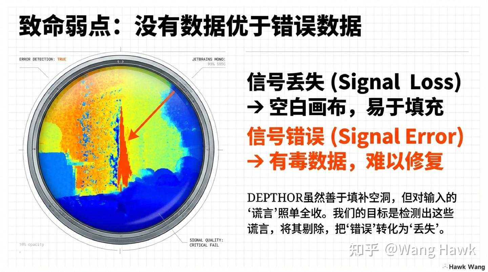

传统方法的致命弱点

这里有一个深刻的洞察：信号丢失和信号错误是完全不同的问题。

dToF的信号丢失意味着某处没有数据，留下的是空白画布，易于填充。dToF的信号错误意味着某处有数据，但这个数据是”有毒”的——它会误导算法，而且很难被发现和修复。

DEPTHOR虽然善于填补空洞，但对输入的”谎言”照单全收。DEPTHOR++的目标是：检测出这些谎言，将其剔除，把”错误”转化为”丢失”。

### 五、隐式学习 + 显式检测

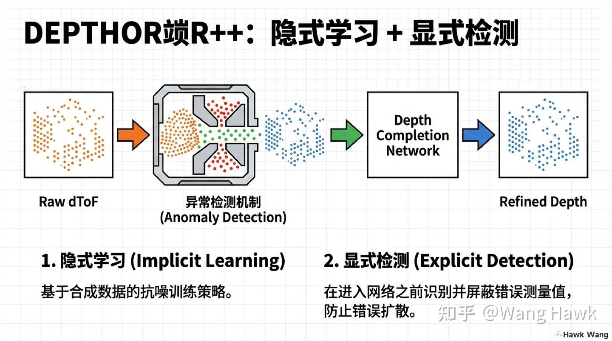

隐式学习与显式检测DEPTHOR++的核心架构包含两个模块。

第一个模块是隐式学习，基于合成数据的抗噪训练策略，让网络学会处理不完美的输入， 这个跟咱们之前讲过的DEPTHOR, SVDC等的思想类似。第二个模块是显式检测，是DEPTHOR++独有的，它在数据进入网络之前识别并屏蔽错误测量值，防止错误扩散。

这两个模块的配合，实现了”信任但验证”的策略。

#### 5.1 基于排名的异常检测的方法

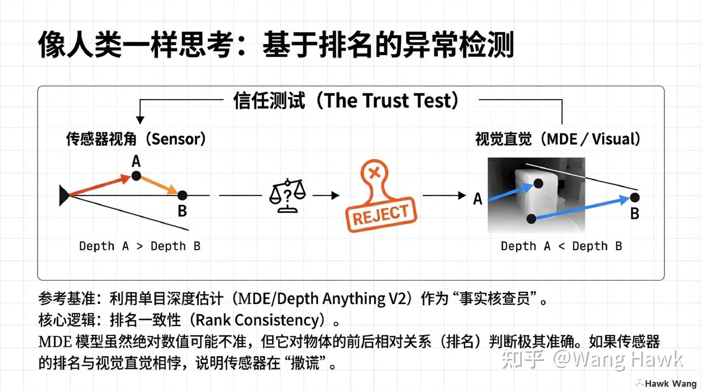

基于排名的异常检测

显式检测的核心思想是：利用单目深度估计（MDE/Depth Anything V2）作为”事实核查员”。

具体来说，通过”信任测试”来验证传感器数据。传感器的深度排序和MDE的视觉直觉进行对比。如果两者对物体前后关系的排名相悖，说明传感器在”撒谎”。

为什么用排名而不是绝对值？因为MDE模型虽然绝对数值可能不准，但它对物体的前后相对关系判断极其准确。排名一致性是检测异常的有效手段。

#### 5.2 基于MDE的异常检测是零成本的

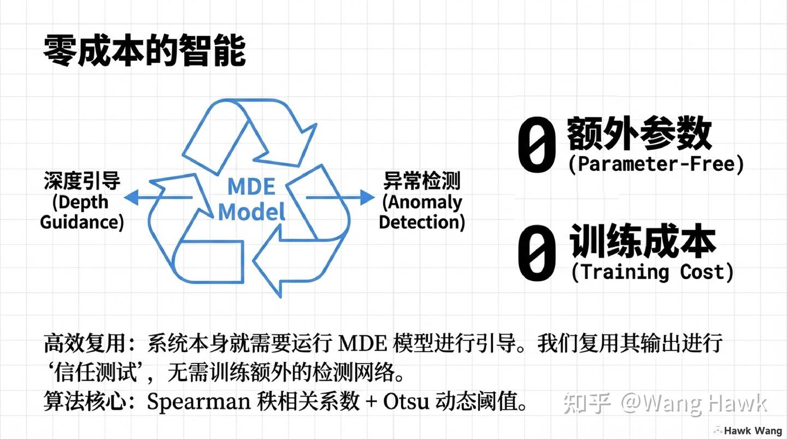

零成本的异常检测

这个异常检测机制的精妙之处在于：它几乎不增加任何成本。系统本身就需要运行MDE模型进行深度引导。DEPTHOR++复用其输出进行”信任测试”，无需训练额外的检测网络。算法核心是Spearman秩相关系数和Otsu动态阈值——都是成熟的、无需训练的算法。

零额外参数，零训练成本，却带来了显著的鲁棒性提升。我们可以看看DEPTHOR++在Mirror3D这样充满挑战的数据集的表现：

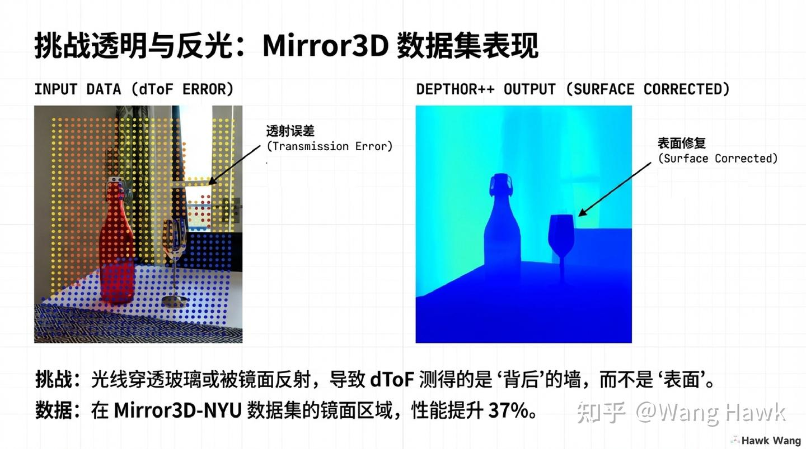

透明与反光

镜面反射是深度感知的经典难题。光线穿透玻璃或被镜面反射，导致dToF测得的是”背后”的墙，而不是”表面”本身。DEPTHOR++通过异常检测，能够识别这些错误信号，将其剔除后再进行补全。在Mirror3D-NYU数据集的镜面区域，性能提升了37%。

### 六、隐式学习的抗噪训练策略

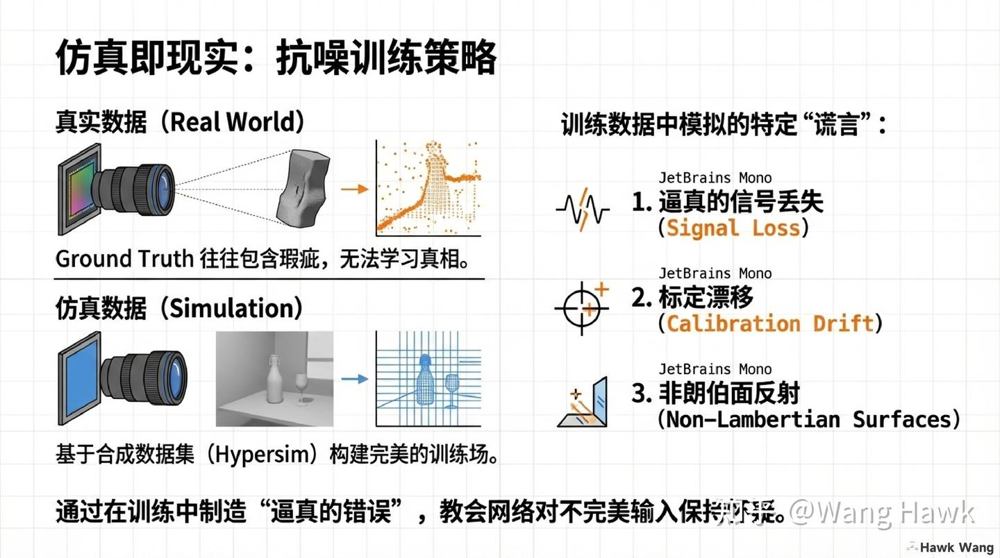

抗噪训练

刚才提到，DEPTHOR++第一个模块是隐式学习，基于合成数据的抗噪训练策略，让网络学会处理不完美的输入。 这里训练数据的质量决定了模型的上限。但真实数据集的Ground Truth往往包含与输入相同的传感器噪声，无法学习”真相”。DEPTHOR++的解决方案是：基于合成数据集（Hypersim）构建完美的训练场，然后在其中模拟真实世界的”谎言”。

这些”谎言”包括：逼真的信号丢失、标定漂移、非朗伯面反射。通过在训练中制造”逼真的错误”，教会网络对不完美输入保持怀疑。

### 七、DEPTHOR++在ZJU-L5数据集的真实量化评估

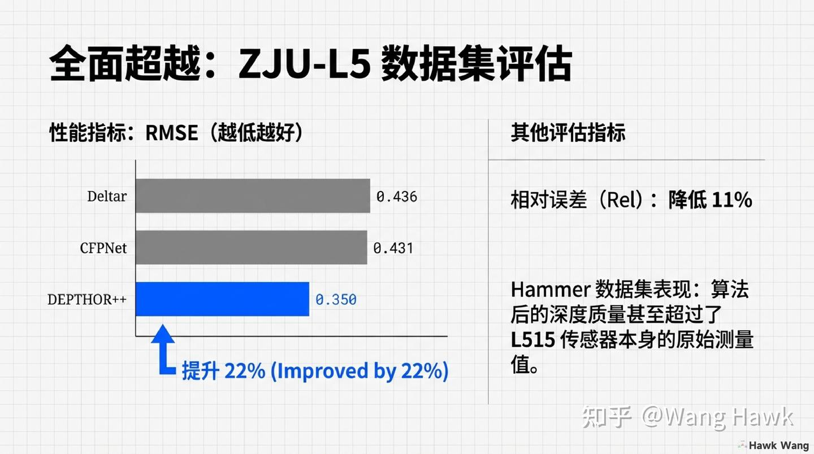

定量评估

在ZJU-L5数据集上，DEPTHOR++显著优于现有方法。RMSE（均方根误差）降低了22%，相对误差（Rel）降低了11%。更有意思的是，在Hammer数据集上，算法生成的深度质量甚至超过了L515传感器本身的原始测量值。

这意味着：用算法处理低成本传感器的数据，可以获得比昂贵传感器更好的结果。

### 八、肉眼可见的进化：在ZJU-L5数据集的真实可视化结果

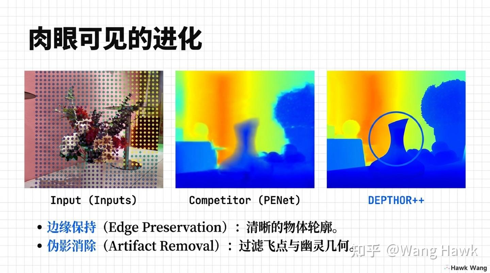

可视化对比

定量数字之外，定性对比更加直观。边缘保持方面，DEPTHOR++能够生成清晰的物体轮廓。伪影消除方面，它能够过滤飞点与”幽灵几何”。输入是布满噪点和错误的原始数据，输出是干净、连续、准确的深度图。

### 九、DEPTHOR++速度大幅度提升

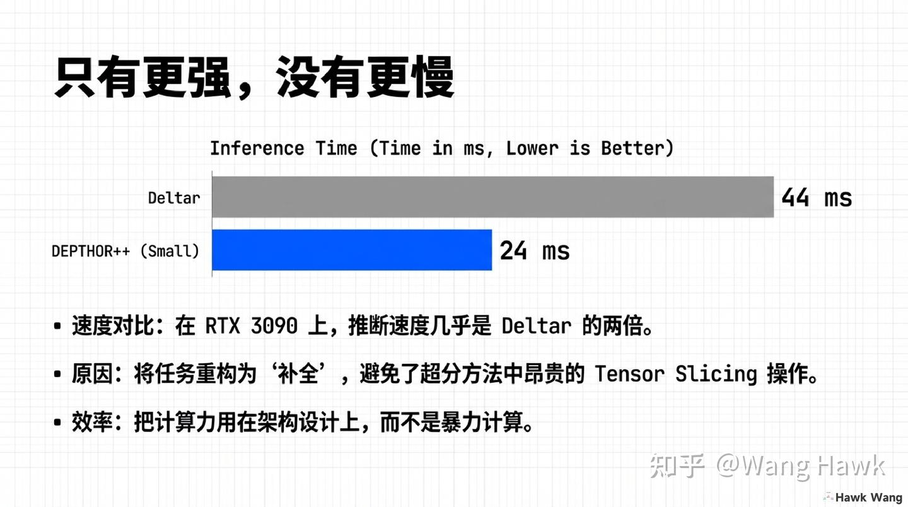

速度对比

通常，更强的性能意味着更慢的速度。但DEPTHOR++打破了这一规律。在RTX 3090上，推断速度几乎是Deltar的两倍（24ms vs 44ms）。原因是DEPTHOR++将任务重构为”补全”，避免了超分方法中昂贵的Tensor Slicing操作。把计算力用在架构设计上，而不是暴力计算。

### 十、总体架构解析：多模态融合与精炼

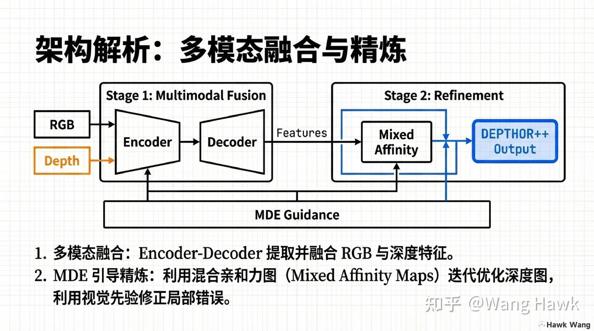

架构解析

DEPTHOR++的网络架构分为两个阶段。

第一阶段是多模态融合，通过Encoder-Decoder提取并融合RGB与深度特征。第二阶段是MDE引导精炼，利用混合亲和力图（Mixed Affinity Maps）迭代优化深度图，利用视觉先验修正局部错误。

### 十一、总结

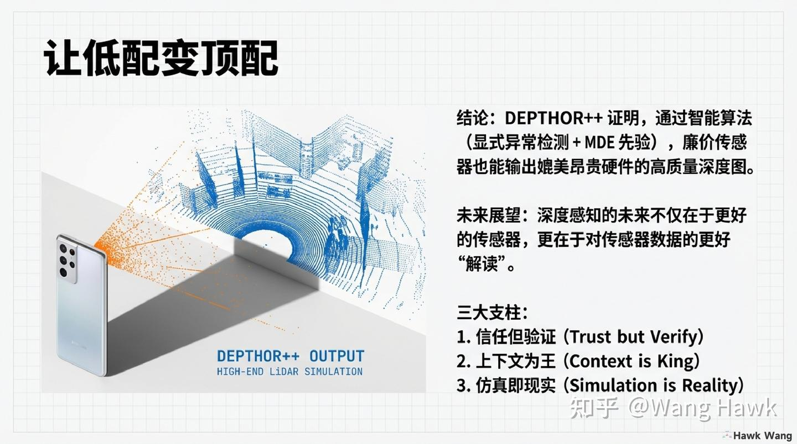

让低配变顶配

DEPTHOR++证明了什么？**

通过智能算法（显式异常检测 + MDE先验），廉价传感器也能输出媲美昂贵硬件的高质量深度图。深度感知的未来不仅在于更好的传感器，更在于对传感器数据的更好”解读”。

它通过三大支柱支撑了这一理念：

- 信任但验证
- 上下文为王
- 仿真即现实
从某种意义上说，DEPTHOR++代表了一种新的技术哲学：用智能算法弥补硬件局限，让低成本设备也能实现高端性能。这对于消费级移动设备、AR/VR、机器人等领域具有深远意义。

### 参考资料

- Xiang et al. “DEPTHOR++: Robust Depth Enhancement from Real-World Lightweight dToF and RGB Guidance”, 2025
- Huazhong University of Science and Technology & Honor Device Co., Ltd
**本文同步发表在我的微信公众号和知乎专栏”计算摄影学”，欢迎扫码关注，转载请注明作者和来源**

https://t.zsxq.com/05qRRjUfq (二维码自动识别)
