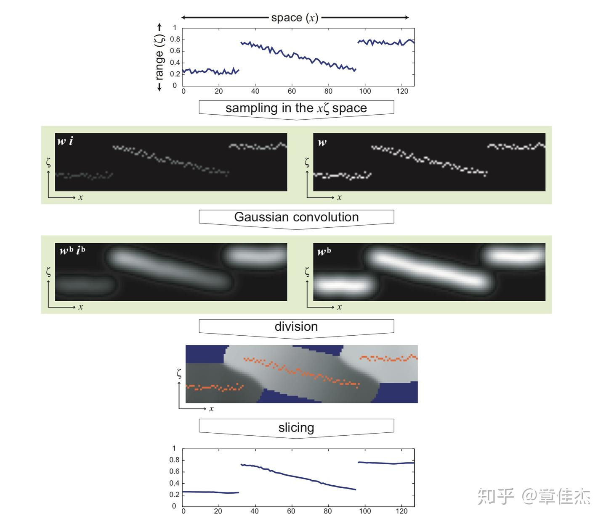
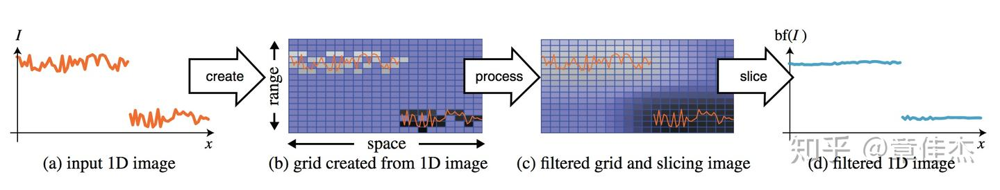
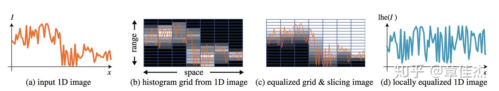
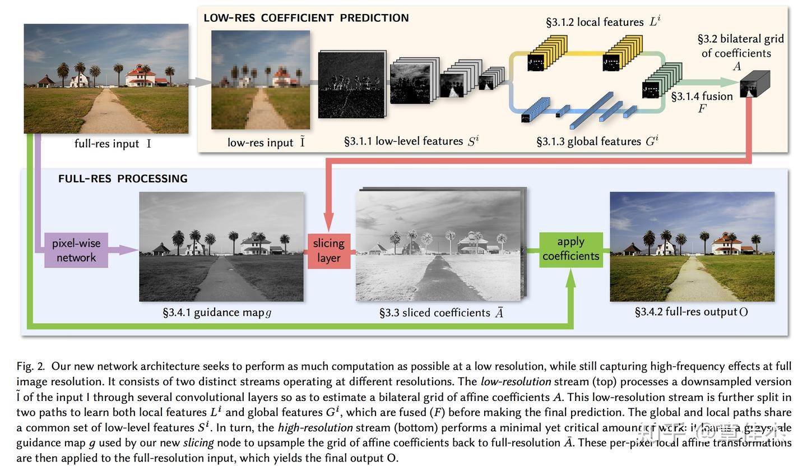

*这算是一篇写给自己看的笔记，所以记录思路为主，对于其中涉及到的算法细节不展开描述。*

我一直对图像降噪方面感兴趣，在降噪这个事情上，几种比较有效的算法包括 bilateral filter、non-local means、BM3D。最近看到 Google 的 HDRnet 的工作，虽说这个工作与降噪并没有直接的关系，但我发现其思路与 bilateral filter 有着千丝万缕的联系。我对 HDRnet 背后的思路做了一个比较深入的调研，觉得作者在 bilateral filter 方面连贯的思路非常值得学习，正好趁此机会总结一下。

### 原始版本

Bilateral filter 算是比较早的滤镜，但是生命力很强，其内在的思想比较深刻。原始的思路比较简单，也很直观：

$$˜I(p)=∑qI(p)w(p,q)∑qw(p,q)\tilde{I}(p)=\frac{\sum_qI(p)w(p,q)}{\sum_qw(p,q)} $$

这里 I(p)  代表图像， p , q 是图像上的坐标， w(p,q) 代表与位置相关的权重。一大类降噪算法其实都可以归结到这个公式，关键在于权重 w 的选择。这里，权重和两个因素有关，一个是 p , q 两点之间的距离，距离越远权重越低；另一个是 p , q" role="presentation">qq 两点之间的像素值相似程度，越相似权重越大。对 bilateral filter 来说，权重定义如下：

$$w(p,q)=g_{\sigma_s}(\|p-q\|)g_{\sigma_r}(\|I(p)-I(q)\|) $$

这里 g(&#x22C5;)" role="presentation">g(⋅)g(\cdot) 表示高斯函数。原始版本的 bilateral filter 数据组织形式上能较有效地利用 data locality，效率较高。尽管如此，相比于早期其他 convolution based filter（比如 gaussian filter），计算量非常大，速度较慢。

PS. 这里 bilateral filter 是直接利用像素值的差异来衡量 p, q 两点之间的相似程度，如果换成两个中心位于 p, q 的小 patch 来度量相似度，就是 non-local means 的核心思想了。

### 近似加速算法

Durand 在 2006 年提出了近似加速算法（参见：https://dspace.mit.edu/bitstream/handle/1721./MIT-CSAIL-TR-2006-073.pdf ）通过引入额外的维度，极大加速了计算过程。

下图大致描绘了算法思路：

核心的思想有三个：

- 将像素值作为一个额外维度，使得 weight 的计算转变成在第三维度上的卷积，极大提高了 data locality 利用率
- 离散化，并用一个额外的 channel 记录分母，作者称其为 homogeneous coordinate（上面示意图右侧一列）
- 计算后使用 slicing 操作重新得到原数据空间的值
这三个思想给了后续进一步加速的空间。

### 承上启下的过渡：Bilateral Grid

此后 Durand 进一步发展了这个思路，和 Jiawen Chen 一起做了优秀的工作，将空间域和像素值域都离散化、网格化，提出了 bilateral grid 数据结构，进一步加速了计算过程（参见：https://groups.csail.mit.edu/graphics/bilagrid/bilagrid_web.pdf ），这篇文章是承上启下的一个工作，把之前引入额外维度这个动作背后的思想进一步挖掘深化，为后来的工作铺平了道路。

在这个工作中，将之前提出的 fast approximate 算法中的核心思想提炼出来，总结成一个新的数据结构 bilateral grid，并且发现很多操作都可以归纳到这个框架内。普通的 bilateral filter 如下图所示：

利用这个数据结构还可以做很多其他的工作比如 local histogram equalization，如下图所示：

可以看到对之前工作中核心思想的继承和发展。

### 加速多种滤镜的速度：BGU

Chen 和 Durand 在此基础上继续发展，利用 bilateral grid 的思想，加速其他滤镜，做出了 Bilateral Guided Upsample (BGU) 这样优秀的工作（参见：https://people.csail.mit.edu/hasinoff/pubs/ChenEtAl16-bgu.pdf ）

由于很多复杂的滤镜处理速度比较慢，一个很常用的解决思路是对原图 downsample 之后做处理，然后用 upsample 得到处理结果。这里 Kaiming He 的 guide filter 就是一个这种思路的很好的应用。而在 BGU 这个例子里，利用 bilateral grid 来做 downsample - upsample 的工作，使得效果更为出色。

其核心思想是：

- 任何滤镜效果，在局部小区域内都可以看做是一个线性变换
- 利用 bilateral grid 可以从一个低分辨率的图上 slice 得到高分辨率的结果
- upsample 针对的是变换系数，而不是直接针对像素。这样对细节方面损失降低到最小
具体实现的步骤如下：

- 对原图 downsample 得到一个小图
- 在小图上应用滤镜
- 在小图上划分网格（bilateral graid），拟合每一个网格中的线性变换
- 线性变换的系数在网格间做平滑
- 利用这个网格，根据原始大图在这个网格上做 slicing，得到高分辨率的线性变换系数，进一步得到高分辨率的结果
这里有两点比较重要，一是利用 bilaeral grid 做 slicing 来 upsample，二是用线性变换的系数做中间媒介，而不是直接 upsample 小图，这样得到的结果更为自然，大图的细节损失很小。

### 集大成者：HDRnet

HDRnet 可以说是沿着 bilateral filter 这个思路的集大成者了。综合运用了多种手段，与神经网络结合，使得表现力非常强大（参见：https://groups.csail.mit.edu/graphics/hdrnet/data/hdrnet.pdf ）

这里沿用文章中的一幅图解释一下他的核心思想：

这里重点在右上角黄色背景的这个模块，利用神经网络提取出一系列特征，包括「低级特征」、「局部特征」和「全局特征」。所有特征综合起来，得到一系列特征图。从这些特征图，进一步得到每一张特征图对应的局部线性变换（参见上一小节），并利用 bilateral grid 存下这些线性变换的系数；注意，这里的系数对应的是 downsample 后的小图。

在下面蓝色的模块中，首先得到一张「引导图」，参照这个引导图，在 bilateral grid 中做 sliceing 操作，得到大图的 per pixel 的变换系数（参见上一小节，对系数 upsample）。最后 apply 这些系数，就得到变换后的输出图像。

我认为这个工作价值非常大，可以作为很多滤镜的终极形态。有以下优点：

- 神经网络提取出一系列特征，包含低级特征、局部特征、全局特征。对于图像处理来说，非常完整。考虑到人类摄影师修图的过程，也无非考虑这几方面的特征，因此这个方法适用范围非常广。
- 神经网络强大的学习能力，可以学习非常复杂的变换；局部线性变换的假设，一定程度上防止了过拟合。这个方法鲁棒性很好。
- 相比 BGU 在像素上做线性变换，这里是在神经网络提取的特征上做变换，结果更稳定，并且能 handle 极为复杂、非线性极强的变换形式（我猜测，比如可以学习某一个特定摄影师的修图风格 ← 这种非常抽象很难定义的问题）
- 利用 bilateral grid 做 upsample，可以得到较高的质量，从而在前期可以放心做 downsample，一方面减少计算量加快计算速度，一方面也防止过拟合到一些局部细节上。
此外，从工程应用的角度，这个工作很大的一个现实意义在于，学习一些高耗时的操作，极大缩短计算时间，甚至可以让一些复杂的滤镜达到实时。
