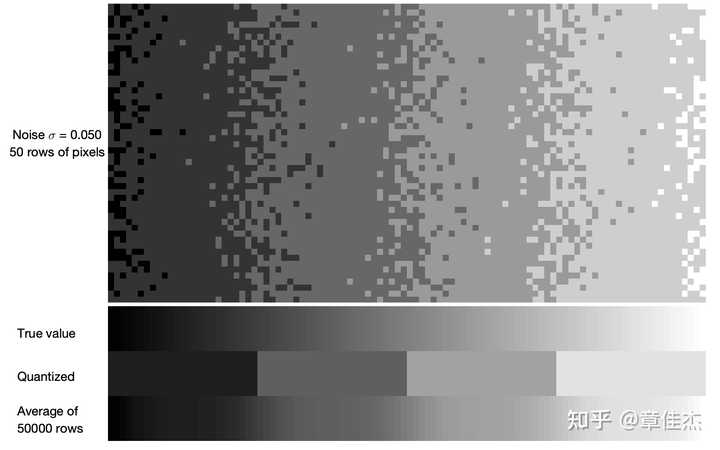
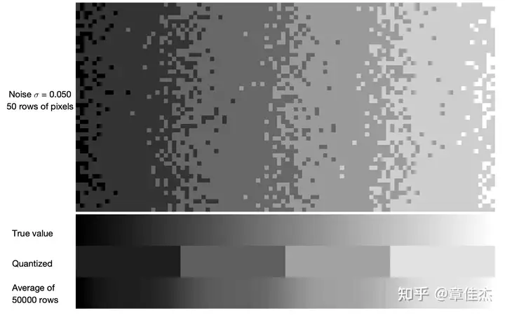
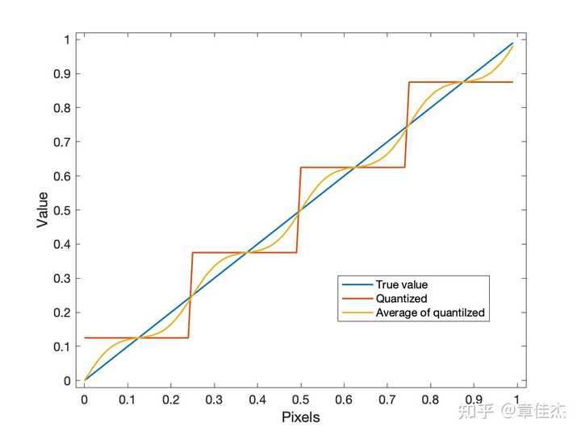
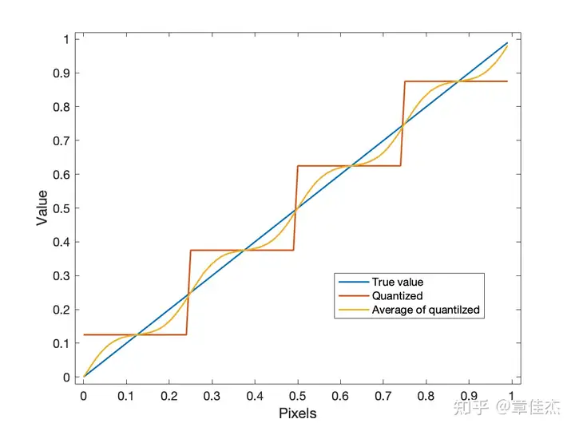
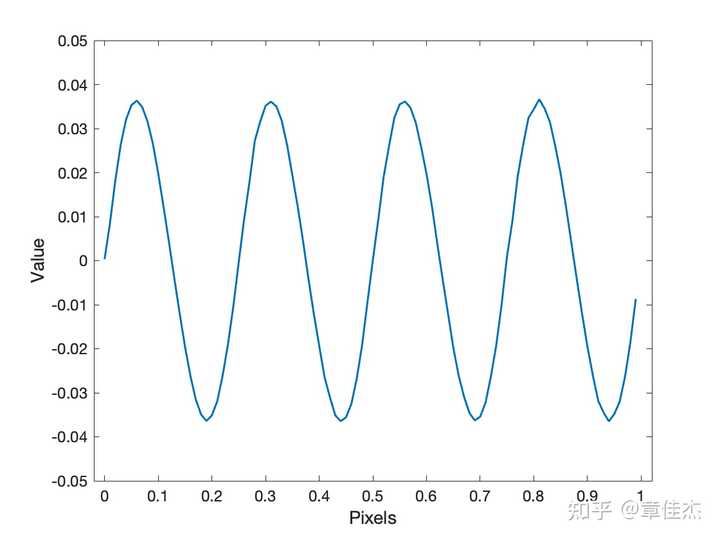

好几年没有写回答了，突然刷到这个问题真的一激灵，简直是「垂死病中惊坐起」，字面意义上的跳了起来，忍不住写下这篇回答。

先聊点引子，说一下为什么我会激动。

几年前的一天我日常在键摄群里跟人吹水，群友们聊天聊到一个话题——「如果仅考虑正态分布的噪声，那么多张照片堆栈叠加后取均值，是不是能提升色深 bit depth？」

大体上可以用下面这张图来示意说明一下：

真实亮度是一个线性渐变，而图的上半部分展示了 50 行像素，是经过叠加了正态分布的噪声再经过量化的结果。在图的下半部分，第一行展示了真实亮度，是一个平滑的线性渐变，第二行展示了**无噪声**情况下的量化结果，第三行展示了 5w 行**叠加了噪声的、量化后的像素、的平均**结果——这是对「拍摄多张照片堆栈叠加后取平均值」过程的模拟。

可以看出来，经过堆栈叠加取平均的操作后，原本量化后明显的「台阶」变得平滑了，似乎真的有提升色深的效果。但是仔细看又会发现这个平滑的结果与真正的线性渐变还是略有区别，还是能看到一些台阶的痕迹，更像是「圆滑的台阶」。

如果把亮度曲线画出来更加明显：

蓝色斜线就是真实值，是一个平滑的线性渐变，红色的「台阶」就是量化后的值，很明显这里有 4 个台阶；而黄色的曲线就是【**叠加噪声后再量化然后取平均**】的结果。（**记住这个图，很重要**）

我原本期待的是黄色的曲线能随着叠加数量增加（也就是样本数量趋于无穷）能够趋于蓝色的斜线，然而事实打脸了，黄色的曲线一直是弯曲的。（**记住这个结论，很重要**）。

从键摄的角度，这个结论很难说明「堆栈叠加后对色深的提升有多大」，毕竟「圆滑的台阶」也还是「台阶」嘛，在键摄看来还是不行，于是这个话题就鸽了。

但是东方不亮西方亮，虽然在键摄群里这个话题不了了之了，可是念念不忘终有回响——如果你看了前面的引子就会发现，其实这个问题，本质上和题主的问题是一样的。如果说一个像素其真实亮度是 x ，那么「叠加噪声后再量化」的值 y 就可以表示成： y=[x+n], \quad \text{where } n\sim \mathcal{N}(0, \sigma^2) \\ 

其中 [\cdot] 表示取整运算，取到最接近的整数，而题主的问题其实是这里 \sigma=1 的情况（也就是噪声的标准差和量化台阶一样大的情况，题主后来补充的情况其实都可以通过线性变换给转化成这种「标准情况」，就不细分了）。

题主的问题其实是：

E(y)-x=E([x+n])-x \xlongequal{\text{?}} 0 \\（最初写的时候这里我多加了一层求期望，可能和题主最初的描述有些不同了。评论区几位指出多加一层期望反而让人困惑，所以我还是删去，感谢评论区 @Yves S

 @来一点荡漾

 的评论）从上面的曲线图其实可以猜到结论，可以看到黄色曲线在一个台阶周期内与蓝色曲线之间互有正负，两者**并不相等**，但是在一个周期内求取期望之后可以猜测正负正好抵消，所以**题主的结论在期望的角度是成立的（也是我最开始多加一层期望的结论），如果不对整个周期求期望，那么题主的结论是不成立的**。

下面就比较干了，写一下我当年的一些推导，非常枯燥，不感兴趣还是可以跳过。

我们先看看 y 的分布，这里我们稍微扩展一下取整函数 [\cdot] ，记 [x;s] 表示以 s 为步长的取整，这样可以让问题更泛化一点，给推导过程提供一些方便：

$$\begin{aligned} P(y=Y) &= P([x+n;s]=Y) \\ &= P(Y-s/2 \le x+n  这里 \eta=Y/s ， \mu=x/s ；那么 y 的期望就是： \begin{aligned} E(y) &= \sum_{Y=-\infty}^{Y=+\infty}{Y P(y=Y)} \\ &= \sum_{\eta=-\infty}^{\infty}\frac{1}{2}\eta s\big(\mathrm{erf}\big(\frac{\eta-\mu+}{\sqrt{2}}\frac{s}{\sigma}\big)-\mathrm{erf}\big(\frac{\eta-\mu-}{\sqrt{2}}\frac{s}{\sigma}\big)\big) \\ &=\frac{1}{2}s \big(-1 + \sum_{\eta=-\infty}^\infty\mathrm{erf}\big(\frac{\eta++\mu}{\sqrt{2}}\frac{s}{\sigma}\big) \big) \end{aligned} \\ $$

$$而这个期望与真实值之间的偏差就是： \begin{aligned} E(y)-x &= \frac{1}{2}s \big(-1 -\mu + \sum_{\eta=-\infty}^\infty\mathrm{erf}\big(\frac{\eta++\mu}{\sqrt{2}}\frac{s}{\sigma}\big) \big)\\ &= \frac{1}{2}s \big(-1 -\mu + \sum_{\eta=-\infty}^\infty\mathrm{erf}\big((\eta++\mu) k\big) \big)\\ &= D(\mu) \end{aligned} \\ $$

$$这个求和号看起来很恐怖，一下让人手足无措，但考虑到取整函数是周期函数，所以我第一想法是用傅里叶级数来试试看，记求和号里面这个为函数 f： \mathcal{F}\big[f\big]=a_0+\sum_{m\in \mathbb{Z},m\ne 0}a_m \\ 第一项相对简单等会再看，先看第二项： \begin{aligned} a_m = &-\frac{i\exp(-m\pi(i+2m\pi/k^2))}{2m\pi}\big(\exp(2m^2\pi^2/k^2)\big(\mathrm{erf}(k \eta)-\mathrm{erf}(k+k \eta)\big) \\ &+\exp(m\pi(2i \eta+m\pi/k^2))\big(-\mathrm{erf}(k \eta+im\pi/k)+\mathrm{erf}(k+k\eta+im\pi/k)\big)\big) \\ = -&\frac{i\exp(-m\pi i-m^2\pi^2/k^2)}{2m\pi}\big(\exp(m^2\pi^2/k^2) \big(\mathrm{erf}(k\eta)-\mathrm{erf}(k+k\eta)\big) \\ &+\exp(2m\eta\pi i)\big(-\mathrm{erf}(k\eta+im\pi/k)+\mathrm{erf}(k+k\eta+im\pi/k)\big)\big) \end{aligned} \\ 由于 m, \eta 都是整数，所以这里很多 exp 的项都是 ±1，可以进一步化简：$$

$$\begin{aligned} a_m = -&\frac{i(-1)^m\exp(-m^2\pi^2/k^2)}{2m\pi}\big(\exp(m^2\pi^2/k^2)\big(\mathrm{erf}(k\eta)-\mathrm{erf}(k(\eta+1))\big) \\ &+\big(-\mathrm{erf}(k\eta+im\pi/k)+\mathrm{erf}(k(\eta+1)+im\pi/k)\big)\big) \end{aligned} $$

$$在外层的求和号这里会对 \eta 求和，我们就交换一下求和顺序（我知道这里不太严谨，不过我也不是数学系的，就这样吧）在这里对 \eta 求和的话，就会发现前后相邻两项 \eta 和 \eta+1 就会抵消掉 \begin{aligned} \sum_{\eta=-\infty}^{\infty}a_m &&=& \lim_{N\to\infty}-\frac{i(-1)^m\exp(-m^2\pi^2/k^2)}{2m\pi}\big(\exp(m^2\pi^2/k^2)(\mathrm{erf}(-kN)-\mathrm{erf}(kN)) \\ &&&+(-\mathrm{erf}(-kN+im\pi/k)+\mathrm{erf}(kN+im\pi/k))\big) \\ &&=& \frac{i(-1)^m\exp(-m^2\pi^2/k^2)}{2m\pi}(0 + 2) \\ &&=& \frac{i(-1)^m\exp(-m^2\pi^2/k^2)}{m\pi} \end{aligned} \\ $$

$$类似情况，a0 也可以这样做变换然后求和抵消，最后正好等于 0： \begin{aligned} \sum_{\eta=-\infty}^{\infty}a_0 &= \lim_{N\to\infty} \frac{-\exp(-k^2N^2)+\exp(-k^2N^2)}{k\sqrt{\pi}} - (-N)\mathrm{erf}(-kN)+N\mathrm{erf}(kN) =0 \end{aligned} \\所以回到上面计算期望的表达式： \begin{aligned} E(y)-x &= \frac{1}{2}s\sum_{m\in\mathbb{Z}, m \ne 0}a_m \exp(i2\pi m \mu) \\ &= s\sum_{m =1}^{\infty} \frac{(-1)^m \exp(-m^2\pi^2/k^2)}{m\pi}\sin(2\pi m\mu) \end{aligned} \\可以看出这是一个奇函数，本身并不恒等于0，但对其求期望当然是 0，所以题主的结论本身不成立，但对周期内求期望的话是成立的。$$

而实际上，以题主的情况，即「标准差和量化台阶一样大」的情况，差值是很小的。读者朋友可以用上面的公式验证一下。

还有一个彩蛋。

既然这里反复提到了 E(y) 与 x 的差，那么我们把这个差值曲线画出来（也就是一开始曲线图里黄色和蓝色线的差），是什么样的呢？

Duang！看起来非常像一条正弦曲线！为什么呢？

从上面的推导可以看到，三角级数前面的系数的一部分是 exp(-m^2)/m，随着 m 增加会迅速衰减，第二项就只有第一项的 ，第三项更是衰减到 ，所以就结果而言几乎就等同于第一项——也就是一个正弦函数了。

以题主的条件，「噪声标准差和量化步长相等」，即代入 s=1, k=1/√2，可以得出三角级数第一项的幅值只有 10E-9 数量级，在数值实验上难免会当做相等了。

当然了，我本人水平有限，推导过程中难免不严谨，中间过程可能还有笔误，不过整体思路我相信是正确的。

然后我看到 @Yuz.Scarlet

 回答，以及下面评论区 @来一点荡漾

 贴出的参考文献（The Density of the Fractional Part of a Normal Distribution）后，真的有一种激动涌入心头，算是把几年前的一个断了的线头又给接上了。特别开心。

数学真好玩。

[编辑于 2024-08-09 09:32](//www.zhihu.com/question/663488472/answer/3588361656)・浙江

​​1969 ​112 ​分享

​​

收起​
