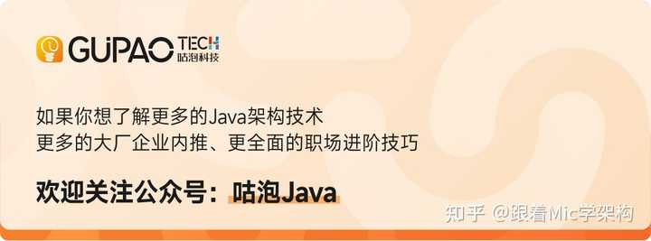
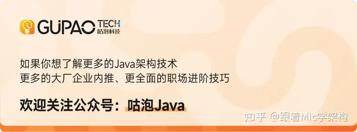

想成为Java架构师，突破职业发展瓶颈，欢迎来咕泡教育见字如面，我是咕泡科技创始人Mic（谭锋）

缓存一致性（cache coherency）是计算机系统中处理器缓存之间保持数据一致性的机制，其目的是确保多个处理器或核心之间对共享数据的读写操作都能够正确同步。

以下是一些模拟器和代码库，可以用来模拟实验缓存一致性协议：

- CacheSim：是一个用于模拟多处理器缓存一致性协议的模拟器，可以通过修改配置文件来模拟不同的协议和处理器拓扑结构。可以用于研究MESI、MOESI等常见的缓存一致性协议。
- COAST：是一个用于模拟多处理器系统的高性能缓存一致性模拟器，支持多种常见的缓存一致性协议，包括MESI、MOESI、MESIF等。可以通过修改配置文件来模拟不同的协议和处理器拓扑结构。
- Herd：是一个用于模拟多处理器系统的缓存一致性验证工具，可以通过编写简单的C语言程序来验证不同的缓存一致性协议。通过编写C语言程序来验证协议的方式非常适合学习和理解缓存一致性协议的工作原理。
- CacheLab：是一个用于模拟多处理器系统的缓存一致性实验室，包括多个实验，旨在帮助学生深入理解缓存一致性协议。可以用于学习和理解MESI、MOESI等常见的缓存一致性协议。

https://ke.gupaoedu.cn/course/java

送礼物

还没有人送礼物，鼓励一下作者吧

[发布于 2023-03-19 13:08](//www.zhihu.com/question/590540790/answer/2943285963)・湖南

​添加评论​12 ​3 ​分享

​​

收起​
