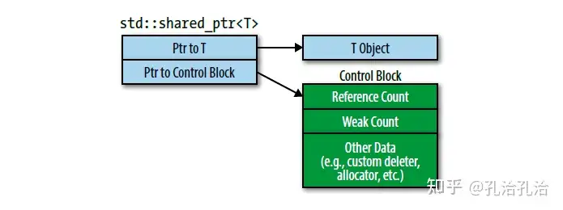

之前和同学讨论过这个，当时也没想得太清楚。

最近看了些cpp的书，发现《Effective modern c++》里面 Item19  shared pointer 的部分有详细介绍这个。我尝试着把它搬过来尽量说明白（表达能力有限 QAQ

#### shared pointer 介绍

`std::shared_ptr`对象在内存中是这样：

当指向对象的`std::shared_ptr`一创建，被管理对象的控制块就建立了。被管理的对象的控制块中有引用计数(reference count)，当引用计数为0时，被管理的对象会被销毁。

控制块的创建会遵循下面几条规则：

- `std::make_shared`会创建控制块。
- 从 `std::unique_ptr`  上构造出 `std::shared_ptr`的时候，会创建控制块。
- 从原始指针上构造 `std::shared_ptr`的时候会创建控制块
假若我们为一个指针构建了多个控制块，那么会有多个引用计数，意味着对象可能销毁多次，这是非法行为。所以使用 `std::shared_ptr`的时候，我们应该**避免构建多个控制块**。

#### enabled_shared_from_this 的用处

`this`指针作为`std::shared_ptr`构造函数实参的时候可能导致创建多个控制块。导致非法行为。

我们用一个例子来说明，假设我们的程序使用`std::shared_ptr`管理`Widget`对象，我们有一个数据结构用于跟踪已经处理过的`Widget`对象：

`std::vectorstd::shared_ptrWidget>> processedWidgets;
`

假设`Widget`有一个用于处理的成员函数：

`class Widget {
public:
    // ...
    void process();
    // ...
};
`

对于`Widget::process`看起来合理的代码如下：

`void Widget::process()
{
    // ...
    processedWidgets.emplace_back(this);
}
`

在 `process()` 中执行 `processedWidgets.emplace_back(this);` 的时候，`std::shared_ptr`的会为 `this`这个原始指针创建一个控制块。但是有可能，`this` 指向的 `Widget` 的 `process()` 成员函数之外也被其他的 `std::shared_ptr`管理，所以**可能存在多个 `std::shared_ptr`的控制块，导致非法行为**。 

`std::enabled_shared_from_this`就是解决这个问题的。 

`std::enable_shared_from_this`定义了一个成员函数：`shared_from_this()`，它会创建指向当前对象的`std::shared_ptr`，会去关联同一个已经创建的控制块，解决了多个控制块的问题。

`Widget::process`的安全实现：

`class Widget: public std::enable_shared_from_thisWidget> {
public:
    // ...
    void process();
    // ...
};
void Widget::process()
{
    processedWidgets.emplace_back(shared_from_this());
}
`

`shared_from_this()`会查找当前对象控制块，然后创建一个新的`std::shared_ptr`关联这个控制块。用这个函数之前，是假设当前对象已经存在一个关联的控制块。因此，必须已经存在一个指向当前对象的`std::shared_ptr`。如果没有`std::shared_ptr`指向当前对象（即当前对象没有关联控制块），那么`shared_from_this`会抛出一个异常。

Reference:

- https://cntransgroup.github.io/EffectiveModernCppChinese/4.SmartPointers/item19.html
 （我是知识的搬运工，侵删

[编辑于 2022-10-04 06:14](//www.zhihu.com/question/30957800/answer/2700292012)・湖南

​​209 ​9 ​分享

​​

收起​
