### 说明

最近在学习CUDA，感觉看完就忘，于是这里写一个导读，整理一下重点

主要内容来源于NVIDIA的官方文档《CUDA C Programming Guide》，结合了另一本书《CUDA并行程序设计 GPU编程指南》的知识。 因此在翻译总结官方文档的同时，会加一些评注，不一定对，望大家讨论指出。

另外，我才不会老老实实的翻译文档，因此细节还是需要从文档里看的。

看完两份文档总的来说，感觉《CUDA C Programming Guide》这本书作为一份官方文档，知识细碎且全面，且是针对最新的Maxwell、Pascal、Volta架构的阐述。但相对来说不够深入，且有关程序设计方面所述甚少。

而《CUDA并行程序设计 GPU编程指南》这本书，讲解的比较深入，不仅阐述了NVIDIA GPU的特性，并且在程序设计方面有比较深入的见解。美中不足的是该书是针对老旧的Tesla、Fermi架构GPU，没有涉及到新架构的新特性。  

### Chapter 1 简介

### 1.1 从图形处理到通用并行计算

GPU是能够高度并行化、具有很多处理器核心的器件，具有很强的计算能力和内存带宽。下图是CPU和GPU在浮点运算上的性能对比发展趋势。

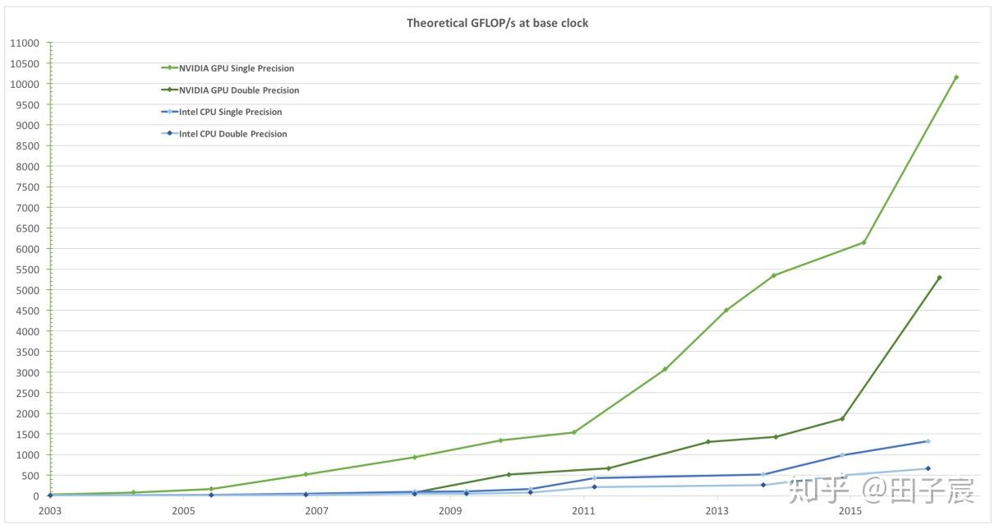

NVIDIA GPU和 Intel CPU 浮点计算能力对比**

可以看到，NVIDIA的GPU在浮点运算能力上，吊打了Intel的CPU。其原因来自于CPU和GPU结构上的差异。

如下图所示，CPU仅仅具有有限的核心数量。相比于GPU，CPU的核心属于“少而精”的存在，核心数虽然很少，但是每个核心的性能很强，适合处理具有很多分支的复杂的逻辑。近些年来，CPU中集成了一些并行指令集，如SSE、AVX等，其中AVX可以同时处理256位(32个字节)，可以大大加速并行计算。但是相比于GPU，还是小巫见大巫。

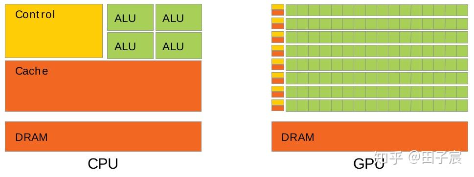

CPU 与 GPU 内部结构对比

GPU的设计理念与CPU不同，GPU具有庞大的核心数。以TITANX为例，流处理器（等同于CPU的核心）达到3072个之多。这意味着相比于8核的CPU处理器，TITANX可以同时并行处理384倍的任务。但是GPU的单个核心不如CPU的核心强大。因此相对于CPU，GPU更适合处理高度并行化的任务。

从另一个视角来看上图，在CPU芯片中，运算单元(ALU)所占的比例较小，CPU中更多的硅片被用来制作控制单元和缓存，以完成复杂的逻辑；而GPU的运算单元使用的硅片面积比例要大于CPU，以完成高强度的计算。因此CPU的侧重点在于逻辑控制，而GPU的侧重点在于计算。

深度学习，尤其是卷积神经网络中，有很多可以高度并行化的向量运算与矩阵运算。因此使用GPU进行深度学习运算，远比CPU快速。

另外还需注意的是，由于GPU的核心数量太多，即使GPU的内存（也称作显存）优于CPU的内存，其内存仍然是瓶颈。因此，GPU希望程序是 计算密集型 而不是 内存密集型。

### 1.2 CUDA

CUDA(Compute Unified Device Architecture)，是NVIDIA推出的通用并行计算平台和编程模型。CUDA是在底层API的基础上，封装了一层，使得程序员可以使用C语言来方便的编程。

CUDA还支持C++/Python等更高级的语言编程；此外，NVIDIA还提供了CuDNN、TensorRT、NPP等更高级的库函数。

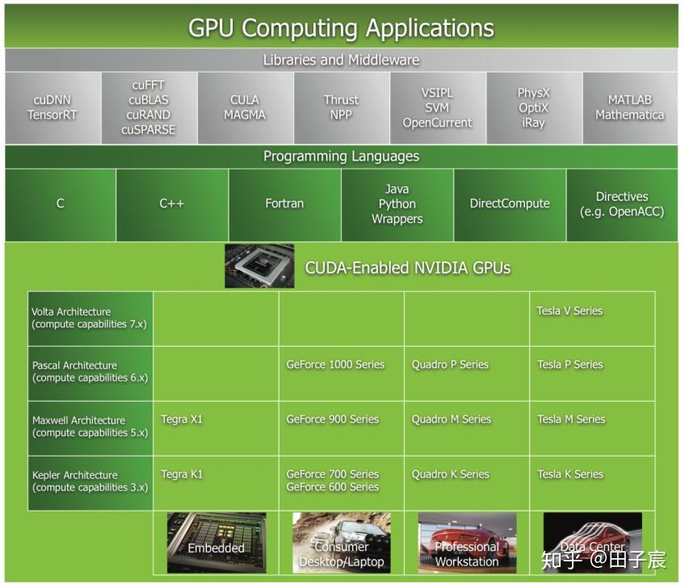

各代显卡、CUDA、上层库之间的关系

从上图中也可以看出各个系列的GPU属于哪些架构、什么定位。例如GeForece 1000系列，就是使用Pascal架构的消费显卡。

### 1.3 可扩展的编程模型

CUDA的编程模型，使得同一个CUDA程序，可以在不同的显卡上运行。

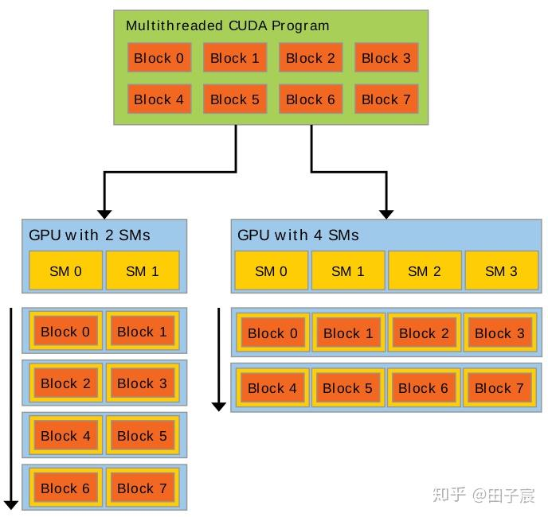

CUDA编程模型

如上图所示，CUDA程序一般会创建一些线程块(Block)，线程块会被调度到空闲的流处理器簇(SM)上去。当线程块执行完毕后，线程块会退出SM，释放出SM的资源，以供其他待执行线程块调度进去。

因此，无论是只有2个SM的GPU，还是有4个SM的GPU，这些线程块都会被调度执行，只不过是执行的时间有长有短。因此，同样的程序，可以在具有不同SM数量上的GPU运行。

### 1.4 Document Structure

略

### Chapter 2 编程模型

### 2.2 线程层级

在讲解内核函数前，先讲解一下线程层级，不然有点难讲。

CUDA编程是一个多线程编程，数个线程(Thread)组成一个线程块(Block)，所有线程块组成一个线程网格(Grid)，如下图所示：

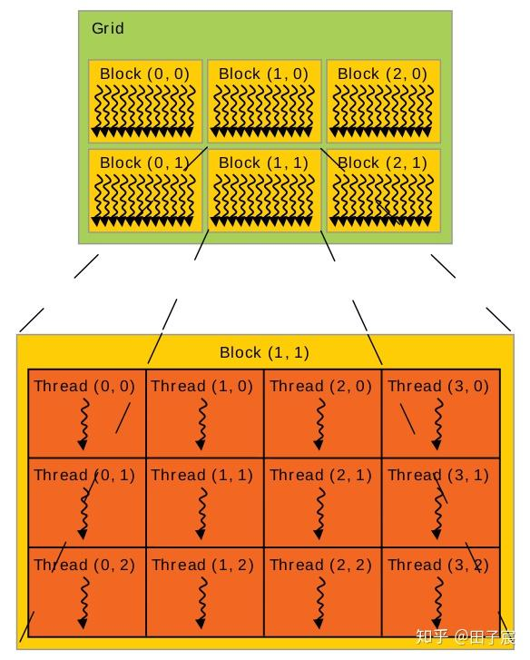

CUDA线程层级

图中的线程块，以及线程块中的线程，是按照2维的方式排布的。实际上，CUDA编程模型允许使用1维、2维、3维三种方式来排布。另外，即使线程块使用的是1维排布，线程块中的线程也不一定要按照1维排，而是可以任意排布。

目前的GPU限制一个线程块中，最多可以安排1024个线程。

一个线程块用多少线程，以及一个线程网格用多少线程块，是程序员可以自由安排的。由于32个相邻的线程会组成一个线程束(Thread Warp)，而一个线程束中的线程会运行同样的指令。因此一般线程块中线程的数量被安排为32的倍数，选用256是比较合适的。

在线程数定下来之后，一般根据数据的排布情况来确定线程块的个数。

例如：一个数组的长度为4096，安排每个线程处理一个元素。如果安排一个线程块为256个线程，则需要=16个线程块。

### 2.1 内核函数(Kernels)

内核函数是CUDA 每个线程** 执行的函数。CUDA使用扩展的C语言编写内核函数，关键字为**global**。内核函数返回值只能是void。

下面是一段简单的内核函数，用于求两个数组的和：

`// Kernel definition
__global__ void VecAdd(float* A, float* B, float* C)
{
    int i = threadIdx.x;
    C[i] = A[i] + B[i];
}

int main()
{
    ...
    // Kernel invocation with N threads
    VecAdd1, N>>>(A, B, C);
    ...
}
`

`threadIdx.x`是线程在所处线程块中的X方向的ID。由于本例中是定义的1维排布，因此X方向ID即为线程的ID。

由于GPU中的每个线程都会执行相同的VecAdd函数，因此不同的线程需要使用自己独有的ID来区分彼此，来获取不同的数据。这就是SIMT的概念，即“相同指令，不同线程”。

在main()函数中，我们注意到，VecAdd函数的调用使用了`>`关键字。这是调用内核函数所独有的。程序员通过该关键字，制定网格中线程块和线程的排布方式。排布方式与数据息息相关。

下面举一个2维排布的例子，用于做矩阵加法：

`// Kernel definition
__global__ void MatAdd(float A[N][N], float B[N][N],
float C[N][N])
{
    int i = blockIdx.x * blockDim.x + threadIdx.x;
    int j = blockIdx.y * blockDim.y + threadIdx.y;
    if (i  N && j  N)
        C[j][i] = A[j][i] + B[j][i];
}

int main()
{
    ...
    // Kernel invocation
    dim3 threadsPerBlock(16, 16);
    dim3 numBlocks(N / threadsPerBlock.x, N / threadsPerBlock.y);
    MatAddnumBlocks, threadsPerBlock>>>(A, B, C);
...
}
`

首先看主函数，当排布不使用1维时，需要使用`dim3`数据类型。该程序每个线程块中线程为16x16排布，而线程块的排布依赖于数据的多少。

在内核函数中，i代表x方向上的ID，j代表y方向上的ID。`blockDim`代表当前线程块的尺寸。从程序中可以看到，x方向为行方向，y方向为列方向。（注意，这里官方文档里面写的有些错误）

每个线程读取自己ID对应的数据A[j][i]和B[j][i]，并将结果写回C[j][i]。其中A、B、C都存储在GPU的全局内存上（后面会提及）

### 2.3 内存层级

同CPU一样，GPU也有不同层级的内存。越靠近核心的内存速度越快，但容量越小；反之，越远离核心的内存速度越慢，但容量较大。

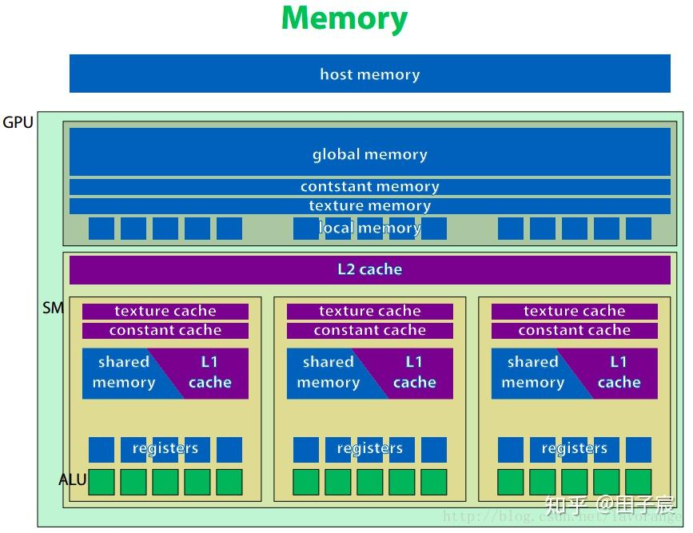

CUDA内存层级

上图是NVIDIA设备的硬件示意图。

- 最上方是主机端内存(host memory)，指的就是我们常说的内存。一般主机端内存通过PCI-E总线与设备端内存交换数据。数据交换的速度等于PCI-E总线的速度。
- 全局内存(global memory)** 、常量内存(constant memory)、纹理内存(texture memory)、本地内存(local memory)。都位于GPU板上，但不在片内。因此速度相对片内内存较慢。** 常量内存和纹理内存对于GPU来说是只读的。  
- GPU上有 L2 cache和 L1 cahce。其中L2 cache为所有流处理器簇(SM)共享，而L1 cache为每个SM内部共享。这里的cache和CPU的cache一样，程序员无法对cache显式操纵。
- 纹理缓存和常量缓存在SM内部共享，在早期1.x计算能力的时代，这两种缓存是片上唯一的缓存，十分宝贵。而当Fermi架构出现后，普通的全局内存也具有了缓存，因此就不那么突出了。
- 共享内存(shared memory, SMEM)** 具有和L1缓存同样的速度，且可以被程序员显式操纵，因此经常被用作存放一些需要反复使用的数据。共享内存只能在SM内共享，且对于CUDA编程模型来说，即使线程块被调度到了同一个SM内也无法互相访问。
- GPU的**寄存器(registers)** 和CPU不一样，其空间非常巨大，以至于可以为每一个线程分配一块独立的寄存器空间。因此，不像CPU那样切换进程时需要保存上下文，GPU只需要修改一下寄存器空间的指针即可继续运行。所以巨大的寄存器空间，使得GPU上线程切换成为了一个几乎无消耗的操作。** 不过有一点需要注意，寄存器的空间不是无限大的。如果线程数过多，或一个线程使用的寄存器数量太多，多出来的数据会被保存到缓慢的本地内存上，影响程序速度，需要注意。
这里想强调一下共享内存。
 共享内存在物理上是一个个存储体组成的。如果在访问时没有出现冲突，则可以实现高速的访问。但如果出现了冲突(如对某一个存储体的原子操作)，则不仅仅当前线程束会发生串行化，*而且会导致其他线程束无法被调度(存疑，待考证)*。

以上是从硬件的角度解读了一下GPU的内存层级。从编程角度来看，CUDA的线程网格、线程块、线程与各个内存见的关系如下图：

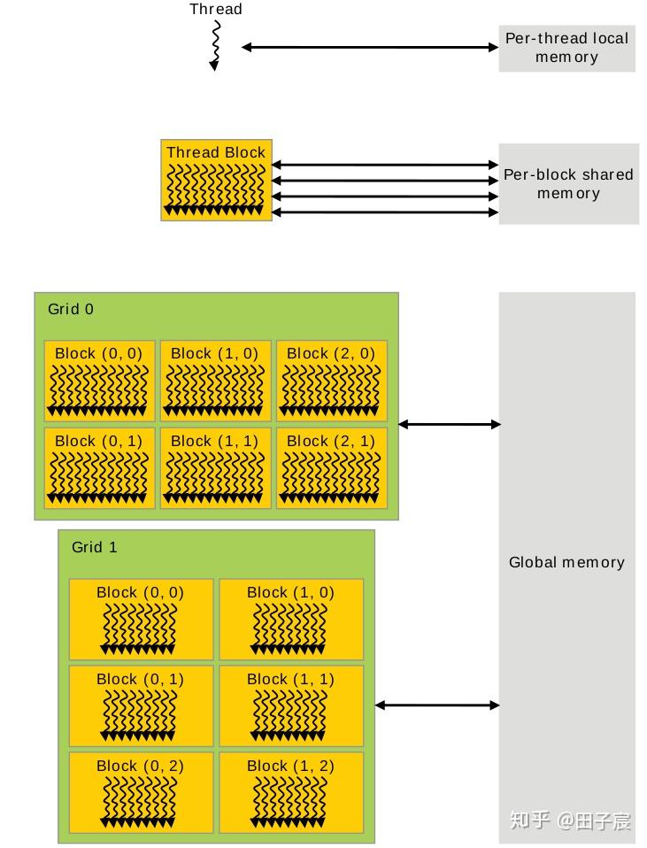

线程层级与内存层级对应图

- 寄存器和本地内存绑定到了每个线程，其他线程无法访问。
- 同一个线程块内的线程，可以访问同一块共享内存。注意，即使两个线程块被调度到了同一个SM上，他们的共享内存也是隔离开的，不能互相访问。
- 网格中的所有线程都可以自由读写全局内存。
- 常量内存和纹理内存只能被CPU端修改，GPU内的线程只能读取数据。

### 2.4 CPU/GPU混合编程

一种最简单的CPU/GPU混合编程如下图所示：

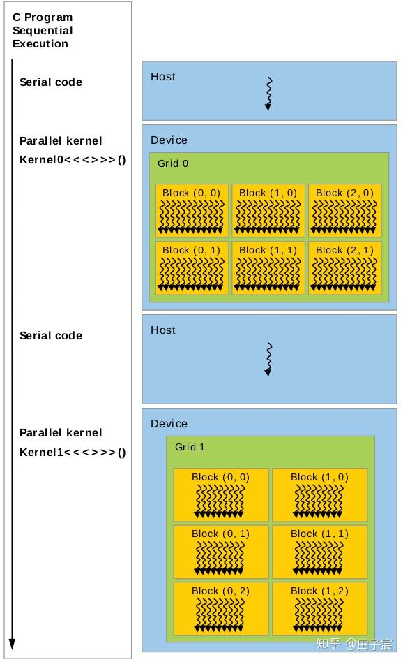

CPU/GPU混合编程

主机端(Host，即CPU)执行串行代码，然后调用内核函数，让设备端(Device，即GPU)执行并行代码。如此交错执行。

CPU和GPU的内存是独立的。因此在运行内核函数前，主机端需要调用内存拷贝函数，将数据通过PCI-E总线拷贝到设备端。内核运行结束后，需要CPU再次调用内存拷贝函数，将数据拷回主机端内存。

另一种方式是使用统一编址，将设备端的内存和主机端内存编到一起。这样主机就不需要显式的调用函数将数据拷贝到设备端内存了。

除了CPU/GPU交错执行代码的方式外，还可以通过使用事件(event)和流(stream)等方式，让CPU/GPU并行工作，提升整体的效率。

### 2.5 计算能力(Compute Capability)

所谓的计算能力(Compute Capability)，说白了就是GPU的版本号。有时也被称作SM Version。

不同版本的GPU具有不同的特性，因此程序编写也会有所差异。

计算能力为X.Y，其中主版本号X代表架构，各个架构如下表：

版本号与架构名称在CUDA的书籍文档中，我们经常能看到"1.x"、"5.x"等这样的字眼，代表第1代/第5代架构，也就是Tesla/Maxwell架构。

次版本号Y，代表在架构的基础上，有一定改进，或者有一些新特性的引入。

最新的图灵架构(Turing)，实际上计算能力是7.5，也就是说还是属于Volta架构。

CUDA是软件平台，其版本(CUDA7.5 CUDA8.0 CUDA10.0)与计算能力基本没有关系。不过最新的CUDA一般会支持最新的架构。
 从CUDA7.0起，Tesla架构不再被支持；从CUDA9.0起，Fermi架构不再被支持。

### 2.6 完整的例子

初学者的话，上面内容能看明白的都是勇士。这里给一个例子，是我自己写的BGR转灰度图的程序，希望能让大家稍微明白一点CUDA程序如何写。

`/* main.cu */
#include *
#include 
#include "opencv2/highgui.hpp"  //实际上在/usr/include下
#include "opencv2/opencv.hpp"
using namespace cv;
using namespace std;

//内核函数
__global__ void rgb2grayincuda(uchar3 * const d_in, unsigned char * const d_out, 
                                uint imgheight, uint imgwidth)
{
    const unsigned int idx = blockIdx.x * blockDim.x + threadIdx.x;
    const unsigned int idy = blockIdx.y * blockDim.y + threadIdx.y;

    if (idx  imgwidth && idy  imgheight)  //有的线程会跑到图像外面去，不执行即可
    {
        uchar3 rgb = d_in[idy * imgwidth + idx];
        d_out[idy * imgwidth + idx] = 0.299f * rgb.x + 0.587f * rgb.y + 0.114f * rgb.z;
    }
}

//用于对比的CPU串行代码
void rgb2grayincpu(unsigned char * const d_in, unsigned char * const d_out,
                                uint imgheight, uint imgwidth)
{
    for(int i = 0; i  imgheight; i++)
    {
        for(int j = 0; j  imgwidth; j++)
        {
            d_out[i * imgwidth + j] = 0.299f * d_in[(i * imgwidth + j)*3]
                                     + 0.587f * d_in[(i * imgwidth + j)*3 + 1]
                                     + 0.114f * d_in[(i * imgwidth + j)*3 + 2];
        }
    }
}

int main(void)
{
    Mat srcImage = imread("./test.jpg");
    imshow("srcImage", srcImage);
    waitKey(0);

    const uint imgheight = srcImage.rows;
    const uint imgwidth = srcImage.cols;

    Mat grayImage(imgheight, imgwidth, CV_8UC1, Scalar(0));

    uchar3 *d_in;   //向量类型，3个uchar
    unsigned char *d_out;

    //首先分配GPU上的内存
    cudaMalloc((void**)&d_in, imgheight*imgwidth*sizeof(uchar3));
    cudaMalloc((void**)&d_out, imgheight*imgwidth*sizeof(unsigned char));

    //将主机端数据拷贝到GPU上
    cudaMemcpy(d_in, srcImage.data, imgheight*imgwidth*sizeof(uchar3), cudaMemcpyHostToDevice);

    //每个线程处理一个像素
    dim3 threadsPerBlock(32, 32);
    dim3 blocksPerGrid((imgwidth + threadsPerBlock.x - 1) / threadsPerBlock.x,
        (imgheight + threadsPerBlock.y - 1) / threadsPerBlock.y);

    clock_t start, end;
    start = clock();

    //启动内核
    rgb2grayincuda blocksPerGrid, threadsPerBlock>> >(d_in, d_out, imgheight, imgwidth);

    //执行内核是一个异步操作，因此需要同步以测量准确时间
    cudaDeviceSynchronize();
    end = clock();

    printf("cuda exec time is %.8f\n", (double)(end-start)/CLOCKS_PER_SEC);

    //拷贝回来数据
    cudaMemcpy(grayImage.data, d_out, imgheight*imgwidth*sizeof(unsigned char), cudaMemcpyDeviceToHost);

    //释放显存
    cudaFree(d_in);
    cudaFree(d_out);

    imshow("grayImage", grayImage);
    waitKey(0);

    return 0;

}
`

这里我对比了CUDA、CPU、OPENCV三种实现方式的执行时间：

CUDA、CPU、OPENCV执行时间对比速度：CUDA>OPENCV>CPU。其中OPENCV快于CPU的主要原因是OPENCV调用了并行运算指令，但慢于CUDA。

附上CMakeLists.txt：

`cmake_minimum_required(VERSION 2.8)
project(testcuda)
find_package(CUDA REQUIRED)
find_package(OpenCV REQUIRED)
cuda_add_executable(testcuda main.cu)
target_link_libraries(testcuda ${OpenCV_LIBS})`

水水的介绍到此结束，剩下的我就要放飞自我了，看不懂别怪我*

### Chapter 3 编程接口

CUDA的编程接口由一系列C语言的扩展和运行库(runtime library)组成。  

C语言的扩展在第二章“编程模型”中有所提及，如内核函数、线程网格和线程块等；
 运行库则是在CUDA Driver API的基础上建立的。用户可以直接在应用程序中跳过CUDA，直接调用CUDA Driver API，以便更底层地操作GPU，如操作GPU的上下文。不过对于大多数应用来说，使用CUDA提供的运行库就足够了。

本章讲首先讲解CUDA程序的编译过程，之后会介绍CUDA运行库，最后会介绍程序兼容性等问题。

### 3.1 使用NVCC编译CUDA程序

CUDA程序使用NVCC编译器。
 NVCC提供了简单方便的接口，能够很好的同时处理主机端和设备端代码。这里将简要介绍NVCC编译CUDA程序的流程，更多信息请参考nvcc user manual。

### 3.1.1 编译流程

### 3.1.1.1 离线编译

NVCC进行离线编译的操作流程是：
 * 分离CUDA程序中的主机端代码(host code)和设备端代码(device code) * 将设备端代码编译成一种虚拟汇编文件(名为PTX)，再接着编译成二进制代码(名为cubin) * 将主机端代码中含有">>"的代码(即内核调用)替换为CUDA运行库中的函数调用代码 * 之后NVCC会借助其他编译器(如gcc)将主机端代码编译出来 * 主机端代码和设备端代码被编译好后，nvcc会将两段代码链接起来

### 3.1.1.2 在线编译(JIT Compilation)

PTX是一个虚拟汇编文件。其形式虽然很像汇编，但里面的每一条指令实际上是一个虚拟的指令，与机器码无法对应。需要编译器或设备驱动程序将其翻译成对应平台的汇编/机器码才能运行。

如果在编译过程中，NVCC不将设备端代码编译为cubin文件，即二进制代码，而是停在PTX代码上。设备驱动(device driver)会负责在运行时，使用PTX代码生成二进制代码。这个过程被称作在线编译(JIT Compilation, Just-In-Time Compilation)。

在线编译必然会使得程序启动的时间延长，不过设备驱动程序会自动缓存编译出来的二进制代码(也被称作compute cache)。

在线编译一方面的优势在于兼容性。另一方面的优势在于，当设备驱动程序有关编译的部分得到优化时，同样的PTX编出来的cubin文件同样会得到优化。也就是说，一段祖传的PTX代码，很有可能因为驱动程序不断的优化，而躺着得到了优化。而如果直接离线编译得到了cubin文件的话，则无法享受到这一优化。

### 3.1.2 二进制代码的兼容性

二进制代码cubin是受到GPU计算能力的限制的。在编译时，需要使用`-code`来指定将代码编译到哪个计算能力平台上，如`-code=sm_35`代表生成的cubin代码是运行在计算能力为3.5的平台上的。

二进制代码若要兼容，首先架构得一致。不同架构上的二进制代码不能互相兼容，如在Maxwell架构上编译出来的代码，不能在其他架构上运行。
 其次，若执行平台的次版本号版本比编译时指定的的次版本号高，则可以运行。例如如果在编译时指定`-code=sm_35`，则在计算能力3.7的平台上也可以运行。反之则不可以。

另外需要说明的是，上述二进制代码的兼容性原则只限于桌面款显卡。

### 3.1.3 PTX代码的兼容性

PTX代码的兼容性远强于二进制代码。只要不涉及到不同架构上的特性差异，PTX可以在任何架构上运行。

不过PTX代码在两种情况下其兼容性会受限：
 1. 若PTX代码使用了较高级别架构的特有特性，则无法在较低架构上运行。例如若PTX代码用到了计算能力3.0以上才能使用的Warp Shuffle特性，则无法在2.x或1.x平台上运行。 2. 若PTX在较低架构上生成，则虽然能够在所有更高级别的架构上运行，但无法充分利用这些架构的硬件特性，造成性能无法最大化的问题。

在编译时，可以通过`-arch`来指定生成的PTX代码的版本，如`-arch=compute_30`。

### 3.1.4 应用程序兼容性

为了保证应用程序的兼容性，最好是将代码编译成PTX代码，然后依靠各个计算能力的驱动程序在线编译成对应平台的二进制代码cubin。

除了使用`-arch`和`-code`来分别指定C->PTX和PTX->cubin的计算能力外，还可以用`-gencode`关键字来操作，如下例：

`nvcc x.cu
    -gencode arch=compute_35,code=sm_35
    -gencode arch=compute_50,code=sm_50
    -gencode arch=compute_60,code=\'compute_60,sm_60\'`

使用上述编译指令后，会生成3...0的cubin文件，以及6.0的PTX代码。具体内容请参考nvcc user manual。

对于主机端代码，会自动编译，并在运行时决定调用哪一个版本的执行。对于上例，主机端代码会编译为：3...0的二进制文件，以及7.0的PTX文件。

另外，在程序中可以使用`__CUDA_ARCH__`宏来指定计算能力(只能用于修饰设备端代码)。计算能力3.5在程序中对应的`__CUDA_ARCH__`为350。

有一点需要注意的是，7.0以前，都是以线程束为单位在调度，线程束内指令永远是同步的，被成为锁步**。而Volta架构(计算能力7.x)引入了Independent Thread Scheduling，破坏了线程束内的隐式同步。因此，如果老版本的代码里面有默认锁步的代码，在Volta架构下运行时可能会因为锁步的消失而出问题，可以指定`-arch=compute_60 -code=sm_70`，即将PTX编到Pascal架构下以禁用Independent Thread Scheduling特性。（当然，也可以修改代码来显示同步）

另外，版本相关编译指令有缩写的情况，具体看手册。

### 3.1.5 C/C++兼容性

对于主机端代码，nvcc支持C++的全部特性；而对于设备端代码，只支持C++的部分特性。具体查阅手册。

### 3.1.6 位兼容性

当且仅当主机端代码按照64位编译时，设备端代码才能编译为64位。当主机端代码编译为32位时，设备端代码只能编译成32位。即设备端代码的位数和主机端永远保持一致。

具体编译成位的哪一种，取决于nvcc本身的版本。32位nvcc会自动编出32位的代码，不过可以使用`-m64`来编出64位代码。对于64位编译器亦然。

### 3.2 CUDA C 运行库

运行库实际上在cudart库内，可以使静态链接库`cudart.lib/libcudart.a`，或者动态链接库`cudart.dll/cudart.so`。

所有程序的入口都是`cuda`。

### 3.2.1 初始化

CUDA运行库没有显式的初始化函数，在调用第一个函数时会自动初始化(设备和版本管理函数不行)。初始化时，会产生一个全局可见的设备上下文(device context)。

当主机端代码调用了`cudaDeviceReset()`函数，则会销毁掉这个上下文。注意，销毁的上下文是主机端正在操纵的设备。如要更换，需要使用`cudaSetDevice()`来进行切换。

### 3.2.2 设备内存

CUDA运行库提供了函数以分配/释放设备端的内存，以及与主机端内存传输数据。

这里的设备内存，指的是全局内存+常量内存+纹理内存。

设备内存有两种分配模式：线性存储(linear memory)、CUDA arrays。 其中CUDA arrays与纹理内存有关，本导读略去不谈。

线性内存是我们常用的内存方式，在GPU上用40位的地址线寻址。线性内存可以用`cudaMalloc()`分配，用`cudaFree()`释放，用`cudaMemcpy()`复制数据，用`cudaMemset()`赋值。

对于2D或3D数组，可以使用`cudaMallocPitch()`和`cudaMalloc3D()`来分配内存。这两个函数会自动padding，以满足内存对齐的要求，提高内存读写效率。内存对齐的问题，会在第五章里详细阐述。

另外，如果要在设备内存中定义全局变量，则需要使用使用`__constant__`或`__device__`来修饰，并使用`cudaMemcpyToSymbol()`和`cudaMemcpyFromSymbol()`来读写。如下例：

`__constant__ float constData[256];
float data[256];
cudaMemcpyToSymbol(constData, data, sizeof(data));
cudaMemcpyFromSymbol(data, constData, sizeof(data));

__device__ float devData;
float value = 3.14f;
cudaMemcpyToSymbol(devData, &value, sizeof(float));

__device__ float* devPointer;
float* ptr;
cudaMalloc(&ptr, 256 * sizeof(float));
cudaMemcpyToSymbol(devPointer, &ptr, sizeof(ptr));
`

实际上，当使用`__constant__`关键字时，是申请了一块常量内存；而使用`__device__`时，是普通的全局内存。因此`__device__`申请的内存需要申请，而`__constant__`不用。不管是全局内存，还是常量内存，需要用带有`Symbol`的函数拷贝。

### 3.2.3 共享内存

不管是全局变量还是局部变量，都需要使用`__shared__`来修饰。不过需要注意的是，即使定义为全局变量，共享内存依旧只能被同一线程块内的线程可见。

举个例子，对于如下代码，虽然是定义了一个全局的共享内存hist_shared，但实际上，在每一个线程块被调度到SM上时，都会在SM的共享内存区开一块内存。因此，每一个线程块都有一个hist_shared，且之间无法互相访问。

`__shared__ unsigned int hist_shared[256];   //共享内存仅在线程块内共享

__global__ void getGrayHistincuda_usesharemem(unsigned char * const grayData, 
                                            unsigned int * const hist,
                                            uint imgheight,
                                            uint imgwidth)  //使用共享内存加速
{
    const unsigned int idx = blockDim.x * blockIdx.x + threadIdx.x;
    const unsigned int idy = blockDim.y * blockIdx.y + threadIdx.y;  
    const unsigned char inner_idx = threadIdx.y * blockDim.x + threadIdx.x;

    hist_shared[inner_idx%256] = 0;   //清空数据，由于每个块的inner_idx可以超过256，所以这样可以保证hist_shared被全部清零

    __syncthreads();    //等待其他线程完成

    if(idx  imgwidth && idy  imgheight)
    {
        const unsigned long pid = imgwidth * idy + idx;
        const unsigned char value = grayData[pid];
        atomicAdd(&(hist_shared[value]), 1);
    }

    __syncthreads();

    if(threadIdx.y  8) //每个线程块将自己共享内存中的值合并到全局内存中去
    {
        atomicAdd(&(hist[inner_idx]), hist_shared[inner_idx]);
    }

}
`

当然，共享内存的声明放在内核函数里面也是可以的，效果一致。

使用共享内存，可以获得等同于L1 cache的访存速度，其速度远快于全局内存。

但是注意，并不是什么时候都可以使用共享内存来获取加速的。例如内核函数计算出来结果后，如果这个结果只需要传输回主机端，而不需要再次被用到时，直接写回全局内存会比较快。如果先写回共享内存，再写回全局内存，反而会比较缓慢。** 一般来讲，当需要频繁读写，或是有原子操作时，使用共享内存替代全局内存，会取得比较大的增益。

强调一下，共享内存只能为线程块内的线程共享。如果需要整个线程网格中线程都能访问，则需要全局内存或常量内存。

另外，共享内存是一个稀缺资源。有些架构可以通过配置，分配L1 cache和共享内存的比例。

### 3.2.4 锁页内存(Page-Locked Host Memory/Pinned Memory)

锁页内存指的是主机端上不会被换出到虚拟内存(位于硬盘)上的内存。  

锁页内存的分配与释放：
 在CUDA程序中，使用`cudaHostAlloc()`，可以分配锁页内存，使用`cudaFreeHost()`来释放锁页内存
 或者使用`cudaHostRegister()`来将`malloc()`分配的内存指定为锁页内存

NVIDIA官方给出的锁页内存相对于普通的内存的的好处是：
 * 使用锁页内存后，锁页内存与设备内存之间的数据传输，可以使用流的方式，和内核函数执行并行。 * 使用锁页内存后，可以将锁页内存映射到设备内存上。 * 对于使用*前端总线*的系统，使用锁页内存可以提升主机端到设备端传输的带宽；
 如果将锁页内存指定为合并写(write_combining)，则可以进一步提高带宽。

另一本书对于锁页内存之所以快的解释是：
 * 如果主机端将数据放在锁页内存，则可以使用PCI-E的DMA与设备内存进行数据传输，而不需要CPU来搬运数据。 这也是为何使用了锁页内存后，可以使用流和内存映射，来让CPU程序、数据传输和内核执行并行。 * 如果主机端将数据放在普通内存，则CUDA会先申请一块锁页内存，然后将数据拷贝到锁页内存，再做后面的操作。 拷贝的过程浪费了一定时间。

注意，锁页内存在 *non I/O coherent Tegra* 设备上不支持

### 3.2.4.1 Portable Memory

NVIDIA官方文档表示：上述所说的锁页内存的优点，只有在使用`cudaHostAlloc()`时，传入`cudaHostAllocPortable` flag，或者在使用`cudaHostRegister()`时传入`cudaHostRegisterPortable` flag，才能体现。否则锁页内存并不会有上述优点。

《GPU编程指南》一书中是这么描述的：如果传入了`cudaHostAllocPortable` flag，则锁页内存在所有的CUDA上下文中变成锁页的和可见的。如果需要在CUDA上下文之间或者主机处理器的线程之间传递指针，则必须使用这个标志。

*(好吧，从编程指南一书中确实没出来用Portable的必要性，不是很明白)*

### 3.2.4.2 合并写内存(Write-Combining Memory)

锁页内存默认是使用缓存的。如果将flag `cudaHostAllocWriteCombined` 传入到 `cudaHostAlloc()`，则可以将这块锁页内存指定为合并写内存。

合并写内存不再使用主机端的L1&L2 cache，使得更多的cache可以供其他任务使用。

另外，对于通过PCI-E传输数据的情景，使用合并写内存不会被snooped *(是不是指的是不会被缓存管？不理解这个snooped什么意思)*，可以提升40%的传输性能。

此外需要注意的是，由于合并写内存不使用缓存，因此读入CPU核的操作会非常的慢**。因此合并写内存最好只用作向GPU传数据的内存，而不是传回数据的内存。

### 3.2.4.3 内存映射(Mapped Memory)

CUDA中的内存映射，指的是将CPU端的锁页内存，映射到GPU端。

通过向`cudaHostAlloc()`传入`cudaHostAllocMapped` flag，或向`cudaHostRegister()`传入`cudaHostAllocMapped` flag，来将一块内存指定为向GPU映射的内存。

映射的内存有两个地址，一个是CPU端访问的地址，一个是GPU端访问的地址。** CPU端的地址在调用`malloc()`或`cudaHostAlloc()`时就已经返回； GPU端的地址使用`cudaHostGetDevicePointer()`函数来获取。

使用内存映射有以下好处：
 * 使用内存映射，可以让CPU/GPU之间的数据传输隐式执行，而不需要显示的分配GPU内存并传输数据。*
* 当设备端执行内核函数需要某一块数据时，如果数据实际上在CPU端，会给出一个PCI-E传输请求(比全局内存还慢)，从主机端内存获取数据。此时给出数据请求的线程会被换出，直到数据就位后再被换入。因此如果使用内存映射，需要使用足够多的线程来隐藏PCI-E的传输延迟。 * 内存映射可以替代流，实现数据传输和内核执行的并行  有一点不是很确定：内存映射是否会在GPU端缓存数据；据我的记忆是不会缓存的，因此多次请求同一块数据的话，会启动多个PCI-E传输，效率很低  *不清楚内存映射在GPU更新后，CPU端数据会何时更新。是在CPU访问这些数据时？还是自动更新？*

使用内存映射必须要注意的几点：
 * 由于映射的内存会被CPU和GPU两方共享，因此程序需要注意数据同步问题 * 如果要使用内存映射，必须在其他CUDA函数执行前，执行`cudaSetDeviceFlags()`并传入`cudaDeviceMapHost`，来使能设备的内存映射功能。否则`cudaHostGetDevicePointer()`函数会返回error。 * 如果设备本身不支持内存映射，则使用`cudaHostGetDevicePointer()`一定会返回error。可以通过查看设备的`canMapHostMemory`信息来确认。 * 如果使用原子操作(atomicXXX)，需要注意，主机端和设备端的同时操作是不原子的。

### 3.2.5 异步并行执行

CUDA允许以下操作互相并行：
 * 主机端计算 * 设备端计算(内核执行) * 主机端to设备端传数据 * 设备端to主机端传数据 * 设备端内部传数据 * 设备间传数据(可通过PCI-E直接传输，不需要先传到主机端再转发，*不过这一操作跟使用的操作系统有关*)

### 3.2.5.1 主机端/设备端并行

设备端的如下操作，可以跟主机端并行：

- *内核启动与执行(可以通过将`CUDA_LAUNCH_BLOCKING`设为1，来disable内核执行并行，debug使用) * 
- 设备端内部传输数据 * 64KB及以下的 host-to-device数据传输 * 
- 使用流(带有`Async`前缀的内存传输函数)或内存映射传输数据（不再受64KB的限制）
- 设备端memset函数(`cudaMemset()`)
其中第3、4条说明，在使用`cudaMemcpy()`时，如果数据小于等于64KB，其实传输相对于CPU是异步的。 如果数据多于64KB，则CPU会阻塞*到数据传输完成*。 这时使用带`Async`的内存传输函数，会释放CPU资源。
 使用`Async`传输函数，不仅可以和CPU并行，而且可以和内核执行并行。

需要注意的是，如果没有使用锁页内存，即使使用了`Async`函数，内存传输也不是并行的(*和CPU？还是GPU？*)。

### 3.2.5.2 内核并行执行

计算能力2.x及以上的设备，支持多个内核函数同时执行。(可以通过检查`concurrentKernels`来确定)

执行多个内核函数，需要主机端不同的线程启动。如果一个线程依次启动多个内核，则这些内核会串行执行。同一线程的内核函数返回时会触发隐式的同步。**

另外，多个内核函数必须位于同一个CUDA上下文(CUDA context)上。不同CUDA上下文上的内核不能并行。这意味着，启动多个内核的多个线程必须使用相同的CUDA上下文。(*如何传递CUDA上下文？*)

### 3.2.5.3 数据传输和内核执行并行(需要使用锁页内存)

一些设备支持数据传输(主机端/设备端、设备端/设备端)和内核执行并行，可通过检查`asyncEngineCount`来确认。

一些设备支持设备端内部数据传输和内核执行/数据传输并行，可通过检查`concurrentKernels`来确认。

这一特性需要使用锁页内存。

### 3.2.5.4 数据并行传输(需要使用锁页内存)

计算能力2.x及以上的设备，支持数据传入和传出并行。

必须使用锁页内存。

### 3.2.5.5 流(streams)

在CUDA中，流(streams)指的是在GPU上一连串执行的命令。

不同的线程，可以向同一个流填入任务。

同一个流内的任务会按顺序执行；同一设备上不同的流有可能并行，其执行顺序不会有保证。

### 3.2.5.5.1 流的创建和销毁

下述代码是一个流的创建和销毁的例子。该程序创建了两个流，分配了两个锁页内存传输数据，依次启动了两个内核，最后销毁了这两个流。

`cudaStream_t stream[2];
for (int i = 0; i  2; ++i)
    cudaStreamCreate(&stream[i]);
float* hostPtr;
cudaMallocHost(&hostPtr, 2 * size);

for (int i = 0; i  2; ++i) {
    cudaMemcpyAsync(inputDevPtr + i * size, hostPtr + i * size,
                    size, cudaMemcpyHostToDevice, stream[i]);
    MyKernel 100, 512, 0, stream[i]>>>
        (outputDevPtr + i * size, inputDevPtr + i * size, size);
    cudaMemcpyAsync(hostPtr + i * size, outputDevPtr + i * size,
                    size, cudaMemcpyDeviceToHost, stream[i]);
}

for (int i = 0; i  2; ++i)
    cudaStreamDestroy(stream[i]);
`

从上例中可以看到，流的创建需要定义`cudaStream_t`结构，并调用`cudaStreamCreate()`来初始化。** 流的销毁需要调用`cudaStreamDestroy()`来实现。

当向流中添加内核函数任务时，`>>`不再是`>>`，而是`>>`。
 其中dynamic_shared_memory指的是动态共享内存的大小(*回去翻书*)； stream就是`cudaStream_t`结构。

当设备还在执行流中的任务，而用户调用`cudaStreamDestroy()`函数时，函数会立刻执行(不会阻塞)。之后，当流中的任务完成后，与流相关的资源会自动释放。

另外需要注意的是，上例中主机端线程、数据拷贝和内核执行完全异步，因此在"拷贝回主机端"这一操作完成之前，主机端的内存数据是不正确的。必须在数据返回的一步做同步操作，方能保证数据是正确的。**

*(需要了解一下流内部是如何实现的，为什么内核执行和内存拷贝能够异步且重叠？什么样的操作又不能重叠？)*

### 3.2.5.5.2 默认流(Default Stream)

在调用内核函数时，不指定流或者将流指定为0，则代表使用了默认流(default stream)。

如果在编译时使用了`--default-stream per-thread`，或是在include任何cuda头文件前`#define CUDA_API_PER_THREAD_DEFAULT_STREAM`，则主机端的每一个线程都有自己专属的默认流。** 而如果在编译时未指定相关flag，或指定`--default-stream legacy`，则默认流是一个特殊的流，称作NULL stream。主机端的所有线程会共享这个NULL stream。NULL stream是一个同步流，所有命令会产生隐式的同步。

### 3.2.5.5.3 显式同步(Explicit Synchronization)

可以使用如下函数进行显式同步：
 *`cudaDeviceSynchronize()`：直到所有线程**向设备端的**所有流**的**所有已送入指令**完成，才会退出阻塞。 * `cudaStreamSynchronize()`：直到**指定流**的**之前所有已送入指令**完成，才会退出阻塞。此函数可以用作同步指定流，而其他流可以不受干扰地继续运行。  *`cudaStreamWaitEvent()`：需要stream和event作为输入参数。在调用该函数之后的命令，需要等待该函数等待的事件(Event)发生后，才能执行。如果stream指定为0，则对于向所有stream加入的命令来说，只要加在了该函数之后，都会阻塞直到等待的时间发生方可执行。 *(不知道我理解的对不对：如果是Event->内核1->WaitEvent->内核2，则内核1不用等到Event发生就可以执行，而内核2必须等到Event发生才能执行。还是说内核1其实只有等待Event发生后才会执行？) (如果多个线程向同一个流压入了任务，然后线程0调用了cudaStreamWaitEvent()，则线程1会不会被阻塞？线程1压入的任务会不会被阻塞？)  `cudaStreamQuery()`：查询流内所有压入的指令(preceding commands)是否全部完成。

注意，同步函数慎用，因为有可能会产生速度的下降。

### 3.2.5.5.4 隐式同步(Implicit Synchronization)

一般来讲，不同流内的命令可以并行。但是当任何一个流执行如下的命令时，情况例外，不能并行：** * 锁页内存的分配 * 设备端内存分配 * 设备端内存设置(memset) * 设备内部拷贝 * NULL stream内的命令 * L1 cache/共享内存空间的重新分配

### 3.2.5.5.5 操作重叠(Overlapping Behavior)

操作的重叠程度，一方面取决于各个操作的顺序，另一方面取决于设备支持重叠的程度(是否支持内核执行并行/数据传输与内核执行并行/数据传输并行)

### 3.2.5.5.6 回调函数(Callbacks)

可以使用`cudaStreamAddCallback()`函数，向流中添加callback。该callback会在流中之前所有的任务完成后被调用。如果stream参数设为0，则代表之前的所有stream的任务执行完后就调用该callback。

回调函数和`cudaStreamWaitEvent()`一样，对于在加在callback之后的指令，必须等待callback*执行完成*后，才会继续执行。

下例是一个使用回调的例子。该例中，两个stream将数据拷回主机端后，会调用回调函数。

`void CUDART_CB MyCallback(cudaStream_t stream, cudaError_t status, void *data){
    printf("Inside callback %d\n", (size_t)data);
}
...
for (size_t i = 0; i  2; ++i) {
    cudaMemcpyAsync(devPtrIn[i], hostPtr[i], size, cudaMemcpyHostToDevice, stream[i]);
    MyKernel100, 512, 0, stream[i]>>>(devPtrOut[i], devPtrIn[i], size);
    cudaMemcpyAsync(hostPtr[i], devPtrOut[i], size, cudaMemcpyDeviceToHost, stream[i]);
    cudaStreamAddCallback(stream[i], MyCallback, (void*)i, 0);
}
`

回调函数中不能直接或间接的执行CUDA函数，否则会因为等待自己完成而造成死锁。 *(原因尚不太明白)*

### 3.2.5.5.7 流的优先级(Stream Priorities)

可以通过`cudaStreamCreateWithPriority()`来在创建流时指定流的优先级。可以指定的优先级可由`cudaDeviceGetStreamPriorityRange()`来获得。

运行时，高优先级stream中的线程块不能打断正在执行的低优先级stream的线程块(即不是抢占式的)。但是当低优先级stream的线程块退出SM时，高优先级stream中的线程块会被优先调度进SM。

### 3.2.5.6 事件(Event)

事件(Event)可以被压入流中以监视流的运行情况，或者用于精确计时。

如果向stream 0压入事件，则当压入事件前向所有流压入的任务完成后，事件才被触发。

### 3.2.5.6.1 事件的创建和销毁

`cudaEvent_t start, stop;    //创建
cudaEventCreate(&start);
cudaEventCreate(&stop);
...
cudaEventDestroy(start);    //销毁
cudaEventDestroy(stop);
`

### 3.2.5.6.2 计算时间

下例是一个使用Event计算时间的例子：  

`cudaEventRecord(start, 0);  //记录事件(将事件压入流)，流0则代表所有流完成任务后事件才会被触发
for (int i = 0; i  2; ++i) {
    cudaMemcpyAsync(inputDev + i * size, inputHost + i * size, size, cudaMemcpyHostToDevice, stream[i]);
    MyKernel100, 512, 0, stream[i]>>>(outputDev + i * size, inputDev + i * size, size);
    cudaMemcpyAsync(outputHost + i * size, outputDev + i * size, size, cudaMemcpyDeviceToHost, stream[i]);
}
cudaEventRecord(stop, 0);
cudaEventSynchronize(stop);
float elapsedTime;
cudaEventElapsedTime(&elapsedTime, start, stop);    //获取两个事件发生的时间差(ms)
`

### 3.2.6 多设备系统(Multi-Device System)

### 3.2.6.1 设备枚举(Device Enumeration)

下例是如何枚举设备，并获取设备信息的例子：

`int deviceCount;
cudaGetDeviceCount(&deviceCount);   //获取设备数量
int device;
for (device = 0; device  deviceCount; ++device) {
    cudaDeviceProp deviceProp;
    cudaGetDeviceProperties(&deviceProp, device);
    printf("Device %d has compute capability %d.%d.\n", device, deviceProp.major, deviceProp.minor);
}
`

### 3.2.6.2 设备选择(Device Selection)

使用`cudaSetDevice()`选择设备，当不选择时，默认使用设备0。

注意，所有的内存分配、内核函数启动、流和事件的创建等，都是针对当前选择的设备的。

下例是一个设备选择的例子：

`size_t size = 1024 * sizeof(float);
cudaSetDevice(0);   // Set device 0 as current
float* p0;
cudaMalloc(&p0, size);  // Allocate memory on device 0
MyKernel1000, 128>>>(p0);    // Launch kernel on device 0
cudaSetDevice(1);   // Set device 1 as current
float* p1;
cudaMalloc(&p1, size);  // Allocate memory on device 1
MyKernel1000, 128>>>(p1); // Launch kernel on device 1
`

### 3.2.6.3 (多设备下)流和事件的执行情况

下面将讨论，如果对一个不属于当前设备的流或事件进行操作，哪些操作会成功，哪些操作会失败：

- 内核启动**(will fail)：如果将内核压入不属于当前设备的流中，则内核会启动失败。也就是说，如果要向一个流中压入内核，必须先切换到流所在的设备：
`cudaSetDevice(0);   // Set device 0 as current
cudaStream_t s0;
cudaStreamCreate(&s0);  // Create stream s0 on device 0
MyKernel100, 64, 0, s0>>>(); // Launch kernel on device 0 in s0
cudaSetDevice(1);   // Set device 1 as current
cudaStream_t s1;
cudaStreamCreate(&s1);  // Create stream s1 on device 1
MyKernel100, 64, 0, s1>>>(); // Launch kernel on device 1 in s1

// This kernel launch will fail:
MyKernel100, 64, 0, s0>>>(); // Launch kernel on device 1 in s0
`

- **内存拷贝**(will success)：如果对一个不属于当前设备的流进行内存拷贝工作，内存拷贝会成功。
- **cudaEventRecord()**(will fail)：必须现将设备上下文切换过去，再向流压入事件。
- **cudaEventElapsedTime()**(will fail)：计算时间差前，必须先切换设备。
- **cudaEventSynchronize() and cudaEventQuery()**(will success)：即使处于不同的设备，事件同步和事件查询依然有效。
- **cudaStreamWaitEvent()**(will success)：比较特殊，即使函数输入的流和事件不在同一个设备上，也能成功执行。也就是说，可以让流等待另一个设备上(当然当前设备也可以)的事件。这个函数可以用作多个设备间的同步。
另外需要注意，**每个设备都有自己的默认流**。因此在没有指定流的情况下，向不同设备分派的任务，实际上是压入了各个设备的默认流，他们之间是并行执行的。

### 3.2.6.4 (设备间)对等内存访问(Peer-to-Peer Memory Access)

计算能力2.0及以上的设备支持设备间对等内存访问，这意味着两个GPU之间的传输和访问可以不经过主机端中转，速度会有提升。查询`cudaDeviceCanAccessPeer()`可以得知设备是否支持这一特性。*(官方文档说还需要一个条件：64位程序，存疑)*

需要使用`cudaDeviceEnablePeerAccess()`来使能这一特性。

对等设备的的地址是统一编址的，可用同一个指针访问，如下例：

`cudaSetDevice(0);   // Set device 0 as current
float* p0;
size_t size = 1024 * sizeof(float);
cudaMalloc(&p0, size);      // Allocate memory on device 0
MyKernel1000, 128>>>(p0);    // Launch kernel on device 0
cudaSetDevice(1);               // Set device 1 as current
cudaDeviceEnablePeerAccess(0, 0);   // Enable peer-to-peer access with device 0

// Launch kernel on device 1
// This kernel launch can access memory on device 0 at address p0
MyKernel1000, 128>>>(p0);
`

### 3.2.6.5 (设备间)对等内存拷贝(Peer-to-Peer Memory Copy)

对等设备的地址是统一编址的，可以使用`cudaMemcpyPeer()、cudaMemcpyPeerAsync()、cudaMemcpy3DPeer、cudaMemcpy3DPeerAsync()`来进行直接拷贝。无需先拷贝会主机端内存，再转到另一块卡上。如下例：

`cudaSetDevice(0);   // Set device 0 as current
float* p0;
size_t size = 1024 * sizeof(float);
cudaMalloc(&p0, size);  // Allocate memory on device 0
cudaSetDevice(1);
float* p1;
cudaMalloc(&p1, size);  // Allocate memory on device 1
cudaSetDevice(0);       // Set Device 0 as Current
MyKernel1000, 128>>>(p0);    // Launch Kernel on Device 0
cudaSetDevice(1);               // Set Device 1 as Current
cudaMemcpyPeer(p1, 1, p0, 0, size); // Copy p0 to p1
MyKernel1000, 128>>>(p1);        // Launch Kernel on Device 1
`

关于设备间的对等拷贝，如果使用的是NULL stream，则有如下性质：** * 如果拷贝的双方中的任何一方，在设备拷贝前有任务未完成，则拷贝会被阻塞，直至任务完成。 * 只有拷贝结束后，两者的后续任务才能继续执行。

*(使用的如果不是NULL Stream，又会怎样呢？)*

### 3.2.7 统一虚拟地址空间(Unified Virtual Address Space)

当程序是64位程序时，所有主机端内存，以及计算能力≥2.0的设备的内存是统一编址的。所有通过CUDA API分配的主机内存和设备内存，都在统一编址的范围内，有自己的虚拟地址。因此：

- 可以通过`cudaPointerGetAttributes()`，来确定指针所指的内存处在主机端还是设备端。
- 进行拷贝时，可以将`cudaMemcpy***()`中的`cudaMemcpyKind`参数设置为`cudaMemcpyDefault`，去让函数根据指针所处的位置自行判断应该是从哪里拷到哪里。
- 使用`cudaHostAlloc()`分配的锁页内存，自动是*Portable*的，所有支持统一虚拟编址的设备均可访问。`cudaHostAlloc()`返回的指针，无需通过`cudaHostGetDevicePointer()`，就可以直接被设备端使用。
可以通过查询`unifiedAddressing`来查看设备是否支持统一虚拟编址。

### 3.2.8 进程间通讯(Interprocess Communication)

线程间通讯，可以很方便的通过共享的变量来实现。然而进程间通讯不行。

为了在进程间共享设备端内存的指针或者事件，必须使用IPC(Inter Process Communication) API。IPC API只支持64位程序，并且要求设备计算能力≥2.0。

通过IPC中的`cudaIpcGetMemHandle()`，可以得到设备内存指针的IPC句柄。该句柄可以通过标准的IPC机制(interprocess shared memory or files)传递到另一个进程，再使用`cudaIpcOpenMemHandle()`解码得到该进程可以使用的设备内存指针。
 事件的共享也是如此。

### 3.2.9 错误检查(Error Checking)

所有的runtime function都会返回一个error code，可通过检查error code判断是否出错。

但是对于异步函数，由于在执行前就会返回，因此返回的error code仅仅代表函数启动时的错误(如参数校验)；异步函数不会返回运行时出现的错误。如果运行时出了错，会被后面的某个函数捕获并返回。

检查异步函数是否出错的唯一方式，就是在异步函数启动后，进行同步。 如在异步函数后，调用`cudaDeviceSynchronize()`，则异步函数的错误会被`cudaDeviceSynchronize()`捕获到。

事实上，除了runtime function会返回error code之外，每一个主机端线程都会有一个初始化为`cudaSuccess`的变量，用于指示错误。一旦发生了错误，该变量也会被设置为相应的error code。

该变量不会被直接调用，但可以被`cudaPeekAtLastError()`和`cudaGetLastError()`访问到。不同的是，`cudaGetLastError()`在返回这一变量的同时，会把它重置为`cudaSuccess`。

内核函数不会返回值，因此只能通过`cudaPeekAtLastError()`或`cudaGetLastError()`来知悉调用内核**是否有错误。** 当然，为了排除错误出现在调用内核之前就有错误，可以先检验之前的错误变量是否为`cudaSuccess`。

另外需要注意的是，`cudaStreamQuery()`和`cudaEventQuery()`这类函数，有可能会返回`cudaErrorNotReady`。但这不被认为是错误，因此不会被`cudaPeekAtLastError()`和`cudaGetLastError()`捕获到。

### 3.2.10 调用栈(Call Stack)

对于计算能力≥2.0的设备，可以通过`cudaDeviceGetLimit()`/`cudaDeviceSetLimit()`来查询/设置调用栈的大小。

### 3.2.11 纹理内存

略

### 3.2.12 Graphics Interoperability

略

### 3.3 版本和兼容性(Versioning and Compatibility)

有两个版本需要注意：计算能力，以及CUDA driver API的版本。其中计算能力及其兼容性在前面已有阐述。

CUDA driver API的版本定义在驱动的头文件中的`CUDA_VERSION`宏内。可以在程序中将该宏调出，以检查程序是否可以在目标设备上运行。

CUDA driver API不是向前兼容的。也就是说，针对新版本的CUDA driver API编译的程序、插件、库，并不能在旧版本的驱动上运行。

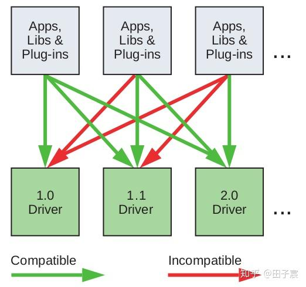

CUDA Driver API 兼容性

关于CUDA driver API，有几点需要注意：

- 由于一个系统只能装一个版本的驱动。因此驱动版本要足够高(至少程序所需的版本)，否则程序跑不起来。
- 默认情况下，nvcc编译程序时，库和插件是静态编译的。静态编译不要求库和插件的驱动版本和CUDA运行库保持一致。但是动态链接则要求版本一致。

### 3.4 计算模式(Compute Mode)

NVIDIA的设备可以设置三种计算模式：
 * 默认模式(Default Compute Mode)：多个主机端线程可以同时使用一个设备(通过调用`cudaSetDevice()`) * 专属进程模式(Exclusive-Process Compute Mode)：对于一个设备，只能由一个进程创建设备上下文。一旦创建成功后，该进程的所有线程都可以使用该设备，而其他进程则不行。 * 禁止模式(Prohibited Compute Mode)：无法对设备建立CUDA上下文。

正常情况下，如果程序没有调用`cudaSetDevice()`，则会默认使用0号设备。但是如果0号设备被置成禁止模式，亦或是被其他进程所专属，则会在其他设备上创建上下文并使用。 可以向`cudaSetValidDevices()`函数输入一个设备列表，函数会在第一个可以使用的设备上创建上下文。

Pascal及以上架构，支持指令级的优先级调度。不再是以线程块为SM的最小调度单位，而是以指令为最小调度单位，且具有优先级。 这意味着具有冗长kernel的线程块不再会占据太多的计算资源，或是发生timeout。但是这也有缺点：当多个进程创建了上下文时，以往基于线程块的调度不会造成太多的上下文切换，但现在的指令级调度则会造成很多的上下文切换，降低效率。(注意跟GPU内线程的上下文切换不同，GPU内线程上下文切换几乎不浪费时间，直接换一个指针就好)。因此最好设置为Exclusive-process，这样只有一个进程会使用设备。*(如果线程很多的话，效果不是一样吗？)*

*(讲道理好好看看上下文是什么鬼)*

*(这段需要再看一下Pascal架构的说明，看看指令级的调度是如何实现的，寄存器等又是如何分配的)*

设备处于哪种计算模式，可通过检查`computeMode`来查看。

### 3.5 模式切换(Mode Switches)

GPU会将一些内存专门分配给primary surface，用于刷新显示设备。 一旦用户将显示模式切换，如增加分辨率或增加彩色的位数，会造成primary surface所需的内存变多。此时系统会把原来分配给CUDA运算的内存，调拨给primary surface，从而造成CUDA runtime产生错误，并返回invalid context error。

*(言外之意是说，跑cuda的时候不要切分辨率？)*

### 3.6 Tesla Compute Cluster Mode for Windows

略

### Chapter 4 硬件架构

### 4.0 补充内容

这份官方文档讲的硬件内容太少了，从另一本书里补一点过来，可能内容有点老旧，见谅。

### 4.0.0 硬件结构

(在一本比较老旧的书上找到的结构图)

下图是一款比较老旧的显卡(G80/GT200)的硬件结构图：

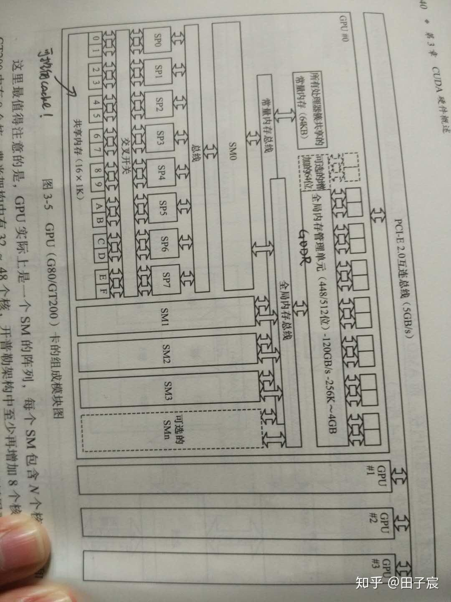

NVIDIA显卡硬件结构

从图中可以看到，GPU由内存和一系列流处理器簇(Streaming Multiprocessors, SM)组成，不同GPU的具有不同的内存大小和SM数量。
 多个GPU可以挂载在PCI-E总线上，可以跟主机端或其他GPU通信。

流处理器簇(SM)内部结构如下图所示：

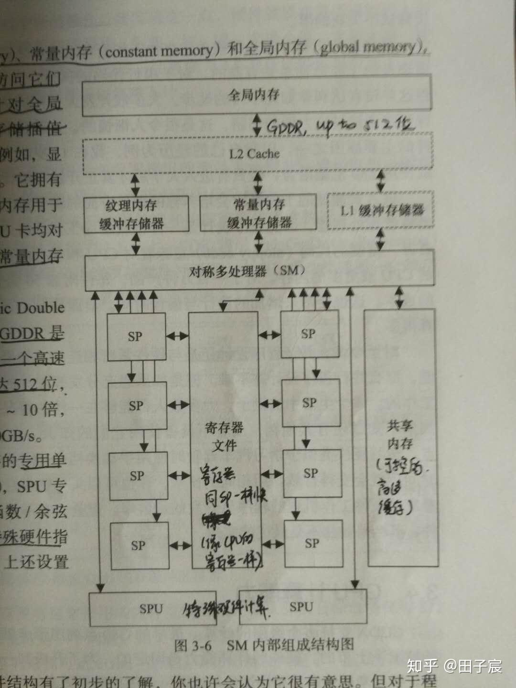

SM内部结构

SM由一系列流处理器(Streaming Processor，SP)、寄存器文件(Register File)、共享内存(Shared Memory, SMem)、SPU(特殊运算单元)，以及纹理/常量/L1缓存组成。L2 cache是由所有SM共享的。

- 流处理器(SP)：GPU的ALU单元，每个SP运行调度器分配给它的一个线程。
 在CUDA编程模型里，32个线程(称为一个线程束)同时执行一套指令；但是实际调度时，是以半个线程束(16个线程)调度的。这对应了NVIDIA GPU的每个SM内，SP的数量都是16的整数倍。
- 寄存器文件：SM内的寄存器文件很大，大到分配到SM每个线程块内的每个线程，都可以拥有自己的寄存器空间。因此线程的上下文切换，实际上只需要换一下寄存器空间的指针即可，十分迅速。
- 共享内存：程序可控制的高速缓存。
- 特殊运算单元(SPU)：进行一些特殊运算。
- 纹理/常量/L1缓存。

### 4.0.1 调度过程

线程块调度**** 当主机端启动内核时，会根据线程网格中的线程块(thread block)所需的寄存器和共享内存，决定将线程块调度到哪个SM上运行，或者等待调度(没有SM有足够的资源运行该线程块)。
 只要资源足够，一个SM上可以同时运行多个线程块。
 当线程块运行完毕时，线程块会退出SM，以供其他线程块被调度上去。  

另外需要强调一点的是，如果线程块需要的寄存器或共享内存太多，以至于SM连一个线程块都无法满足的时候，内核会启动失败。
 CUDA Toolkit提供了 CUDA Occupancy Calculator以供分析。

线程束调度**** 当线程块被调度到SM上后，具体调度到哪个SP上运行，是由SM内部的调度器执行的。
 NVIDIA GPU在逻辑上以32个线程(线程束)，作为最小调度单位。但实际上在硬件方面，是以半个线程束(16个线程)调度的。只不过调度器在调度了前半个线程束后，会立刻调度后半个线程束。调度过程如下图所示(计算能力2.0平台)：

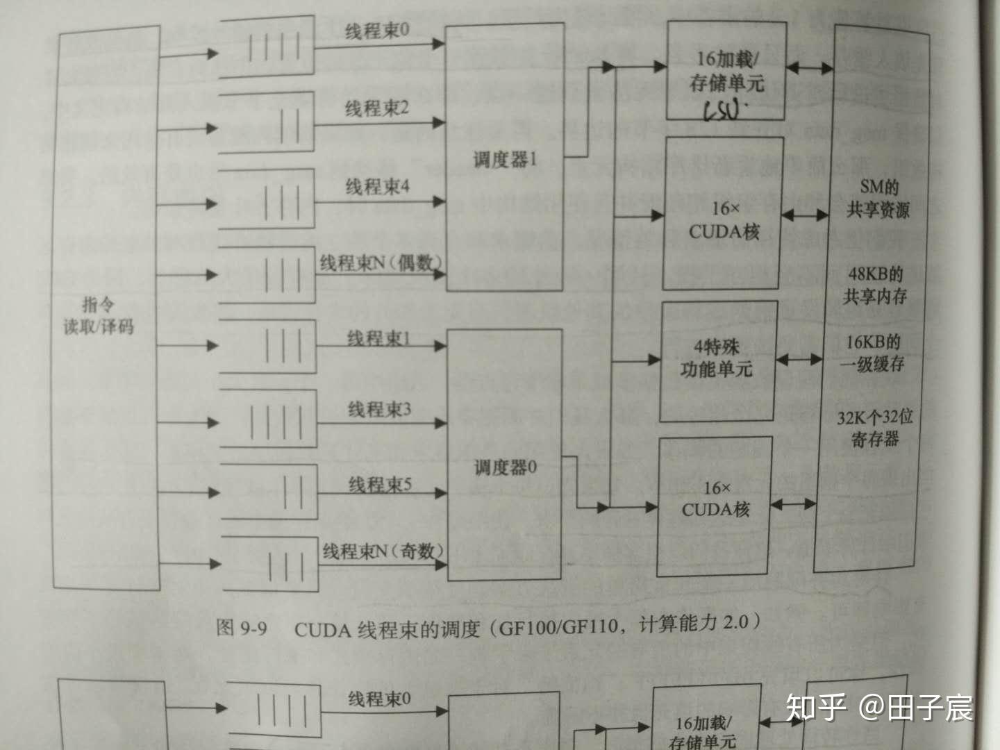

CUDA线程束调度

当调度器选择调度线程束0时，第一个时钟周期会将半个线程束调度到第一个16xSP上，然后下一个周期会将另外半个线程束调度到另一个16xSP上。因此，调度一个完整的线程束0的指令，需要2个时钟周期。
 上图所示的计算能力2.0的设备，具有两个调度器，刚好能够保证32个SP核可以连续工作。但前提是SM至少有2个线程束待调度。否则如果只有一个线程束的话，调度器0将会限制。

线程束有时会处于等待状态(等待内存，或等待特殊计算的结果)。此时调度器会调度其它线程束到SP上运行。当等待的线程束等到了所需的元素后，会再次处于就位状态，等待调度器调度运行。

不同计算能力的平台，具有不同的调度器数量和SP数量。

### 4.1 SIMT架构

NVIDIA GPU是典型的SIMT架构(Single-Instruction, Multiple-Thread Architecture，单指令多线程架构)。(半)线程束在同一时间内执行同样的指令(相同的PC)，但每个线程有自己的数据空间(寄存器)；可以同时做同样的事情，但是处理不同的数据。这样可以有效节省指令带宽(指令由线程束共享)，实现高效并行。

当线程束中的线程，必须要执行不同的条件分支时，满足分支条件的线程会被激活并执行分支内的内容；不满足分支条件的线程会接收同样的指令，但不会被激活，不会实际执行，但也不能跳过去执行其他指令。换言之，当线程束中的线程遇到分支时，不论线程是否需要执行分支，都会消耗执行该分支的时间，因为线程束中的线程执行同样的指令，是高度同步的。
 举个例子，假如程序是按如下方式编写的：

`...
if(条件)
{
    操作1
}
else
{
    操作2
}
...
`

如果是CPU，如果不满足条件，则会直接跳转去执行操作2，不会执行操作1。 但是对于GPU同一个线程束内的线程，即使不满足条件，依旧会去跟其他线程一起去执行操作1。等到操作1执行完毕后，该线程又会跟其他线程一起执行操作2。这也就意味着，不管线程实际上需不需要执行某一分支，它都要跟其他线程一起跑完这一分支。

另外，GPU不支持分支预测和推测执行**，只会老老实实的一条条执行各个分支里的内容。因此，对于CUDA程序来说，分支实际上是一种低效的行为。

但是有两种情况是例外：** * 线程束中所有线程均只需要执行一个分支，如线程束中的所有线程满足条件，则所有线程执行完操作1后，不会去执行操作2。 * 线程束中的半个线程束(线程0~15、线程16~31)同时满足条件，则这半个线程束不会去执行操作2(因为硬件实际上是按照半个线程束调度的)。

但是从Volta架构开始，Independent Thread Scheduling被引入，线程束内的线程不再完全同步。每个线程都会有自己独立的PC。遇到分支时，不再像之前的架构一样，只有(半)线程束内的线程条件一致时，才会跳过分支；Volta架构的调度优化器会将线程束中的线程，按照分支条件是否满足，重新组合成SIMT单元，从而跳过分支。

Volta架构的Independent Thread Scheduling无疑是高效的，但是这是一个跟旧架构完全不同的特性。在编写旧架构的CUDA程序时，程序员会默认线程束内的线程一定会同步执行。Volta架构的新特性破坏了这一假设，无疑会给程序带来一些问题，需要注意。

### 4.1.1 线程的激活与原子操作

在一个线程束中，参与当前指令的线程称为active threads，不参与的被称为inactive threads。造成线程inactive的原因有：

- *某个线程比线程束中其他线程先退出(应该只发生在半线程束同时满足分支的情况，或是Volta架构上)。 * 
- 在分支结构中，线程不满足当前分支的条件 
- 设置线程块大小时，为了补齐32的倍数而创建的线程(如线程块定义为31个线程，则会补1个线程，这个线程是inactive的)
当线程束中所有线程，向同一个内存地址写数据时，不能保证哪个线程先写，哪个线程后写，即程序的正确性是无法保证的。 这时需要使用CUDA提供的原子操作(atomic)函数，如`atomicAdd()`。

原子操作可以保证程序的正确性，但是会造成线程束中线程的串行化(serialization)，执行时间比并行执行要长。

另外需要注意的是，即使没使用原子操作，向同一个内存地址写数据，一样也会产生一定程度的串行化，串行化程度依架构而定。不过这样，内存地址的数据时不确定的，可能会引入错误（除非程序刻意为之）。

### 4.2 硬件多线程

GPU线程束中的线程的上下文(寄存器&PC等)都存在片内空间庞大的寄存器文件中，直到线程束执行完毕才会被释放(生命周期为整个线程束执行过程)。因此，不像CPU，GPU的线程束上下文切换十分迅速，没有损耗。 线程束调度器(warp scheduler)会选择ready状态的线程束，将其调度到SP上执行。

（这里跟硬件多线程的概念有点冲突，从另一本书上看到硬件多线程的概念是：一个核可以同时执行两个线程的指令，这是由多发射实现的。NVIDIA的GPU显然不是这个概念。姑且只理解为切换非常迅速吧）

### Chapter 5 性能优化

### 5.1 性能优化概述

CUDA程序性能优化有三个原则：

- *最大化并行，以提升资源利用率*
- 优化内存排布，以最大化内存吞吐
- 最大化指令吞吐
在性能优化前，需要先分析程序性能的瓶颈，再针对瓶颈优化，否则收益会很低。
 分析程序瓶颈，可以使用CUDA profiler等工具。

### 5.2 最大化利用率(Maximize Utilization)

最大化利用率的方法就是并行。

### 5.2.1 应用级别并行(Application Level)

从程序最高层来看，应该尽可能让主机端、设备端、PCI-E总线并行工作。对此可以使用异步CUDA函数，以及流(Stream)来实现。

同步操作，以及内存的共享会影响程序的并行性。因此需要仔细设计算法流程，尽量减少同步和内存共享。 如果一定需要同步和内存共享，尽量在线程块内完成(线程块同步——使用`__syncthreads()`涉及到的线程少，且可以通过SM内的共享内存共享数据。如果需要线程网格内同步，则需要两个内核调用，且共享数据只能通过全局内存，速度慢)。

### 5.2.2 设备级别并行(Device Level)

可以通过流的方式，尽可能的让多个内核并行，提升利用率。

### 5.2.3 处理器级别并行(Multiprocessor Level)

延迟(latency)指的是线程束(从上一个动作开始)到它处于ready状态的时钟数。 例如线程束先提交了一个内存访问请求，然后等了400个时钟周期，内存管理系统才返回数据，线程束可以继续执行。这400个时钟周期称为延迟。

当一个线程束发生延迟时，线程束调度器(warp scheduler)会将其他处于ready状态的线程束调度到SP上。等到延迟结束后，再将该线程调度回SP继续执行。这样一来，前一个线程束的延迟，就被另一个线程束的执行所隐藏了。 这一过程被称作延迟的隐藏(hidden latency)。  

隐藏延迟是GPU编程的核心概念。由于GPU具有巨大的寄存器空间，线程的切换不存在损耗。因此，通过向GPU上分配足够多的线程，可以让这些线程延迟互相交错，以起到隐藏延迟的作用，提高硬件利用率。

造成线程(束)产生延迟的原因有：

- *指令执行：不同指令有不同的执行延迟 * 
- 内存请求：共享内存、全局内存、PCI-E(Mapped Memory)的读写请求 
- 同步操作：如使用`__syncthreads()`后，先完成的线程(束)，会等待线程块中其他线程(束)达到同步点。
通过配置线程网格、线程块、寄存器和共享内存用量，让SM可以运行尽可能多的线程束，以隐藏延迟。例如对于计算能力3.x的设备，为了完全隐藏全局内存读取的延迟(200-400时钟)，需要大概40个线程束。

举个例子，设SM有32KB共享內存空间。程序每个线程需要32B共享內存，即一个线程束需要1KB共享內存，考虑下述两种方案：
 * 方案1：每个线程块有16个线程束，则每个线程块需要16KB共享內存。可以调度两个线程块到SM上。 * 方案2：每个线程块有18个线程束，则每个线程块需要18KB共享內存，则只能调度一个线程块到SM上。

虽然方案2在一个线程块上，有更多的线程束，但是实际上SM上运行的线程束减少了(32->18)。因此方案2隐藏延迟的能力弱于方案1，资源利用率较低。

*此外，如果寄存器使用过多，超过了SM上的寄存器空间，则会使用本地内存作为寄存器。本地内存是存在在全局内存上的，速度很慢，会严重影响程序速度。因此需要严格考虑寄存器使用数量。* *(这里官方文档和另一本书里说的有矛盾，难道是新的架构把本地内存给取消掉了？)*

最后强调一点，线程块中的线程数量，最好是32的整数倍。这样，就不会有为了补齐线程束，而出现的永远不会激活的线程。这些不激活的线程也会占用SM的资源，降低资源利用率。

CUDA具有Occupancy Calculator，帮助程序员设计。

### 5.3 最大化内存吞吐(Maximize Memory Throughput)

最大化内存吞吐，主要手段就是少用低带宽的内存。这意味着首先要尽可能减少主机端和设备端间的设备传输(PCI-E，特别慢)，其次要尽可能减少全局内存的读写(快于PCI-E，但是相对于片内内存来说，还是挺慢的)；尽可能的使用片内的内存(寄存器、cache、共享内存)。

这里需要强调一下cache和共享内存的事情。

共享内存是程序可控的高速缓存。一般情况下，共享内存的使用流程为： 

- *将数据从全局内存拷贝到共享内存，或初始化共享内存 * 
- 进行一个同步操作，确保共享内存全部被赋值 
- *利用共享内存的数据，运行程序 * 
- 如果出现了共享内存的写操作，一般需要进行一个同步操作，确保写操作全部完成后再进行下面的操作 
- 将数据写回全局内存
这里有一点要强调，只有在数据需要反复读写的时候，共享内存才有意义。如果数据只会被读一次，处理完后又写回并不再处理。则直接从全局内存读出->寄存器运行->写回全局内存是最快的。在共享内存中转反而是慢的。

缓存(L1/L2 cache)是程序员无法显式编程的。但是如果了解缓存的特性的话，可以通过合适的程序设计，增加缓存命中率。
 *事实上，硬件控制的cache，拥有更好的数据局部性(locality)*。

### 5.3.1 主机端和设备端间数据传输

由于PCI-E传输并不快，因此要尽量减少主机端和设备端间的数据传输： * 一种方式是让中间结果尽可能的在设备端产生，在设备端使用。 * 另一种方式是将很多小的数据，打包传输。 * 还有可以通过分配锁页内存来加快前端总线*系统的带宽。

当使用内存映射时，需要注意，每次内存访问都会启动一次PCI-E传输。因此，尽量保证数据只被读写一次，且尽可能合并访问以提升有效内存带宽。

有些GPU设备，主机端和设备端内存，在物理上就是同一块。这种情况下，主机端和设备端传输是不存在的。可通过标志`integrated`来查看。

### 5.3.2 设备内存访问

### 5.3.2.1 全局内存(global memory)

全局内存支持合并访问，可以一次性传输连续的32、 64、 128字节的数据。因此，在设计内核时，线程束内的线程尽量连续的访问内存。

考虑如下两个内核：

`//假设gpuData是一个二维数组，尺寸为32x32
int gpuData[32][32];  //这样是不合法的，因为这么定义实际上是在主机端，还需要拷贝到设备端，这里只是为了方便说明问题

__global__ void Kernel1(int gpuData[][32])
{
    const int tid = blockIdx.x * blockDim.x + threadIdx.x;
    int sum = 0;
    for(int i = 0; i  32; i++)
        sum += gpuData[i][tid]; //行访问
    ...
}

__global__ void Kernel2(int gpu[][32])
{
    const int tid = blockIdx.x * blockDim.x + threadIdx.x;
    int sum = 0;
    for(int i = 0; i  32; i++)
        sum += gpuData[tid][i]; //列访问
    ...
}
`

上例中，执行Kernel1的线程束中的线程，在一次循环中，32个线程依次访问`gpuData[0][0], gpuData[0][1], gpuData[0][2], ..., gpuData[0][31]`。在内存中，这32个变量是连续存储的，因此可以被合并访问。这种访问被称为行访问。
 而Kernel2在一次循环中，读取的变量为`gpuData[0][0], gpuData[1][0], gpuData[2][0], ..., gpuData[31][0]`。这32个变量是不连续的，需要进行32次内存请求。这种访问被称为列访问。

上例中，列访问之所以效率低，原因有二：
 * 对于执行一次循环，行访问只需要一个内存请求指令，而列访问需要32个内存请求指令。从指令角度来讲，行访问的内存请求指令带宽是列访问的。 * 全局内存的最大带宽为一次取128Byte，但是内核每次只需要4个Byte的数据。这使得列访问的内存带宽为峰值带宽的。事实上，即使内核只需要4Byte，GPU也会取连续的*32Byte*，然后丢掉后面的28Byte，造成资源的浪费。但是缓存的引入(自计算能力2.x开始)，这一问题得到了缓解，28Byte会先放到缓存中，下次会命中。

因此，从上例中可以看到，好好安排内存排布，尽量使得内存访问可以合并，可以加速全局内存的读写。

### 5.3.2.2 对齐(Alignment)

当变量的尺寸为//16字节时，变量会对齐。但如果不是的话，变量无法对齐，会产生额外的内存访问。

C/C++内建的变量(int/float等)，以及CUDA支持的向量(float2/float4等)，是对齐的。

一些结构体可能会产生不对齐的情况，看下例：

`struct struct1{
    float x;
    float y;
};

struct struct2{
    float x;
    float y;
    float z;
};

struct struct3 __align__(16){
    float x;
    float y;
    float z;
};
`

上例中，struct1是8字节的结构体，自动会对齐； struct2具有12个字节，无法对齐； struct3使用了`__align__(16)`关键字，显式指定对齐到16。

使用各类malloc分配的设备内存，一定是256字节对齐的。

### 5.3.2.3 本地内存(local memory)

当使用了*自动变量(不明白，再看)*时，有可能会将数据放到本地内存上：
  Arrays for which it cannot determine that they are indexed with constant quantities  大的结构体，寄存器放不下 * 寄存器溢出(register spilling)，即内核使用的寄存器多于SM上可用的寄存器

通过看PTX代码，可以看到标记为`.local`的变量，就是本地内存。
 即使PTX代码里没有使用本地内存，在编译到cubin代码的过程中，仍然会使用本地内存，编译器会报告`lmem`的使用情况。

前面多次强调过了，一旦使用了本地内存，其速度会非常慢。不过本地内存在存储的时候，是按照32个线程连续存储的，因此可以合并访问。
 对于计算能力3.x的设备，本地内存会被缓存在L1/L2 cahce；对于计算能力5.x和6.x设备，本地内存会被缓存到L2 cache。即便如此，其速度还是慢于寄存器。

### 5.3.2.4 共享内存(shared memory)

共享内存实际上是被分为多个存储体(memory bank)。多个线程访问同一个存储体会造成串行化。
 *(存疑：存储体其实是可以广播的，因此多个线程读同一个存储体是不存在冲突的，只是写会存在串行化问题)*

因此，编写内核时，需要认真设计，以避免存储体访问的冲突。

### 5.3.2.5 Texture and Surface Memory

略

### 5.4 最大化指令吞吐(Maximize Instruction Throughput)

可以使用如下方法来最大化指令吞吐：

- *尽量少使用吞吐率低的算数指令 * 
- 尽量减少线程束内的分支 
- 尽量减少指令数，如少用`__syncthreads()`，或者在合适的时候使用`__restrict__`
指令吞吐的定义：每个SP**在每个时钟周期内执行的操作数。如果一个线程束在一个时钟周期内执行了N个操作，则指令吞吐为N/32。

### 5.4.1 算数指令(Arithmetic Instructions)

官方文档这里比较混乱，但主要有如下几点： * 不同架构的设备，不同指令有不同的指令吞吐，可以查表 * 有一些快速的内联(inline)函数，如使用`__fdividef()`(快速浮点数除法)来代替普通的除法来加速 * 整形的除法和取余会比较慢，可能需要20个机器周期；因此对于n为2的幂次的情况，使用`i>>log2(n)`代替`i/n`，使用`i&(n-1)`来代替`i%n`*  半精度(浮点数)运算(Half Precision Arithmetic)：可以使用`half2`数据类型，并使用对应的运算指令(如`__hadd2, __hsub2, __hmul2, __hfma2`等)，来让一个周期内执行两次运算，以节省指令带宽。可以通过`__halves2half2`将两个半精度浮点数合并为`half2`数据类型。 *(半精度又是咋定义的？)* * 数据类型转换：当使用char或short，亦或是双精度常量与单精度变量相互操作时，会触发数据类型转换，需要一定执行时间(实际上，char和short，不管是存储在寄存器中，还是在运算时，都是以int型进行的)

### 5.4.2 控制流指令(Control Flow Instructions)

尽量避免向线程束中引入分支。

此外，可以使用`#pragma unroll`宏，来进行循环展开，减少控制指令。

### 5.4.3 同步指令(Synchronization Instruction)

下表为不同计算能力的设备，同步指令`__syncthreads()`需要消耗的指令周期为：
 |计算能力|`__syncthreads()消耗的指令周期`| |---|---| |3.x|128| |5.x,6.1,6.2|64| |6.0|32| |7.x|16|

注意，`__syncthreads()`会造成线程块中的线程等待，影响内核执行效率。
