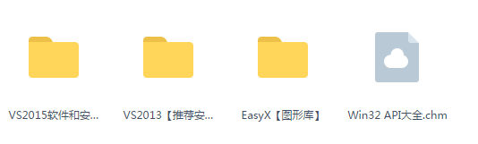
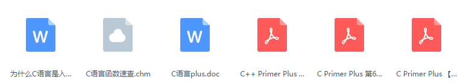
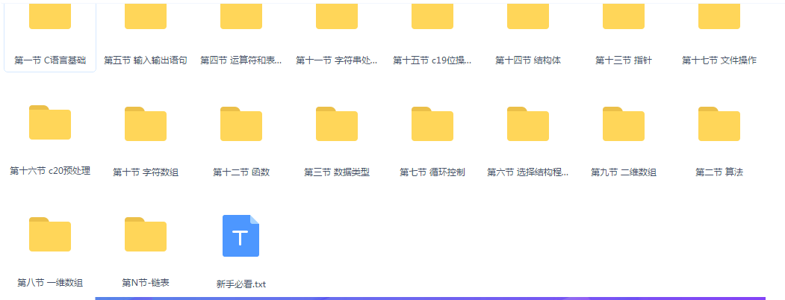
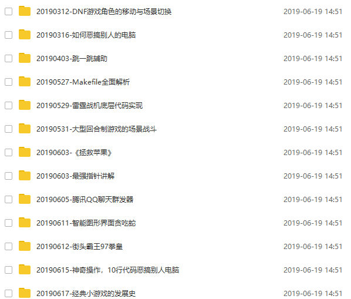

#### 前言：

这篇文章实际上是我自己入门过程的总结，一个尽量少废话的C++入门指南。总结完忽然发现像个读书清单 。

文章最后有福利~记得看完

#### 技术书阅读方法论

**一.速读一遍（最好在1~2天内完成）**

人的大脑记忆力有限，在一天内快速看完一本书会在大脑里留下深刻印象，对于之后复习以及总结都会有特别好的作用。

对于每一章的知识，先阅读标题，弄懂大概讲的是什么主题，再去快速看一遍，不懂也没有关系，但是一定要在不懂的地方做个记号，什么记号无所谓，但是要让自己后面再看的时候有个提醒的作用，看看第二次看有没有懂了些。

**二.精读一遍（在2周内看完）**

有了前面速读的感觉，第二次看会有慢慢深刻了思想和意识的作用，具体为什么不要问我，去问30年后的神经大脑专家，现在人类可能还没有总结出为什么大脑对记忆的完全方法论，但是，就像我们专业程序员，打代码都是先实践，然后就渐渐懂了过程，慢慢懂了原理，所以第二遍读的时候稍微慢下来，2周内搞定。

记住一句话：每看完一个章节后，总结一下这个章节讲了啥。很关键。

**三.实践（在整个过程中都要）**

实践的时候，要注意不用都去实践，最好看着书，敲下代码，把重点的内容敲一遍有个肌肉记忆就很不错了。

以及到自己做过的项目中去把每个有涉及的原理的代码，研究一遍，就可以了

#### 书单目录总结

**零.手册类：**

- 《C++程序设计语言(The C++ Programming Language)》
- 《C++标准程序库(C++ Standard Library Tutorial and Reference) 》
- 《The C++ IO Streams and Locales》
- 《The C++ Standard (INCITS/ISO/IEC 14882-2011)》
- 《Overview of the New C++ (C++) 》
- 《The Standard C Library》
**一.初级入门系列：**

- 《C++ Primer》
- 《Accelerated C++》
- 《C++编程思想（Thinking in C++) 》
- 《C++程序设计原理与实践（Programming: Principles and Practice Using C++ ）》
- 《C++初学者指南》
- 《C++ Primer Plus》
- 《Visual.C++.2008入门经典》
- 《面向对象程序设计—C++语言描述》
- 《数据结构(C++语言版)第三版_邓俊辉》
**二.实用系列：**

- 《Effective C++ 》
- 《Effective STL》
- 《深入浅出设计模式》
- 《设计模式：可复用面向对象软件的基础》
- 《HeadFirst设计模式》
- 《大话设计模式》
**三.中级进阶系列：**

- 《More Effective C++ 》
- 《Exceptional C++ 》
- 《More Exceptional C++》
- 《Exceptional C++ Style》
- 《C++编程规范(C++ Coding Standards) 》
- 《C++ 模板完全指南(C++ Templates: The Complete Guide)》
- 《Beyond the C++ Standard Library(Boost)》
- 《C和C++安全编码》
- 《深入理解C++11》
**四.高级成神系列：**

- 《C++设计新思维-泛型编程与设计模式之应用(Modern C++ Design ) 》
- 《C++模板元编程(C++ Template Metaprogramming)》
- 《C++ Concurrency In Action》
- 《Advanced c++ Programming Styles and Idioms 》
- 《Real-Time C++ Efficient Object-Oriented and Template Microcontroller Programming》
- 《Advanced_Metaprogramming_in_Classic_C 》

#### 推荐几本经典书籍

**《C++ Primer 第五版》**

C++语法太过繁杂，很多语法特性一辈子也用不上。对于初学者来说，学完前7章就能写简单的程序。

**《大话数据结构》**

这实在是一本对新手非常友好的书，暂时先看完前5章就够了。此时应该多做一些练习，可以是简单的小软件或小游戏。

**《C++ Primer 第五版》**

没错还是这本书，之前7章学了基础语法。现在继续学习8~12章，涵盖了标准库常用组件的基本用法。想完整学习标准库的同学可以在未来深入阅读《C++标准程序库:自修教程与参考手册》。

**进阶学习：**

此时可以选择性地把《C++ Primer 第五版》剩下的部分看完，第15章面向对象是重要内容，需要认真研究。

此时也可以把《大话数据结构》看完，或换一本正经的深入讲解算法的书，比如《算法导论》。

**《Effective C++》、《C++编程规范》**

C++给了程序员过高的自由度，这反而不是一件好事，这两本书告诉你使用C++哪些做法是正确的，哪些是错误的，C++进阶必读。还有一本补充读物《More Effective C++》可选读。

#### 总结

天下没有不劳而获的果实，望各位年轻的朋友，想学技术的朋友，在决心扎入技术道路的路上披荆斩棘，把书弄懂了，再去敲代码，把原理弄懂了，再去实践，将会带给你的人生，你的工作，你的未来一个美梦。

#### 文章福利

对于自己找不到视频、书籍资源的读者，可以加小编的**C语言/C++交流群：967051845！**整理了一些个人觉得比较好的学习书籍、视频资料共享在群文件里面，有需要的可以自行添加哦！~

**VS编译器，图形库**

**C语言相关电子书**

**C/C++基础视频及笔记**

**C/C++项目实战**

**日积月累，终有所成！！！**
