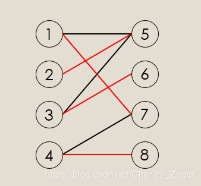
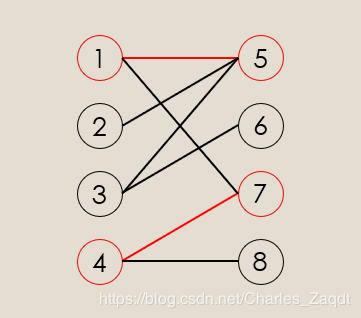
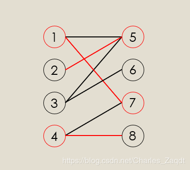

作者：Charlesss

链接：https://blog.nowcoder.net/n/0e9a713d93f54bc79739588e928f091a

来源：牛客网

本篇博客主要讲解什么是二分图，怎样判断二分图，匈牙利算法和HK(Hopcroft-Karp)算法，以及二分图多重匹配。

**二分图定义：**

二分图又称作二部图，是图论中的一种特殊模型。 设G=(V,E)是一个无向图，如果顶点V可分割为两个互不相交的子集(A,B)，并且图中的每条边（i，j）所关联的两个顶点i和j分别属于这两个不同的顶点集(i in A,j in B)，则称图G为一个二分图。简而言之，就是顶点集V可分割为两个互不相交的子集，并且图中每条边依附的两个顶点都分属于这两个互不相交的子集，两个子集内的顶点不相邻。

**二分图匹配：**

给定一个二分图G，在G的一个子图M中，M的边集{E}中的任意两条边都不依附于同一个顶点，则称M是一个匹配。极大匹配(Maximal Matching)是指在当前已完成的匹配下,无法再通过增加未完成匹配的边的方式来增加匹配的边数。最大匹配(maximum matching)是所有极大匹配当中边数最大的一个匹配。选择这样的边数最大的子集称为图的最大匹配问题。如果一个匹配中，图中的每个顶点都和图中某条边相关联，则称此匹配为完全匹配，也称作完备匹配。求二分图匹配可以用最大流(Maximal Flow)或者匈牙利算法(Hungarian Algorithm)。**完全匹配一定是极大匹配，但是极大匹配不一定是完全匹配。下图就是一个最大匹配。

二分图判断：**

对于二分图的问题我们首先要判断一个图它是不是二分图。对于二分图的判断方法最常见的是染色法，顾名思义就是我们对每一个点进行染色操作，我们只用黑白两种颜色，问能不能使所有的点都染上了色，而且相邻两个点的颜色不同，如果可以那么这个图就是一个二分图，对于判断是否是一个二分图的方法可以用dfs和bfs两种方式去实现。下面我就上一个bfs的判断二分图的代码。

**BFS判断二分图code：**

`vectorint> G[maxn];  // 存边
int col[maxn];        // 标记顶点颜色
int n,m;         // 点和边的个数
bool bfs(){
  queueint> q;
  q.push(1);     // 放入第一个点
  memset(col,0,sizeof(col));
  col[1] = 1;    // 先标记第一个点为1
  while(!q.empty()){
    int v = q.front();
    q.pop();
    for(int i=0;iG[v].size();i++){
      int xx = G[v][i];
      if(col[xx] == 0){      // 判断这个点是否标记过
        col[xx] = -col[v];   // 没有标记过就标记上与v相反的颜色
        q.push(xx);
      }
      else{
        if(col[v] == col[xx]){    // 如果颜色冲突说明不是二分图
          return false;
        }
      }
    }
  }
  return true;
}
`

**二分图最大匹配：**

给定一个二分图G，在G的一个子图M中，M的边集中的任意两条边都不依附于同一个顶点，则称M是一个匹配。选择这样的边数最大的子集称为图的最大匹配问题（maximal matching problem)。

**首先我们先了解两个概念**

交替路：从一个未匹配的点出发，依次经过未匹配边、匹配边、未匹配边....这样的路叫做交替路。

增广路：从一个未匹配的点出发，走交替路，到达了一个未匹配过的点，这条路叫做增广路。**看下图，其中1、4、5、7是已经匹配的点，1->5,4->7是已经匹配的边，那么我们从8开始出发，8->4->7->1->5->2这条路就是一条增广路。

为什么我们要去找增广路呢？

因为接下来要讲的匈牙利算法就是去寻找增广路而求出最大匹配数的(一句废话)，对于求二分图最大匹配的算法可以用网络流去跑一个最大流求解，还可以用二分图的常见算法匈牙利算法(Hungarian Algorithm)，这里我就只讲一下匈牙利算法，这个算法的核心就是去找未匹配的点，然后从这个点出发去寻找增广路，因为增广路有几个主要的特点：

 1.   增广路有奇数条边 。
 2.   路径上的点一定是一个在X边，一个在Y边，交错出现。 
 3.   起点和终点都是目前还没有配对的点。
 4.   未匹配边的数量比匹配边的数量多1。

重点是第4点，我们可以根据此特性，把这条增广路中的匹配边改为未匹配边，把未匹配边改为匹配边，这样我们就可以使总匹配边数+1了，根据上面的图得出下图，很显然匹配边多了一条。

匈牙利算法code：**

`vectorint> G[maxn];    // 存边
int pre[maxn];     // 记录匹配点
bool vis[maxn];    // 标记是否匹配过
int n,m;           // n个点 m条边
bool dfs(int x){
  for(int i=0;iG[x].size();i++){
    int v = G[x][i];
    if(vis[v] == false){       // 判断是否标记过
      vis[v] = true;
      if(pre[v] == -1 || dfs(pre[v])){      // 判断当前点是否匹配过 dfs为判断这个点能不能和其他的点匹配
        pre[v] = x;
        return true;
      }
    }
  }
  return false;
}
int Fun(){
  int sum = 0;
  memset(pre,-1,sizeof(pre));
  for(int i=1;in;i++){
    memset(vis,false,sizeof(vis));     // 每次遍历都需要初始化
    if(dfs(i)) sum ++;
  }
  return sum;
}
`

**比匈牙利算法更快的算法：**

对于匈牙利算法来说它虽然是最简单最常见的求最大匹配数的算法，但是它的时间复杂度是O(n*m)，对于一般的题来说最多有500个点，所以匈牙利是最好的做法，但是有些题就很变态，比如：HDU 2389 Rain on your Parade（http://acm.hdu.edu.cn/showproblem.php?pid=2389），这道题的点有3000个，所以直接上匈牙利会T，所以有一种更高效的算法：Hopcroft-Karp算法，它的时间复杂度是O(n^() * m)(我不会算...)，但是呆码量会比匈牙利多。

这个算法主要是对匈牙利算法进行了优化，匈牙利是依次去遍历点和边，而HK算法是用bfs同时去寻找多条增广路，然后寻找到了极大增广路集，然后再用匈牙利算法的dfs去对增广路集进行增广，直接上呆码吧，可以当板子用。

**HDU 2389 AC代码：**

`#include **
#define maxn 3010
#define inf 0x3f3f3f3f
using namespace std;
struct Node{     
	int to,next;
}Edge[maxn*maxn];
struct node{     
	double x,y,v;
}
a[maxn];
int head[maxn],num;
int lx[maxn],ly[maxn],dx[maxn],dy[maxn];
bool vis[maxn];
int T,n,m,t,dis;
void init(){     
	memset(lx,-1,sizeof(lx));     
	memset(ly,-1,sizeof(ly));     
	memset(head,-1,sizeof(head));     
	num = 0;
}
void add(int u,int v){     
	Edge[num].to = v;     
	Edge[num].next = head[u];     
	head[u] = num ++;
}
double dist(double x, double y, double xx, double yy){     
	return sqrt((x - xx) * (x - xx) + (y - yy) * (y - yy));
}
bool Search(){     
	queueint> q;     
	dis = inf;     
	memset(dx,-1,sizeof(dx));     
	memset(dy,-1,sizeof(dy));     
	for(int i=0;in;i++){         
		if(lx[i] == -1){             
		q.push(i);             
		dx[i] = 0;         
	}     
}     
while(!q.empty()){         
	int u = q.front();         
	q.pop();         
if(dx[u] > dis) break;         
for(int i=head[u];i!=-1;i=Edge[i].next){             
	int v = Edge[i].to;             
	if(dy[v] == -1){                 
		dy[v] = dx[u] + 1;                 
	if(ly[v] == -1) dis = dy[v];                 
		else{                     
			dx[ly[v]] = dy[v] + 1;                     
			q.push(ly[v]);                 
	}             
	}         
}     
}     
return dis != inf;
}
bool dfs(int u){     
for(int i=head[u];i!=-1;i=Edge[i].next){         
int v = Edge[i].to;         
if(!vis[v] && dy[v] == dx[u] + 1){            
 vis[v] = true;            
 if(ly[v] != -1 && dy[v] == dis) 
continue;             
if(ly[v] == -1 || dfs(ly[v])){                 
ly[v] = u;                
 lx[u] = v;                 
return true;             
}         
}     
}     
return false;
}
int Hopcroft_Karp(){     
int sum = 0;     
while( Search() ){         
memset(vis,false,sizeof(vis));         
for(int i=0;in;i++){             
if(lx[i] == -1 && dfs(i)) sum ++;         
}     
}     
return sum;
}
int main()
{     
int Case = 1;     
scanf("%d",&T);     
while(T--){         
init();         
scanf("%d%d",&t,&n);         
for(int i=0;in;i++){             
scanf("%lf%lf%lf",&a[i].x,&a[i].y,&a[i].v);         
}         
scanf("%d",&m);         
for(int i=0;im;i++){             
double xx, yy;             
scanf("%lf%lf",&xx,&yy);             
for(int j=0;jn;j++){                 
double zz = dist(xx, yy, a[j].x, a[j].y);                 
if(a[j].v * t >= zz){                     
add(j ,i);                 
}             
}         
}         
int ans = Hopcroft_Karp();         
printf("Scenario #%d:\n%d\n\n",Case ++, ans);     
}     
return 0;
}
`

二分图多重匹配：**

对于这个问题，举个栗子就是男女配对，一个男生只能配对一个女生，而女生可以配对最多k个男生(看起来十分不公平)。这就是一个多重匹配的问题，一个点可以和多个匹配边相关联，但是有上限。对于二分图的多重匹配问题，有多重最大匹配问题和多重最优匹配问题，当然后者是带权的，当然这两个问题分别可以用最大流和最小费用最大流去解决。多重最大匹配可以在匈牙利算法的基础上进行改动求解，另外开一个记录数组用来记录当前点所匹配的个数就好了。

**匈牙利思想求多重最大匹配code：**

`struct Link{     
	int cnt;     
	int k[maxn];
}
link[maxn];
bool maps[maxn][maxn];
bool vis[maxn];
int limit;    // 上限
bool dfs(int u, int limit){     
for(int i=1;im;i++){         
if(vis[i] == false && maps[u][i] == true){             
	vis[i] = true;             
	if(link[i].cnt  limit){                 
		link[i].k[ ++ link[i].cnt ] = u;                 
	return true;             
}             
for(int j=1;jlink[i].cnt;j++){                 
	if(dfs(link[i].k[j], limit)){                     
		link[i].k[j] = u;                     
	return true;                 
	}             
	}         
}     
}     
	return false;
}
int solve(){
  int sum = 0;     
  memset(link,0,sizeof(link));     
  for(int i=1;in;i++){         
	  memset(vis,false,sizeof(vis));         
	  if(dfs(i)) 
		  sum ++;     
	  }     
  return sum;
}
`

二分图的讲解除了带权的就都已经讲完了(带权的最优匹配以后再更)，然后练习的话可以去写一下kuangbin的题，不是很难，就是刚开始写的时候不知道为什么可以用到二分图...

查看作者更多博客：https://blog.nowcoder.net/charles

欢迎关注公众号：牛客NOIP竞赛学
