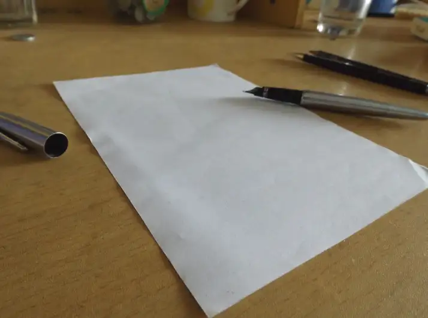
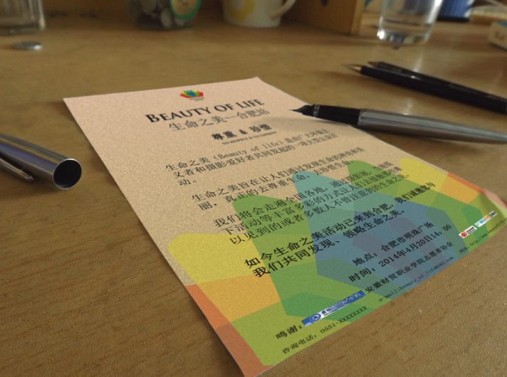
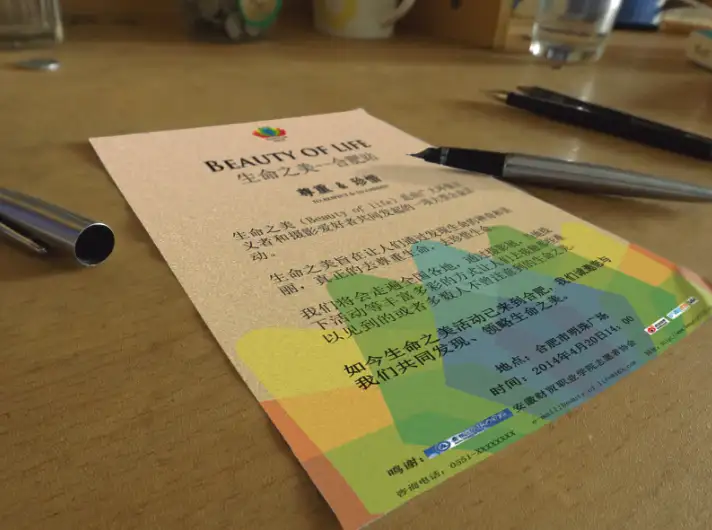
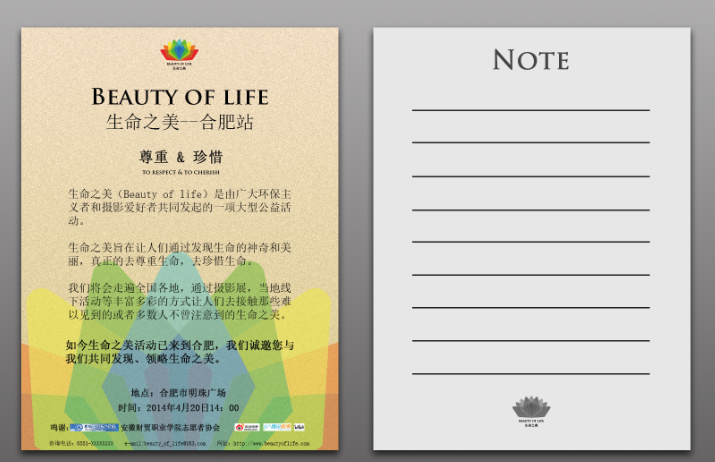
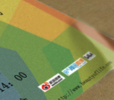
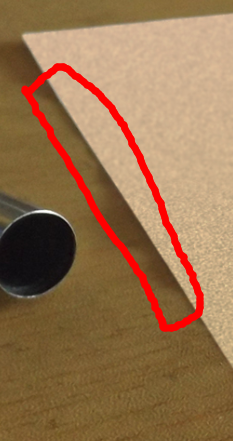
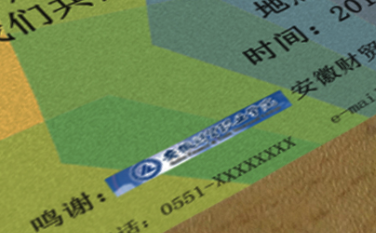

闲来无事回答一下。

这个问题其实算是一个双方的问题，一方面，观看者想知道这张照片有没有被处理过，一方面，处理照片的人处心积虑的让这张照片更加自然。

我有时候会做这样的事：

这是原图

这是处理后的图：

当然，后面那张做的并不是十分精致，因为我就是做个简单的效果图而已，并不是真的要以假乱真。

我说说我是怎么做的。

（这是另一张原图）

首先自然是变换，把它拉到那种样子，这个Ps可以很好的做到。

然后是调色，你要把颜色调的自然，不那么刺眼。

这张原图是我自己拍的，我拍的时候特地放了支钢笔，因为这样我就可以得到更多可控的因素。

在P图时，我们就是在寻找怎么样让它感觉很真实的因素。

我在边上加了支钢笔，这样我就可以制作出钢笔的阴影，让它感觉更真实。

还比如说这个部分。

说实话，我个人觉得这是这张假图里最真的一部分了。

这个皱角，本来就存在的，我用叠加的效果做出了不错的效果。

还有就是这张照片原图是一张近距离拍摄的图片，所以就会出现双向虚化的现象。

就是图片近的部分和远的部分都会不同程度的虚化，只有中间的一部分是最清晰的。

所以我叠加了一层高斯模糊，然后把中间的模糊去掉了，看起来更真实了。

然后我就没怎么弄了。

这张图能从哪里看出是假的呢？

首先是这个边，我们可以通过阴影看出纸是有皱褶的，但是纸面上并没有（因为我懒得去做了= =）。

其次就是整个纸面的各个部分的亮度出奇的一致，虽然你可能说不出哪里奇怪，但是你就是会觉得奇怪。

还有就是这个logo，因为我是直接拖过来的，背景我做了一些杂色处理，但是这些logo我并没有处理，所以看起来非常非常显眼，也算是一大败笔。

可能还有些其他的，我自己都没有发现的。

但是我作为一个图片处理者，我只要让你说不出哪里不自然，我就差不多大功告成了。至于你看着像不像真的？谁管呢。

我又不是想P张图去弄个大新闻。

但是如果你只是想判断是不是P过，那就相信你的大脑。你要是觉得不自然，那基本上就是P的。

估计是没人看了。。( ▼-▼ )

[编辑于 2014-04-05 19:21](//www.zhihu.com/question/19733441/answer/24139470)

​​35 ​26 ​分享

​​

收起​
