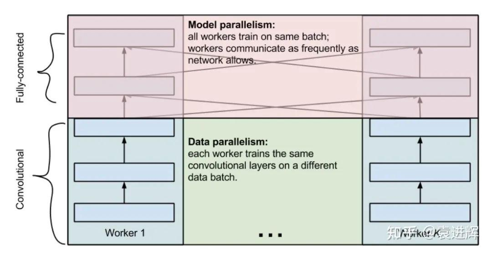
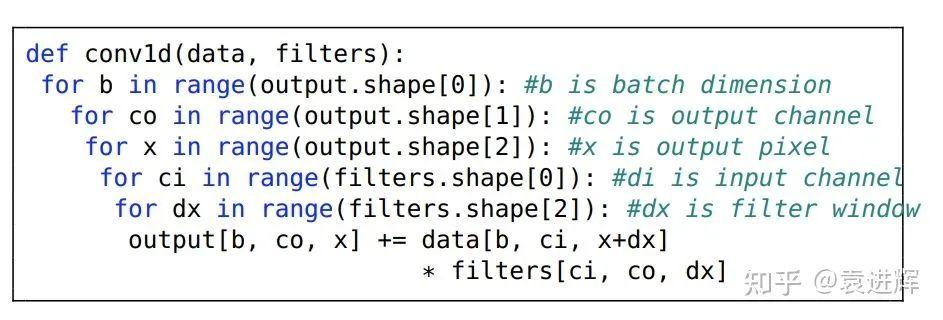
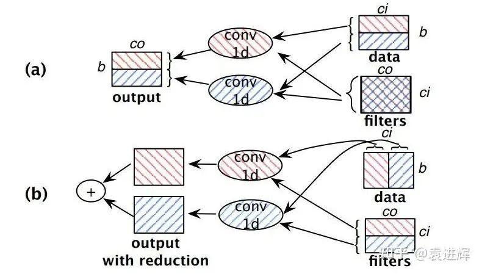
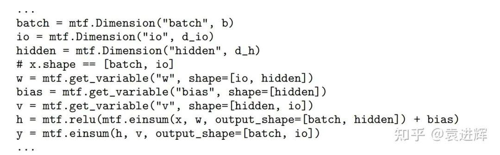
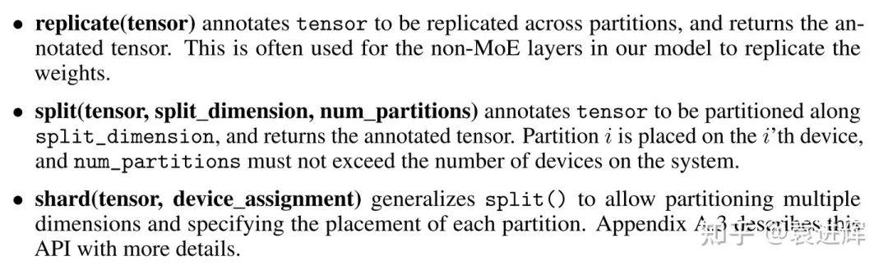
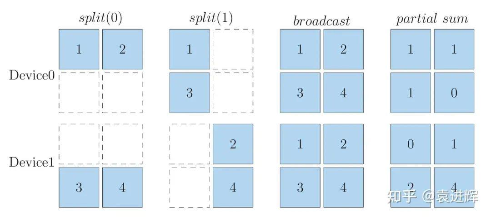
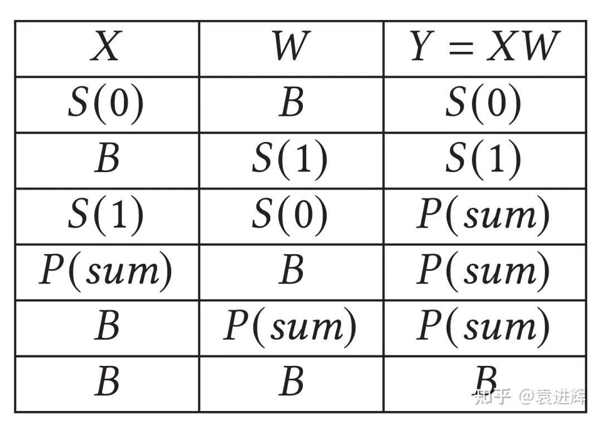
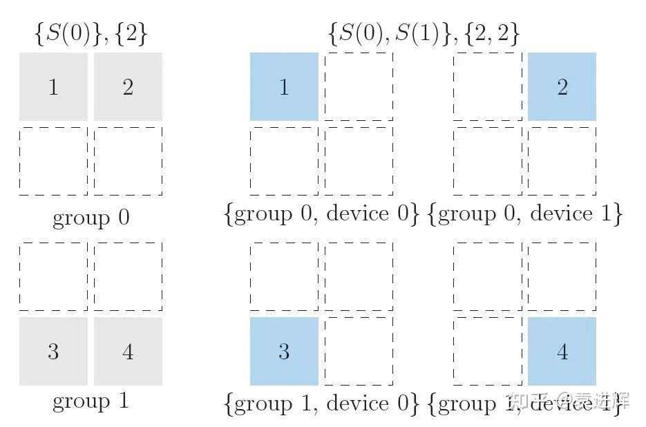

**撰文 | 袁进辉**

**

GShard的论文最早于2020.6.30放在arXiv上，包括《GShard: Scaling Giant Models with Conditional Computation and Automatic Sharding (*[https://arxiv.org/pdf/2006.16668.pdf](https://link.zhihu.com/?target=https%3A//arxiv.org/pdf/2006.16668.pdf)*）》，还有一篇更系统的系统论文《GSPMD: General and Scalable Parallelization for ML Computation Graphs (*[https://arxiv.org/pdf/2105.04663.pdf](https://link.zhihu.com/?target=https%3A//arxiv.org/pdf/2105.04663.pdf)*)》。

文章内容主要包含两部分工作，一部分是并行API，一部分是Mixture of experts，比较有意思的是前一部分，我只讨论这部分，这部分的贡献在论文摘要里概括得很清楚：​

GShard is a module composed of a set of lightweight annotation APIs and an extension to the XLA compiler.（GShard是由一组轻量级注释API和XLA编译器的扩展组成的模块。）

我也不打算过多介绍文章的细节，这些内容在原论文里都可以看到，只介绍一些背景信息，以及从OneFlow里做过的类似工作来评价一下GShard还有哪些可改进的地方。只有把GShard放在上下文里去看，才能更清楚地看到它的好和不好。

### 1、与GShard类似的工作带来的启发**

**

这要从数据并行和模型并行说起，先列一下我知道的在GShard之前的相关工作。

1. One weird trick for parallelizing convolutional neural networks**

这也许是最早探讨模型并行的文章，由Alex Krizhevsky (没错，就是AlexNet那位）在2014年发表在arXiv上（*[https://arxiv.org/pdf/1404.5997.pdf](https://link.zhihu.com/?target=https%3A//arxiv.org/pdf/1404.5997.pdf)*）。

这篇文章最大的洞见是发现不同的层适合用不同的并行方式。具体来说，卷积层数据比参数大，适合数据并行，全连接层参数比数据大，适合模型并行。

**

这最早是在cuda-convnet这个史前的深度学习框架上实现的，现在知道这套软件的人比较少了。

2. Exploring Hidden Dimensions in Parallelizing Convolutional Neural Networks**

这篇由Zhihao Jia在2018年发在ICML（链接：https://cs.stanford.edu/~zhihao/papers/icml18.pdf），他在这个方向上发表过2篇很有影响力的文章。

Alex那篇文章直观地提出，有的层次适合数据并行，有的层次适合模型并行，那么给定一个神经网络，有没有自动的办法找到最优并行办法呢？Zhihao Jia这篇文章就是想解决这个问题。

首先，这篇文章在抽象上更进一步，发现数据并行、模型并行都只是张量切分方式的不同罢了，有的是切数据，有的是切模型，而且对于多维张量，在不同的维度上切分，效果也不同，譬如在sample, channel, width, length等维度都可以切分。

其次，不同的切分方式都是一种构型（configuration)，不同的构型会导致不同的效果，所以寻找最优的并行方式，其实就是在构型空间里面搜索最优的构型而已，问题形式化成一个搜索问题。

最后，它引入了代价模型来衡量每个构型的优劣，并提出了一系列对搜索空间剪枝的策略，并实现了原型系统。

这篇文章勾勒了自动并行的基本框架，很多解决自动并行的工作都是这样一个流程。

**3. Beyond Data and Model Parallelism for Deep Neural Networks**

这篇论文由大名鼎鼎的FlexFlow发表于2019年的SysML（*https://cs.stanford.edu/~zhihao/papers/sysml19a.pdf*），主要提出了execution simulator来完善cost model。但在搜索空间的抽象上，我觉得反而有点退步。譬如，上一篇工作的通用张量切分，这篇反而试图切分方式命名，特别是SOAP (sample, operator, attribute, parameter) 。

首先，我认为给切分维度命名是抽象性和一般性的倒退，这也是我觉得下文的Mesh-Tensorflow的不足，也是GShard在抽象上的优势；其次，它在概念上的简洁和完备性上不好，也就是SOAP里面有重复的语义，而且也不够完备。

**4. Supporting Very Large Models using Automatic Dataflow Graph Partitioning**

这篇是Minjie Wang等人在2019年在EuroSys上发表的Tofu（*[https://arxiv.org/pdf/1807.08887.pdf](https://link.zhihu.com/?target=https%3A//arxiv.org/pdf/1807.08887.pdf)*）。这篇想解决的问题和Zhihao Jia那两篇文章的问题是一样的，是差不多同期并行的探索。

Tofu提出了一套DSL，方便开发者描述张量的划分策略，使用了类似poly的integer interval analysis来描述并行策略，同样，并行策略的搜索算法上也做了很多很有特色的工作。不过在这里，我主要关心各项工作是如何抽象搜索空间的。

**

Tofu与所有其它工作的不同之处在于，它的关注点是operator的划分，其它工作的关注点是tensor的划分，二者当然是等价的。不过，我认为关注点放在tensor的划分上更好一些，这不需要用户修改operator的实现，Tofu需要在DSL里描述operator的实现方式。

这种区别也会反应到API层面，譬如Mindspore和OneFlow作为通用框架里少数实现了完整的数据并行、模型并行的系统，在Python API上也不同，在Mindspore训练盘古模型的示例代码里可以看到，它的划分接口是放在operator上，相反，[OneFlow的SBP体系](https://link.zhihu.com/?target=http%3A//mp.weixin.qq.com/s%3F__biz%3DMzU5ODY2MTk3Nw%3D%3D%26mid%3D2247485240%26idx%3D1%26sn%3D66760e153d08d1d6115692ead64a6a5a%26chksm%3Dfe41890ec9360018dbcd216d6c50f399b7ac4c073be351f6ccfa8189a8e575142c9c7dbb8e64%26scene%3D21%23wechat_redirect)是把划分接口放在张量上，在operator API上单卡和分布式完全一样（OneFlow论文：*[https://arxiv.org/pdf/2110.15032.pdf](https://link.zhihu.com/?target=https%3A//arxiv.org/pdf/2110.15032.pdf)*）。

这篇文章讨论了这套解决办法的适用范围，以及有什么问题解决不了，这是同类工作中比较难得的。特别是限定了partition-n-reduce的模式，其实GShard也是这种模式。partition and reduce也包含小小的缺陷，其实partition之后，不见得”立刻“unreduced, 可以让中间的partial结果在系统里继续参与计算，这样反而有可能效率更优，OneFlow的SBP标注体系之所以引入了P（partial）的原因也在此。

5. Mesh-TensorFlow: Deep Learning for Supercomputers**

这篇是Google Brain在NIPS 2018上发表的Mesh-TensorFlow（*[https://arxiv.org/pdf/1811.02084.pdf](https://link.zhihu.com/?target=https%3A//arxiv.org/pdf/1811.02084.pdf)*）。需要注意的是，Mesh-TensorFlow的作者和GShard的作者几乎是重叠的，Mesh-TensorFlow甚至可以被看作GShard的前身。

Mesh-TensorFlow的核心理念也是beyond batch splitting，数据并行是batch splitting，模型并行是张量其它维度的切分。这篇文章把集群的加速卡抽象成mesh结构，提出了一种把张量切分并映射到这个mesh结构的办法。

**

我认为，Mesh-TensorFlow的不足主要是需要给张量的维度命名，这种命名是反抽象，会丢失一般性，当然GShard作为后续工作，克服了这个问题，也是GShard的进步之处。

好的，文献综述到此为止，我们总结一下：

- 所有这些工作的目的都是提供一个与编程语言”类型系统“类似的annotation 体系，这个体系需要最简且完备，这个体系定义了”自动并行“的搜索空间。**
- **搜索空间中的任何一种构型，也就是任何一种并行策略，在数学上都是正确的，它们的区别仅仅是执行效率不同，我们目的是找到效率最高的并行策略。**
- **框架需要这样一种能力，给定任何一种构型，都能翻译和转换成一个物理图（执行计划），确保这个并行策略可以成功执行，即使它的效率不高。**
- **框架最好能够自动搜索到效率最高的那个构型。**
**

从这些维度来考察所有这些工作，我们就可以对每一件工作做出评价，当然也可以评价GShard。

### 2、GShard需要改进的地方**

**

GShard 提供了3种类型的标注，即：

与OneFlow的SBP相比，我认为GShard有一些不足。

首先，这个定义有点冗余**。split和shard实际上是一回事，不过split仅仅是在一个维度切分，shard可以在多个维度切分，OneFlow里的broadcast和GShard replicate完全对应，OneFlow的split和GShard的split, shard 对应，不过OneFlow把split拓展到了多维，1D split与GShard split等价，ND split与GShard shard 等价。

**其次，这个定义并不完备**。缺少OneFlow SBP里的Partial的概念，这样当系统中有局部计算结果时，就要立即通过规约操作进行处理，得到完整的结果 （If the inputs are partitioned along contracting dimensions, the local result is partial and we need to use an AllReduce to combine them and produce the final result）。

但实际上，有些局部计算结果是仍然可以参与下游的计算也是合法的，可以把规约操作延迟到必要的时候才执行。

为了说明这些问题，简要介绍一下OneFlow的SBP。

**

同样一个逻辑张量，在两个设备上可以有以上几种映射方式。

对于矩阵乘来说，当两个输入的SBP签名给定时，其输出的SBP签名也就确定了，上表罗列了所有合法的矩阵乘法的实现，从第5行和第6行可以看到，局部的结果可以作为矩阵乘的输入，只不过其输出也是局部结果罢了。假如有一连串的矩阵乘 Y = U * V * W , 前面计算的局部计算结果是不需要在规约之后再参与下游的计算的，局部的计算结果可以一直在系统中流动，直到需要完整结果时才规约。（补充说明，上文的partial用unreduced更精确一些）

最后，GShard对于多维划分的概念不够简洁**，对1维和多维使用了不同的定义，分别是split和shard，OneFlow统一使用split，只不过区分了是1D还是ND， 更加通用。

下图展示了一个2维split的例子，设备被分成2个group，每个group里包含了2个device，一个矩阵可以先通过S(0) 对0轴切分到两个group里，在每个group内部再通过S(1)按1轴划分，切分到2个device上去。

**

多维SBP可以有非常强大的功能，譬如基于SBP实现下面这篇文章描述的2D矩阵乘就非常便利：An Efficient 2D Method for Training Super-Large Deep Learning Models (*[https://arxiv.org/pdf/2104.05343.pdf](https://link.zhihu.com/?target=https%3A//arxiv.org/pdf/2104.05343.pdf)*)。

*原文首发于知乎：[https://www.zhihu.com/question/404721763/answer/2111040851](https://www.zhihu.com/question/404721763/answer/2111040851)*

题图源自TheDigitalArtist, Pixabay

其他人都在看

- [OneFlow v0.5.0正式上线](https://link.zhihu.com/?target=http%3A//mp.weixin.qq.com/s%3F__biz%3DMzU5ODY2MTk3Nw%3D%3D%26mid%3D2247485741%26idx%3D2%26sn%3D8a4cf38e57f480b66d518c3ee1bc16f8%26chksm%3Dfe41871bc9360e0dbed294e3c3601475dfe26b236cabf7a211eae527447c0eabbacf299c75bd%26scene%3D21%23wechat_redirect)
- [OneFlow中的错误处理：Maybe](https://link.zhihu.com/?target=http%3A//mp.weixin.qq.com/s%3F__biz%3DMzU5ODY2MTk3Nw%3D%3D%26mid%3D2247486009%26idx%3D1%26sn%3D92cda6fa88feb8918539ba9a18017483%26chksm%3Dfe41840fc9360d1931c36a574f4ce095b78592e74a639555f347d2ea8f240cc915ba56334158%26scene%3D21%23wechat_redirect)
- [最理想的点到点通信库究竟是怎样的](https://link.zhihu.com/?target=http%3A//mp.weixin.qq.com/s%3F__biz%3DMzU5ODY2MTk3Nw%3D%3D%26mid%3D2247486030%26idx%3D1%26sn%3D99404a83de08af3b2ee879f2e30f3a39%26chksm%3Dfe418478c9360d6e892f4910de864cd9fc36fdfb5f4caa37a5fd2059d4ae247930ec2825afee%26scene%3D21%23wechat_redirect)
- [一文详解OneFlow的DataLoader实现](https://link.zhihu.com/?target=http%3A//mp.weixin.qq.com/s%3F__biz%3DMzU5ODY2MTk3Nw%3D%3D%26mid%3D2247486090%26idx%3D1%26sn%3Dd8b6fb99e01668a3321ec988c7d878f0%26chksm%3Dfe4184bcc9360daa8228defb240b3ab069c4b9cafd5aedf56d25bc3794fe36395ffdb54ec983%26scene%3D21%23wechat_redirect)
- [没有这个传奇工程师，就没有今天的Windows](https://link.zhihu.com/?target=http%3A//mp.weixin.qq.com/s%3F__biz%3DMzU5ODY2MTk3Nw%3D%3D%26mid%3D2247486116%26idx%3D1%26sn%3D357b176a1dcdf7c9840b8d83c9ce7014%26chksm%3Dfe418492c9360d84af75031c7b267b88d72d6f9bf2ef3eb55dedd0a434010efa23169456dcf3%26scene%3D21%23wechat_redirect)
- [如何实现比PyTorch快6倍的Permute/Transpose算子](https://link.zhihu.com/?target=http%3A//mp.weixin.qq.com/s%3F__biz%3DMzU5ODY2MTk3Nw%3D%3D%26mid%3D2247486069%26idx%3D1%26sn%3Da9f6a8f35b8da27e9cb58f34a392e779%26chksm%3Dfe418443c9360d55384e89042954ce39361d0ef3ce199e51de8794228d5f4ad9e8f1e09854c8%26scene%3D21%23wechat_redirect)
欢迎下载体验OneFlow新一代开源深度学习框架：[https://github.com/Oneflow-Inc/oneflow](https://link.zhihu.com/?target=https%3A//github.com/Oneflow-Inc/oneflow)**

https://u.wechat.com/MJIuTeMuRXsF4cvGWz38of0 (二维码自动识别)
