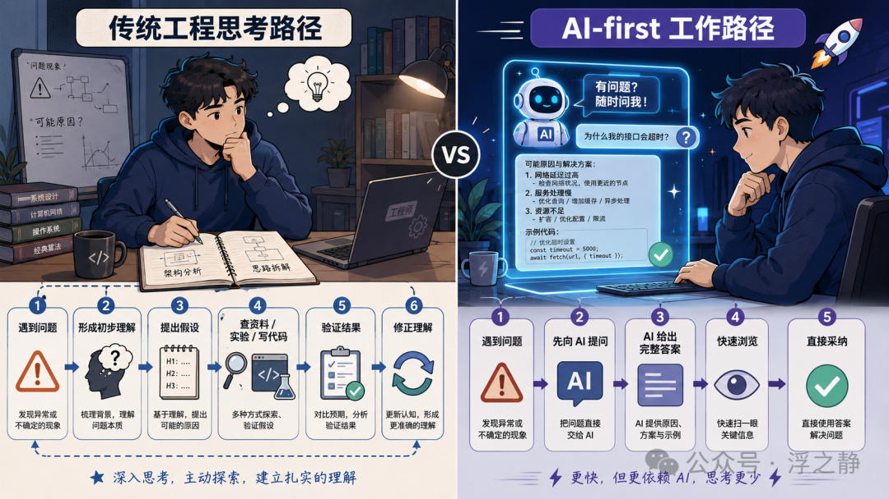
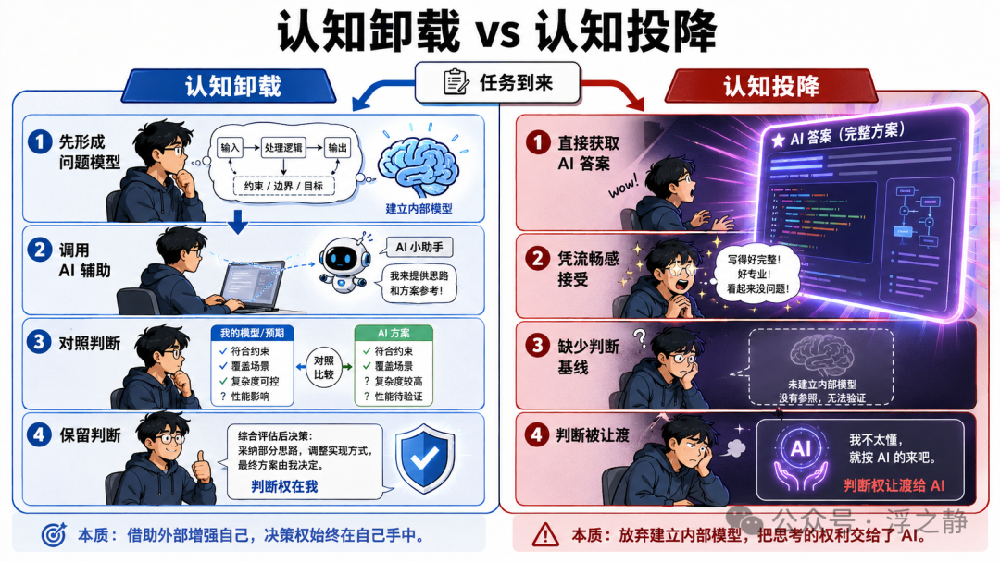
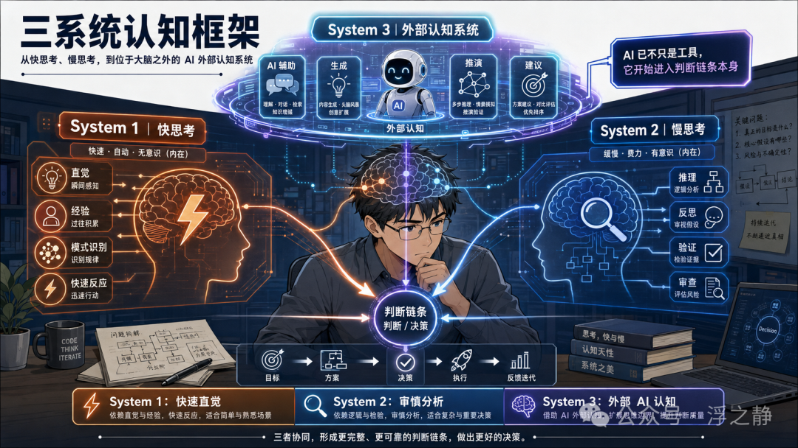
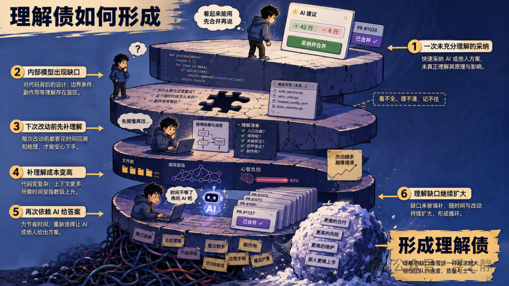
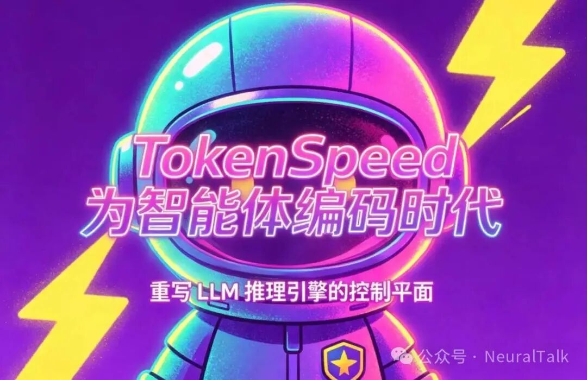

> **作者**: 浮之静  
> **原文**: [微信文章](https://mp.weixin.qq.com/s/V-RsVf7l7hCxspdj4ai2tw)  
> 
> **摘要**: 别让 AI 提前给出的答案，偷走你本该形成的判断。

技术大佬 Addy Osmani 最近写了篇名为 Cognitive Surrender[1] 的文章，很有思考深度。我在此基础上补充梳理、重新展开，整理成文。献给那些在 AI 提速感里越跑越快、却越来越难说清自己在做什么的 vibe coder 们...

别让 AI 提前给出的答案，偷走你本该形成的判断。

AI 编程工具真正改变的，不只是写代码的速度，而是工程师形成判断的顺序。

过去，我们遇到一个问题，通常会先在脑子里搭个很粗的模型：问题大概出在哪，哪些模块可能受影响，边界在哪里，什么解法可能靠谱，什么地方最容易翻车。这个模型不一定完整，甚至很多时候还挺模糊，但它很重要。后面无论你去查文档、看源码、问同事，还是跑实验、打日志、写测试，这些动作都在修正它、补强它。

现在情况变了。很多时候，不是人先有判断，再去调用工具，而是模型先给出一个像样的答案，人再决定接不接受。代码、解释、测试、重构建议、PR 描述、架构理由，甚至一整套“为什么这样设计”的说法，都可能在你还没来得及真正思考之前，就已经摆在你面前了。

这才是今天最值得警惕的变化。问题不再只是 “AI 会不会写错代码”，而是另一层更隐蔽的东西：我们是不是正在把本该由自己完成的判断，也一并交出去。

## 答案来得太早

很多人说 AI 提升了效率，这当然没错。但“效率提升”说法太轻，它只描述了表象，没有碰到本质。

更准确地说，AI 正在把很多人的工作流，从“先理解、再生成”，慢慢推向“先生成、再决定要不要理解”。看起来只是顺序换了一下，实际上整套认知关系都变了。

左边这条路不见得更快，但判断的中心在人，外部工具只是补充。右边这条路，更像今天很多人的真实状态：答案来得太早，太完整，太像专家，于是人很容易直接跳到“采纳”那一步。你会觉得自己也参与了思考，但很多时候，你参与的只是选择题，而不是建模本身。

这就是 AI 对工程最深的冲击。它不只是让代码更容易生成，也改变了人形成理解的方式。

以前是你先对问题有一个粗糙判断，再通过工具修正判断。现在是 AI 先给你一个完整说法，你再围着它做二次加工。这个顺序一旦变了，你很容易误以为自己“理解了”，其实只是“接收了”。

答案来得太早，判断就容易来得太晚。

## 借力，还是让渡

这里有个特别容易混淆的地方。很多人一听到这种说法，第一反应是：工具不都这样吗？计算器、搜索引擎、IDE 自动补全，难道不也是把一部分思考交给外部系统？

是的，但这还不是同一回事。

把一部分计算、检索、执行交给工具，叫认知卸载。你把“怎么做”交出去，但“我到底在解决什么问题”、“结果合不合理”、“如果出错该怎么怀疑”，这些判断仍然在你手里。你当然是在借力，但没有丢掉主导权。

认知投降就不一样了。它不是把某个步骤交出去，而是把“形成答案”的过程本身交出去。AI 的输出慢慢变成“你的输出”，你甚至没有留下一个足够独立的内部模型，去和它做比较。

更麻烦的是，这个过程很少是显性的。它不会跳出一个对话框提醒你：“你已失去判断权，是否继续？”

它更像是悄悄发生的。

这条线很细，所以也最危险。因为从主观感受上看，二者都像是在“高效使用 AI”。都完成了任务，都拿到了结果，也都可能让你当天过得很顺。

真正的差别要到以后才会暴露出来：出 bug 时，你能不能自己把因果链重新搭起来？需求变了，你能不能不靠 AI 也知道该怎么改？系统复杂起来，你还能不能说清楚它为什么是这样？

如果这些能力在变弱，那就不是单纯的借力了。

认知卸载是你借助 AI，但仍然拥有答案。认知投降是 AI 给了答案，你把它接过来，然后误以为那就是自己的判断。

## AI 的自信，不是你的判断

这件事最值得警惕的地方，不是模型会犯错——这谁都知道。真正的问题是：模型常常会让人带着更高的信心去接受错误。

Wharton 的 Steven Shaw 和 Gideon Nave 在 Thinking—Fast, Slow, and Artificial[2] 里提出了一个很重要的视角：除了传统的快思考和慢思考，今天还出现了一种“位于大脑之外”的第三系统，也就是由 AI 承担的外部认知系统。这个框架不是为了发明一个新名词，而是为了准确描述我们正在经历的现实：AI 已经不只是工具，它开始进入判断链条本身了。

他们做了三组实验，1,372 名参与者，9,593 次试验，观察人在 AI 可用的情况下，会怎么处理 AI 给出的建议。结果很扎眼：AI 正确时，人类表现会明显提高；AI 错误时，人类表现也会跟着下降。更危险的是，AI 可用时，参与者的信心还会上升。也就是说，人并不只是借用了 AI 的能力，很多时候还顺手借走了它的自信。

这件事一旦放到软件工程里，味道就完全变了。

因为代码本身就特别容易伪装成“合理”。它能编译，通过 lint，风格统一，测试也绿了。变量名没问题，注释也像那么回事。你看着一个挺工整的 diff，很容易从“我大概理解了”，滑到“应该没问题”，最后变成“那就合吧”。

真正危险的错误，偏偏不长在这些表层信号上。它们通常藏在事务顺序、竞态条件、缓存失效、权限边界、回滚路径、默认值翻转、失败恢复这些更深的地方。

AI 特别擅长制造一种错觉：局部上很像对的，整体上却未必真的对。 更要命的是，它说话很笃定。
- “这里使用队列更适合解耦。”
- “这里的 debounce 能减少抖动。”
- “这个重构不会影响外部行为。”
- “这个 bug 的根因在于异步执行顺序。”

这些句子听上去像工程判断，像某个老手写在团队 wiki 里的经验。你会很自然地把它的语气，误以为结论已经被证明。到最后，你借来的不只是代码，还有一种本不属于你的确定感。

模型的自信不是你的判断。它说得稳，不代表你想清楚了。

## 代码在增长，理解在缩水

软件工程比很多行业更容易中招，因为它同时踩中了几个放大器。

首先，代码的“表面正确性”太强了。很多领域里，AI 生成的东西看一眼就能感觉不稳，软件不是。代码天生就有一种“只要能跑就像真的”的伪装性。一个 patch 看起来完整、整洁、很像人写的，于是人就更容易跳过深层校验。

其次，组织奖励的往往是吞吐，不是理解。团队看 PR 数量、功能交付、工单关闭率、迭代速度。这些指标都只能看见产出，看不见你是否真正理解了刚刚合进去的东西。于是短期内，组织会同时奖励两种完全不同的状态：一种是“我借助 AI 更快地完成了我理解的工作”，另一种是 “AI 完成了工作，我批准了它”。仪表盘分不清这两者，但长期后果完全不一样。

还有一点经常被忽略：代码是可复合的。一次投降会为下一次投降创造条件。你今天接受了一段自己没真正吃透的代码，明天再改到它时，理解门槛就更高。因为你不只是在处理新需求，你还得补上上一次没建立起来的那段内部模型。

很多团队后面越走越依赖 AI，不只是因为 AI 好用，也因为系统里越来越多东西已经没人真正说得清了。

这就是理解债。

技术债大家都熟。结构乱了、耦合高了、测试脆了、性能差了，改起来越来越痛，这是技术债。理解债更隐蔽。它指的不是系统本身有多糟，而是：系统里已经存在的东西，超出了任何人真正理解的范围。代码量一直在涨，行为复杂度一直在涨，但团队脑中的因果模型没有跟上，甚至在缩水。

认知投降，就是理解债最直接的生成机制。

每次你合并一段并未真正吃透的代码，都是在借债。每次你接受一个听起来很顺的设计理由，却没有自己推一遍，也是在借债。每次你让 agent 修好一个 bug，但没有重建 bug 的因果链，还是在借债。

当天看，这些债都不贵，甚至便宜得让人心动。速度更快了，任务完成了，指标漂亮了，大家都轻松了一点。真正的利息是在以后付：下一次改动更难判断，下一次重构更难推进，下一次线上事故更难解释，新人更难接手。那时候你会发现，系统不一定是“写坏了”，但已经慢慢变成了“没人真正懂了”。

这个问题并不只出现在编程里。麻省理工学院 Media Lab 的研究团队做过一项很有代表性的工作，标题叫 Your Brain on ChatGPT[3]。他们把参与者分成 LLM、搜索引擎和纯脑力三组，让大家连续做 essay 写作任务，再结合 EEG、文本分析、教师评分和访谈，观察不同工具条件下，人的认知参与状态会发生什么变化。

这项研究最值得注意的，不是某个单一指标，而是整体趋势：随着外部支持程度增加，大脑连接模式会系统性变弱；纯脑力组最强，搜索组居中，LLM 组最弱。与此同时，LLM 组在“对自己作品的所有权感”和“对自己刚写内容的回忆能力”上也更弱。

当然，这里必须说清楚：MIT 团队自己很谨慎。他们明确提醒外界，不要把这项研究粗暴地解读成 “LLM 让人变笨了”或者“脑子坏了”。这项研究仍然是初步研究，样本量有限，任务场景也集中在写作上，结论需要谨慎看待。

即便如此，它还是点亮了一个关键方向：外部系统在给我们带来短期便利的同时，也可能让人的记忆、参与感、所有权感和内部生成过程一起变薄。

写作里，人可能写出一篇文章，却没真正经历过“组织、推导、打磨、修正”的过程；编程里，人可能提交了一段代码，却没真正经历过“建模、判断、验证、归因”的过程。表面产出都在，内部模型却没同步长起来。

真正值得担心的，不是 AI 让人“不工作”，而是它可能让人完成很多工作，却越来越少感到那是“自己做出来的”。

## 让 AI 晚半步进场

“该不该用 AI？”这个问题其实没什么讨论价值。现实是，大家都会用，而且只会越来越多。

真正该问的是：AI 在什么时候进入你的思考过程？

如果它是在你已经形成问题表示之后介入，它大概率是在帮你放大认知。你已经知道自己在解决什么，AI 提供的是候选解法、对照视角、补充证据、反例，或者更快的执行力。这个时候，它更像是认知放大器。

可如果它在你还没来得及构建内部模型之前，就把一个完整答案塞到你面前，那它很容易直接变成认知替代物。你后面不是在用它思考，而是在围着它给出的答案做二次加工。

说白了，不是所有任务都该默认 AI-first。 样板代码、格式迁移、低风险脚手架、重复劳动，AI-first 没毛病。但遇到架构判断、复杂 bug、核心模块重构、学习新系统、理解新库、关键 PR 审查，默认就不该是“先让 AI 生成”，而应该是“先让我自己有个最小判断，再拿 AI 来对照”。

这个“最小判断”不需要很完整。哪怕只是三句话也够：
- 我觉得问题可能出在这里。
- 我预计会涉及这些模块。
- 我要用这些证据来验证结果。

这三句话的价值不在于它们一定对，而在于它们给你留住了一个判断锚点。有了锚点，AI 输出才是第二视角；没有锚点，AI 输出就是你的第一视角。

而一旦 AI 成为第一视角，人就特别容易把“采纳”错当成“理解”。

所以，高风险任务里，不要急着让 AI 抢第一步。让它晚半步进场。先让自己有一个粗糙但属于自己的判断，再让 AI 来挑战它、补充它、修正它。

## 把判断握在手中

说到这里，很多人会本能地回一句：那我以后多留心一点，不就行了吗？

问题可能没这么简单。认知投降从来不是纯粹的态度问题，它很大程度上是一个疲劳问题、流程问题、结构问题。你赶时间，diff 很大，上下文切换频繁，今天已经看了四五个 PR，脑子其实早就不够用了。这时候最容易发生的，不是明显错误，而是“看起来差不多就算了”。

所以，光靠“提醒自己多思考”是不够的。真正有效的做法，是把那部分本该由 System 2 承担的审慎、验证和怀疑，也一起工程化。

在看答案前，先写出自己的预期。非普通任务上，哪怕只写三五句也行：问题像什么、可能影响哪里、成功标准是什么。这样 AI 给你的就不是“第一视角”，而是“一个可对照的外部答案”。

把验证从“附加项”变成“硬退出条件”。“看起来没问题”太容易骗过自己了。“这里有测试结果、运行日志、trace、截图、复现路径，所以我知道它是真的工作了”，这才是真正有用的完成信号。没有证据，就不应该算完成。

尽量缩小理解单元。AI 会让大规模生成变得非常便宜，但理解不是按生成成本定价的，而是按人类认知极限定价的。50 行 diff，通常还有机会被真正 review；600 行 diff，大概率就只剩“扫一眼”。一旦单次改动超出人类真实的理解能力，review 很快就会退化成批准，而批准就是认知投降最常见的外衣。

学习阶段，尽量让 AI 先解释，后生成。新东西最怕的不是不会写，而是太快写出来。Anthropic 研究过 AI 辅助与技能形成的关系（How AI assistance impacts the formation of coding skills[4]），结果也很说明问题：如果人在学习新库、新系统时，主要把 AI 当成代码生成器，后续理解会明显变弱；而如果把 AI 当成解释器、提问对象、对比器，理解保持得会更好。学习不是把结果抄到手里，而是把内部地图长出来。完全无痛，很多时候就意味着没长什么能力。

最后，保留一定比例的“无 AI 编程时间”。这不是苦行僧式训练，也不是道德洁癖，而是校准。你需要定期确认一件事：如果今天没有 AI，我还能不能独立搭一个简单模块？还能不能自己追一遍 bug 的因果链？还能不能解释一个关键设计为什么成立？

如果这些问题的答案开始变得模糊，那就该警觉了。认知卸载可能已经越过边界，开始滑向认知投降。

这篇文章不是劝人少用 AI。恰恰相反，在一个明显会持续增强的工具面前假装它不存在，才是更大的问题。真正重要的，不是用不用，而是你和它到底是什么关系。

AI 最好的状态，不是替你思考，而是放大你已经开始的思考。它不该成为你停止建模的理由，而应该成为你扩展建模能力的工具。你离开一次对话之后，理想状态不是“我拿到了一段代码”，而是“我对这个问题的结构，比进来之前更清楚了”。

不健康的关系刚好相反：AI 比你更懂问题本身，你只能继续依赖它去解释它之前给出的答案。表面上也很高效，甚至一段时间里产出还会特别亮眼。可时间一长，人的内部模型越来越薄，系统的解释权越来越集中在外部工具身上。你不是在被增强，而是在被架空。

这两种关系，短期看起来很像。都能写代码，都能发版本，都能推任务。真正的差异，要过一阵子才会显现出来。出了故障，前者能从第一性原理修，后者只能继续问 agent；需求一变，前者能自己判断边界，后者得重新让模型给一套解释；系统越复杂，这种差距会越大。

## 结语

AI 时代，代码会越来越便宜，生成会越来越容易，很多原本显得高级的产出能力，很快都会被拉平。真正不会被轻易拉平的，是判断力，是校准能力，是你在高效率表象之下，依然能分清楚一件事：我现在是在形成自己的理解，还是只是在接受一个看起来很像答案的东西。

如果你的代码在增长，而你对系统的理解也在增长，那是健康的增强。如果你的代码在增长，而你的理解却在缩水，那你支付的就不只是 token 成本，而是认知成本。

认知卸载，是把工作交给 AI，但保留判断。认知投降，是把判断也交给 AI，然后误以为自己完成了工作。

工具不会自动让人失去思考。真正危险的，是人太容易在“顺”、“快”、“像对了”的感觉里，悄悄把那部分本该属于自己的思考，也一起让渡出去。

而这条线，最后没人能替你守。只能你自己守。

## References
[1]

Cognitive Surrender:https://addyosmani.com/blog/cognitive-surrender[2]

Thinking—Fast, Slow, and Artificial:https://papers.ssrn.com/sol3/papers.cfm?abstract_id=6097646[3]

Your Brain on ChatGPT:https://www.media.mit.edu/publications/your-brain-on-chatgpt[4]

How AI assistance impacts the formation of coding skills:https://www.anthropic.com/research/AI-assistance-coding-skills
