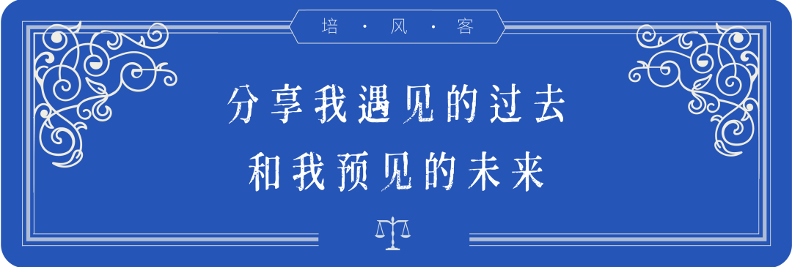
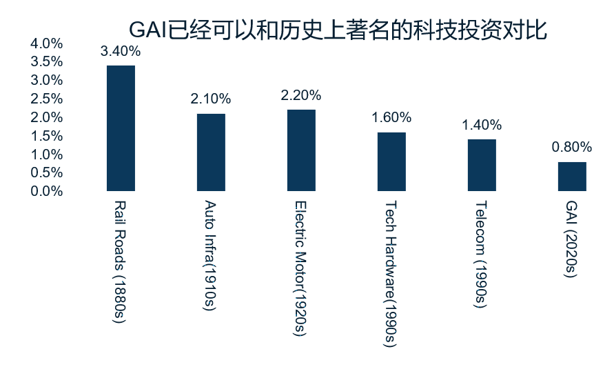

> 人往往高估了短期的变化，而低估了长期的改变。

# 生成式AI的投资与技术周期

在几天前的一个会议上，我用了一个没有更新的PPT图片，原因是换了个电脑之后找不到源文件里面的Excel，我相信很多人都会有这样的经历。但好在不影响结论。

这是去年的数据，今年的数据应该已经是2%左右

## 技术的长周期

当时我想表达的是，人往往高估了短期的变化，而低估了长期的改变。火车在1880年被发明，1910年才进入它资本化和大规模建设的时期，到了2010年，在它被发明了130年之后，中国的高铁建设依然是时代的热点。即便到了今天，印尼的高铁技术发展，越南的高铁技术发展依然带来了很多投资机会。

汽车在1910年代开始慢慢普及，但电动车技术在2020年代，依然有旺盛的生命力。

## 生成式AI已越过阈值

生成式人工智能的投资，我觉得已经越过了一个阈值，它已经成为了人类大规模技术应用的一个新科技，这东西是自我实现的，投资足够多之后，产业链足够丰富，就算过程有波折，最后往往也能走出来，因为沉没成本足够多，基础设施建设已经足够多。就算它有一天因为情绪狂热或者投资增速下滑，带来一些股票价格的下行，我觉得在未来10-20年，甚至30-50年，我们都会伴随这个技术，逐渐应用和拓展它。

这种技术的早期狂热，冷静之后降本增效，然后二次起飞，在矿业领域叫做**拉松德曲线**（Lassonde Curve），说明初级矿业公司往往有两个价格高潮，第一个是找矿热，第二个是产矿。然后中间有一个挫败。我觉得我们大概率就处在第一个高潮中，在可以预见的未来，这个技术的应用会逐渐扩散到足够多的行业。而中间的道路大概率并不平坦。

## AI研究机构

所以我和朋友做了一个基于人工智能去研究地缘政治和其他种种投资机会的机构，就像是前面说的矿业的例子，在勘探结果出来之后，找矿热过去之后，需要有一个仔细的工作，去把正式的可研报告做出来，然后才能有二次增长曲线。从我自己的角度来说，我能理解科技企业在大美利法案下，在2026年用Capex取代未来OPEX的思路，但我觉得GAI还是需要更多长期的应用场景，去证明它更有效率。我自己更多的能力在投资和研究，精力更多在商品和地缘，所以我可以分享在这些领域，我们在过去1-2年时间里面的一些心得和体会。

## 2016年的教训

2016年前后，也就是十年前，当时我刚从研究生毕业，在香港的一个餐厅里面我遇到了一位朋友，当时我说，加拿大的黄金公司Eldorado退出中国市场，把最后四个金矿卖给了两个中国伙伴，是一个时代的终结。而我的朋友当时给阿里做一些咨询，因为他们去美国上市之后有一些需要注意的地方。

在那个时候，对于中国互联网和中国矿业公司的看法，是完全反过来的。大家觉得中国矿业没机会了，甚至闭关锁国这样的说法都在发生。而中国互联网兴兴向荣。但结果是紫金的股价从2016年到2016年就是标准的十年十倍，算上分红其实更多。

这是我亲身经历的故事，除了很简单去说，一致预期都是错的，或者人生发财靠康波这样的话，我觉得还有一点就是**创新的精神，进取的精神**。

说周期很简单，2016年我亲口听到一些周期的研究员说，以后人类都是靠Facebook这样的虚拟经济，实体经济以后就是没有任何机会。大宗商品更是如此，然后完全忽视了在2015年科技出问题之后，没有办法又重启了地产的引擎，加上供给侧改革，供需两旺带来的大宗商品牛市。

当然，我今天看到消费行业确实也有同感，我觉得这种时候如果能等到一个消费行业的政策变化，那就是反转了，到时候一定也会有很多人，甚至消费研究员都不相信。

## 真正的投资机会

2016年碳酸锂处在拉松德曲线的第一阶段，这是个新东西，而我当时刚入行，根本不理解科技对于周期的重要性。

2016年供给侧改革严格来说不是一个新东西，但也是一个大家不愿意相信的社会变革。

2016那年4月份，周行长说居民部门杠杆率还有提高的空间，其实也是一个新提法，甚至有点不合逻辑。

2017年Trump1.0第一年，301调查开始贸易战，但大家没概念，没有意识到这是个多么大的变化。

2018年，中国开始新能源和半导体的产业投资，我觉得面对的就是石油和芯片的进口依赖。

2020年-2021年疫情，美国14%的赤字率。

2022年美国加息速度超预期，同时长端利率在加息和财政赤字双重压力下大幅走高。

2023年GAI横空出世，2024年美国大选结果在几个月内迅速变化。2025年AI Capex依然是60%增速。

上面这些才是真正的投资机会所在，包括2022年之后黄金和实际利率脱钩，2024年降息后铜不跌反涨。这些超预期，超过过去理解的变化，才是大机会的来源。

## 时代变化

或者再说得广大一点，2016年之前的中国，是财富效应逐步积累，然后认为自己的产能可以供给全球的国家。2022年之后这些假设是有变化的，所以之前看到说互联网估值的那张图，我觉得也不能完全怪阿里腾讯，确实是很大的预期改变。不是每个企业，在这些变化下都还能保持原来的节奏，而且很多时候也不是他们自己的问题。

这些问题都是非常真实的，我完全理解这些看法，但我觉得没什么意义，因为上面任何一个机会，都不是纯看周期，看历史，看规律看得出来的。我是一点都不相信有人可以在我们这个年代去做一个先知预言一切。真正在过去10年做得好的企业，都是尝试去应对这些变化，适应时代变化的企业。无论是全球化，电动化，智能化。未来还会有新的挑战和机会。

我觉得一代人有一代人的挑战，只有最狂妄的人才会觉得自己这一代人的机会结束之后以后再无机会。

我自己其实在过去10年这些方面做得只能算一般，我之前太痴迷宏观经济和经济周期，反而错过了一些机会，如果要我重来一遍，我觉得周期股，无论是矿山，还是汽车银行，好的机会都是在变化中产生的，没有变化往往没有大机会，好的企业是应对变化好的企业，而不是只看静态ROE或者PB/PE这些。

## 使命

最后我想做个总结，也是我们自己公司未来的Mission或者Vission，我们尝试用科技提高人类的决策水平。

有太多历史的遗憾，太多本可以规避的风险。

- 我觉得市场的结构性机会，很多由科技带来，GAI不是是人类最后一个发明的科技，所以应该用GAI去更好研究前沿科技的变化
- 我觉得市场的周期之所以存在，相当一部分原因是分配不均，利润在产业链分布不均带来库存周期和价格周期，利润在企业国家居民的分配不均带来经济周期。我不相信GAI可以带来完全公平的社会，所以周期性机会不会消失

生成式人工智能依然有很多薄弱的地方，错误很难被完全规避，对于非结构化的数据，缺乏数据的知识的研究依然可以提高。我和我的伙伴都相信生成式人工智能会改变整个投资行业，甚至整个世界，但它需要一定时间才能做到。在这个过程中我们应该去做什么，或者不做什么。

我觉得到今天我们稍微有了一些头绪，我们一方面需要用最新的技术去思考人类最前沿的挑战和变化，无论是科技，经济，文化，政治。另一方面我们需要用最新的技术，让尽可能更多的人，更好面对这些变化。

我们觉得如果能够成功，我们会看到一个信息传达更加流畅，运转速度更快的社会，我们也经常开玩笑说，这两年市场的信息传导和运行速度非常快，我们不知道这到底是AI带来的社会变化，还是降息周期中后段或者市场情绪高潮阶段的自然体现。
