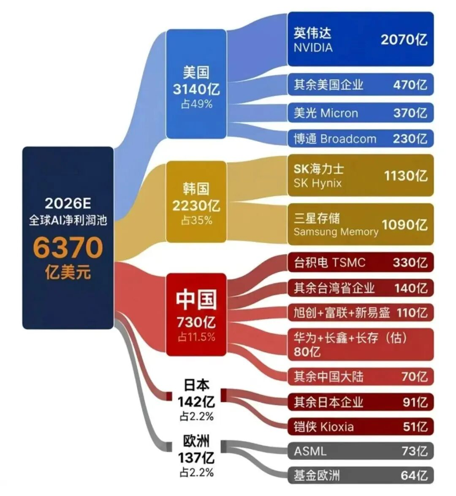

# 老登对AI时代的思考：盛世与先驱

进入AI时代，大家把落伍于该时代的大龄人通称此为“老登”，网上进一步按年龄大小细分为“小登、中登、老登、神登、上古神登”等等，那我就比“上古神登”还要早出生了。尽管如此，我仍不甘于被AI时代淘汰，努力去了解AI产业的发展阶段与特征。好在现在有DeepSeek等大模型，经常可以学习和查阅。

AI第一次带给我的震撼是在10年前，谷歌DeepMind团队开发的AlphaGo 战胜了围棋界曾获得过14次世界冠军的李世石。之前我一直以为围棋变化太复杂，理论上有3的361次方那么多，机器没法学习并战胜顶尖高手。既然AI打破了围棋不会被机器攻破的预言，这就意味着AI还将在未来不断创造奇迹。

AI再次带给我震撼是在两年前：谷歌DeepMind团队的Demis Hassabis和John M. Jumper因为阿尔法折叠（AlphaFold）相关成果获得了‌2024年诺贝尔化学奖‌，这是人工智能在科学领域应用的里程碑事件。

该技术将过去需要数月甚至数年的蛋白质结构解析工作，缩短到几小时甚至几分钟，目前已完成超2亿个蛋白质结构的预测，覆盖几乎所有已编目的蛋白质。全球190多个国家的超300万科研人员正在使用该工具，被广泛应用于抗生素耐药性研究、塑料降解酶设计、新药与疫苗研发等领域，大幅降低了生命科学研究的成本与门槛。

人脑大约只有1.2-1.6KG，能耗相当于20瓦的电灯泡，相比之下，电脑可以做得无限大，存储容量和计算速度都在不断扩展，人类的进化和基因的改良，神经系统、循环系统等机器很难仿制，但人脑后天学习到所有东西，可以很容易被机器全面掌握并优化。所以，AI发展不可限量。

房地产下行周期下——

半导体行业正经历超长周期

如今，AI已经席卷全球，各种大语言模型已经成为部分普通百姓的日常应用，如西方有ChatGPT，中国有豆包等。更深度一点的，所谓推理大模型，美国有GPT-5、Gemini2.0以上的版本等，中国也有DP、豆包升级版等。前段时间全国掀起安装“龙虾（Open Claw）”热，大家唯恐落伍了。 

2025年，美国M7（七巨头）的盈利总额占GDP比重为1.88%，占标普500盈利的比重接近30%，且盈利增速更为惊人，2026年一季度达到45%左右。而中国台湾的一季度GDP名义增速竟然高达16.88%，这显然受台积电为代表的电子行业的带动，其中台积电一季度的盈利增速高达60%。同样，韩国三星电子和SK海力士也十分耀眼，到6月末，这两家公司的市值占韩国KOSPI指数总市值的比重约55%。

最近网上流传下面一张图：

2026年全球AI企业净利润预测

来源：网络 

该图显示，2026年美国和韩国的AI企业盈利额将占全球AI企业盈利总额的84%。因此，AI热潮虽然横扫全球，却存在极度分化的现象。从上图中可以明显看到，如果把AI看成是一场淘金热，那么，如今赚钱的几乎都是提供淘金工具的厂商，AI+的厂商还没有赚到钱或还没有开始赚钱。

我认真学习了十五五规划中关于AI+的目标，即到2030年我国人工智能相关产业规模将增长到10万亿元以上。这意味着AI将从一项前沿技术，真正成长为拉动国民经济增长的支柱性产业。因此，未来对AI基础设施的需求巨大，如加快建设全国一体化算力网，优化国家算力资源布局，支持公共云发展；出台建设全国一体化数据市场的政策，积极推进数据流通利用基础设施建设和运营；加大算力、数据、算法、场景、资金等资源要素供给，充分挖掘人工智能行业应用和新型智能消费需求。

如此看来，今后很长时间内，市场对各种芯片的需求应该还是比较大，包括处理器芯片（如CPU、GPU、DSP、MCU）、存储芯片（如SRAM、DRAM、ROM）、传感器（如CMOS图像传感器、MEMS）、电源芯片、通信芯片（如蓝牙芯片、WIFI芯片、NB-loT芯片）、接口芯片（如USB芯片），对各种云服务、光通讯设备的需要同样也是很大。

实际上AI基础设施需求进入上升期已经很久了，如芯片需求的增加，最早应该与智能手机和电动车的推广有关。如15年前随着对智能化的苹果手机需求爆发，有些中国电子企业也参与到苹果产业链中。因此，作为周期性行业，电子行业确实在经历历史上罕见的超长上行周期。 

例如，代表芯片行业景气度的费城半导体指数，10年前的今天只有680点，如今已经达到了14680点左右，上升了14000多点。且过去一年就上涨了三倍左右。

费城半导体指数一年多来上涨三倍

来源：WIND，中泰国际

记得在10年前，全球半导体上游的原材料出现了五年来的第一次涨价，如硅晶圆等，或意味着硅基时代的来临。我当时还和公司电子行业的首席展开了一次对话，他认为下游以HPC、IoT、汽车电子为代表的新型需求推动第四波硅含量提升周期正式到来。上游硅片供给紧张与下游硅含量提升新兴需求形成闭环，存储芯片作为闭环核心品种最为受益。

今年以来A股市场中的传统周期类公司普遍表现不佳，但与AI相关的科技股则表现靓丽。为何A股市场表现不如美股、日股、韩股呢？原因很简单：AI的超长上行周期，并不能消除我国房地产的下行周期及对相关上下游产业的影响。而房地产的产业链之长、影响行业之多，要远超AI产业链，且体量也要大得多。

而其他国家并没有处在房地产的下行周期，韩国楼市还处在上行期。此外，我国AI及相关上市公司的总体盈利模式还没有充分形成，互联网大厂在AI领域的资本开支规模相对较小，盈利水平也相对较低 。                             

依赖巨额资本开支——

当前增长模式能否持续？

只要某个行业步入上升周期，一般都会带来供给的短缺。如2000年后中国步入重化工业高增长阶段，叠加房地产的上行周期，钢铁、石化、有色等行业产品大幅涨价，通过大规模扩张以满足需求。但这些行业由于门槛不高，如当年中国粗钢产量急速扩大，导致政策层面拼命压产能，故大宗商品的上行周期一般都不长。 

但AI基础设施相关工具生产的门槛比较高，容易形成技术垄断，这就是目前英伟达、台积电、ASML、三星电子、海力士等为何毛利率那么高的原因。AI时代对其基础设施相关产品而言，确实正在经历一轮超长周期，但并不等于AI端侧的产品制造和销售就可以高枕无忧。

30年前，我大约花了5-6千元买了人生第一部手机，是西门子公司生产的“小型大哥大”手机，其功能只有接打电话和接发短信。因为90年代初移动电话刚出现时，只有老板才买得起第一代手机，像一块砖头，当时大家称之为“大哥大”，而我们一般会买只能接发信息 的“拷机”。那个年代，大家的名片上会印上拷机号码。

过去30年来，我陆陆续续更换了十几部手机吧，记得还用过诺基亚、爱立信、摩托罗拉、三星、黑莓、华为和苹果等品牌的手机，其中苹果用的频次最多，从iPhone4开始，跳换过几次，止步于iPhone13，发现功能大同小异，大部分功能其实用不上。如某品牌手机号称可以打卫星电话，导致供不应求。说明端侧产品各领风骚，很难一枝独秀。

联想到当前美国的各大AI企业资本开支巨大，今后能否回本，保持现金流的畅通，存在巨大的不确定性。例如谷歌发行100年期的债券，收益率高达6.05%；2026年其资本开支高达1800-1900亿美元，但预计其利润为约 1590 亿美元。所以，AI企业多是重资产企业，不同于互联网这样的轻资产企业，一旦现金流出现枯竭，企业的估值水平将大幅下移。

根据多家投行的预测，美国主要AI公司的资本开支总额预计在8000亿美元左右，如亚马逊、微软、谷歌、Meta、甲骨文五家巨头加起来的资本开支就达到8000亿美元。推动这轮资本开支的主要是对算力的巨大需求，而存储芯片的涨价又推高了成本。为了增加资本开支，它们通常通过裁员、暂停股票回购或发债等方式来筹措资金。

问题在于，AI行业的技术进步日新月异，设备更新周期应该会很快，故资本开支的增加可能不是一次性的，如2026年美国主要AI公司的资本开支总额比2025年翻了一倍，那么2027年又将增加多少呢？

记得2004年我徒步在雅鲁藏布江的排龙乡一带，由于手机没有信号，也没有卫星定位功能，迷路后夜宿在一户门巴族人的家里，当时的手机尽管还不是智能手机，但已经有了录音功能，门巴族一家四口感到非常新奇，他们轮番唱着门巴语的民歌让我录音，然后不断地听，开心了一个晚上。如今，智能手机都已经普及了，但接下来各类AI手机肯定会花样翻新地推出，诱使消费者去购买。

记得2011年有一个新闻让我刻骨铭心：安徽有一个高中生，做了“卖肾”手术，以此去换iPhone4手机。这实际上就是很冲动的私人资本开支，因为当时该手机是功能最强大也是最时尚的，如果他知道未来还有功能更强大的iPhone14或iPhone40的手机出现，还会去卖肾吗？

AI的发展历程会曲折：

大部分注定成为先驱

未来AI的应用端会发展成怎样，谁能精准预测呢？无人驾驶汽车、家用仿真机器人、AI眼镜、AI手机等等都在未来飞入寻常百姓家，但这需要多少年呢？是否能和如今巨大的资本开支实现无缝衔接？

作为老登，我提出以下一些疑虑：

一、2026年取得暴利的AI企业，大部分都属于AI基础设施建设的设备和材料供应商，如英伟达、海力士、台积电、三星存储、美光、博通等，而买方呢多是谷歌、亚马逊、Meta等云巨头，如果它们2027年的销售收入没有相应增加，那么，2027年的资本开支增速还会达到100%或50%吗？如果增加不了那么多，那么，“卖铲子”的公司估值水平是否有下行风险？

二、中国在算力方面正努力和美国缩小差距，且主要靠政府部门来扩大资本开支，但这样的基础设施投入能否带来相应的现金流，如果不能在几年内见效，是否还会继续且大量投入财政资金？全球会否面临算力过剩的风险？

三、现在AI机器人公司多如牛毛，虽然工业机器人已经很成熟了，但AI机器人基本上都属于程序设定好的“表演类”机器人，智能化程度与人们的预期相差甚远。我国在机器人的硬件方面，全球领先，但在数据和软件（操作系统）方面则偏弱，据说迄今还没有一家进入全球前十的。总体感觉AI在算力、文字和图像创作等“纸上谈兵”方面的优势强大，但在行动方面却非常吃力，所谓知行合一太难了。而更难的是机器如何与人进行互动，这恐怕需要更长的时间。

但我们中的大部分人却恨不得像科幻小说一样，让一个无所不能的机器人很快出现在眼前。恐怕我们还得耐心等待，如马斯克的脑机接口公司Neuralink十年前就创立了，目前仍未上市，其估值（市值）仅仅在90亿美元左右（约合人民币600多亿元），可见脑机接口技术还未成熟，否则早就该做大了。

同样，自动驾驶系统也面临类似的问题，需要大数据和相应的过硬软件。只有当家用AI机器人和纯自动驾驶汽车实现商业化，产生可观的销售收入时，我才相信AI端侧的盈利模式成功了。2026年被普遍视为L3级（有条件自动驾驶）规模化商用的关键验证年，而要达到L5级（完全无人驾驶），恐怕还需要10-20年时间。

基于此，我认为至少目前AI产业的诸多商业模式还不能形成规模效应。即如果AI企业的收入来源主要还是靠卖给企业（B端）或政府（G端），而非个人用户（C端），那么，某些AI的产业链终将有断裂风险。

四、我认可存储芯片存在巨大需求，这种需求来自对算力的巨大需求，现在的大模型多集中在大语言模型、推理大模型等，未来随着无人驾驶和仿真机器人的推广，以及AI与量子科技、生命科学、新材料、新能源、6G 等领域技术协同创新，物理世界大模型、科学大模型的应用及对巨量数据的需求大增，存储芯片将进入超长上行周期。但如果扩产能过快，是否也会带来产能过剩？

我曾是摄影爱好者，胶卷机盛行的年代，胶卷市场被柯达和富士所垄断，看起来牢不可破，如今这两大巨头公司则早已改弦易辙了。当时最贵且专业的胶卷相机是哈苏，后来数码相机崛起后，佳能和尼康的单反成为业余爱好者的标配，我也曾被动地更新相机和存储卡，购置不同功能的镜头。但好景不长，智能手机的摄影功能越来越强悍，如今在旅游景点拍照的游客都很少带相机了。用这个例子来类比当前的存储芯片和AI的端侧产品，不知是否恰当？

任何一个行业的发展过程，都会经历盛世年华、英雄辈出的时代，同样也会遭遇产能过剩的衰退期；在经历几轮盛衰周期之后，行业集中度进一步提高。例如，手机品牌的全球销量排名，前两名分别是三星和苹果，第三名是国产的，但销量与第二名差距甚远。过去那些知名品牌的手机，如今都没有多少记忆了。但它们曾经都是手机发展史上的先驱，曾经风靡一时。

作为老登，我也曾经年轻过。30年前，我入行证券业，就职于当时市场化程度最高的家券商，且入职不久就晋升到了管理岗位。后来这家券商经历了几轮合并，最后连名字都找不到了。但当时的领导在组织管理团队面试新员工的时候讲了一句话我至今都记得很清楚：新员工是我们的掘墓人。言下之意是，如果你不进步，那只能被淘汰。

我想，硅基时代的迭代过程更快。如果说摩尔定律所反映的速度是10年增长100倍，那么，AI是当前唯一处于并且在可以预见的未来持续处于指数式快速增长的技术（scaling law），可能符合超摩尔定律，即10年增长100万倍。今后，大量的程序员岗位被AI替代，网约车司机失业，这些巨大的改变对人类社会和经济将带来哪些影响，现在确实还是一团迷雾。

AI泡沫：

破一批，又将泛起一批 

顺便谈谈如何来看待AI泡沫。最近市场流行这么一种说法：硅基通胀、碳基通缩。这种说法其实反映了宏观经济存在结构性问题，而结构性问题的出现，与经济增长模式相关，世界上任何一种经济发展模式，只要一成不变，肯定会导致结构失衡问题。同样，硅基时代也存在结构失衡问题，因为发展太快了，因为信息不对称、预期不一致导致供需失衡。这就注定了泡沫会破。

然而，现在仍处在AI时代的初级阶段，所以，即便泡沫破裂了，也是阶段性的，因为这个时代仍蓬勃向上。同时，注定有一大批AI企业要成为这个时代的先驱，它们是曾经的英雄，因为迭代太快了。

如果类比房地产长周期的话，上世纪90年代中开始的房地产上行阶段，持续至2021年，中间也有过多次调整期。同样，AI的上升阶段不可能一帆风顺，会经历多次调整期。2021年至今，房地产步入下行周期，尽管也有几次反弹或企稳迹象，但在我看来，属于下山路上的上坡段，不改变泡沫消退的大趋势。

四年前，我在一篇文章中提及我儿时对“泡沫”的观察：小时候每逢下雨，我就不能到院子里玩了。呆呆地看着雨水往下滴，雨打在水缸的水面上，会泛起一个个水泡，但一眨眼，水泡就被雨滴打碎，同时，又在破灭的地方，泛起一个个水泡。

那么，泡沫什么时候才会破呢？看来要等到雨停了之后。如今正值AI突飞猛进的时代，雨下得正猛。当一批泡沫破了，又会泛起一批泡沫。我们是否应该寻找持续时间更长、更坚硬的泡沫？

寻找AI的未来蓝筹

2002年，中国正处于重化工业化的加速期，同时还处在城镇化的加速期和房地产的上升期。我组织不同行业研究员推荐一个本行业的未来龙头股，共30个，并编成一本书，叫《未来蓝筹》。如今，大部分传统行业都步入了下行期，但当年推荐的龙头股组合收益率仍相当惊人。少数目前仍属成长行业的所谓“龙头”则表现更佳，如中芯国际等。

我一直在思考的问题是，美国当前的M7，几年之后可能就要“改选”了，美光、博通、Anthropic等新贵是否有可能晋升，而谁又该退出呢？当年道琼斯30工业指数中的最初30个公司，如今都已全部退出，其中最后一个退出的是GE。

假如当年那个卖肾换钱买苹果手机的少年，能够把对商品的饥渴转变为对厂家的看好，买的不是苹果手机而是苹果股票，那命运可能就大不一样了。AI属于当下，更代表未来。因此，我们需要用更长远的眼光、更深度的思索、更系统的思想体系去提升对未来AI及相关行业和企业的认知。

延伸阅读

大因果与小因果：从无缘世界杯谈起

敬畏周期

硅基时代的思考：分化、就业与泡沫

“资产荒”的背面

透过交易数据看清表象背后的真实经济

对资本市场“共识”的再思考：股市上涨能否促消费？

可怕的时滞

为何延安路隧道不是直的