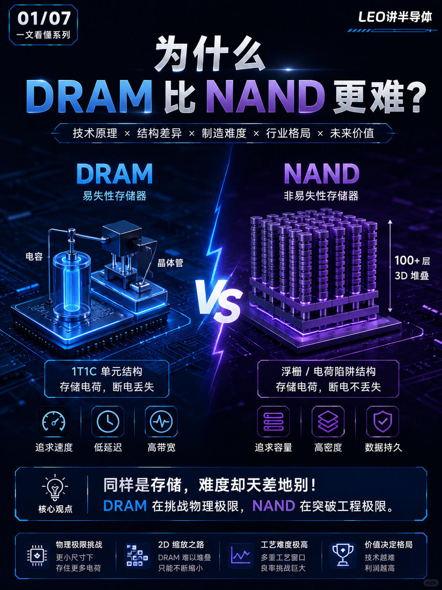
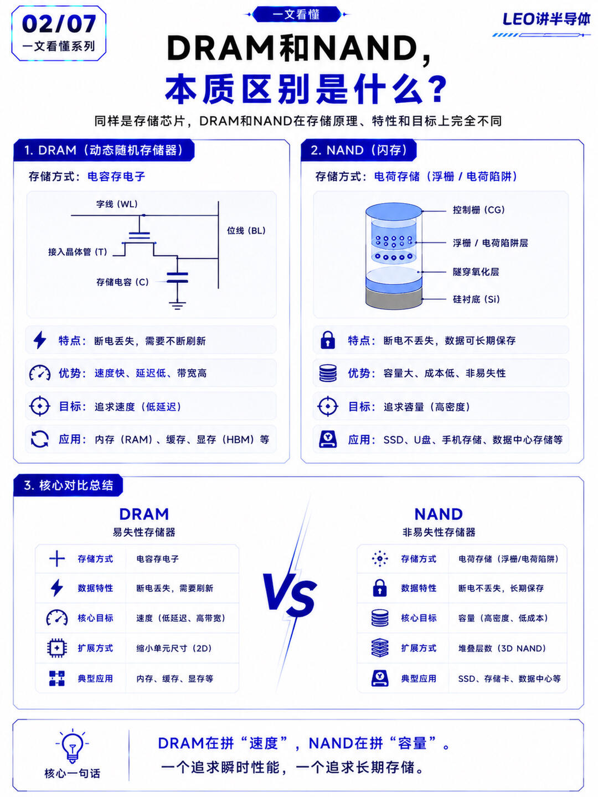
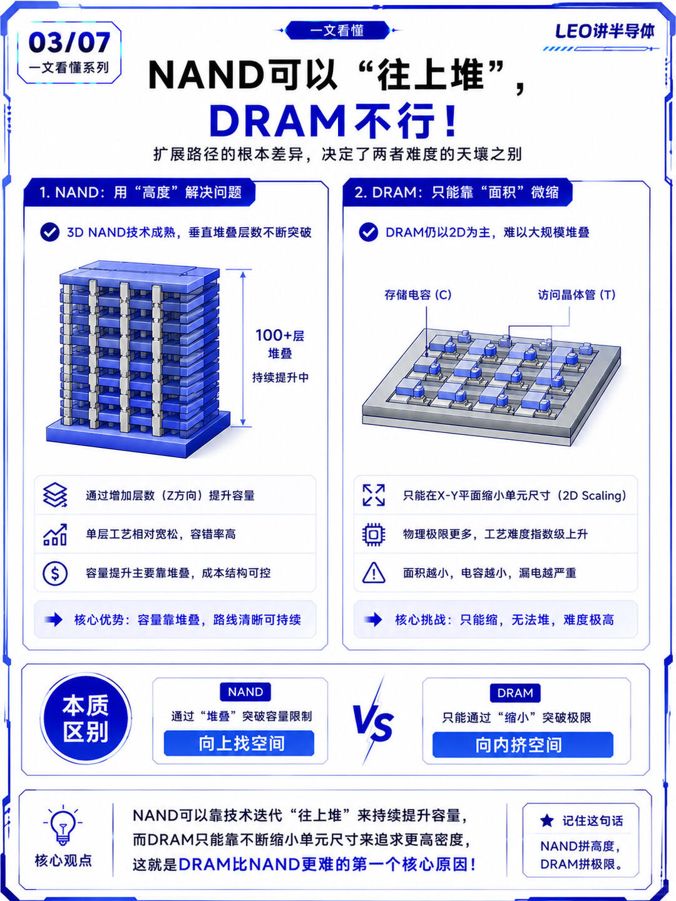
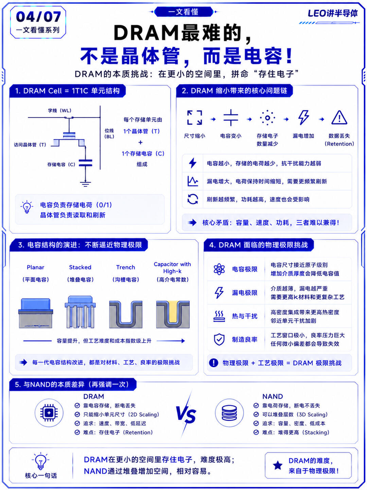
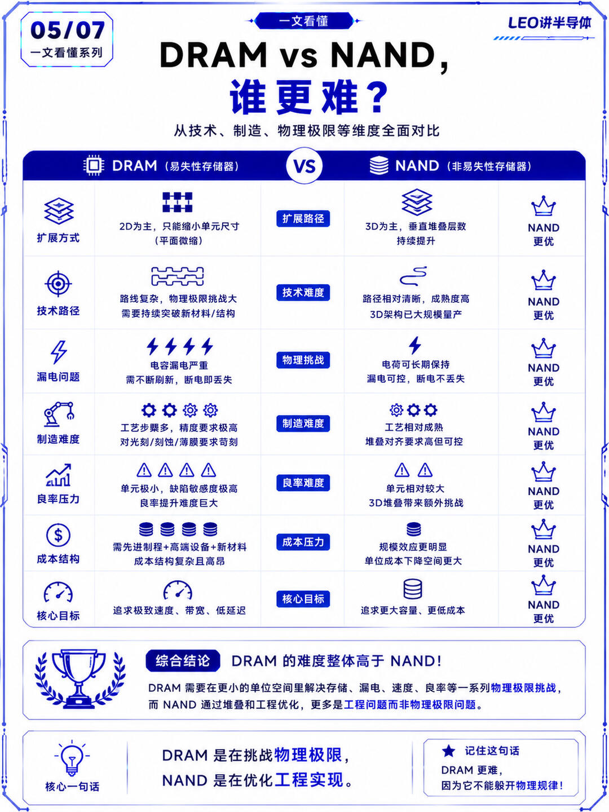
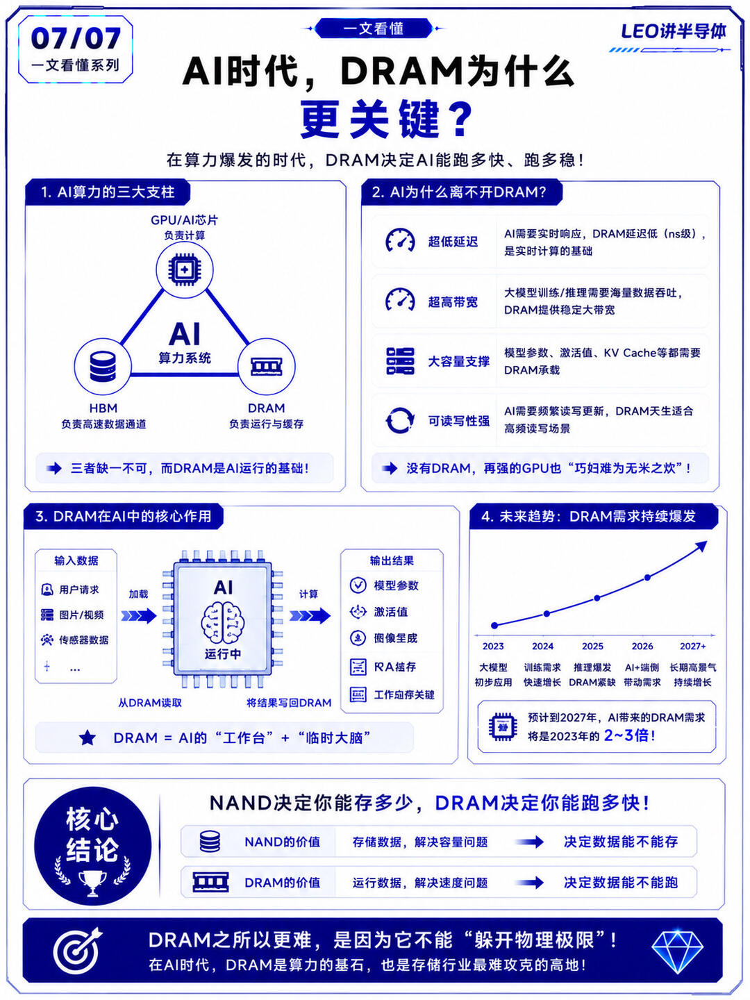

# 🔥为什么DRAM比NAND更难？答案很反直觉

为什么DRAM比NAND更难？因为两者走的是完全不同的技术路径
	
[一R]NAND：可以“往上堆”，3D NAND已经做到：
✅100+层堆叠✅甚至200层以上，不够用，就往上加一层
	
[二R]但是DRAM：只能“往小缩”，DRAM的结构是：1T1C（一个晶体管 + 一个电容），问题在于：尺寸越小👇
电容越小
存的电子越少
漏电越严重
数据更容易丢失
	
[三R]核心区别来了
NAND：用“高度”解决问题
DRAM：用“尺寸”挑战极限
	
也就是说：
➡️NAND是工程问题
➡️DRAM是物理问题
	
[四R]为什么DRAM玩家更少？
全球能做DRAM的只有：Samsung，SK hynix，Micron
原因很简单：难到只有少数公司能活下来
	
👉 到AI时代，这个问题更严重
AI需要：更低延迟，更高带宽，更稳定的数据访问
这些都依赖：
👉 DRAM：一句话总结（一定要打出来），DRAM之所以更难，是因为它不能“绕开物理极限”
	
➡️NAND决定你能存多少
➡️DRAM决定你能跑多快

---
- 作者: 东京LEO
- 链接: https://www.xiaohongshu.com/discovery/item/6a51d8ab000000000702f437?app_platform=harmony&app_version=9.37.1&share_from_user_hidden=true&xsec_source=app_share&type=normal&xsec_token=CBSph6K6unuhzNzsKPwBkhyKvfajAFD2gIWFyfR2inkAM=&author_share=1&&apptime=1784022930&ignoreEngage=true&shareRedId=N0w1Nzc1SUE2NzUyOTgwNjY0OThKPEdK&share_id=e00dd012f1804af4b70a2cfae24f3455&xhsshare=CopyLink
- 日期: 2026-07-11
- 互动: 104赞 / 149收藏 / 5评论
- 标签: 半导体, 半导体芯片, 半导体设备, 芯片, ai, 存储, 闪迪, 美光, 美股, 东京生活