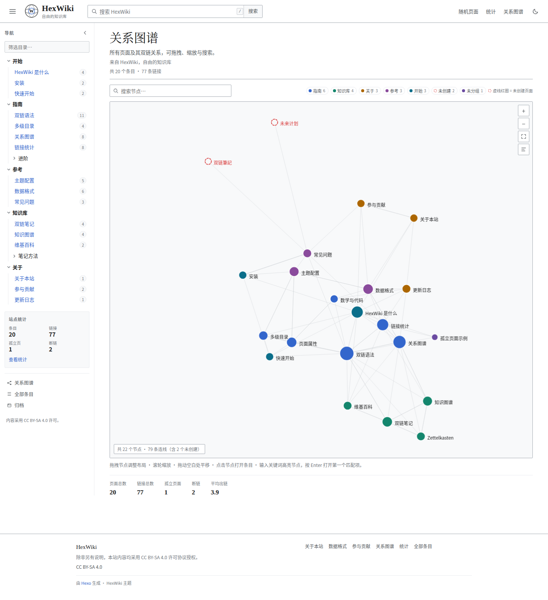

# HexWiki · Wikipedia 风格的 Hexo 知识库主题

一个把 Hexo 变成「维基百科式知识库」的主题：**左侧多级目录**、**`[[双链]]` 引用**、
**反链 / 出链 / 断链统计**，以及 **类似 Obsidian 的关系图谱**。零前端依赖，纯静态输出。

- 条目页：维基百科 Vector 2022 风格排版（衬线标题、信息框、文内目录、分类框、页脚许可说明）
- 左侧：可折叠多级目录树，当前条目高亮、祖先自动展开、实时筛选、反链数徽标
- 双链：`[[页面]]`、`[[页面|显示文字]]`、`[[页面#章节]]`，未解析目标渲染为维基式**红链**
- 关系：全站力导向图谱 + 条目页 2 跳局部图谱（拖拽 / 缩放 / 搜索 / 点击跳转）
- 统计：页面数、双链数、孤立条目、断链、被引用排行、分组与标签分布
- 体验：深色模式、键盘搜索、响应式抽屉、无框架、无 CDN、无构建步骤

> 本仓库根目录是一个可直接运行的 demo 站点，主题本体在 `themes/hexowiki/`。

---

## 快速开始

### 1. 准备 Hexo 站点

```bash
npm install -g hexo-cli
hexo init my-wiki && cd my-wiki
npm install
npm install hexo-renderer-ejs hexo-renderer-marked
```

### 2. 安装主题

```bash
git clone <this-repo> themes/hexowiki
# 或只拷贝 themes/hexowiki 目录到你的站点 themes/ 下
```

### 3. 站点配置（`_config.yml`）

```yaml
theme: hexowiki

# 让 URL 使用源文件名：source/_posts/wikilinks.md → /wiki/wikilinks/
permalink: wiki/:name/
pretty_urls:
  trailing_index: false
  trailing_html: false

post_asset_folder: false
```

### 4. 主题配置（`themes/hexowiki/_config.yml`）

主题配置带完整注释，常用项：

```yaml
brand:
  title: 我的知识库
  tagline: 自由的知识库
  logo: /images/hexowiki/logo.svg

nav:
  # 一级目录排序（不写则按内容中的 nav_order 推断）
  order: [开始, 指南, 参考, 知识库, 关于]
  show_badges: true      # 目录项右侧显示反链数
  show_stats: true       # 侧栏底部显示站点统计

features:
  graph: true            # 全站图谱
  local_graph: true      # 条目页局部图谱
  stats: true            # 统计页
  search: true           # 搜索建议
  dark_mode: true
```

### 5. 写第一篇条目

```bash
hexo new post wikilinks
```

```markdown
---
title: 双链语法
date: 2026-10-20 10:00:00
updated: 2026-10-24 18:00:00
summary: 用双方括号在条目之间建立引用。
navigation: 指南
nav_title: 双链语法
nav_order: 20
aliases: [Wiki链接]
tags: [语法]
---

双链写作 `[[目标标题]]`，可写 `[[目标|显示文字]]` 或 `[[目标#章节]]`。
指向不存在的页面会变成红链，并计入断链统计，例如 [[尚未撰写的条目]]。
```

```bash
hexo clean && hexo generate && hexo server
```

---

## Front-matter 参考

| 字段 | 类型 | 说明 |
| --- | --- | --- |
| `title` | string | **必填**，条目标题，也是双链解析的首选目标名 |
| `date` / `updated` | date | 时间；`updated` 用于「最后编辑」与最近更新 |
| `summary` | string | 一句话摘要，用于搜索结果 / 悬停提示 / 统计页 |
| `navigation` | string | 侧栏父级路径，`/` 分隔，如 `指南/进阶`；不写则回退到源文件目录 |
| `nav_title` | string | 侧栏显示名（默认 `title`） |
| `nav_order` | number | 同级排序，小的在前（默认 100） |
| `nav_hidden` | boolean | 不在侧栏显示（仍参与双链与统计） |
| `aliases` | string[] | 双链解析别名，如 `[双向链接, 双向链接笔记]` |
| `subtitle` | string | 标题下方的小字说明 |
| `tags` / `categories` | string[] | 标签 / 分类（分类页、标签页、分类框） |
| `infobox` | object | 维基式信息框，见下 |
| `wiki` | boolean | 置 `false` 则该页完全退出双链 / 侧栏 / 统计 |

### 信息框

```yaml
infobox:
  image: /images/hexowiki/diagram.svg      # 可选
  caption: 图示说明                         # 可选
  fields:
    - { label: 类型, value: 引用语法 }
    - { label: 相关, value: 知识图谱 }
```

### 侧栏层级

两种方式，可混用：

1. **推荐**：`navigation: 指南/进阶` + `nav_title` + `nav_order`，与 URL 解耦，分组名可为中文；
2. 回退：不写 `navigation` 时，按源文件目录自动分层（`source/_posts/guide/advanced/x.md` → `guide / advanced`）。

一级分组顺序由主题配置 `nav.order` 决定，未列出的分组排在最后。

---

## 双链规则

| 写法 | 结果 |
| --- | --- |
| `[[双链笔记]]` | 链接，显示目标标题 |
| `[[双链笔记\|双向链接]]` | 自定义显示文字 |
| `[[双链语法#基本语法]]` | 跳转到目标条目的章节（锚点取渲染后的 heading id） |
| `[[#基本语法]]` | 本文内锚点 |
| `[[尚不存在的页]]` | 红链（`wikilink--missing`），计入断链统计 |

- 解析顺序：`title` → `aliases` → `slug` → 源文件名；大小写、全角/半角、多余空格均已归一化。
- 代码块与行内代码中的 `[[...]]` 不会被解析。
- 自引用（指向自身）不计入反链、出链与图谱。
- 断链会尝试给出「你可能想找」候选（拼写容错）。

---

## 生成的页面与数据

| 路由 | 说明 |
| --- | --- |
| `/graph/` | 全站关系图谱页 |
| `/stats/` | 链接统计面板 |
| `/wiki/all/` | 全部条目索引（按首字分组） |
| `/wiki-graph.json` | 图谱数据：`{nodes:[{id,title,url,group,tags,in,out,size,missing}], links:[{source,target,count}]}` |
| `/wiki-search.json` | 搜索索引：标题、摘要、标题层级、正文纯文本 |
| `/wiki-stats.json` | 统计快照 |

## 截图




---

## 模板 helper（自定义模板时可用）

| helper | 返回 |
| --- | --- |
| `wiki_nav()` | 侧栏树节点数组（含 `active` / `open` 标记） |
| `wiki_breadcrumb()` | 面包屑数组 |
| `wiki_page()` | 当前条目元数据（`in_count` / `out_count` / `broken_count` / `infobox` / `headings` …） |
| `wiki_in()` / `wiki_out()` / `wiki_broken()` | 反链 / 出链 / 断链数组（含上下文 `snippet`） |
| `wiki_headings()` | 文内标题 `{level,id,text}` |
| `wiki_local_graph()` / `wiki_local_graph_json()` | 2 跳局部图对象 / 安全 JSON 字符串 |
| `wiki_site()` / `wiki_stats()` / `wiki_recent(n)` / `wiki_all_pages()` | 站点级统计 |
| `wiki_urls()` | 上述页面的 URL（已带 `config.root` 前缀） |

---

## 实现说明

- `lib/wiki-text.js`：双链抽取、Markdown 去格式化、标题提取（纯函数，可单测）
- `lib/wiki-graph.js`：注册表、解析、反链、图谱、局部图、侧栏树、统计、HTML 双链替换
- `scripts/wikilinks.js`：Hexo 生命周期接入
  - `before_generate`（priority 1）：在 Hexo 渲染正文前扫描全部 posts/pages，建立模型；默认把 `content` 置空以**强制重新渲染**，保证双链指向与当前页面集合一致（可通过主题配置 `wiki.re_render: false` 关闭）
  - `after_post_render`（priority 5）：把 HTML 文本节点里的 `[[...]]` 替换为 `<a class="wikilink">`（跳过 `pre/code/script/style/textarea/a` 与标签属性）
  - generator：输出 JSON 与三个动态页面
- 前端：`layout/*.ejs` + 原生 CSS/JS。图谱为手写 Canvas 力导向，无 D3 等依赖。

### 测试

```bash
node --test themes/hexowiki/test/*.test.js
```

---

## 图谱运动与调试参数

默认动画是 **gentle 缓慢漂移**（单帧位移 ≤1px，视觉上更接近 Obsidian 的“缓慢生长”，也不会在屏幕上留下相邻帧重影）。
可在主题配置 `themes/hexowiki/_config.yml` 中设置：

```yaml
graph:
  motion: gentle   # gentle（默认）/ normal（较快）/ none（无动画）
```

也可通过 URL 参数临时切换，便于在不同机器/显示器上调试：

| 参数 | 作用 |
| --- | --- |
| `?graph-motion=gentle` | 默认：约 10 秒缓慢聚拢/漂移 |
| `?graph-motion=normal` | 较快（旧手感），单帧位移约 3–4px |
| `?graph-motion=none` 或 `?graph-animate=0` | 立即结算，无动画 |
| `?graph-layer=1` | 强制画布独立合成层（排查 GPU 合成残影） |
| `?graph-debug=1` | 打开页内诊断面板：当前/历史最小节点间隙、zoom、fixed 数量 |

渲染层还做了这些处理：整数 CSS 尺寸 + 精确 DPR 映射（避免每帧重采样）、
`alpha:false` 画布（不与页面做半透明混合）、位图尺寸不变就不重建、容器 `isolation: isolate`、
拖动时硬碰撞分离（节点不会被压成一个）。

## 已知限制

- 双链在**构建期**解析：条目改名后需重新 `hexo generate`（默认已强制重渲染）。
- 章节锚点取 marked 生成的 heading id；标题含复杂行内格式时，建议直接写目标章节的纯文本标题。
- 图谱为全量静态 JSON；条目数 > 2000 时建议关闭 `re_render` 或拆分站点。
- 红链点击不跳转（目标不存在），由前端提示。

## License

MIT
